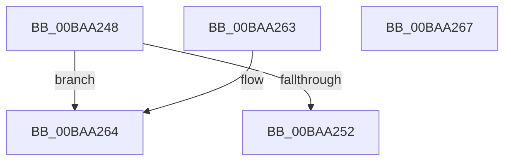

# ViDeadlockSimilarNode

- RVA: `0x00BAA248`–`0x00BAA268` (길이 `32` bytes)
- VA: `0x0000000140BAA248`
- 실행 섹션: `PAGEVRFY`
- PDB 이름 있음: `예`; PDB Function 태그: `아니요`
- unwind 정보 RVA: `0x000DB714`
- 디코드: `14`개 명령, `32/32` bytes 표시
- 미해석 바이트: `0` (있으면 어셈블리에 `.byte`로 보존)

> 이 문서는 커널 이미지의 기계어와 PDB 기호를 분석해 생성했습니다. 4번과 5번은 함수 원형과 자료형을 바이너리 사용 방식에서 추정한 C 해석이며 원본 소스 복구 결과는 아닙니다.

## 1. Dependencies

- 직접 호출 지점: **0**; 고유 호출 대상: **0**
- 직접 호출자로 확인된 함수: **1**
- RIP 상대 이미지 참조: **0**

### Outgoing calls
- 직접 디코드된 call 명령이 없습니다.

### Direct callers
- [VfDeadlockAcquireResource](../BB/VfDeadlockAcquireResource_function_00BB83B4.md) at `0x00BB874D`
- [VfDeadlockAcquireResource](../BB/VfDeadlockAcquireResource_function_00BB83B4.md) at `0x00BB87C9`

### Static image references
- 디코드된 RIP-relative 메모리 참조가 없습니다.

## 2. Other-region calls and transfers

- 다른 실행 섹션으로 향하는 call: **0**
- 별도 외부 분기/꼬리 이동을 확인하지 못했습니다.

## 3. Assembly (complete function range)

```asm
00BAA248  49 8B 40 38                     mov rax, qword ptr [r8 + 0x38]
00BAA24C  48 3B 48 08                     cmp rcx, qword ptr [rax + 8]
00BAA250  75 12                           jne 0x140baa264
00BAA252  41 8B 48 48                     mov ecx, dword ptr [r8 + 0x48]
00BAA256  33 C0                           xor eax, eax
00BAA258  D1 E9                           shr ecx, 1
00BAA25A  83 E1 01                        and ecx, 1
00BAA25D  3B D1                           cmp edx, ecx
00BAA25F  0F 94 C0                        sete al
00BAA262  C3                              ret
00BAA263  CC                              int3
00BAA264  33 C0                           xor eax, eax
00BAA266  C3                              ret
00BAA267  CC                              int3
```

## 4. C-style interpretation (structured pseudocode)

```c
__int64 __fastcall ViDeadlockSimilarNode(__int64 a1, int a2, __int64 a3)
{
    __int64 result;

    if (a1 != (*(unsigned __int64 *)(*(unsigned __int64 *)(a3 + 56) + 8))) goto loc_00BAA264;
    result = 0;
    a1 = (unsigned int)(((unsigned int)(*(unsigned int *)(a3 + 72))) >> (1));
    a1 = (unsigned int)((a1) & (1));
    result = (a2 == ((unsigned int)(a1))) ? 1 : 0;
    return result;
loc_00BAA264:
    result = 0;
    return result;
}
```

## 5. (Beta) C Style

```c
int64_t ViDeadlockSimilarNode(int64_t Arg1, int32_t Arg2, void *Arg3)
{
    uint8_t *arg3 = (uint8_t *)Arg3;

    int64_t result;

    if (Arg1 != (*(uint64_t *)(*(uint64_t *)(arg3 + 0x38) + 0x8))) goto loc_00BAA264;
    result = 0;
    Arg1 = (uint32_t)(((uint32_t)(*(uint32_t *)(arg3 + 0x48))) >> (1));
    Arg1 = (uint32_t)((Arg1) & (1));
    result = (Arg2 == ((uint32_t)(Arg1))) ? 1 : 0;
    return result;
loc_00BAA264:
    result = 0;
    return result;
}
```

### 관측된 메모리 오프셋

구조체 형식이 확인되지 않은 접근은 인자 기준의 오프셋으로만 기록했습니다.

| 기준 인자 | 오프셋 표현 | 폭 (bit) | 접근 |
|---|---:|---:|---|
| `Arg3` | `+ 0x38` | `64` | `R` |
| `Arg3` | `+ 0x48` | `32` | `R` |

## 6. Execution-region graph

[열기: 2D/3D 그래프와 함수 탐색 컨트롤 패널](../../../control-panel.html?section=pagevrfy&rva=0x00BAA248&view=graph)

- 2D 그래프는 위에서 아래로 흐르고, 3D 그래프는 빈 공간을 드래그해 회전합니다. Shift+드래그는 이동, 휠은 확대·축소, 함수 노드 선택은 대상 보고서 이동입니다.

### Static fallback


