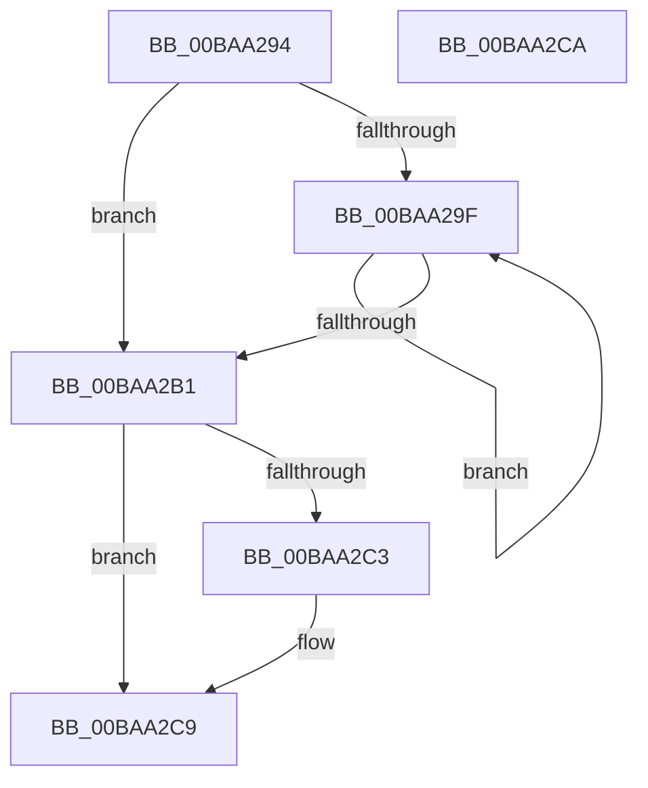

# ViDeadlockUpdateChildrenCount

- RVA: `0x00BAA294`–`0x00BAA2CB` (길이 `55` bytes)
- VA: `0x0000000140BAA294`
- 실행 섹션: `PAGEVRFY`
- PDB 이름 있음: `예`; PDB Function 태그: `아니요`
- unwind 정보 RVA: `0x000DB714`
- 디코드: `17`개 명령, `55/55` bytes 표시
- 미해석 바이트: `0` (있으면 어셈블리에 `.byte`로 보존)

> 이 문서는 커널 이미지의 기계어와 PDB 기호를 분석해 생성했습니다. 4번과 5번은 함수 원형과 자료형을 바이너리 사용 방식에서 추정한 C 해석이며 원본 소스 복구 결과는 아닙니다.

## 1. Dependencies

- 직접 호출 지점: **0**; 고유 호출 대상: **0**
- 직접 호출자로 확인된 함수: **3**
- RIP 상대 이미지 참조: **1**

### Outgoing calls
- 직접 디코드된 call 명령이 없습니다.

### Direct callers
- [ViDeadlockMergeNodes](ViDeadlockMergeNodes_function_00BA9934.md) at `0x00BA9A12`
- [ViDeadlockMergeNodes](ViDeadlockMergeNodes_function_00BA9934.md) at `0x00BA9A42`
- [ViDeadlockMergeNodes](ViDeadlockMergeNodes_function_00BA9934.md) at `0x00BA9A75`
- [ViDeadlockRemoveNode](ViDeadlockRemoveNode_function_00BA9CB8.md) at `0x00BA9D68`
- [VfDeadlockAcquireResource](../BB/VfDeadlockAcquireResource_function_00BB83B4.md) at `0x00BB888F`

### Static image references
- `0x00BAA2B1` → RVA `0x00FFDA00` (`PAGEVRFD`; read)

## 2. Other-region calls and transfers

- 다른 실행 섹션으로 향하는 call: **0**
- 별도 외부 분기/꼬리 이동을 확인하지 못했습니다.

## 3. Assembly (complete function range)

```asm
00BAA294  01 51 4C                        add dword ptr [rcx + 0x4c], edx
00BAA297  4C 8B 01                        mov r8, qword ptr [rcx]
00BAA29A  4D 85 C0                        test r8, r8
00BAA29D  74 12                           je 0x140baa2b1
00BAA29F  41 01 50 4C                     add dword ptr [r8 + 0x4c], edx
00BAA2A3  49 8B C8                        mov rcx, r8
00BAA2A6  49 8B 00                        mov rax, qword ptr [r8]
00BAA2A9  4C 8B C0                        mov r8, rax
00BAA2AC  48 85 C0                        test rax, rax
00BAA2AF  75 EE                           jne 0x140baa29f
00BAA2B1  48 8B 05 48 37 45 00            mov rax, qword ptr [rip + 0x453748]
00BAA2B8  8B 51 4C                        mov edx, dword ptr [rcx + 0x4c]
00BAA2BB  3B 90 68 81 00 00               cmp edx, dword ptr [rax + 0x8168]
00BAA2C1  7E 06                           jle 0x140baa2c9
00BAA2C3  89 90 68 81 00 00               mov dword ptr [rax + 0x8168], edx
00BAA2C9  C3                              ret
00BAA2CA  CC                              int3
```

## 4. C-style interpretation (structured pseudocode)

```c
__int64 __fastcall ViDeadlockUpdateChildrenCount(__int64 a1, int a2)
{
    if (*(unsigned __int64 *)(a1) == 0) goto loc_00BAA2B1;
loc_00BAA29F:
    if (*(unsigned __int64 *)(*(unsigned __int64 *)(a1)) != 0) goto loc_00BAA29F;
loc_00BAA2B1:
    if (((unsigned int)((unsigned int)(*(unsigned int *)(*(unsigned __int64 *)(a1) + 76)))) >= = (*(unsigned int *)(*(unsigned __int64 *)(v_rip + 4536136) + 33128))) {
        *(unsigned int *)(*(unsigned __int64 *)(v_rip + 4536136) + 33128) = (unsigned int)((unsigned int)(*(unsigned int *)(*(unsigned __int64 *)(a1) + 76)));
    }
    return *(unsigned __int64 *)(v_rip + 4536136);
}
```

## 5. (Beta) C Style

```c
int64_t ViDeadlockUpdateChildrenCount(void *Arg1, int32_t Arg2)
{
    uint8_t *arg1 = (uint8_t *)Arg1;

    if (*(uint64_t *)(arg1) == 0) goto loc_00BAA2B1;
loc_00BAA29F:
    if (*(uint64_t *)(*(uint64_t *)(arg1)) != 0) goto loc_00BAA29F;
loc_00BAA2B1:
    if (((uint32_t)((uint32_t)(*(uint32_t *)(*(uint64_t *)(arg1) + 0x4C)))) >= = (*(uint32_t *)(*(uint64_t *)(v_rip + 0x453748) + 0x8168))) {
        *(uint32_t *)(*(uint64_t *)(v_rip + 0x453748) + 0x8168) = (uint32_t)((uint32_t)(*(uint32_t *)(*(uint64_t *)(arg1) + 0x4C)));
    }
    return *(uint64_t *)(v_rip + 0x453748);
}
```

### 관측된 메모리 오프셋

구조체 형식이 확인되지 않은 접근은 인자 기준의 오프셋으로만 기록했습니다.

| 기준 인자 | 오프셋 표현 | 폭 (bit) | 접근 |
|---|---:|---:|---|
| `Arg1` | `+ 0x0` | `64` | `R` |
| `Arg1` | `+ 0x4C` | `32` | `R/W` |

## 6. Execution-region graph

[열기: 2D/3D 그래프와 함수 탐색 컨트롤 패널](../../../control-panel.html?section=pagevrfy&rva=0x00BAA294&view=graph)

- 2D 그래프는 위에서 아래로 흐르고, 3D 그래프는 빈 공간을 드래그해 회전합니다. Shift+드래그는 이동, 휠은 확대·축소, 함수 노드 선택은 대상 보고서 이동입니다.

### Static fallback


