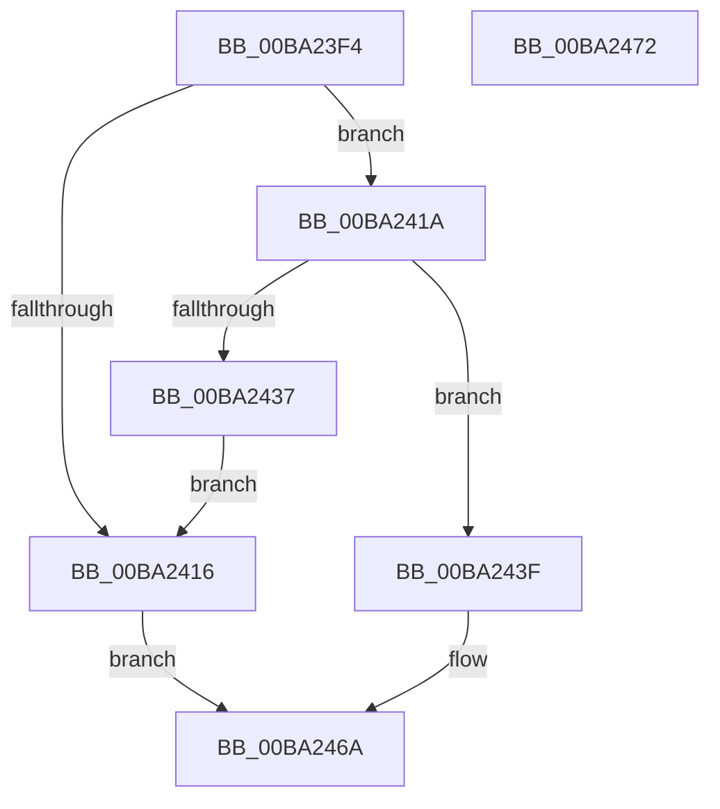

# ViDevObjAdd

- RVA: `0x00BA23F4`–`0x00BA2473` (길이 `127` bytes)
- VA: `0x0000000140BA23F4`
- 실행 섹션: `PAGEVRFY`
- PDB 이름 있음: `예`; PDB Function 태그: `아니요`
- unwind 정보 RVA: `0x000697A4`
- 디코드: `35`개 명령, `127/127` bytes 표시
- 미해석 바이트: `0` (있으면 어셈블리에 `.byte`로 보존)

> 이 문서는 커널 이미지의 기계어와 PDB 기호를 분석해 생성했습니다. 4번과 5번은 함수 원형과 자료형을 바이너리 사용 방식에서 추정한 C 해석이며 원본 소스 복구 결과는 아닙니다.

## 1. Dependencies

- 직접 호출 지점: **4**; 고유 호출 대상: **4**
- 직접 호출자로 확인된 함수: **1**
- RIP 상대 이미지 참조: **3**

### Outgoing calls
- `0x00BA242A` → [VfAvlReserveNode](../../text/3E/VfAvlReserveNode_function_003EF760.md) (function, `0x003EF760`)
- `0x00BA244A` → [VfAvlInitializeLockContext](../../text/4A/VfAvlInitializeLockContext_function_004A686C.md) (function, `0x004A686C`)
- `0x00BA245B` → [VfAvlInsertReservedTreeNode](../../text/3E/VfAvlInsertReservedTreeNode_function_003EE424.md) (function, `0x003EE424`)
- `0x00BA2465` → [VfAvlCleanupLockContext](../../text/3E/VfAvlCleanupLockContext_function_003EF56C.md) (function, `0x003EF56C`)

### Direct callers
- [VerifierIoCreateDevice](VerifierIoCreateDevice_function_00BA2110.md) at `0x00BA215A`

### Static image references
- `0x00BA240C` → RVA `0x00FFDABC` (`PAGEVRFD`; read)
- `0x00BA2423` → RVA `0x00FFDCC0` (`PAGEVRFD`; read)
- `0x00BA2437` → RVA `0x00FFDB90` (`PAGEVRFD`; read/write)

## 2. Other-region calls and transfers

- 다른 실행 섹션으로 향하는 call: **4**
  - `0x00BA242A` → [VfAvlReserveNode](../../text/3E/VfAvlReserveNode_function_003EF760.md) (`PAGEVRFY` → `.text`)
  - `0x00BA244A` → [VfAvlInitializeLockContext](../../text/4A/VfAvlInitializeLockContext_function_004A686C.md) (`PAGEVRFY` → `.text`)
  - `0x00BA245B` → [VfAvlInsertReservedTreeNode](../../text/3E/VfAvlInsertReservedTreeNode_function_003EE424.md) (`PAGEVRFY` → `.text`)
  - `0x00BA2465` → [VfAvlCleanupLockContext](../../text/3E/VfAvlCleanupLockContext_function_003EF56C.md) (`PAGEVRFY` → `.text`)
- 별도 외부 분기/꼬리 이동을 확인하지 못했습니다.

## 3. Assembly (complete function range)

```asm
00BA23F4  40 53                           push rbx
00BA23F6  48 83 EC 40                     sub rsp, 0x40
00BA23FA  33 C0                           xor eax, eax
00BA23FC  0F 57 C0                        xorps xmm0, xmm0
00BA23FF  48 89 44 24 30                  mov qword ptr [rsp + 0x30], rax
00BA2404  0F 11 44 24 20                  movups xmmword ptr [rsp + 0x20], xmm0
00BA2409  8D 58 01                        lea ebx, [rax + 1]
00BA240C  8B 05 AA B6 45 00               mov eax, dword ptr [rip + 0x45b6aa]
00BA2412  85 C0                           test eax, eax
00BA2414  75 04                           jne 0x140ba241a
00BA2416  32 DB                           xor bl, bl
00BA2418  EB 50                           jmp 0x140ba246a
00BA241A  48 8B D1                        mov rdx, rcx
00BA241D  41 B8 50 01 00 00               mov r8d, 0x150
00BA2423  48 8D 0D 96 B8 45 00            lea rcx, [rip + 0x45b896]
00BA242A  E8 31 D3 84 FF                  call 0x1403ef760
00BA242F  4C 8B C0                        mov r8, rax
00BA2432  48 85 C0                        test rax, rax
00BA2435  75 08                           jne 0x140ba243f
00BA2437  87 1D 53 B7 45 00               xchg dword ptr [rip + 0x45b753], ebx
00BA243D  EB D7                           jmp 0x140ba2416
00BA243F  83 60 10 00                     and dword ptr [rax + 0x10], 0
00BA2443  48 8D 4C 24 20                  lea rcx, [rsp + 0x20]
00BA2448  33 D2                           xor edx, edx
00BA244A  E8 1D 44 90 FF                  call 0x1404a686c
00BA244F  48 8D 54 24 20                  lea rdx, [rsp + 0x20]
00BA2454  48 8D 0D 65 B8 45 00            lea rcx, [rip + 0x45b865]
00BA245B  E8 C4 BF 84 FF                  call 0x1403ee424
00BA2460  48 8D 4C 24 20                  lea rcx, [rsp + 0x20]
00BA2465  E8 02 D1 84 FF                  call 0x1403ef56c
00BA246A  8A C3                           mov al, bl
00BA246C  48 83 C4 40                     add rsp, 0x40
00BA2470  5B                              pop rbx
00BA2471  C3                              ret
00BA2472  CC                              int3
```

## 4. C-style interpretation (structured pseudocode)

```c
__int64 __fastcall ViDevObjAdd(__int64 a1)
{
    __int64 result;
    __int64 v_rbx;
    __int64 v_rsp;
    unsigned __int64 v_stack_m18;
    unsigned __int64 v_stack_m28;

    v_rsp = (v_rsp) - (64);
    result = 0;
    v_stack_m18 = 0;
    v_stack_m28 = v_xmm0;
    if ((unsigned int)((unsigned int)(*(unsigned int *)(v_rip + 4568746))) != 0) goto loc_00BA241A;
loc_00BA2416:
    v_rbx = 0;
    goto loc_00BA246A;
loc_00BA241A:
    result = VfAvlReserveNode(v_rip + 4569238, a1, 336, a4);
    if (result != 0) goto loc_00BA243F;
    goto loc_00BA2416;
loc_00BA243F:
    a2 = 0;
    result = VfAvlInitializeLockContext(v_stack_m28, a2, result, a4);
    result = VfAvlInsertReservedTreeNode(v_rip + 4569189, v_stack_m28, result, a4);
    result = VfAvlCleanupLockContext(v_stack_m28, v_stack_m28, result, a4);
loc_00BA246A:
    v_rsp = (v_rsp) + (64);
    return 0;
}
```

## 5. (Beta) C Style

```c
int64_t ViDevObjAdd(int64_t Arg1)
{
    int64_t result;
    int64_t local_rbx;
    int64_t local_rsp;
    uint64_t v_stack_m18;
    uint64_t v_stack_m28;

    local_rsp = (local_rsp) - (64);
    result = 0;
    v_stack_m18 = 0;
    v_stack_m28 = v_xmm0;
    if ((uint32_t)((uint32_t)(*(uint32_t *)(v_rip + 0x45B6AA))) != 0) goto loc_00BA241A;
loc_00BA2416:
    local_rbx = 0;
    goto loc_00BA246A;
loc_00BA241A:
    result = VfAvlReserveNode(v_rip + 4569238, Arg1, 336, a4);
    if (result != 0) goto loc_00BA243F;
    goto loc_00BA2416;
loc_00BA243F:
    a2 = 0;
    result = VfAvlInitializeLockContext(v_stack_m28, a2, result, a4);
    result = VfAvlInsertReservedTreeNode(v_rip + 4569189, v_stack_m28, result, a4);
    result = VfAvlCleanupLockContext(v_stack_m28, v_stack_m28, result, a4);
loc_00BA246A:
    local_rsp = (local_rsp) + (64);
    return 0;
}
```

## 6. Execution-region graph

[열기: 2D/3D 그래프와 함수 탐색 컨트롤 패널](../../../control-panel.html?section=pagevrfy&rva=0x00BA23F4&view=graph)

- 2D 그래프는 위에서 아래로 흐르고, 3D 그래프는 빈 공간을 드래그해 회전합니다. Shift+드래그는 이동, 휠은 확대·축소, 함수 노드 선택은 대상 보고서 이동입니다.

### Static fallback


