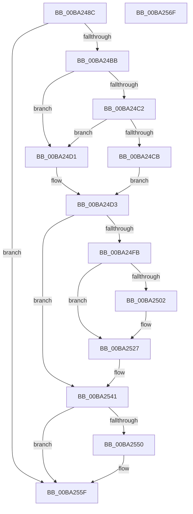

# ViDevObjRemove

- RVA: `0x00BA248C`–`0x00BA2570` (길이 `228` bytes)
- VA: `0x0000000140BA248C`
- 실행 섹션: `PAGEVRFY`
- PDB 이름 있음: `예`; PDB Function 태그: `아니요`
- unwind 정보 RVA: `0x000D0050`
- 디코드: `61`개 명령, `228/228` bytes 표시
- 미해석 바이트: `0` (있으면 어셈블리에 `.byte`로 보존)

> 이 문서는 커널 이미지의 기계어와 PDB 기호를 분석해 생성했습니다. 4번과 5번은 함수 원형과 자료형을 바이너리 사용 방식에서 추정한 C 해석이며 원본 소스 복구 결과는 아닙니다.

## 1. Dependencies

- 직접 호출 지점: **6**; 고유 호출 대상: **6**
- 직접 호출자로 확인된 함수: **1**
- RIP 상대 이미지 참조: **2**

### Outgoing calls
- `0x00BA24DA` → [VfAvlInitializeLockContext](../../text/4A/VfAvlInitializeLockContext_function_004A686C.md) (function, `0x004A686C`)
- `0x00BA24F1` → [VfAvlLookupTreeNode](../../text/3E/VfAvlLookupTreeNode_function_003EF1B4.md) (function, `0x003EF1B4`)
- `0x00BA2522` → [CarReportRuleViolationFromNt](../B9/CarReportRuleViolationFromNt_function_00B9D904.md) (function, `0x00B9D904`)
- `0x00BA2539` → [VfAvlDeleteTreeNode](../../text/3E/VfAvlDeleteTreeNode_function_003EE240.md) (function, `0x003EE240`)
- `0x00BA2546` → [VfAvlCleanupLockContext](../../text/3E/VfAvlCleanupLockContext_function_003EF56C.md) (function, `0x003EF56C`)
- `0x00BA255A` → [VfAvlFreeNodeNoLock](../../text/61/VfAvlFreeNodeNoLock_function_006126D8.md) (function, `0x006126D8`)

### Direct callers
- [VfIoDeleteDevice](VfIoDeleteDevice_function_00BA221C.md) at `0x00BA2256`

### Static image references
- `0x00BA24A8` → RVA `0x00FFDABC` (`PAGEVRFD`; read)
- `0x00BA24EA` → RVA `0x00FFDCC0` (`PAGEVRFD`; read)

## 2. Other-region calls and transfers

- 다른 실행 섹션으로 향하는 call: **5**
  - `0x00BA24DA` → [VfAvlInitializeLockContext](../../text/4A/VfAvlInitializeLockContext_function_004A686C.md) (`PAGEVRFY` → `.text`)
  - `0x00BA24F1` → [VfAvlLookupTreeNode](../../text/3E/VfAvlLookupTreeNode_function_003EF1B4.md) (`PAGEVRFY` → `.text`)
  - `0x00BA2539` → [VfAvlDeleteTreeNode](../../text/3E/VfAvlDeleteTreeNode_function_003EE240.md) (`PAGEVRFY` → `.text`)
  - `0x00BA2546` → [VfAvlCleanupLockContext](../../text/3E/VfAvlCleanupLockContext_function_003EF56C.md) (`PAGEVRFY` → `.text`)
  - `0x00BA255A` → [VfAvlFreeNodeNoLock](../../text/61/VfAvlFreeNodeNoLock_function_006126D8.md) (`PAGEVRFY` → `.text`)
- 별도 외부 분기/꼬리 이동을 확인하지 못했습니다.

## 3. Assembly (complete function range)

```asm
00BA248C  48 89 5C 24 08                  mov qword ptr [rsp + 8], rbx
00BA2491  48 89 74 24 10                  mov qword ptr [rsp + 0x10], rsi
00BA2496  57                              push rdi
00BA2497  48 83 EC 60                     sub rsp, 0x60
00BA249B  33 C0                           xor eax, eax
00BA249D  0F 57 C0                        xorps xmm0, xmm0
00BA24A0  48 89 44 24 50                  mov qword ptr [rsp + 0x50], rax
00BA24A5  48 8B D9                        mov rbx, rcx
00BA24A8  8B 05 0E B6 45 00               mov eax, dword ptr [rip + 0x45b60e]
00BA24AE  0F 11 44 24 40                  movups xmmword ptr [rsp + 0x40], xmm0
00BA24B3  85 C0                           test eax, eax
00BA24B5  0F 84 A4 00 00 00               je 0x140ba255f
00BA24BB  33 FF                           xor edi, edi
00BA24BD  48 85 C9                        test rcx, rcx
00BA24C0  74 0F                           je 0x140ba24d1
00BA24C2  48 8B 41 08                     mov rax, qword ptr [rcx + 8]
00BA24C6  48 85 C0                        test rax, rax
00BA24C9  74 06                           je 0x140ba24d1
00BA24CB  48 8B 70 18                     mov rsi, qword ptr [rax + 0x18]
00BA24CF  EB 02                           jmp 0x140ba24d3
00BA24D1  33 F6                           xor esi, esi
00BA24D3  33 D2                           xor edx, edx
00BA24D5  48 8D 4C 24 40                  lea rcx, [rsp + 0x40]
00BA24DA  E8 8D 43 90 FF                  call 0x1404a686c
00BA24DF  45 33 C9                        xor r9d, r9d
00BA24E2  48 8D 54 24 40                  lea rdx, [rsp + 0x40]
00BA24E7  4C 8B C3                        mov r8, rbx
00BA24EA  48 8D 0D CF B7 45 00            lea rcx, [rip + 0x45b7cf]
00BA24F1  E8 BE CC 84 FF                  call 0x1403ef1b4
00BA24F6  48 85 C0                        test rax, rax
00BA24F9  74 46                           je 0x140ba2541
00BA24FB  8B 40 10                        mov eax, dword ptr [rax + 0x10]
00BA24FE  A8 01                           test al, 1
00BA2500  74 25                           je 0x140ba2527
00BA2502  BA DB 00 00 00                  mov edx, 0xdb
00BA2507  48 89 74 24 30                  mov qword ptr [rsp + 0x30], rsi
00BA250C  C7 44 24 28 04 00 00 00         mov dword ptr [rsp + 0x28], 4
00BA2514  45 33 C9                        xor r9d, r9d
00BA2517  48 21 7C 24 20                  and qword ptr [rsp + 0x20], rdi
00BA251C  4C 8B C3                        mov r8, rbx
00BA251F  8D 4A E9                        lea ecx, [rdx - 0x17]
00BA2522  E8 DD B3 FF FF                  call 0x140b9d904
00BA2527  45 33 C9                        xor r9d, r9d
00BA252A  48 8D 54 24 40                  lea rdx, [rsp + 0x40]
00BA252F  4C 8B C3                        mov r8, rbx
00BA2532  48 8D 0D 87 B7 45 00            lea rcx, [rip + 0x45b787]
00BA2539  E8 02 BD 84 FF                  call 0x1403ee240
00BA253E  48 8B F8                        mov rdi, rax
00BA2541  48 8D 4C 24 40                  lea rcx, [rsp + 0x40]
00BA2546  E8 21 D0 84 FF                  call 0x1403ef56c
00BA254B  48 85 FF                        test rdi, rdi
00BA254E  74 0F                           je 0x140ba255f
00BA2550  48 8B D7                        mov rdx, rdi
00BA2553  48 8D 0D 66 B7 45 00            lea rcx, [rip + 0x45b766]
00BA255A  E8 79 01 A7 FF                  call 0x1406126d8
00BA255F  48 8B 5C 24 70                  mov rbx, qword ptr [rsp + 0x70]
00BA2564  48 8B 74 24 78                  mov rsi, qword ptr [rsp + 0x78]
00BA2569  48 83 C4 60                     add rsp, 0x60
00BA256D  5F                              pop rdi
00BA256E  C3                              ret
00BA256F  CC                              int3
```

## 4. C-style interpretation (structured pseudocode)

```c
__int64 __fastcall ViDevObjRemove(__int64 a1, int a2, __int64 a3, int a4)
{
    __int64 result;
    __int64 v_rdi;
    __int64 v_rsi;
    __int64 v_rsp;
    unsigned __int64 v_stack_m18;
    unsigned __int64 v_stack_m28;
    unsigned __int64 v_stack_m38;
    unsigned int v_stack_m40;
    unsigned __int64 v_stack_m48;
    unsigned __int64 v_stack_p10;
    unsigned __int64 v_stack_p8;

    v_stack_p8 = v_rbx;
    v_stack_p10 = v_rsi;
    v_rsp = (v_rsp) - (96);
    result = 0;
    v_stack_m18 = 0;
    v_stack_m28 = v_xmm0;
    if ((unsigned int)((unsigned int)(*(unsigned int *)(v_rip + 4568590))) == 0) goto loc_00BA255F;
    v_rdi = 0;
    if (a1 == 0) goto loc_00BA24D1;
    if (*(unsigned __int64 *)(a1 + 8) == 0) goto loc_00BA24D1;
    goto loc_00BA24D3;
loc_00BA24D1:
    v_rsi = 0;
loc_00BA24D3:
    a2 = 0;
    result = VfAvlInitializeLockContext(v_stack_m28, a2, a3, a4);
    a4 = 0;
    result = VfAvlLookupTreeNode(v_rip + 4569039, v_stack_m28, a1, a4);
    if (result == 0) goto loc_00BA2541;
    result = (unsigned int)(*(unsigned int *)(result + 16));
    if ((((unsigned __int8)((unsigned int)(*(unsigned int *)(result + 16)))) & (1)) != 0) {
        a2 = 219;
        v_stack_m38 = 0;
        v_stack_m40 = 4;
        a4 = 0;
        a3 = a1;
        a1 = a2 - 23;
        result = CarReportRuleViolationFromNt(a1, a2, a3, a4);
    }
    a4 = 0;
    result = VfAvlDeleteTreeNode(v_rip + 4568967, v_stack_m28, a1, a4);
loc_00BA2541:
    result = VfAvlCleanupLockContext(v_stack_m28, v_stack_m28, a1, a4);
    if (result != 0) {
        a2 = result;
        a1 = v_rip + 4568934;
        result = VfAvlFreeNodeNoLock(a1, a2, a1, a4);
    }
    v_rsp = (v_rsp) + (96);
    return result;
}
```

## 5. (Beta) C Style

```c
int64_t ViDevObjRemove(int64_t Arg1, int32_t Arg2, int64_t Arg3, int32_t Arg4)
{
    int64_t result;
    int64_t local_rdi;
    int64_t local_rsi;
    int64_t local_rsp;
    uint64_t v_stack_m18;
    uint64_t v_stack_m28;
    uint64_t v_stack_m38;
    uint32_t v_stack_m40;
    uint64_t v_stack_m48;
    uint64_t v_stack_p10;
    uint64_t v_stack_p8;

    v_stack_p8 = local_rbx;
    v_stack_p10 = local_rsi;
    local_rsp = (local_rsp) - (96);
    result = 0;
    v_stack_m18 = 0;
    v_stack_m28 = v_xmm0;
    if ((uint32_t)((uint32_t)(*(uint32_t *)(v_rip + 0x45B60E))) == 0) goto loc_00BA255F;
    local_rdi = 0;
    if (Arg1 == 0) goto loc_00BA24D1;
    if (*(uint64_t *)(Arg1 + 0x8) == 0) goto loc_00BA24D1;
    goto loc_00BA24D3;
loc_00BA24D1:
    local_rsi = 0;
loc_00BA24D3:
    Arg2 = 0;
    result = VfAvlInitializeLockContext(v_stack_m28, Arg2, Arg3, Arg4);
    Arg4 = 0;
    result = VfAvlLookupTreeNode(v_rip + 4569039, v_stack_m28, Arg1, Arg4);
    if (result == 0) goto loc_00BA2541;
    result = (uint32_t)(*(uint32_t *)(result + 0x10));
    if ((((uint8_t)((uint32_t)(*(uint32_t *)(result + 0x10)))) & (1)) != 0) {
        Arg2 = 219;
        v_stack_m38 = 0;
        v_stack_m40 = 4;
        Arg4 = 0;
        Arg3 = Arg1;
        Arg1 = Arg2 - 23;
        result = CarReportRuleViolationFromNt(Arg1, Arg2, Arg3, Arg4);
    }
    Arg4 = 0;
    result = VfAvlDeleteTreeNode(v_rip + 4568967, v_stack_m28, Arg1, Arg4);
loc_00BA2541:
    result = VfAvlCleanupLockContext(v_stack_m28, v_stack_m28, Arg1, Arg4);
    if (result != 0) {
        Arg2 = result;
        Arg1 = v_rip + 4568934;
        result = VfAvlFreeNodeNoLock(Arg1, Arg2, Arg1, Arg4);
    }
    local_rsp = (local_rsp) + (96);
    return result;
}
```

## 6. Execution-region graph

[열기: 2D/3D 그래프와 함수 탐색 컨트롤 패널](../../../control-panel.html?section=pagevrfy&rva=0x00BA248C&view=graph)

- 2D 그래프는 위에서 아래로 흐르고, 3D 그래프는 빈 공간을 드래그해 회전합니다. Shift+드래그는 이동, 휠은 확대·축소, 함수 노드 선택은 대상 보고서 이동입니다.

### Static fallback


