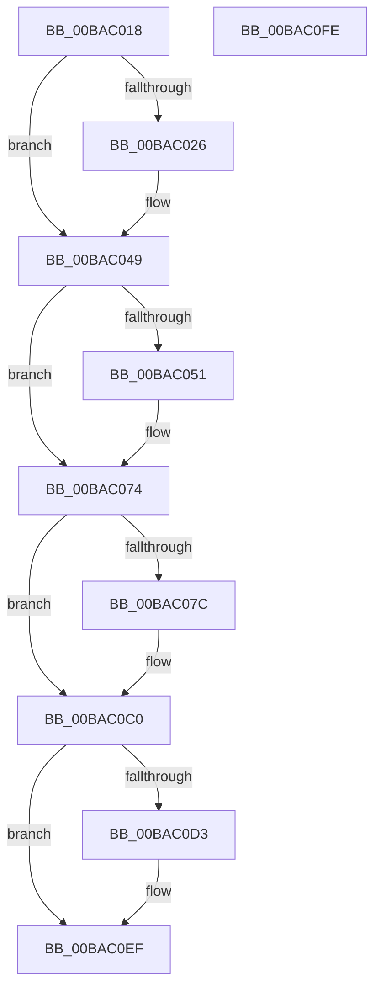

# ViDmaInit

- RVA: `0x00BAC018`–`0x00BAC0FF` (길이 `231` bytes)
- VA: `0x0000000140BAC018`
- 실행 섹션: `PAGEVRFY`
- PDB 이름 있음: `예`; PDB Function 태그: `아니요`
- unwind 정보 RVA: `0x00063458`
- 디코드: `40`개 명령, `231/231` bytes 표시
- 미해석 바이트: `0` (있으면 어셈블리에 `.byte`로 보존)

> 이 문서는 커널 이미지의 기계어와 PDB 기호를 분석해 생성했습니다. 4번과 5번은 함수 원형과 자료형을 바이너리 사용 방식에서 추정한 C 해석이며 원본 소스 복구 결과는 아닙니다.

## 1. Dependencies

- 직접 호출 지점: **1**; 고유 호출 대상: **1**
- 직접 호출자로 확인된 함수: **1**
- RIP 상대 이미지 참조: **24**

### Outgoing calls
- `0x00BAC0B4` → [ExInitializeNPagedLookasideListInternal](../../text/46/ExInitializeNPagedLookasideListInternal_function_00468720.md) (function, `0x00468720`)

### Direct callers
- [VfDmaPluginEntry](../../text/61/VfDmaPluginEntry_function_00616590.md) at `0x0061664D`

### Static image references
- `0x00BAC01E` → RVA `0x00F03FA1` (`.data`; read)
- `0x00BAC026` → RVA `0x00F03FC0` (`.data`; read)
- `0x00BAC02D` → RVA `0x00F03FD0` (`.data`; write)
- `0x00BAC034` → RVA `0x00F03FC8` (`.data`; write)
- `0x00BAC03B` → RVA `0x00F03FC0` (`.data`; write)
- `0x00BAC042` → RVA `0x00F03FA1` (`.data`; write)
- `0x00BAC049` → RVA `0x00F03FA2` (`.data`; read)
- `0x00BAC051` → RVA `0x00F03FE0` (`.data`; read)
- `0x00BAC058` → RVA `0x00F03FF0` (`.data`; write)
- `0x00BAC05F` → RVA `0x00F03FE8` (`.data`; write)
- `0x00BAC066` → RVA `0x00F03FE0` (`.data`; write)
- `0x00BAC06D` → RVA `0x00F03FA2` (`.data`; write)
- `0x00BAC074` → RVA `0x00F03FA0` (`.data`; read)
- `0x00BAC07C` → RVA `0x00F04368` (`.data`; read)
- `0x00BAC082` → RVA `0x004C65D0` (`VfUtilFreePoolCheckIRQL`; read)
- `0x00BAC08D` → RVA `0x00E28A80` (`.data`; read)
- `0x00BAC0B9` → RVA `0x00F03FA0` (`.data`; write)
- `0x00BAC0C0` → RVA `0x00E007F0` (`.data`; read)
- `0x00BAC0C7` → RVA `0x00F03FA4` (`.data`; write)
- `0x00BAC0D3` → RVA `0x00E00850` (`.data`; read)
- `0x00BAC0DA` → RVA `0x00F03FD8` (`.data`; write)
- `0x00BAC0E1` → RVA `0x00B970B0` (`VfHalAllocateMapRegisters`; read)
- `0x00BAC0E8` → RVA `0x00E00850` (`.data`; write)
- `0x00BAC0EF` → RVA `0x00FF4004` (`PAGEVRFD`; write)

## 2. Other-region calls and transfers

- 다른 실행 섹션으로 향하는 call: **1**
  - `0x00BAC0B4` → [ExInitializeNPagedLookasideListInternal](../../text/46/ExInitializeNPagedLookasideListInternal_function_00468720.md) (`PAGEVRFY` → `.text`)
- 별도 외부 분기/꼬리 이동을 확인하지 못했습니다.

## 3. Assembly (complete function range)

```asm
00BAC018  48 83 EC 48                     sub rsp, 0x48
00BAC01C  33 C9                           xor ecx, ecx
00BAC01E  38 0D 7D 7F 35 00               cmp byte ptr [rip + 0x357f7d], cl
00BAC024  75 23                           jne 0x140bac049
00BAC026  48 8D 05 93 7F 35 00            lea rax, [rip + 0x357f93]
00BAC02D  48 89 0D 9C 7F 35 00            mov qword ptr [rip + 0x357f9c], rcx
00BAC034  48 89 05 8D 7F 35 00            mov qword ptr [rip + 0x357f8d], rax
00BAC03B  48 89 05 7E 7F 35 00            mov qword ptr [rip + 0x357f7e], rax
00BAC042  C6 05 58 7F 35 00 01            mov byte ptr [rip + 0x357f58], 1
00BAC049  38 0D 53 7F 35 00               cmp byte ptr [rip + 0x357f53], cl
00BAC04F  75 23                           jne 0x140bac074
00BAC051  48 8D 05 88 7F 35 00            lea rax, [rip + 0x357f88]
00BAC058  48 89 0D 91 7F 35 00            mov qword ptr [rip + 0x357f91], rcx
00BAC05F  48 89 05 82 7F 35 00            mov qword ptr [rip + 0x357f82], rax
00BAC066  48 89 05 73 7F 35 00            mov qword ptr [rip + 0x357f73], rax
00BAC06D  C6 05 2E 7F 35 00 01            mov byte ptr [rip + 0x357f2e], 1
00BAC074  38 0D 26 7F 35 00               cmp byte ptr [rip + 0x357f26], cl
00BAC07A  75 44                           jne 0x140bac0c0
00BAC07C  8B 05 E6 82 35 00               mov eax, dword ptr [rip + 0x3582e6]
00BAC082  4C 8D 05 47 A5 91 FF            lea r8, [rip - 0x6e5ab9]
00BAC089  89 44 24 38                     mov dword ptr [rsp + 0x38], eax
00BAC08D  48 8D 0D EC C9 27 00            lea rcx, [rip + 0x27c9ec]
00BAC094  66 C7 44 24 30 10 00            mov word ptr [rsp + 0x30], 0x10
00BAC09B  41 B9 00 02 00 00               mov r9d, 0x200
00BAC0A1  C7 44 24 28 48 61 6C 56         mov dword ptr [rsp + 0x28], 0x566c6148
00BAC0A9  33 D2                           xor edx, edx
00BAC0AB  48 C7 44 24 20 98 00 00 00      mov qword ptr [rsp + 0x20], 0x98
00BAC0B4  E8 67 C6 8B FF                  call 0x140468720
00BAC0B9  C6 05 E0 7E 35 00 01            mov byte ptr [rip + 0x357ee0], 1
00BAC0C0  83 3D 29 47 25 00 3D            cmp dword ptr [rip + 0x254729], 0x3d
00BAC0C7  C7 05 D3 7E 35 00 01 00 00 00   mov dword ptr [rip + 0x357ed3], 1
00BAC0D1  72 1C                           jb 0x140bac0ef
00BAC0D3  48 8B 05 76 47 25 00            mov rax, qword ptr [rip + 0x254776]
00BAC0DA  48 89 05 F7 7E 35 00            mov qword ptr [rip + 0x357ef7], rax
00BAC0E1  48 8D 05 C8 AF FE FF            lea rax, [rip - 0x15038]
00BAC0E8  48 89 05 61 47 25 00            mov qword ptr [rip + 0x254761], rax
00BAC0EF  C7 05 0B 7F 44 00 01 00 00 00   mov dword ptr [rip + 0x447f0b], 1
00BAC0F9  48 83 C4 48                     add rsp, 0x48
00BAC0FD  C3                              ret
00BAC0FE  CC                              int3
```

## 4. C-style interpretation (structured pseudocode)

```c
__int64 __fastcall ViDmaInit(int a1, int a2)
{
    __int64 result;
    __int64 v_rsp;
    unsigned int v_stack_m10;
    unsigned __int16 v_stack_m18;
    unsigned int v_stack_m20;
    unsigned __int64 v_stack_m28;

    v_rsp = (v_rsp) - (72);
    a1 = 0;
    if ((*(unsigned __int8 *)(v_rip + 3506045)) == 0) {
        result = v_rip + 3506067;
        *(unsigned __int64 *)(v_rip + 3506076) = 0;
        *(unsigned __int64 *)(v_rip + 3506061) = result;
        *(unsigned __int64 *)(v_rip + 3506046) = result;
        *(unsigned __int8 *)(v_rip + 3506008) = 1;
    }
    if ((*(unsigned __int8 *)(v_rip + 3506003)) == 0) {
        result = v_rip + 3506056;
        *(unsigned __int64 *)(v_rip + 3506065) = 0;
        *(unsigned __int64 *)(v_rip + 3506050) = result;
        *(unsigned __int64 *)(v_rip + 3506035) = result;
        *(unsigned __int8 *)(v_rip + 3505966) = 1;
    }
    if ((*(unsigned __int8 *)(v_rip + 3505958)) == 0) {
        result = *(unsigned int *)(v_rip + 3506918);
        a3 = v_rip - 7232185;
        v_stack_m10 = (unsigned int)(result);
        a1 = v_rip + 2607596;
        v_stack_m18 = 16;
        a4 = 512;
        v_stack_m20 = 0x566C6148ULL;
        a2 = 0;
        v_stack_m28 = 152;
        result = ExInitializeNPagedLookasideListInternal(a1, a2, a3, a4);
        *(unsigned __int8 *)(v_rip + 3505888) = 1;
    }
    *(unsigned int *)(v_rip + 3505875) = 1;
    if ((*(unsigned int *)(v_rip + 2443049)) >= 61) {
        result = *(unsigned __int64 *)(v_rip + 2443126);
        *(unsigned __int64 *)(v_rip + 3505911) = result;
        result = v_rip - 86072;
        *(unsigned __int64 *)(v_rip + 2443105) = result;
    }
    *(unsigned int *)(v_rip + 4488971) = 1;
    v_rsp = (v_rsp) + (72);
    return result;
}
```

## 5. (Beta) C Style

```c
int64_t ViDmaInit(int32_t Arg1, int32_t Arg2)
{
    int64_t result;
    int64_t local_rsp;
    uint32_t v_stack_m10;
    uint16_t v_stack_m18;
    uint32_t v_stack_m20;
    uint64_t v_stack_m28;

    local_rsp = (local_rsp) - (72);
    Arg1 = 0;
    if ((*(uint8_t *)(v_rip + 0x357F7D)) == 0) {
        result = v_rip + 3506067;
        *(uint64_t *)(v_rip + 0x357F9C) = 0;
        *(uint64_t *)(v_rip + 0x357F8D) = result;
        *(uint64_t *)(v_rip + 0x357F7E) = result;
        *(uint8_t *)(v_rip + 0x357F58) = 1;
    }
    if ((*(uint8_t *)(v_rip + 0x357F53)) == 0) {
        result = v_rip + 3506056;
        *(uint64_t *)(v_rip + 0x357F91) = 0;
        *(uint64_t *)(v_rip + 0x357F82) = result;
        *(uint64_t *)(v_rip + 0x357F73) = result;
        *(uint8_t *)(v_rip + 0x357F2E) = 1;
    }
    if ((*(uint8_t *)(v_rip + 0x357F26)) == 0) {
        result = *(uint32_t *)(v_rip + 0x3582E6);
        a3 = v_rip - 7232185;
        v_stack_m10 = (uint32_t)(result);
        Arg1 = v_rip + 2607596;
        v_stack_m18 = 16;
        a4 = 512;
        v_stack_m20 = 0x566C6148ULL;
        Arg2 = 0;
        v_stack_m28 = 152;
        result = ExInitializeNPagedLookasideListInternal(Arg1, Arg2, a3, a4);
        *(uint8_t *)(v_rip + 0x357EE0) = 1;
    }
    *(uint32_t *)(v_rip + 0x357ED3) = 1;
    if ((*(uint32_t *)(v_rip + 0x254729)) >= 61) {
        result = *(uint64_t *)(v_rip + 0x254776);
        *(uint64_t *)(v_rip + 0x357EF7) = result;
        result = v_rip - 86072;
        *(uint64_t *)(v_rip + 0x254761) = result;
    }
    *(uint32_t *)(v_rip + 0x447F0B) = 1;
    local_rsp = (local_rsp) + (72);
    return result;
}
```

## 6. Execution-region graph

[열기: 2D/3D 그래프와 함수 탐색 컨트롤 패널](../../../control-panel.html?section=pagevrfy&rva=0x00BAC018&view=graph)

- 2D 그래프는 위에서 아래로 흐르고, 3D 그래프는 빈 공간을 드래그해 회전합니다. Shift+드래그는 이동, 휠은 확대·축소, 함수 노드 선택은 대상 보고서 이동입니다.

### Static fallback


