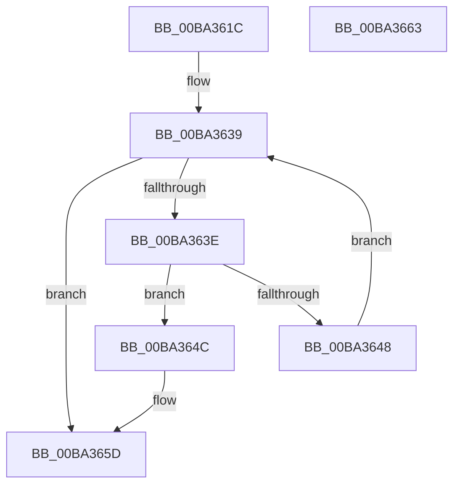

# ViErrorDisplayDescription

- RVA: `0x00BA361C`–`0x00BA3664` (길이 `72` bytes)
- VA: `0x0000000140BA361C`
- 실행 섹션: `PAGEVRFY`
- PDB 이름 있음: `예`; PDB Function 태그: `아니요`
- unwind 정보 RVA: `0x0005CF00`
- 디코드: `22`개 명령, `72/72` bytes 표시
- 미해석 바이트: `0` (있으면 어셈블리에 `.byte`로 보존)

> 이 문서는 커널 이미지의 기계어와 PDB 기호를 분석해 생성했습니다. 4번과 5번은 함수 원형과 자료형을 바이너리 사용 방식에서 추정한 C 해석이며 원본 소스 복구 결과는 아닙니다.

## 1. Dependencies

- 직접 호출 지점: **2**; 고유 호출 대상: **1**
- 직접 호출자로 확인된 함수: **13**
- RIP 상대 이미지 참조: **3**

### Outgoing calls
- `0x00BA362B` → [VfUtilDbgPrint](../../text/61/VfUtilDbgPrint_function_006122AC.md) (function, `0x006122AC`)
- `0x00BA3658` → [VfUtilDbgPrint](../../text/61/VfUtilDbgPrint_function_006122AC.md) (function, `0x006122AC`)

### Direct callers
- [ViErrorReport1](../../text/61/ViErrorReport1_function_00614584.md) at `0x006145A6`
- [ViErrorReport10](../../text/61/ViErrorReport10_function_00614608.md) at `0x00614631`
- [ViErrorReport4](../../text/61/ViErrorReport4_function_0061469C.md) at `0x006146C7`
- [ViErrorReport6](../../text/61/ViErrorReport6_function_00614740.md) at `0x00614769`
- [ViGenericVerifyIrpStackDownward](../B9/ViGenericVerifyIrpStackDownward_function_00B93F90.md) at `0x00B9405D`
- [ViGenericVerifyNewIrp](../B9/ViGenericVerifyNewIrp_function_00B94260.md) at `0x00B942F0`
- [VfIoDeleteDevice](VfIoDeleteDevice_function_00BA221C.md) at `0x00BA2270`
- [VfIoDeleteDevice](VfIoDeleteDevice_function_00BA221C.md) at `0x00BA22C8`
- [VfIoDetachDevice](VfIoDetachDevice_function_00BA234C.md) at `0x00BA237D`
- [VfErrorReport7](VfErrorReport7_function_00BA34B0.md) at `0x00BA34DB`
- [VfErrorReport8](VfErrorReport8_function_00BA3548.md) at `0x00BA356D`
- [VerifierNtCreateFile](../BB/VerifierNtCreateFile_function_00BB10A0.md) at `0x00BB10FE`
- [VerifierNtReadFile](../BB/VerifierNtReadFile_function_00BB1250.md) at `0x00BB12C6`
- [VerifierNtWriteFile](../BB/VerifierNtWriteFile_function_00BB13A0.md) at `0x00BB1416`

### Static image references
- `0x00BA3624` → RVA `0x00BBA890` (` ?? ::JKADOLAD::`string'`; read)
- `0x00BA3632` → RVA `0x00FF4650` (`PAGEVRFD`; read)
- `0x00BA3651` → RVA `0x00BBA940` (` ?? ::JKADOLAD::`string'`; read)

## 2. Other-region calls and transfers

- 다른 실행 섹션으로 향하는 call: **2**
  - `0x00BA362B` → [VfUtilDbgPrint](../../text/61/VfUtilDbgPrint_function_006122AC.md) (`PAGEVRFY` → `.text`)
  - `0x00BA3658` → [VfUtilDbgPrint](../../text/61/VfUtilDbgPrint_function_006122AC.md) (`PAGEVRFY` → `.text`)
- 별도 외부 분기/꼬리 이동을 확인하지 못했습니다.

## 3. Assembly (complete function range)

```asm
00BA361C  40 53                           push rbx
00BA361E  48 83 EC 20                     sub rsp, 0x20
00BA3622  8B D9                           mov ebx, ecx
00BA3624  48 8D 0D 65 72 01 00            lea rcx, [rip + 0x17265]
00BA362B  E8 7C EC A6 FF                  call 0x1406122ac
00BA3630  33 C0                           xor eax, eax
00BA3632  48 8D 0D 17 10 45 00            lea rcx, [rip + 0x451017]
00BA3639  83 F8 3F                        cmp eax, 0x3f
00BA363C  73 1F                           jae 0x140ba365d
00BA363E  8B D0                           mov edx, eax
00BA3640  48 03 D2                        add rdx, rdx
00BA3643  39 1C D1                        cmp dword ptr [rcx + rdx*8], ebx
00BA3646  74 04                           je 0x140ba364c
00BA3648  FF C0                           inc eax
00BA364A  EB ED                           jmp 0x140ba3639
00BA364C  48 8B 54 D1 08                  mov rdx, qword ptr [rcx + rdx*8 + 8]
00BA3651  48 8D 0D E8 72 01 00            lea rcx, [rip + 0x172e8]
00BA3658  E8 4F EC A6 FF                  call 0x1406122ac
00BA365D  48 83 C4 20                     add rsp, 0x20
00BA3661  5B                              pop rbx
00BA3662  C3                              ret
00BA3663  CC                              int3
```

## 4. C-style interpretation (structured pseudocode)

```c
__int64 __fastcall ViErrorDisplayDescription(int a1)
{
    __int64 result;
    __int64 v_rsp;

    v_rsp = (v_rsp) - (32);
    result = VfUtilDbgPrint(v_rip + 94821, a2, a3, a4);
    result = 0;
loc_00BA3639:
    if (0 >= 63) goto loc_00BA365D;
    a2 = (0) + (0);
    if ((*(unsigned int *)(v_rip + 4526103 + a2 * 8)) == ((unsigned int)((unsigned int)(a1)))) goto loc_00BA364C;
    result = (unsigned int)((result) + 1);
    goto loc_00BA3639;
loc_00BA364C:
    result = VfUtilDbgPrint(v_rip + 94952, *(unsigned __int64 *)(v_rip + 4526103 + a2 * 8 + 8), a3, a4);
loc_00BA365D:
    v_rsp = (v_rsp) + (32);
    return result;
}
```

## 5. (Beta) C Style

```c
int64_t ViErrorDisplayDescription(int32_t Arg1)
{
    int64_t result;
    int64_t local_rsp;

    local_rsp = (local_rsp) - (32);
    result = VfUtilDbgPrint(v_rip + 94821, a2, a3, a4);
    result = 0;
loc_00BA3639:
    if (0 >= 63) goto loc_00BA365D;
    a2 = (0) + (0);
    if ((*(uint32_t *)(v_rip + 0x451017 + a2 * 8)) == ((uint32_t)((uint32_t)(Arg1)))) goto loc_00BA364C;
    result = (uint32_t)((result) + 1);
    goto loc_00BA3639;
loc_00BA364C:
    result = VfUtilDbgPrint(v_rip + 94952, *(uint64_t *)(v_rip + 0x451017 + a2 * 8 + 0x8), a3, a4);
loc_00BA365D:
    local_rsp = (local_rsp) + (32);
    return result;
}
```

## 6. Execution-region graph

[열기: 2D/3D 그래프와 함수 탐색 컨트롤 패널](../../../control-panel.html?section=pagevrfy&rva=0x00BA361C&view=graph)

- 2D 그래프는 위에서 아래로 흐르고, 3D 그래프는 빈 공간을 드래그해 회전합니다. Shift+드래그는 이동, 휠은 확대·축소, 함수 노드 선택은 대상 보고서 이동입니다.

### Static fallback


