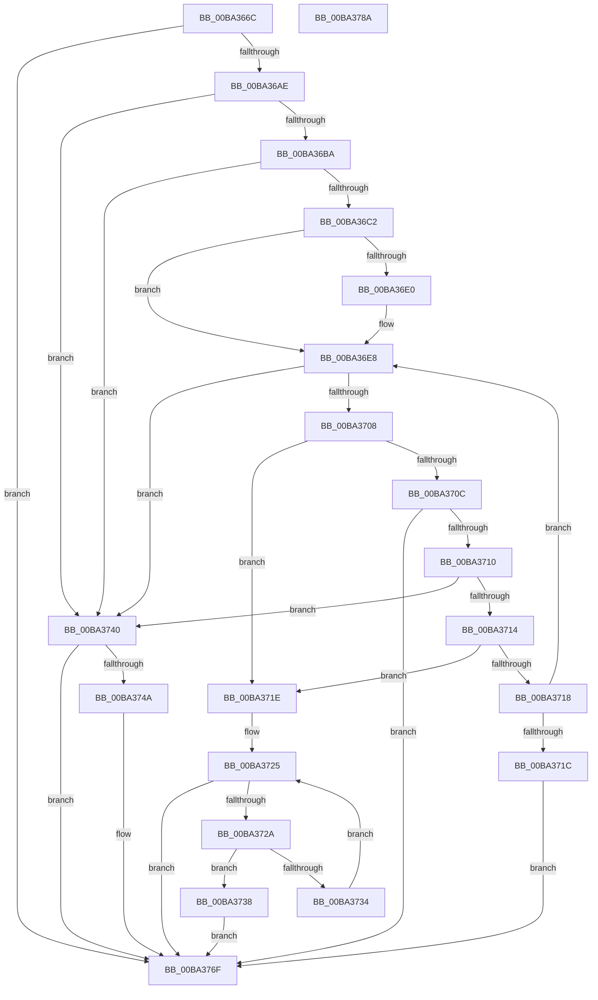

# ViErrorFinishReport

- RVA: `0x00BA366C`–`0x00BA378B` (길이 `287` bytes)
- VA: `0x0000000140BA366C`
- 실행 섹션: `PAGEVRFY`
- PDB 이름 있음: `예`; PDB Function 태그: `아니요`
- unwind 정보 RVA: `0x00091ECC`
- 디코드: `82`개 명령, `287/287` bytes 표시
- 미해석 바이트: `0` (있으면 어셈블리에 `.byte`로 보존)

> 이 문서는 커널 이미지의 기계어와 PDB 기호를 분석해 생성했습니다. 4번과 5번은 함수 원형과 자료형을 바이너리 사용 방식에서 추정한 C 해석이며 원본 소스 복구 결과는 아닙니다.

## 1. Dependencies

- 직접 호출 지점: **5**; 고유 호출 대상: **5**
- 직접 호출자로 확인된 함수: **13**
- RIP 상대 이미지 참조: **7**

### Outgoing calls
- `0x00BA3698` → [VfUtilDbgPrint](../../text/61/VfUtilDbgPrint_function_006122AC.md) (function, `0x006122AC`)
- `0x00BA369F` → [ViErrorIsBreakDisabled](ViErrorIsBreakDisabled_function_00BA3794.md) (function, `0x00BA3794`)
- `0x00BA36D5` → [VfErrorStoreTriageInformation](VfErrorStoreTriageInformation_function_00BA35D0.md) (function, `0x00BA35D0`)
- `0x00BA36FA` → [DbgPrompt](../../text/5E/DbgPrompt_function_005E5880.md) (function, `0x005E5880`)
- `0x00BA376A` → [CarReportRuleViolationFromNt](../B9/CarReportRuleViolationFromNt_function_00B9D904.md) (function, `0x00B9D904`)

### Direct callers
- [ViErrorReport1](../../text/61/ViErrorReport1_function_00614584.md) at `0x006145E2`
- [ViErrorReport10](../../text/61/ViErrorReport10_function_00614608.md) at `0x00614672`
- [ViErrorReport4](../../text/61/ViErrorReport4_function_0061469C.md) at `0x00614718`
- [ViErrorReport6](../../text/61/ViErrorReport6_function_00614740.md) at `0x006147A9`
- [ViGenericVerifyIrpStackDownward](../B9/ViGenericVerifyIrpStackDownward_function_00B93F90.md) at `0x00B940A0`
- [ViGenericVerifyNewIrp](../B9/ViGenericVerifyNewIrp_function_00B94260.md) at `0x00B94333`
- [VfIoDeleteDevice](VfIoDeleteDevice_function_00BA221C.md) at `0x00BA22A7`
- [VfIoDeleteDevice](VfIoDeleteDevice_function_00BA221C.md) at `0x00BA2302`
- [VfIoDetachDevice](VfIoDetachDevice_function_00BA234C.md) at `0x00BA23BC`
- [VfErrorReport7](VfErrorReport7_function_00BA34B0.md) at `0x00BA351F`
- [VfErrorReport8](VfErrorReport8_function_00BA3548.md) at `0x00BA35A9`
- [VerifierNtCreateFile](../BB/VerifierNtCreateFile_function_00BB10A0.md) at `0x00BB1138`
- [VerifierNtReadFile](../BB/VerifierNtReadFile_function_00BB1250.md) at `0x00BB1300`
- [VerifierNtWriteFile](../BB/VerifierNtWriteFile_function_00BB13A0.md) at `0x00BB1450`

### Static image references
- `0x00BA368B` → RVA `0x00BBA900` (` ?? ::JKADOLAD::`string'`; read)
- `0x00BA36AE` → RVA `0x00F475F8` (`.data`; read)
- `0x00BA36BA` → RVA `0x00F475DC` (`.data`; read)
- `0x00BA36E2` → RVA `0x00FFDB58` (`PAGEVRFD`; read/write)
- `0x00BA36F3` → RVA `0x00BBA950` (` ?? ::JKADOLAD::`string'`; read)
- `0x00BA371E` → RVA `0x00FF4650` (`PAGEVRFD`; read)
- `0x00BA3740` → RVA `0x00F04A20` (`.data`; read)

## 2. Other-region calls and transfers

- 다른 실행 섹션으로 향하는 call: **2**
  - `0x00BA3698` → [VfUtilDbgPrint](../../text/61/VfUtilDbgPrint_function_006122AC.md) (`PAGEVRFY` → `.text`)
  - `0x00BA36FA` → [DbgPrompt](../../text/5E/DbgPrompt_function_005E5880.md) (`PAGEVRFY` → `.text`)
- 별도 외부 분기/꼬리 이동을 확인하지 못했습니다.

## 3. Assembly (complete function range)

```asm
00BA366C  48 8B C4                        mov rax, rsp
00BA366F  48 89 58 08                     mov qword ptr [rax + 8], rbx
00BA3673  48 89 68 10                     mov qword ptr [rax + 0x10], rbp
00BA3677  48 89 70 18                     mov qword ptr [rax + 0x18], rsi
00BA367B  48 89 78 20                     mov qword ptr [rax + 0x20], rdi
00BA367F  41 56                           push r14
00BA3681  48 83 EC 50                     sub rsp, 0x50
00BA3685  48 63 F9                        movsxd rdi, ecx
00BA3688  49 8B E9                        mov rbp, r9
00BA368B  48 8D 0D 6E 72 01 00            lea rcx, [rip + 0x1726e]
00BA3692  4D 8B F0                        mov r14, r8
00BA3695  48 8B F2                        mov rsi, rdx
00BA3698  E8 0F EC A6 FF                  call 0x1406122ac
00BA369D  8B CF                           mov ecx, edi
00BA369F  E8 F0 00 00 00                  call 0x140ba3794
00BA36A4  33 DB                           xor ebx, ebx
00BA36A6  85 C0                           test eax, eax
00BA36A8  0F 85 C1 00 00 00               jne 0x140ba376f
00BA36AE  38 1D 44 3F 3A 00               cmp byte ptr [rip + 0x3a3f44], bl
00BA36B4  0F 84 86 00 00 00               je 0x140ba3740
00BA36BA  38 1D 1C 3F 3A 00               cmp byte ptr [rip + 0x3a3f1c], bl
00BA36C0  75 7E                           jne 0x140ba3740
00BA36C2  48 8B D7                        mov rdx, rdi
00BA36C5  48 89 6C 24 20                  mov qword ptr [rsp + 0x20], rbp
00BA36CA  4D 8B CE                        mov r9, r14
00BA36CD  4C 8B C6                        mov r8, rsi
00BA36D0  B9 C9 00 00 00                  mov ecx, 0xc9
00BA36D5  E8 F6 FE FF FF                  call 0x140ba35d0
00BA36DA  90                              nop
00BA36DB  CC                              int3
00BA36DC  85 C0                           test eax, eax
00BA36DE  74 08                           je 0x140ba36e8
00BA36E0  8B C3                           mov eax, ebx
00BA36E2  87 05 70 A4 45 00               xchg dword ptr [rip + 0x45a470], eax
00BA36E8  41 B8 02 00 00 00               mov r8d, 2
00BA36EE  48 8D 54 24 40                  lea rdx, [rsp + 0x40]
00BA36F3  48 8D 0D 56 72 01 00            lea rcx, [rip + 0x17256]
00BA36FA  E8 81 21 A4 FF                  call 0x1405e5880
00BA36FF  0F B7 44 24 40                  movzx eax, word ptr [rsp + 0x40]
00BA3704  3C 42                           cmp al, 0x42
00BA3706  74 38                           je 0x140ba3740
00BA3708  3C 44                           cmp al, 0x44
00BA370A  74 12                           je 0x140ba371e
00BA370C  3C 52                           cmp al, 0x52
00BA370E  74 5F                           je 0x140ba376f
00BA3710  3C 62                           cmp al, 0x62
00BA3712  74 2C                           je 0x140ba3740
00BA3714  3C 64                           cmp al, 0x64
00BA3716  74 06                           je 0x140ba371e
00BA3718  3C 72                           cmp al, 0x72
00BA371A  75 CC                           jne 0x140ba36e8
00BA371C  EB 51                           jmp 0x140ba376f
00BA371E  48 8D 0D 2B 0F 45 00            lea rcx, [rip + 0x450f2b]
00BA3725  83 FB 3F                        cmp ebx, 0x3f
00BA3728  73 45                           jae 0x140ba376f
00BA372A  8B C3                           mov eax, ebx
00BA372C  48 03 C0                        add rax, rax
00BA372F  39 3C C1                        cmp dword ptr [rcx + rax*8], edi
00BA3732  74 04                           je 0x140ba3738
00BA3734  FF C3                           inc ebx
00BA3736  EB ED                           jmp 0x140ba3725
00BA3738  F0 83 4C C1 04 01               lock or dword ptr [rcx + rax*8 + 4], 1
00BA373E  EB 2F                           jmp 0x140ba376f
00BA3740  8B 05 DA 12 36 00               mov eax, dword ptr [rip + 0x3612da]
00BA3746  A8 10                           test al, 0x10
00BA3748  74 25                           je 0x140ba376f
00BA374A  48 89 74 24 30                  mov qword ptr [rsp + 0x30], rsi
00BA374F  48 8B D7                        mov rdx, rdi
00BA3752  C7 44 24 28 04 00 00 00         mov dword ptr [rsp + 0x28], 4
00BA375A  4D 8B CE                        mov r9, r14
00BA375D  4C 8B C6                        mov r8, rsi
00BA3760  48 89 6C 24 20                  mov qword ptr [rsp + 0x20], rbp
00BA3765  B9 C9 00 00 00                  mov ecx, 0xc9
00BA376A  E8 95 A1 FF FF                  call 0x140b9d904
00BA376F  48 8B 5C 24 60                  mov rbx, qword ptr [rsp + 0x60]
00BA3774  48 8B 6C 24 68                  mov rbp, qword ptr [rsp + 0x68]
00BA3779  48 8B 74 24 70                  mov rsi, qword ptr [rsp + 0x70]
00BA377E  48 8B 7C 24 78                  mov rdi, qword ptr [rsp + 0x78]
00BA3783  48 83 C4 50                     add rsp, 0x50
00BA3787  41 5E                           pop r14
00BA3789  C3                              ret
00BA378A  CC                              int3
```

## 4. C-style interpretation (structured pseudocode)

```c
__int64 __fastcall ViErrorFinishReport(int a1, __int64 a2, __int64 a3, __int64 a4)
{
    __int64 result;
    __int64 v_rbx;
    __int64 v_rsp;
    unsigned __int64 v_stack_m18;
    unsigned __int64 v_stack_m28;
    unsigned int v_stack_m30;
    unsigned __int64 v_stack_m38;
    unsigned __int64 v_stack_p10;
    unsigned __int64 v_stack_p18;
    unsigned __int64 v_stack_p20;
    unsigned __int64 v_stack_p8;

    *(unsigned __int64 *)(v_rsp + 8) = v_rbx;
    *(unsigned __int64 *)(v_rsp + 16) = v_rbp;
    *(unsigned __int64 *)(v_rsp + 24) = v_rsi;
    *(unsigned __int64 *)(v_rsp + 32) = v_rdi;
    v_rsp = (v_rsp) - (80);
    result = VfUtilDbgPrint(v_rip + 94830, a2, a3, a4);
    result = ViErrorIsBreakDisabled((unsigned int)((unsigned int)((int)(a1))), a2, a3, a4);
    v_rbx = 0;
    if ((unsigned int)(result) != 0) goto loc_00BA376F;
    if ((*(unsigned __int8 *)(v_rip + 3817284)) == 0) goto loc_00BA3740;
    if ((*(unsigned __int8 *)(v_rip + 3817244)) != 0) goto loc_00BA3740;
    v_stack_m38 = a4;
    result = VfErrorStoreTriageInformation(201, (int)(a1), a2, a3);
    if ((unsigned int)(result) != 0) {
        result = 0;
    }
    result = DbgPrompt(v_rip + 94806, v_stack_m18, 2, a3);
    if (((unsigned __int8)(v_stack_m18)) == 66) goto loc_00BA3740;
    if (((unsigned __int8)(v_stack_m18)) == 68) goto loc_00BA371E;
    if (((unsigned __int8)(v_stack_m18)) == 82) goto loc_00BA376F;
    if (((unsigned __int8)(v_stack_m18)) == 98) goto loc_00BA3740;
    if (((unsigned __int8)(v_stack_m18)) == 100) goto loc_00BA371E;
    if (((unsigned __int8)(v_stack_m18)) != 114) goto loc_00BA36E8;
    goto loc_00BA376F;
loc_00BA371E:
loc_00BA3725:
    if (0 >= 63) goto loc_00BA376F;
    result = (0) + (0);
    if ((*(unsigned int *)(v_rip + 4525867 + result * 8)) == ((unsigned int)((int)(a1)))) goto loc_00BA3738;
    v_rbx = (unsigned int)((v_rbx) + 1);
    goto loc_00BA3725;
loc_00BA3738:
    goto loc_00BA376F;
loc_00BA3740:
    result = (unsigned int)(*(unsigned int *)(v_rip + 3543770));
    if ((((unsigned __int8)((unsigned int)(*(unsigned int *)(v_rip + 3543770)))) & (16)) != 0) {
        v_stack_m28 = a2;
        a2 = (int)(a1);
        v_stack_m30 = 4;
        a4 = a3;
        a3 = a2;
        v_stack_m38 = a4;
        a1 = 201;
        result = CarReportRuleViolationFromNt(a1, a2, a3, a4);
    }
    v_rsp = (v_rsp) + (80);
    return result;
}
```

## 5. (Beta) C Style

```c
int64_t ViErrorFinishReport(int32_t Arg1, int64_t Arg2, int64_t Arg3, int64_t Arg4)
{
    int64_t result;
    int64_t local_rbx;
    int64_t local_rsp;
    uint64_t v_stack_m18;
    uint64_t v_stack_m28;
    uint32_t v_stack_m30;
    uint64_t v_stack_m38;
    uint64_t v_stack_p10;
    uint64_t v_stack_p18;
    uint64_t v_stack_p20;
    uint64_t v_stack_p8;

    *(uint64_t *)(local_rsp + 0x8) = local_rbx;
    *(uint64_t *)(local_rsp + 0x10) = local_rbp;
    *(uint64_t *)(local_rsp + 0x18) = local_rsi;
    *(uint64_t *)(local_rsp + 0x20) = local_rdi;
    local_rsp = (local_rsp) - (80);
    result = VfUtilDbgPrint(v_rip + 94830, Arg2, Arg3, Arg4);
    result = ViErrorIsBreakDisabled((uint32_t)((uint32_t)((int32_t)(Arg1))), Arg2, Arg3, Arg4);
    local_rbx = 0;
    if ((uint32_t)(result) != 0) goto loc_00BA376F;
    if ((*(uint8_t *)(v_rip + 0x3A3F44)) == 0) goto loc_00BA3740;
    if ((*(uint8_t *)(v_rip + 0x3A3F1C)) != 0) goto loc_00BA3740;
    v_stack_m38 = Arg4;
    result = VfErrorStoreTriageInformation(201, (int32_t)(Arg1), Arg2, Arg3);
    if ((uint32_t)(result) != 0) {
        result = 0;
    }
    result = DbgPrompt(v_rip + 94806, v_stack_m18, 2, Arg3);
    if (((uint8_t)(v_stack_m18)) == 66) goto loc_00BA3740;
    if (((uint8_t)(v_stack_m18)) == 68) goto loc_00BA371E;
    if (((uint8_t)(v_stack_m18)) == 82) goto loc_00BA376F;
    if (((uint8_t)(v_stack_m18)) == 98) goto loc_00BA3740;
    if (((uint8_t)(v_stack_m18)) == 100) goto loc_00BA371E;
    if (((uint8_t)(v_stack_m18)) != 114) goto loc_00BA36E8;
    goto loc_00BA376F;
loc_00BA371E:
loc_00BA3725:
    if (0 >= 63) goto loc_00BA376F;
    result = (0) + (0);
    if ((*(uint32_t *)(v_rip + 0x450F2B + result * 8)) == ((uint32_t)((int32_t)(Arg1)))) goto loc_00BA3738;
    local_rbx = (uint32_t)((local_rbx) + 1);
    goto loc_00BA3725;
loc_00BA3738:
    goto loc_00BA376F;
loc_00BA3740:
    result = (uint32_t)(*(uint32_t *)(v_rip + 0x3612DA));
    if ((((uint8_t)((uint32_t)(*(uint32_t *)(v_rip + 0x3612DA)))) & (16)) != 0) {
        v_stack_m28 = Arg2;
        Arg2 = (int32_t)(Arg1);
        v_stack_m30 = 4;
        Arg4 = Arg3;
        Arg3 = Arg2;
        v_stack_m38 = Arg4;
        Arg1 = 201;
        result = CarReportRuleViolationFromNt(Arg1, Arg2, Arg3, Arg4);
    }
    local_rsp = (local_rsp) + (80);
    return result;
}
```

## 6. Execution-region graph

[열기: 2D/3D 그래프와 함수 탐색 컨트롤 패널](../../../control-panel.html?section=pagevrfy&rva=0x00BA366C&view=graph)

- 2D 그래프는 위에서 아래로 흐르고, 3D 그래프는 빈 공간을 드래그해 회전합니다. Shift+드래그는 이동, 휠은 확대·축소, 함수 노드 선택은 대상 보고서 이동입니다.

### Static fallback


