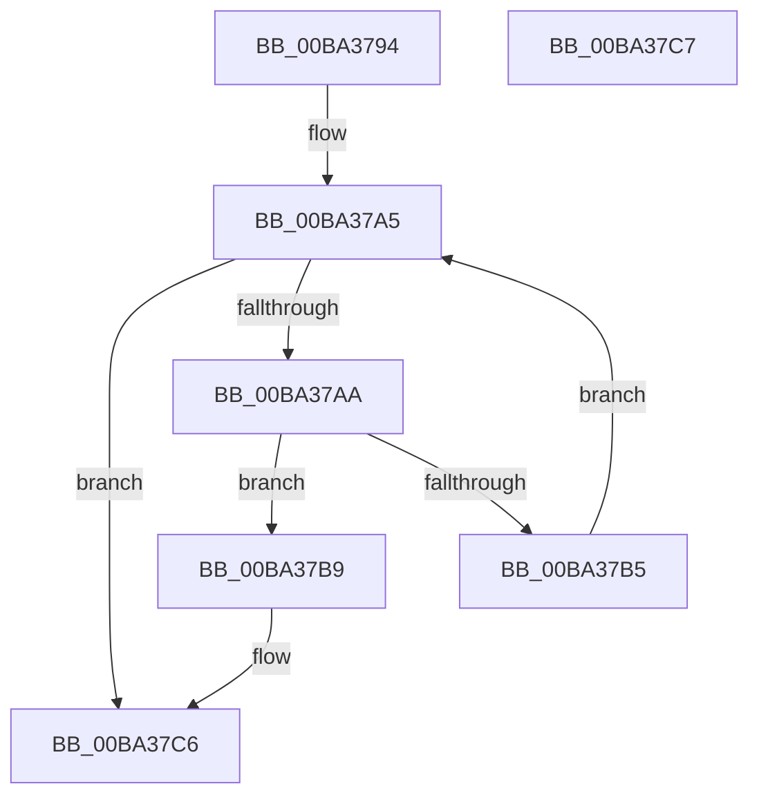

# ViErrorIsBreakDisabled

- RVA: `0x00BA3794`–`0x00BA37C8` (길이 `52` bytes)
- VA: `0x0000000140BA3794`
- 실행 섹션: `PAGEVRFY`
- PDB 이름 있음: `예`; PDB Function 태그: `아니요`
- unwind 정보 RVA: `0x000DB714`
- 디코드: `19`개 명령, `52/52` bytes 표시
- 미해석 바이트: `0` (있으면 어셈블리에 `.byte`로 보존)

> 이 문서는 커널 이미지의 기계어와 PDB 기호를 분석해 생성했습니다. 4번과 5번은 함수 원형과 자료형을 바이너리 사용 방식에서 추정한 C 해석이며 원본 소스 복구 결과는 아닙니다.

## 1. Dependencies

- 직접 호출 지점: **0**; 고유 호출 대상: **0**
- 직접 호출자로 확인된 함수: **1**
- RIP 상대 이미지 참조: **1**

### Outgoing calls
- 직접 디코드된 call 명령이 없습니다.

### Direct callers
- [ViErrorFinishReport](ViErrorFinishReport_function_00BA366C.md) at `0x00BA369F`

### Static image references
- `0x00BA3797` → RVA `0x00FF4650` (`PAGEVRFD`; read)

## 2. Other-region calls and transfers

- 다른 실행 섹션으로 향하는 call: **0**
- 별도 외부 분기/꼬리 이동을 확인하지 못했습니다.

## 3. Assembly (complete function range)

```asm
00BA3794  44 8B C1                        mov r8d, ecx
00BA3797  4C 8D 0D B2 0E 45 00            lea r9, [rip + 0x450eb2]
00BA379E  B8 01 00 00 00                  mov eax, 1
00BA37A3  33 D2                           xor edx, edx
00BA37A5  83 FA 3F                        cmp edx, 0x3f
00BA37A8  73 1C                           jae 0x140ba37c6
00BA37AA  8B CA                           mov ecx, edx
00BA37AC  48 03 C9                        add rcx, rcx
00BA37AF  45 39 04 C9                     cmp dword ptr [r9 + rcx*8], r8d
00BA37B3  74 04                           je 0x140ba37b9
00BA37B5  03 D0                           add edx, eax
00BA37B7  EB EC                           jmp 0x140ba37a5
00BA37B9  41 8A 4C C9 04                  mov cl, byte ptr [r9 + rcx*8 + 4]
00BA37BE  22 C8                           and cl, al
00BA37C0  F6 D9                           neg cl
00BA37C2  1B C9                           sbb ecx, ecx
00BA37C4  23 C1                           and eax, ecx
00BA37C6  C3                              ret
00BA37C7  CC                              int3
```

## 4. C-style interpretation (structured pseudocode)

```c
__int64 __fastcall ViErrorIsBreakDisabled(int a1, int a2)
{
    __int64 result;

    a2 = 0;
loc_00BA37A5:
    if (0 >= 63) goto loc_00BA37C6;
    a1 = (0) + (0);
    if ((*(unsigned int *)(v_rip + 4525746 + a1 * 8)) == ((unsigned int)((unsigned int)(a1)))) goto loc_00BA37B9;
    a2 = (unsigned int)((a2) + (1));
    goto loc_00BA37A5;
loc_00BA37B9:
    a1 = (unsigned __int8)((*(unsigned __int8 *)(v_rip + 4525746 + a1 * 8 + 4)) & (1));
    a1 = (unsigned __int8)(-(a1));
    result = (unsigned int)((1) & (a1));
loc_00BA37C6:
    return result;
}
```

## 5. (Beta) C Style

```c
int64_t ViErrorIsBreakDisabled(int32_t Arg1, int32_t Arg2)
{
    int64_t result;

    Arg2 = 0;
loc_00BA37A5:
    if (0 >= 63) goto loc_00BA37C6;
    Arg1 = (0) + (0);
    if ((*(uint32_t *)(v_rip + 0x450EB2 + Arg1 * 8)) == ((uint32_t)((uint32_t)(Arg1)))) goto loc_00BA37B9;
    Arg2 = (uint32_t)((Arg2) + (1));
    goto loc_00BA37A5;
loc_00BA37B9:
    Arg1 = (uint8_t)((*(uint8_t *)(v_rip + 0x450EB2 + Arg1 * 8 + 0x4)) & (1));
    Arg1 = (uint8_t)(-(Arg1));
    result = (uint32_t)((1) & (Arg1));
loc_00BA37C6:
    return result;
}
```

## 6. Execution-region graph

[열기: 2D/3D 그래프와 함수 탐색 컨트롤 패널](../../../control-panel.html?section=pagevrfy&rva=0x00BA3794&view=graph)

- 2D 그래프는 위에서 아래로 흐르고, 3D 그래프는 빈 공간을 드래그해 회전합니다. Shift+드래그는 이동, 휠은 확대·축소, 함수 노드 선택은 대상 보고서 이동입니다.

### Static fallback


