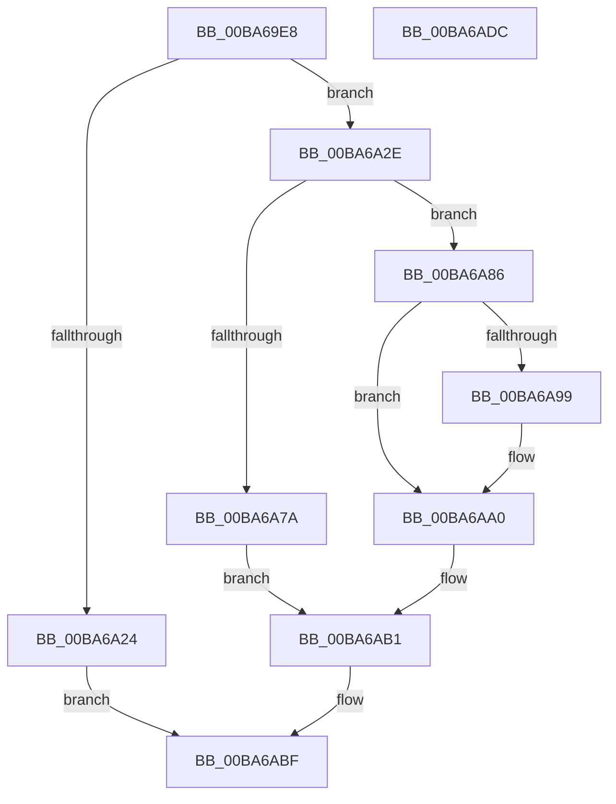

# ViFaultsAddAppNoDuplicates

- RVA: `0x00BA69E8`–`0x00BA6ADD` (길이 `245` bytes)
- VA: `0x0000000140BA69E8`
- 실행 섹션: `PAGEVRFY`
- PDB 이름 있음: `예`; PDB Function 태그: `아니요`
- unwind 정보 RVA: `0x0005E6B4`
- 디코드: `65`개 명령, `245/245` bytes 표시
- 미해석 바이트: `0` (있으면 어셈블리에 `.byte`로 보존)

> 이 문서는 커널 이미지의 기계어와 PDB 기호를 분석해 생성했습니다. 4번과 5번은 함수 원형과 자료형을 바이너리 사용 방식에서 추정한 C 해석이며 원본 소스 복구 결과는 아닙니다.

## 1. Dependencies

- 직접 호출 지점: **8**; 고유 호출 대상: **8**
- 직접 호출자로 확인된 함수: **1**
- RIP 상대 이미지 참조: **4**

### Outgoing calls
- `0x00BA6A17` → [ExAllocatePool2](../../poolcode/B8/ExAllocatePool2_function_00B820F0.md) (function, `0x00B820F0`)
- `0x00BA6A38` → [memcpy](../../text/6C/memcpy_function_006C6840.md) (function, `0x006C6840`)
- `0x00BA6A4D` → [RtlInitUnicodeString](../../text/42/RtlInitUnicodeString_function_0042A780.md) (function, `0x0042A780`)
- `0x00BA6A5B` → [RtlUpcaseUnicodeString](../../page/96/RtlUpcaseUnicodeString_function_00960780.md) (function, `0x00960780`)
- `0x00BA6A67` → [KeAcquireSpinLockRaiseToDpc](../../text/20/KeAcquireSpinLockRaiseToDpc_function_00208470.md) (function, `0x00208470`)
- `0x00BA6A71` → [ViFaultsIsAppTarget](ViFaultsIsAppTarget_function_00BA6CE0.md) (function, `0x00BA6CE0`)
- `0x00BA6A7F` → [ExFreePoolWithTag](../../poolcode/B8/ExFreePoolWithTag_function_00B82870.md) (function, `0x00B82870`)
- `0x00BA6ABA` → [KeReleaseSpinLock](../../text/39/KeReleaseSpinLock_function_00392BA0.md) (function, `0x00392BA0`)

### Direct callers
- [VfFaultsAddAllApps](VfFaultsAddAllApps_function_00BA61D0.md) at `0x00BA6241`

### Static image references
- `0x00BA6A60` → RVA `0x00F044C8` (`.data`; read)
- `0x00BA6A86` → RVA `0x00F043A8` (`.data`; read)
- `0x00BA6A8D` → RVA `0x00F043A0` (`.data`; read)
- `0x00BA6AAA` → RVA `0x00F043A8` (`.data`; write)

## 2. Other-region calls and transfers

- 다른 실행 섹션으로 향하는 call: **7**
  - `0x00BA6A17` → [ExAllocatePool2](../../poolcode/B8/ExAllocatePool2_function_00B820F0.md) (`PAGEVRFY` → `POOLCODE`)
  - `0x00BA6A38` → [memcpy](../../text/6C/memcpy_function_006C6840.md) (`PAGEVRFY` → `.text`)
  - `0x00BA6A4D` → [RtlInitUnicodeString](../../text/42/RtlInitUnicodeString_function_0042A780.md) (`PAGEVRFY` → `.text`)
  - `0x00BA6A5B` → [RtlUpcaseUnicodeString](../../page/96/RtlUpcaseUnicodeString_function_00960780.md) (`PAGEVRFY` → `PAGE`)
  - `0x00BA6A67` → [KeAcquireSpinLockRaiseToDpc](../../text/20/KeAcquireSpinLockRaiseToDpc_function_00208470.md) (`PAGEVRFY` → `.text`)
  - `0x00BA6A7F` → [ExFreePoolWithTag](../../poolcode/B8/ExFreePoolWithTag_function_00B82870.md) (`PAGEVRFY` → `POOLCODE`)
  - `0x00BA6ABA` → [KeReleaseSpinLock](../../text/39/KeReleaseSpinLock_function_00392BA0.md) (`PAGEVRFY` → `.text`)
- 별도 외부 분기/꼬리 이동을 확인하지 못했습니다.

## 3. Assembly (complete function range)

```asm
00BA69E8  48 8B C4                        mov rax, rsp
00BA69EB  48 89 58 08                     mov qword ptr [rax + 8], rbx
00BA69EF  48 89 68 10                     mov qword ptr [rax + 0x10], rbp
00BA69F3  48 89 70 18                     mov qword ptr [rax + 0x18], rsi
00BA69F7  48 89 78 20                     mov qword ptr [rax + 0x20], rdi
00BA69FB  41 56                           push r14
00BA69FD  48 83 EC 20                     sub rsp, 0x20
00BA6A01  48 8D 3C 12                     lea rdi, [rdx + rdx]
00BA6A05  4C 8B F1                        mov r14, rcx
00BA6A08  33 ED                           xor ebp, ebp
00BA6A0A  48 8D 57 22                     lea rdx, [rdi + 0x22]
00BA6A0E  41 B8 56 66 46 41               mov r8d, 0x41466656
00BA6A14  8D 4D 40                        lea ecx, [rbp + 0x40]
00BA6A17  E8 D4 B6 FD FF                  call 0x140b820f0
00BA6A1C  48 8B F0                        mov rsi, rax
00BA6A1F  48 85 C0                        test rax, rax
00BA6A22  75 0A                           jne 0x140ba6a2e
00BA6A24  BD 9A 00 00 C0                  mov ebp, 0xc000009a
00BA6A29  E9 91 00 00 00                  jmp 0x140ba6abf
00BA6A2E  4C 8B C7                        mov r8, rdi
00BA6A31  48 8D 48 20                     lea rcx, [rax + 0x20]
00BA6A35  49 8B D6                        mov rdx, r14
00BA6A38  E8 03 FE B1 FF                  call 0x1406c6840
00BA6A3D  66 89 6C 37 20                  mov word ptr [rdi + rsi + 0x20], bp
00BA6A42  48 8D 56 20                     lea rdx, [rsi + 0x20]
00BA6A46  48 8D 7E 10                     lea rdi, [rsi + 0x10]
00BA6A4A  48 8B CF                        mov rcx, rdi
00BA6A4D  E8 2E 3D 88 FF                  call 0x14042a780
00BA6A52  45 33 C0                        xor r8d, r8d
00BA6A55  48 8B D7                        mov rdx, rdi
00BA6A58  48 8B CF                        mov rcx, rdi
00BA6A5B  E8 20 9D DB FF                  call 0x140960780
00BA6A60  48 8D 0D 61 DA 35 00            lea rcx, [rip + 0x35da61]
00BA6A67  E8 04 1A 66 FF                  call 0x140208470
00BA6A6C  48 8B CF                        mov rcx, rdi
00BA6A6F  8A D8                           mov bl, al
00BA6A71  E8 6A 02 00 00                  call 0x140ba6ce0
00BA6A76  85 C0                           test eax, eax
00BA6A78  74 0C                           je 0x140ba6a86
00BA6A7A  33 D2                           xor edx, edx
00BA6A7C  48 8B CE                        mov rcx, rsi
00BA6A7F  E8 EC BD FD FF                  call 0x140b82870
00BA6A84  EB 2B                           jmp 0x140ba6ab1
00BA6A86  48 8B 05 1B D9 35 00            mov rax, qword ptr [rip + 0x35d91b]
00BA6A8D  48 8D 0D 0C D9 35 00            lea rcx, [rip + 0x35d90c]
00BA6A94  48 39 08                        cmp qword ptr [rax], rcx
00BA6A97  74 07                           je 0x140ba6aa0
00BA6A99  B9 03 00 00 00                  mov ecx, 3
00BA6A9E  CD 29                           int 0x29
00BA6AA0  48 89 0E                        mov qword ptr [rsi], rcx
00BA6AA3  48 89 46 08                     mov qword ptr [rsi + 8], rax
00BA6AA7  48 89 30                        mov qword ptr [rax], rsi
00BA6AAA  48 89 35 F7 D8 35 00            mov qword ptr [rip + 0x35d8f7], rsi
00BA6AB1  8A D3                           mov dl, bl
00BA6AB3  48 8D 0D 0E DA 35 00            lea rcx, [rip + 0x35da0e]
00BA6ABA  E8 E1 C0 7E FF                  call 0x140392ba0
00BA6ABF  48 8B 5C 24 30                  mov rbx, qword ptr [rsp + 0x30]
00BA6AC4  8B C5                           mov eax, ebp
00BA6AC6  48 8B 6C 24 38                  mov rbp, qword ptr [rsp + 0x38]
00BA6ACB  48 8B 74 24 40                  mov rsi, qword ptr [rsp + 0x40]
00BA6AD0  48 8B 7C 24 48                  mov rdi, qword ptr [rsp + 0x48]
00BA6AD5  48 83 C4 20                     add rsp, 0x20
00BA6AD9  41 5E                           pop r14
00BA6ADB  C3                              ret
00BA6ADC  CC                              int3
```

## 4. C-style interpretation (structured pseudocode)

```c
__int64 __fastcall ViFaultsAddAppNoDuplicates(__int64 a1, __int64 a2)
{
    __int64 result;
    __int64 v_rbp;
    __int64 v_rsp;
    unsigned __int64 v_stack_p10;
    unsigned __int64 v_stack_p18;
    unsigned __int64 v_stack_p20;
    unsigned __int64 v_stack_p8;

    *(unsigned __int64 *)(v_rsp + 8) = v_rbx;
    *(unsigned __int64 *)(v_rsp + 16) = v_rbp;
    *(unsigned __int64 *)(v_rsp + 24) = v_rsi;
    *(unsigned __int64 *)(v_rsp + 32) = v_rdi;
    v_rsp = (v_rsp) - (32);
    v_rbp = 0;
    result = ExAllocatePool2(v_rbp + 64, a2 + a2 * 1 + 34, (unsigned int)(0x41466656ULL), a4);
    if (result != 0) goto loc_00BA6A2E;
    goto loc_00BA6ABF;
loc_00BA6A2E:
    result = memcpy(result + 32, a1, a2 + a2 * 1, a4);
    *(unsigned __int16 *)(a2 + a2 * 1 + result * 1 + 32) = (unsigned __int16)((unsigned int)(0xC000009AULL));
    result = RtlInitUnicodeString(result + 16, result + 32, a2 + a2 * 1, a4);
    a3 = 0;
    result = RtlUpcaseUnicodeString(result + 16, result + 16, a3, a4);
    result = KeAcquireSpinLockRaiseToDpc(v_rip + 3529313, result + 16, a3, a4);
    result = ViFaultsIsAppTarget(result + 16, result + 16, a3, a4);
    if ((unsigned int)(result) == 0) goto loc_00BA6A86;
    a2 = 0;
    result = ExFreePoolWithTag(result, a2, a3, a4);
    goto loc_00BA6AB1;
loc_00BA6A86:
    if ((*(unsigned __int64 *)(*(unsigned __int64 *)(v_rip + 3528987))) != (v_rip + 3528972)) {
        a1 = 3;
    }
    *(unsigned __int64 *)(result) = a1;
    *(unsigned __int64 *)(result + 8) = *(unsigned __int64 *)(v_rip + 3528987);
    *(unsigned __int64 *)(*(unsigned __int64 *)(v_rip + 3528987)) = result;
    *(unsigned __int64 *)(v_rip + 3528951) = result;
loc_00BA6AB1:
    result = KeReleaseSpinLock(v_rip + 3529230, (unsigned __int8)((unsigned __int8)(result)), a3, a4);
loc_00BA6ABF:
    v_rsp = (v_rsp) + (32);
    return (unsigned int)((unsigned int)((unsigned int)(0xC000009AULL)));
}
```

## 5. (Beta) C Style

```c
int64_t ViFaultsAddAppNoDuplicates(int64_t Arg1, void *Arg2)
{
    uint8_t *arg2 = (uint8_t *)Arg2;

    int64_t result;
    int64_t local_rbp;
    int64_t local_rsp;
    uint64_t v_stack_p10;
    uint64_t v_stack_p18;
    uint64_t v_stack_p20;
    uint64_t v_stack_p8;

    *(uint64_t *)(local_rsp + 0x8) = local_rbx;
    *(uint64_t *)(local_rsp + 0x10) = local_rbp;
    *(uint64_t *)(local_rsp + 0x18) = local_rsi;
    *(uint64_t *)(local_rsp + 0x20) = local_rdi;
    local_rsp = (local_rsp) - (32);
    local_rbp = 0;
    result = ExAllocatePool2(local_rbp + 64, Arg2 + Arg2 * 1 + 34, (uint32_t)(0x41466656ULL), a4);
    if (result != 0) goto loc_00BA6A2E;
    goto loc_00BA6ABF;
loc_00BA6A2E:
    result = memcpy(result + 32, Arg1, Arg2 + Arg2 * 1, a4);
    *(uint16_t *)(arg2 + arg2 * 1 + result * 1 + 0x20) = (uint16_t)((uint32_t)(0xC000009AULL));
    result = RtlInitUnicodeString(result + 16, result + 32, Arg2 + Arg2 * 1, a4);
    a3 = 0;
    result = RtlUpcaseUnicodeString(result + 16, result + 16, a3, a4);
    result = KeAcquireSpinLockRaiseToDpc(v_rip + 3529313, result + 16, a3, a4);
    result = ViFaultsIsAppTarget(result + 16, result + 16, a3, a4);
    if ((uint32_t)(result) == 0) goto loc_00BA6A86;
    Arg2 = 0;
    result = ExFreePoolWithTag(result, Arg2, a3, a4);
    goto loc_00BA6AB1;
loc_00BA6A86:
    if ((*(uint64_t *)(*(uint64_t *)(v_rip + 0x35D91B))) != (v_rip + 3528972)) {
        Arg1 = 3;
    }
    *(uint64_t *)(result) = Arg1;
    *(uint64_t *)(result + 0x8) = *(uint64_t *)(v_rip + 0x35D91B);
    *(uint64_t *)(*(uint64_t *)(v_rip + 0x35D91B)) = result;
    *(uint64_t *)(v_rip + 0x35D8F7) = result;
loc_00BA6AB1:
    result = KeReleaseSpinLock(v_rip + 3529230, (uint8_t)((uint8_t)(result)), a3, a4);
loc_00BA6ABF:
    local_rsp = (local_rsp) + (32);
    return (uint32_t)((uint32_t)((uint32_t)(0xC000009AULL)));
}
```

### 관측된 메모리 오프셋

구조체 형식이 확인되지 않은 접근은 인자 기준의 오프셋으로만 기록했습니다.

| 기준 인자 | 오프셋 표현 | 폭 (bit) | 접근 |
|---|---:|---:|---|
| `Arg2` | `+ 0x0 + rdx*1` | `64` | `R` |
| `Arg2` | `+ 0x20 + rsi*1` | `16` | `W` |
| `Arg2` | `+ 0x22` | `64` | `R` |

## 6. Execution-region graph

[열기: 2D/3D 그래프와 함수 탐색 컨트롤 패널](../../../control-panel.html?section=pagevrfy&rva=0x00BA69E8&view=graph)

- 2D 그래프는 위에서 아래로 흐르고, 3D 그래프는 빈 공간을 드래그해 회전합니다. Shift+드래그는 이동, 휠은 확대·축소, 함수 노드 선택은 대상 보고서 이동입니다.

### Static fallback


