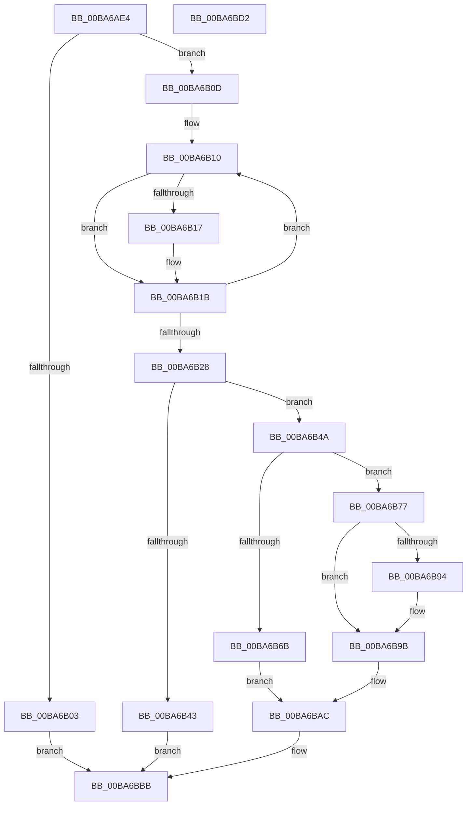

# ViFaultsAddTagNoDuplicates

- RVA: `0x00BA6AE4`–`0x00BA6BD3` (길이 `239` bytes)
- VA: `0x0000000140BA6AE4`
- 실행 섹션: `PAGEVRFY`
- PDB 이름 있음: `예`; PDB Function 태그: `아니요`
- unwind 정보 RVA: `0x000B6A1C`
- 디코드: `64`개 명령, `239/239` bytes 표시
- 미해석 바이트: `0` (있으면 어셈블리에 `.byte`로 보존)

> 이 문서는 커널 이미지의 기계어와 PDB 기호를 분석해 생성했습니다. 4번과 5번은 함수 원형과 자료형을 바이너리 사용 방식에서 추정한 C 해석이며 원본 소스 복구 결과는 아닙니다.

## 1. Dependencies

- 직접 호출 지점: **5**; 고유 호출 대상: **5**
- 직접 호출자로 확인된 함수: **1**
- RIP 상대 이미지 참조: **5**

### Outgoing calls
- `0x00BA6B36` → [ExAllocatePool2](../../poolcode/B8/ExAllocatePool2_function_00B820F0.md) (function, `0x00B820F0`)
- `0x00BA6B58` → [KeAcquireSpinLockRaiseToDpc](../../text/20/KeAcquireSpinLockRaiseToDpc_function_00208470.md) (function, `0x00208470`)
- `0x00BA6B62` → [ViFaultsIsTagPresentInList](ViFaultsIsTagPresentInList_function_00BA6DE4.md) (function, `0x00BA6DE4`)
- `0x00BA6B70` → [ExFreePoolWithTag](../../poolcode/B8/ExFreePoolWithTag_function_00B82870.md) (function, `0x00B82870`)
- `0x00BA6BB6` → [KeReleaseSpinLock](../../text/39/KeReleaseSpinLock_function_00392BA0.md) (function, `0x00392BA0`)

### Direct callers
- [VfFaultsAddAllTags](VfFaultsAddAllTags_function_00BA627C.md) at `0x00BA62ED`

### Static image references
- `0x00BA6B4E` → RVA `0x00F044C8` (`.data`; read)
- `0x00BA6B77` → RVA `0x00F044E8` (`.data`; read)
- `0x00BA6B7E` → RVA `0x00F044E0` (`.data`; read)
- `0x00BA6B85` → RVA `0x00F044F0` (`.data`; write)
- `0x00BA6BA5` → RVA `0x00F044E8` (`.data`; write)

## 2. Other-region calls and transfers

- 다른 실행 섹션으로 향하는 call: **4**
  - `0x00BA6B36` → [ExAllocatePool2](../../poolcode/B8/ExAllocatePool2_function_00B820F0.md) (`PAGEVRFY` → `POOLCODE`)
  - `0x00BA6B58` → [KeAcquireSpinLockRaiseToDpc](../../text/20/KeAcquireSpinLockRaiseToDpc_function_00208470.md) (`PAGEVRFY` → `.text`)
  - `0x00BA6B70` → [ExFreePoolWithTag](../../poolcode/B8/ExFreePoolWithTag_function_00B82870.md) (`PAGEVRFY` → `POOLCODE`)
  - `0x00BA6BB6` → [KeReleaseSpinLock](../../text/39/KeReleaseSpinLock_function_00392BA0.md) (`PAGEVRFY` → `.text`)
- 별도 외부 분기/꼬리 이동을 확인하지 못했습니다.

## 3. Assembly (complete function range)

```asm
00BA6AE4  48 89 5C 24 08                  mov qword ptr [rsp + 8], rbx
00BA6AE9  48 89 6C 24 18                  mov qword ptr [rsp + 0x18], rbp
00BA6AEE  48 89 74 24 20                  mov qword ptr [rsp + 0x20], rsi
00BA6AF3  57                              push rdi
00BA6AF4  48 83 EC 20                     sub rsp, 0x20
00BA6AF8  33 FF                           xor edi, edi
00BA6AFA  4C 8B C1                        mov r8, rcx
00BA6AFD  48 83 FA 04                     cmp rdx, 4
00BA6B01  76 0A                           jbe 0x140ba6b0d
00BA6B03  BF 0D 00 00 C0                  mov edi, 0xc000000d
00BA6B08  E9 AE 00 00 00                  jmp 0x140ba6bbb
00BA6B0D  48 8B C7                        mov rax, rdi
00BA6B10  B1 20                           mov cl, 0x20
00BA6B12  48 3B C2                        cmp rax, rdx
00BA6B15  73 04                           jae 0x140ba6b1b
00BA6B17  41 8A 0C 40                     mov cl, byte ptr [r8 + rax*2]
00BA6B1B  88 4C 04 38                     mov byte ptr [rsp + rax + 0x38], cl
00BA6B1F  48 FF C0                        inc rax
00BA6B22  48 83 F8 04                     cmp rax, 4
00BA6B26  72 E8                           jb 0x140ba6b10
00BA6B28  BA 18 00 00 00                  mov edx, 0x18
00BA6B2D  41 B8 56 66 46 54               mov r8d, 0x54466656
00BA6B33  8D 4A 28                        lea ecx, [rdx + 0x28]
00BA6B36  E8 B5 B5 FD FF                  call 0x140b820f0
00BA6B3B  48 8B F0                        mov rsi, rax
00BA6B3E  48 85 C0                        test rax, rax
00BA6B41  75 07                           jne 0x140ba6b4a
00BA6B43  BF 9A 00 00 C0                  mov edi, 0xc000009a
00BA6B48  EB 71                           jmp 0x140ba6bbb
00BA6B4A  8B 5C 24 38                     mov ebx, dword ptr [rsp + 0x38]
00BA6B4E  48 8D 0D 73 D9 35 00            lea rcx, [rip + 0x35d973]
00BA6B55  89 58 10                        mov dword ptr [rax + 0x10], ebx
00BA6B58  E8 13 19 66 FF                  call 0x140208470
00BA6B5D  8B CB                           mov ecx, ebx
00BA6B5F  40 8A E8                        mov bpl, al
00BA6B62  E8 7D 02 00 00                  call 0x140ba6de4
00BA6B67  85 C0                           test eax, eax
00BA6B69  74 0C                           je 0x140ba6b77
00BA6B6B  33 D2                           xor edx, edx
00BA6B6D  48 8B CE                        mov rcx, rsi
00BA6B70  E8 FB BC FD FF                  call 0x140b82870
00BA6B75  EB 35                           jmp 0x140ba6bac
00BA6B77  48 8B 05 6A D9 35 00            mov rax, qword ptr [rip + 0x35d96a]
00BA6B7E  48 8D 0D 5B D9 35 00            lea rcx, [rip + 0x35d95b]
00BA6B85  C7 05 61 D9 35 00 01 00 00 00   mov dword ptr [rip + 0x35d961], 1
00BA6B8F  48 39 08                        cmp qword ptr [rax], rcx
00BA6B92  74 07                           je 0x140ba6b9b
00BA6B94  B9 03 00 00 00                  mov ecx, 3
00BA6B99  CD 29                           int 0x29
00BA6B9B  48 89 0E                        mov qword ptr [rsi], rcx
00BA6B9E  48 89 46 08                     mov qword ptr [rsi + 8], rax
00BA6BA2  48 89 30                        mov qword ptr [rax], rsi
00BA6BA5  48 89 35 3C D9 35 00            mov qword ptr [rip + 0x35d93c], rsi
00BA6BAC  40 8A D5                        mov dl, bpl
00BA6BAF  48 8D 0D 12 D9 35 00            lea rcx, [rip + 0x35d912]
00BA6BB6  E8 E5 BF 7E FF                  call 0x140392ba0
00BA6BBB  48 8B 5C 24 30                  mov rbx, qword ptr [rsp + 0x30]
00BA6BC0  8B C7                           mov eax, edi
00BA6BC2  48 8B 6C 24 40                  mov rbp, qword ptr [rsp + 0x40]
00BA6BC7  48 8B 74 24 48                  mov rsi, qword ptr [rsp + 0x48]
00BA6BCC  48 83 C4 20                     add rsp, 0x20
00BA6BD0  5F                              pop rdi
00BA6BD1  C3                              ret
00BA6BD2  CC                              int3
```

## 4. C-style interpretation (structured pseudocode)

```c
__int64 __fastcall ViFaultsAddTagNoDuplicates(__int64 a1, __int64 a2)
{
    __int64 result;
    __int64 v_rdi;
    __int64 v_rsp;
    unsigned int v_stack_p10;
    unsigned __int64 v_stack_p18;
    unsigned __int64 v_stack_p20;
    unsigned __int64 v_stack_p8;

    v_stack_p8 = v_rbx;
    v_stack_p18 = v_rbp;
    v_stack_p20 = v_rsi;
    v_rsp = (v_rsp) - (32);
    v_rdi = 0;
    if (a2 <= 4) goto loc_00BA6B0D;
    goto loc_00BA6BBB;
loc_00BA6B0D:
loc_00BA6B10:
    if (((unsigned int)(0xC000000DULL)) < a2) {
        a1 = *(unsigned __int8 *)(a1 + (unsigned int)(0xC000000DULL) * 2);
    }
    *(unsigned __int8 *)(v_rsp + (unsigned int)(0xC000000DULL) * 1 + 56) = (unsigned __int8)(a1);
    result = ((unsigned int)(0xC000000DULL)) + 1;
    if (result < 4) goto loc_00BA6B10;
    result = ExAllocatePool2(24 + 40, 24, (unsigned int)(0x54466656ULL), a4);
    if (result != 0) goto loc_00BA6B4A;
    goto loc_00BA6BBB;
loc_00BA6B4A:
    *(unsigned int *)(result + 16) = (unsigned int)((unsigned int)(v_stack_p10));
    result = KeAcquireSpinLockRaiseToDpc(v_rip + 3529075, 24, (unsigned int)(0x54466656ULL), a4);
    result = ViFaultsIsTagPresentInList((unsigned int)((unsigned int)((unsigned int)(v_stack_p10))), 24, (unsigned int)(0x54466656ULL), a4);
    if ((unsigned int)(result) == 0) goto loc_00BA6B77;
    a2 = 0;
    result = ExFreePoolWithTag(result, a2, (unsigned int)(0x54466656ULL), a4);
    goto loc_00BA6BAC;
loc_00BA6B77:
    *(unsigned int *)(v_rip + 3529057) = 1;
    if ((*(unsigned __int64 *)(*(unsigned __int64 *)(v_rip + 3529066))) != (v_rip + 3529051)) {
        a1 = 3;
    }
    *(unsigned __int64 *)(result) = a1;
    *(unsigned __int64 *)(result + 8) = *(unsigned __int64 *)(v_rip + 3529066);
    *(unsigned __int64 *)(*(unsigned __int64 *)(v_rip + 3529066)) = result;
    *(unsigned __int64 *)(v_rip + 3529020) = result;
loc_00BA6BAC:
    result = KeReleaseSpinLock(v_rip + 3528978, (unsigned __int8)((unsigned __int8)(result)), (unsigned int)(0x54466656ULL), a4);
loc_00BA6BBB:
    v_rsp = (v_rsp) + (32);
    return (unsigned int)((unsigned int)((unsigned int)(0xC000009AULL)));
}
```

## 5. (Beta) C Style

```c
int64_t ViFaultsAddTagNoDuplicates(void *Arg1, int64_t Arg2)
{
    uint8_t *arg1 = (uint8_t *)Arg1;

    int64_t result;
    int64_t local_rdi;
    int64_t local_rsp;
    uint32_t v_stack_p10;
    uint64_t v_stack_p18;
    uint64_t v_stack_p20;
    uint64_t v_stack_p8;

    v_stack_p8 = local_rbx;
    v_stack_p18 = local_rbp;
    v_stack_p20 = local_rsi;
    local_rsp = (local_rsp) - (32);
    local_rdi = 0;
    if (Arg2 <= 4) goto loc_00BA6B0D;
    goto loc_00BA6BBB;
loc_00BA6B0D:
loc_00BA6B10:
    if (((uint32_t)(0xC000000DULL)) < Arg2) {
        Arg1 = *(uint8_t *)(arg1 + (uint32_t)(0xC000000DULL) * 2);
    }
    *(uint8_t *)(local_rsp + (uint32_t)(0xC000000DULL) * 1 + 0x38) = (uint8_t)(Arg1);
    result = ((uint32_t)(0xC000000DULL)) + 1;
    if (result < 4) goto loc_00BA6B10;
    result = ExAllocatePool2(24 + 40, 24, (uint32_t)(0x54466656ULL), a4);
    if (result != 0) goto loc_00BA6B4A;
    goto loc_00BA6BBB;
loc_00BA6B4A:
    *(uint32_t *)(result + 0x10) = (uint32_t)((uint32_t)(v_stack_p10));
    result = KeAcquireSpinLockRaiseToDpc(v_rip + 3529075, 24, (uint32_t)(0x54466656ULL), a4);
    result = ViFaultsIsTagPresentInList((uint32_t)((uint32_t)((uint32_t)(v_stack_p10))), 24, (uint32_t)(0x54466656ULL), a4);
    if ((uint32_t)(result) == 0) goto loc_00BA6B77;
    Arg2 = 0;
    result = ExFreePoolWithTag(result, Arg2, (uint32_t)(0x54466656ULL), a4);
    goto loc_00BA6BAC;
loc_00BA6B77:
    *(uint32_t *)(v_rip + 0x35D961) = 1;
    if ((*(uint64_t *)(*(uint64_t *)(v_rip + 0x35D96A))) != (v_rip + 3529051)) {
        Arg1 = 3;
    }
    *(void **)(result) = Arg1;
    *(uint64_t *)(result + 0x8) = *(uint64_t *)(v_rip + 0x35D96A);
    *(uint64_t *)(*(uint64_t *)(v_rip + 0x35D96A)) = result;
    *(uint64_t *)(v_rip + 0x35D93C) = result;
loc_00BA6BAC:
    result = KeReleaseSpinLock(v_rip + 3528978, (uint8_t)((uint8_t)(result)), (uint32_t)(0x54466656ULL), a4);
loc_00BA6BBB:
    local_rsp = (local_rsp) + (32);
    return (uint32_t)((uint32_t)((uint32_t)(0xC000009AULL)));
}
```

### 관측된 메모리 오프셋

구조체 형식이 확인되지 않은 접근은 인자 기준의 오프셋으로만 기록했습니다.

| 기준 인자 | 오프셋 표현 | 폭 (bit) | 접근 |
|---|---:|---:|---|
| `Arg1` | `+ 0x0 + rax*2` | `8` | `R` |

## 6. Execution-region graph

[열기: 2D/3D 그래프와 함수 탐색 컨트롤 패널](../../../control-panel.html?section=pagevrfy&rva=0x00BA6AE4&view=graph)

- 2D 그래프는 위에서 아래로 흐르고, 3D 그래프는 빈 공간을 드래그해 회전합니다. Shift+드래그는 이동, 휠은 확대·축소, 함수 노드 선택은 대상 보고서 이동입니다.

### Static fallback


