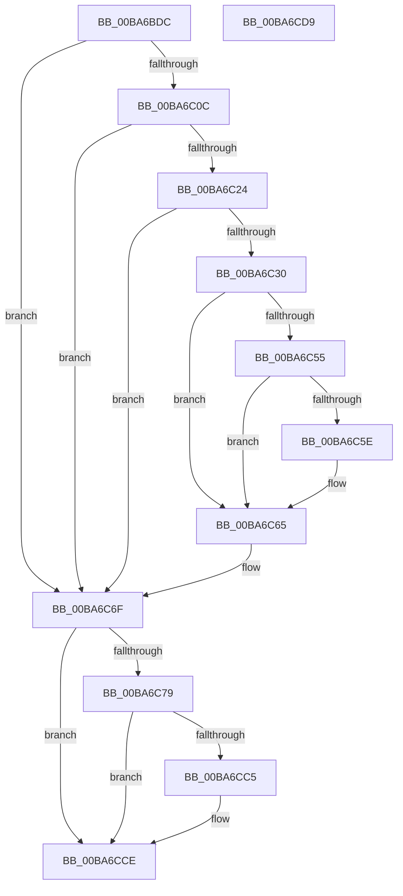

# ViFaultsInjectionNotification

- RVA: `0x00BA6BDC`–`0x00BA6CDA` (길이 `254` bytes)
- VA: `0x0000000140BA6BDC`
- 실행 섹션: `PAGEVRFY`
- PDB 이름 있음: `예`; PDB Function 태그: `아니요`
- unwind 정보 RVA: `0x00065960`
- 디코드: `65`개 명령, `254/254` bytes 표시
- 미해석 바이트: `0` (있으면 어셈블리에 `.byte`로 보존)

> 이 문서는 커널 이미지의 기계어와 PDB 기호를 분석해 생성했습니다. 4번과 5번은 함수 원형과 자료형을 바이너리 사용 방식에서 추정한 C 해석이며 원본 소스 복구 결과는 아닙니다.

## 1. Dependencies

- 직접 호출 지점: **6**; 고유 호출 대상: **6**
- 직접 호출자로 확인된 함수: **1**
- RIP 상대 이미지 참조: **7**

### Outgoing calls
- `0x00BA6C1B` → [ViTargetUpdateTreeAllowed](../B9/ViTargetUpdateTreeAllowed_function_00B9BC04.md) (function, `0x00B9BC04`)
- `0x00BA6C27` → [VfDriverIsKernelImageAddress](../BB/VfDriverIsKernelImageAddress_function_00BB7EBC.md) (function, `0x00BB7EBC`)
- `0x00BA6C37` → [VfAvlInitializeLockContext](../../text/4A/VfAvlInitializeLockContext_function_004A686C.md) (function, `0x004A686C`)
- `0x00BA6C4B` → [VfAvlLookupTreeNode](../../text/3E/VfAvlLookupTreeNode_function_003EF1B4.md) (function, `0x003EF1B4`)
- `0x00BA6C6A` → [VfAvlCleanupLockContext](../../text/3E/VfAvlCleanupLockContext_function_003EF56C.md) (function, `0x003EF56C`)
- `0x00BA6CBB` → [RtlCaptureStackBackTrace](../../text/2F/RtlCaptureStackBackTrace_function_002F9FF0.md) (function, `0x002F9FF0`)

### Direct callers
- [VfFaultsInjectResourceFailure](VfFaultsInjectResourceFailure_function_00BA6558.md) at `0x00BA65F4`

### Static image references
- `0x00BA6BE6` → RVA `0x00F04A4C` (`.data`; read)
- `0x00BA6BF5` → RVA `0x00F04A20` (`.data`; read)
- `0x00BA6BFF` → RVA `0x00F04A4C` (`.data`; write)
- `0x00BA6C44` → RVA `0x00F049A0` (`.data`; read)
- `0x00BA6C6F` → RVA `0x00FFDB18` (`PAGEVRFD`; read)
- `0x00BA6C7B` → RVA `0x00FFDD08` (`PAGEVRFD`; read/write)
- `0x00BA6C83` → RVA `0x00FF4020` (`PAGEVRFD`; read)

## 2. Other-region calls and transfers

- 다른 실행 섹션으로 향하는 call: **4**
  - `0x00BA6C37` → [VfAvlInitializeLockContext](../../text/4A/VfAvlInitializeLockContext_function_004A686C.md) (`PAGEVRFY` → `.text`)
  - `0x00BA6C4B` → [VfAvlLookupTreeNode](../../text/3E/VfAvlLookupTreeNode_function_003EF1B4.md) (`PAGEVRFY` → `.text`)
  - `0x00BA6C6A` → [VfAvlCleanupLockContext](../../text/3E/VfAvlCleanupLockContext_function_003EF56C.md) (`PAGEVRFY` → `.text`)
  - `0x00BA6CBB` → [RtlCaptureStackBackTrace](../../text/2F/RtlCaptureStackBackTrace_function_002F9FF0.md) (`PAGEVRFY` → `.text`)
- 별도 외부 분기/꼬리 이동을 확인하지 못했습니다.

## 3. Assembly (complete function range)

```asm
00BA6BDC  48 89 5C 24 08                  mov qword ptr [rsp + 8], rbx
00BA6BE1  57                              push rdi
00BA6BE2  48 83 EC 40                     sub rsp, 0x40
00BA6BE6  8B 05 60 DE 35 00               mov eax, dword ptr [rip + 0x35de60]
00BA6BEC  BB 01 00 00 00                  mov ebx, 1
00BA6BF1  03 C3                           add eax, ebx
00BA6BF3  8B F9                           mov edi, ecx
00BA6BF5  F7 05 21 DE 35 00 00 10 00 00   test dword ptr [rip + 0x35de21], 0x1000
00BA6BFF  89 05 47 DE 35 00               mov dword ptr [rip + 0x35de47], eax
00BA6C05  4C 8B 44 24 48                  mov r8, qword ptr [rsp + 0x48]
00BA6C0A  74 63                           je 0x140ba6c6f
00BA6C0C  33 C0                           xor eax, eax
00BA6C0E  0F 57 C0                        xorps xmm0, xmm0
00BA6C11  0F 11 44 24 20                  movups xmmword ptr [rsp + 0x20], xmm0
00BA6C16  48 89 44 24 30                  mov qword ptr [rsp + 0x30], rax
00BA6C1B  E8 E4 4F FF FF                  call 0x140b9bc04
00BA6C20  85 C0                           test eax, eax
00BA6C22  74 4B                           je 0x140ba6c6f
00BA6C24  49 8B C8                        mov rcx, r8
00BA6C27  E8 90 12 01 00                  call 0x140bb7ebc
00BA6C2C  85 C0                           test eax, eax
00BA6C2E  75 3F                           jne 0x140ba6c6f
00BA6C30  8B D3                           mov edx, ebx
00BA6C32  48 8D 4C 24 20                  lea rcx, [rsp + 0x20]
00BA6C37  E8 30 FC 8F FF                  call 0x1404a686c
00BA6C3C  44 8B CB                        mov r9d, ebx
00BA6C3F  48 8D 54 24 20                  lea rdx, [rsp + 0x20]
00BA6C44  48 8D 0D 55 DD 35 00            lea rcx, [rip + 0x35dd55]
00BA6C4B  E8 64 85 84 FF                  call 0x1403ef1b4
00BA6C50  48 85 C0                        test rax, rax
00BA6C53  74 10                           je 0x140ba6c65
00BA6C55  48 8B 40 40                     mov rax, qword ptr [rax + 0x40]
00BA6C59  48 85 C0                        test rax, rax
00BA6C5C  74 07                           je 0x140ba6c65
00BA6C5E  F0 01 98 B4 00 00 00            lock add dword ptr [rax + 0xb4], ebx
00BA6C65  48 8D 4C 24 20                  lea rcx, [rsp + 0x20]
00BA6C6A  E8 FD 88 84 FF                  call 0x1403ef56c
00BA6C6F  48 83 3D A1 6E 45 00 00         cmp qword ptr [rip + 0x456ea1], 0
00BA6C77  74 55                           je 0x140ba6cce
00BA6C79  8B C3                           mov eax, ebx
00BA6C7B  F0 0F C1 05 85 70 45 00         lock xadd dword ptr [rip + 0x457085], eax
00BA6C83  8B 0D 97 D3 44 00               mov ecx, dword ptr [rip + 0x44d397]
00BA6C89  03 C3                           add eax, ebx
00BA6C8B  FF C9                           dec ecx
00BA6C8D  45 33 C9                        xor r9d, r9d
00BA6C90  48 23 C8                        and rcx, rax
00BA6C93  48 8B 05 7E 6E 45 00            mov rax, qword ptr [rip + 0x456e7e]
00BA6C9A  48 8D 0C C9                     lea rcx, [rcx + rcx*8]
00BA6C9E  48 8D 1C C8                     lea rbx, [rax + rcx*8]
00BA6CA2  65 48 8B 04 25 88 01 00 00      mov rax, qword ptr gs:[0x188]
00BA6CAB  8D 4F 01                        lea ecx, [rdi + 1]
00BA6CAE  48 89 03                        mov qword ptr [rbx], rax
00BA6CB1  41 8D 79 08                     lea edi, [r9 + 8]
00BA6CB5  8B D7                           mov edx, edi
00BA6CB7  4C 8D 43 08                     lea r8, [rbx + 8]
00BA6CBB  E8 30 33 75 FF                  call 0x1402f9ff0
00BA6CC0  66 3B C7                        cmp ax, di
00BA6CC3  73 09                           jae 0x140ba6cce
00BA6CC5  0F B7 C0                        movzx eax, ax
00BA6CC8  48 83 64 C3 08 00               and qword ptr [rbx + rax*8 + 8], 0
00BA6CCE  48 8B 5C 24 50                  mov rbx, qword ptr [rsp + 0x50]
00BA6CD3  48 83 C4 40                     add rsp, 0x40
00BA6CD7  5F                              pop rdi
00BA6CD8  C3                              ret
00BA6CD9  CC                              int3
```

## 4. C-style interpretation (structured pseudocode)

```c
__int64 __fastcall ViFaultsInjectionNotification(int a1)
{
    __int64 result;
    __int64 v_rsp;
    unsigned __int64 v_stack_m18;
    unsigned __int64 v_stack_m28;
    unsigned __int64 v_stack_p0;
    unsigned __int64 v_stack_p8;

    v_stack_p8 = v_rbx;
    v_rsp = (v_rsp) - (64);
    result = (unsigned int)(((unsigned int)(*(unsigned int *)(v_rip + 3530336))) + (1));
    *(unsigned int *)(v_rip + 3530311) = (unsigned int)(result);
    if (((*(unsigned int *)(v_rip + 3530273)) & (0x1000ULL)) == 0) goto loc_00BA6C6F;
    result = 0;
    v_stack_m28 = v_xmm0;
    v_stack_m18 = 0;
    result = ViTargetUpdateTreeAllowed(a1, a2, v_stack_p0, a4);
    if ((unsigned int)(result) == 0) goto loc_00BA6C6F;
    result = VfDriverIsKernelImageAddress(v_stack_p0, a2, v_stack_p0, a4);
    if ((unsigned int)(result) != 0) goto loc_00BA6C6F;
    result = VfAvlInitializeLockContext(v_stack_m28, 1, v_stack_p0, a4);
    result = VfAvlLookupTreeNode(v_rip + 3530069, v_stack_m28, v_stack_p0, 1);
    if (result == 0) goto loc_00BA6C65;
    if (*(unsigned __int64 *)(result + 64) != 0) {
    }
    result = VfAvlCleanupLockContext(v_stack_m28, v_stack_m28, v_stack_p0, 1);
loc_00BA6C6F:
    if ((*(unsigned __int64 *)(v_rip + 4550305)) == 0) goto loc_00BA6CCE;
    result = (unsigned int)((1) + (1));
    a1 = (unsigned int)(((unsigned int)(*(unsigned int *)(v_rip + 4510615))) - 1);
    a4 = 0;
    a1 = (a1) & (result);
    *(unsigned __int64 *)(*(unsigned __int64 *)(v_rip + 4550270) + a1 + a1 * 8 * 8) = *(unsigned __int64 *)(gs_base + (0 + 392));
    result = RtlCaptureStackBackTrace((unsigned int)(a1) + 1, (unsigned int)((unsigned int)(a4 + 8)), *(unsigned __int64 *)(v_rip + 4550270) + a1 + a1 * 8 * 8 + 8, a4);
    if (((unsigned __int16)(result)) < ((unsigned __int16)(a4 + 8))) {
        result = (unsigned __int16)(result);
    }
    v_rsp = (v_rsp) + (64);
    return result;
}
```

## 5. (Beta) C Style

```c
int64_t ViFaultsInjectionNotification(void *Arg1)
{
    uint8_t *arg1 = (uint8_t *)Arg1;

    int64_t result;
    int64_t local_rsp;
    uint64_t v_stack_m18;
    uint64_t v_stack_m28;
    uint64_t v_stack_p0;
    uint64_t v_stack_p8;

    v_stack_p8 = local_rbx;
    local_rsp = (local_rsp) - (64);
    result = (uint32_t)(((uint32_t)(*(uint32_t *)(v_rip + 0x35DE60))) + (1));
    *(uint32_t *)(v_rip + 0x35DE47) = (uint32_t)(result);
    if (((*(uint32_t *)(v_rip + 0x35DE21)) & (0x1000ULL)) == 0) goto loc_00BA6C6F;
    result = 0;
    v_stack_m28 = v_xmm0;
    v_stack_m18 = 0;
    result = ViTargetUpdateTreeAllowed(Arg1, a2, v_stack_p0, a4);
    if ((uint32_t)(result) == 0) goto loc_00BA6C6F;
    result = VfDriverIsKernelImageAddress(v_stack_p0, a2, v_stack_p0, a4);
    if ((uint32_t)(result) != 0) goto loc_00BA6C6F;
    result = VfAvlInitializeLockContext(v_stack_m28, 1, v_stack_p0, a4);
    result = VfAvlLookupTreeNode(v_rip + 3530069, v_stack_m28, v_stack_p0, 1);
    if (result == 0) goto loc_00BA6C65;
    if (*(uint64_t *)(result + 0x40) != 0) {
    }
    result = VfAvlCleanupLockContext(v_stack_m28, v_stack_m28, v_stack_p0, 1);
loc_00BA6C6F:
    if ((*(uint64_t *)(v_rip + 0x456EA1)) == 0) goto loc_00BA6CCE;
    result = (uint32_t)((1) + (1));
    Arg1 = (uint32_t)(((uint32_t)(*(uint32_t *)(v_rip + 0x44D397))) - 1);
    a4 = 0;
    Arg1 = (Arg1) & (result);
    *(uint64_t *)(*(uint64_t *)(v_rip + 0x456E7E) + arg1 + arg1 * 8 * 8) = *(uint64_t *)(gs_base + (0 + 0x188));
    result = RtlCaptureStackBackTrace((uint32_t)(Arg1) + 1, (uint32_t)((uint32_t)(a4 + 8)), *(uint64_t *)(v_rip + 0x456E7E) + Arg1 + Arg1 * 8 * 8 + 8, a4);
    if (((uint16_t)(result)) < ((uint16_t)(a4 + 8))) {
        result = (uint16_t)(result);
    }
    local_rsp = (local_rsp) + (64);
    return result;
}
```

### 관측된 메모리 오프셋

구조체 형식이 확인되지 않은 접근은 인자 기준의 오프셋으로만 기록했습니다.

| 기준 인자 | 오프셋 표현 | 폭 (bit) | 접근 |
|---|---:|---:|---|
| `Arg1` | `+ 0x1` | `32` | `R` |

## 6. Execution-region graph

[열기: 2D/3D 그래프와 함수 탐색 컨트롤 패널](../../../control-panel.html?section=pagevrfy&rva=0x00BA6BDC&view=graph)

- 2D 그래프는 위에서 아래로 흐르고, 3D 그래프는 빈 공간을 드래그해 회전합니다. Shift+드래그는 이동, 휠은 확대·축소, 함수 노드 선택은 대상 보고서 이동입니다.

### Static fallback


