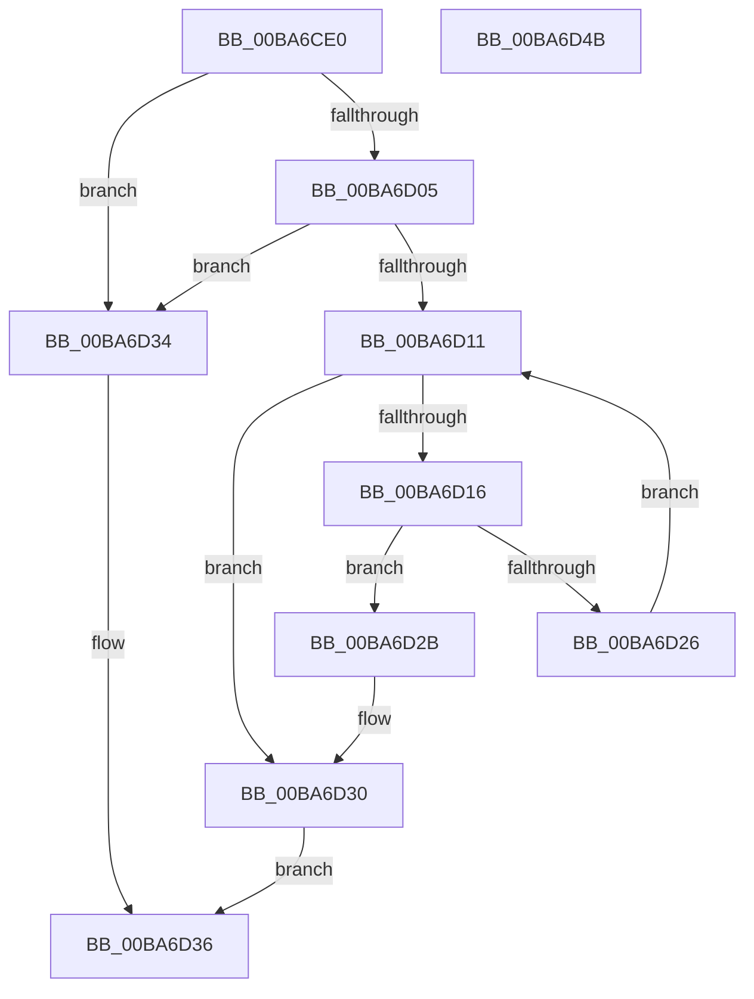

# ViFaultsIsAppTarget

- RVA: `0x00BA6CE0`–`0x00BA6D4C` (길이 `108` bytes)
- VA: `0x0000000140BA6CE0`
- 실행 섹션: `PAGEVRFY`
- PDB 이름 있음: `예`; PDB Function 태그: `아니요`
- unwind 정보 RVA: `0x0005C954`
- 디코드: `33`개 명령, `108/108` bytes 표시
- 미해석 바이트: `0` (있으면 어셈블리에 `.byte`로 보존)

> 이 문서는 커널 이미지의 기계어와 PDB 기호를 분석해 생성했습니다. 4번과 5번은 함수 원형과 자료형을 바이너리 사용 방식에서 추정한 C 해석이며 원본 소스 복구 결과는 아닙니다.

## 1. Dependencies

- 직접 호출 지점: **1**; 고유 호출 대상: **1**
- 직접 호출자로 확인된 함수: **2**
- RIP 상대 이미지 참조: **1**

### Outgoing calls
- `0x00BA6D1D` → [VfUtilEqualUnicodeString](../B9/VfUtilEqualUnicodeString_function_00B93218.md) (function, `0x00B93218`)

### Direct callers
- [ViCreateProcessCallbackInternal](ViCreateProcessCallbackInternal_function_00BA68C0.md) at `0x00BA698A`
- [ViFaultsAddAppNoDuplicates](ViFaultsAddAppNoDuplicates_function_00BA69E8.md) at `0x00BA6A71`

### Static image references
- `0x00BA6CF4` → RVA `0x00F043A0` (`.data`; read)

## 2. Other-region calls and transfers

- 다른 실행 섹션으로 향하는 call: **0**
- 별도 외부 분기/꼬리 이동을 확인하지 못했습니다.

## 3. Assembly (complete function range)

```asm
00BA6CE0  48 89 5C 24 08                  mov qword ptr [rsp + 8], rbx
00BA6CE5  48 89 6C 24 10                  mov qword ptr [rsp + 0x10], rbp
00BA6CEA  48 89 74 24 18                  mov qword ptr [rsp + 0x18], rsi
00BA6CEF  57                              push rdi
00BA6CF0  48 83 EC 20                     sub rsp, 0x20
00BA6CF4  48 8B 1D A5 D6 35 00            mov rbx, qword ptr [rip + 0x35d6a5]
00BA6CFB  33 FF                           xor edi, edi
00BA6CFD  48 8B F1                        mov rsi, rcx
00BA6D00  48 85 DB                        test rbx, rbx
00BA6D03  74 2F                           je 0x140ba6d34
00BA6D05  48 8D 2D 94 D6 35 00            lea rbp, [rip + 0x35d694]
00BA6D0C  48 3B DD                        cmp rbx, rbp
00BA6D0F  74 23                           je 0x140ba6d34
00BA6D11  48 3B DD                        cmp rbx, rbp
00BA6D14  74 1A                           je 0x140ba6d30
00BA6D16  48 8D 4B 10                     lea rcx, [rbx + 0x10]
00BA6D1A  48 8B D6                        mov rdx, rsi
00BA6D1D  E8 F6 C4 FE FF                  call 0x140b93218
00BA6D22  85 C0                           test eax, eax
00BA6D24  75 05                           jne 0x140ba6d2b
00BA6D26  48 8B 1B                        mov rbx, qword ptr [rbx]
00BA6D29  EB E6                           jmp 0x140ba6d11
00BA6D2B  BF 01 00 00 00                  mov edi, 1
00BA6D30  8B C7                           mov eax, edi
00BA6D32  EB 02                           jmp 0x140ba6d36
00BA6D34  33 C0                           xor eax, eax
00BA6D36  48 8B 5C 24 30                  mov rbx, qword ptr [rsp + 0x30]
00BA6D3B  48 8B 6C 24 38                  mov rbp, qword ptr [rsp + 0x38]
00BA6D40  48 8B 74 24 40                  mov rsi, qword ptr [rsp + 0x40]
00BA6D45  48 83 C4 20                     add rsp, 0x20
00BA6D49  5F                              pop rdi
00BA6D4A  C3                              ret
00BA6D4B  CC                              int3
```

## 4. C-style interpretation (structured pseudocode)

```c
__int64 __fastcall ViFaultsIsAppTarget(__int64 a1)
{
    __int64 result;
    __int64 v_rdi;
    __int64 v_rsp;
    unsigned __int64 v_stack_p10;
    unsigned __int64 v_stack_p18;
    unsigned __int64 v_stack_p8;

    v_stack_p8 = v_rbx;
    v_stack_p10 = v_rbp;
    v_stack_p18 = v_rsi;
    v_rsp = (v_rsp) - (32);
    v_rdi = 0;
    if (*(unsigned __int64 *)(v_rip + 3528357) == 0) goto loc_00BA6D34;
    if ((*(unsigned __int64 *)(v_rip + 3528357)) == (v_rip + 3528340)) goto loc_00BA6D34;
loc_00BA6D11:
    if ((*(unsigned __int64 *)(v_rip + 3528357)) == (v_rip + 3528340)) goto loc_00BA6D30;
    result = VfUtilEqualUnicodeString(*(unsigned __int64 *)(v_rip + 3528357) + 16, a1, a3, a4);
    if ((unsigned int)(result) != 0) goto loc_00BA6D2B;
    goto loc_00BA6D11;
loc_00BA6D2B:
loc_00BA6D30:
    goto loc_00BA6D36;
loc_00BA6D34:
    result = 0;
loc_00BA6D36:
    v_rsp = (v_rsp) + (32);
    return result;
}
```

## 5. (Beta) C Style

```c
int64_t ViFaultsIsAppTarget(int64_t Arg1)
{
    int64_t result;
    int64_t local_rdi;
    int64_t local_rsp;
    uint64_t v_stack_p10;
    uint64_t v_stack_p18;
    uint64_t v_stack_p8;

    v_stack_p8 = local_rbx;
    v_stack_p10 = local_rbp;
    v_stack_p18 = local_rsi;
    local_rsp = (local_rsp) - (32);
    local_rdi = 0;
    if (*(uint64_t *)(v_rip + 0x35D6A5) == 0) goto loc_00BA6D34;
    if ((*(uint64_t *)(v_rip + 0x35D6A5)) == (v_rip + 3528340)) goto loc_00BA6D34;
loc_00BA6D11:
    if ((*(uint64_t *)(v_rip + 0x35D6A5)) == (v_rip + 3528340)) goto loc_00BA6D30;
    result = VfUtilEqualUnicodeString(*(uint64_t *)(v_rip + 0x35D6A5) + 16, Arg1, a3, a4);
    if ((uint32_t)(result) != 0) goto loc_00BA6D2B;
    goto loc_00BA6D11;
loc_00BA6D2B:
loc_00BA6D30:
    goto loc_00BA6D36;
loc_00BA6D34:
    result = 0;
loc_00BA6D36:
    local_rsp = (local_rsp) + (32);
    return result;
}
```

## 6. Execution-region graph

[열기: 2D/3D 그래프와 함수 탐색 컨트롤 패널](../../../control-panel.html?section=pagevrfy&rva=0x00BA6CE0&view=graph)

- 2D 그래프는 위에서 아래로 흐르고, 3D 그래프는 빈 공간을 드래그해 회전합니다. Shift+드래그는 이동, 휠은 확대·축소, 함수 노드 선택은 대상 보고서 이동입니다.

### Static fallback


