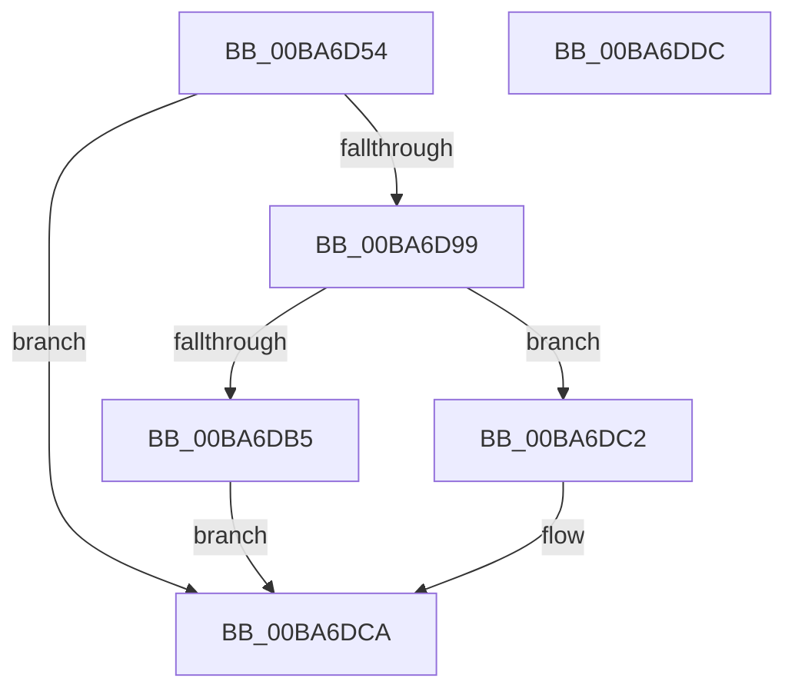

# ViFaultsIsCurrentAppTarget

- RVA: `0x00BA6D54`–`0x00BA6DDD` (길이 `137` bytes)
- VA: `0x0000000140BA6D54`
- 실행 섹션: `PAGEVRFY`
- PDB 이름 있음: `예`; PDB Function 태그: `아니요`
- unwind 정보 RVA: `0x00060BC4`
- 디코드: `32`개 명령, `137/137` bytes 표시
- 미해석 바이트: `0` (있으면 어셈블리에 `.byte`로 보존)

> 이 문서는 커널 이미지의 기계어와 PDB 기호를 분석해 생성했습니다. 4번과 5번은 함수 원형과 자료형을 바이너리 사용 방식에서 추정한 C 해석이며 원본 소스 복구 결과는 아닙니다.

## 1. Dependencies

- 직접 호출 지점: **2**; 고유 호출 대상: **2**
- 직접 호출자로 확인된 함수: **1**
- RIP 상대 이미지 참조: **4**

### Outgoing calls
- `0x00BA6D6A` → [KeAcquireSpinLockRaiseToDpc](../../text/20/KeAcquireSpinLockRaiseToDpc_function_00208470.md) (function, `0x00208470`)
- `0x00BA6D8F` → [KeReleaseSpinLock](../../text/39/KeReleaseSpinLock_function_00392BA0.md) (function, `0x00392BA0`)

### Direct callers
- [VfFaultsInjectResourceFailure](VfFaultsInjectResourceFailure_function_00BA6558.md) at `0x00BA65CF`

### Static image references
- `0x00BA6D63` → RVA `0x00F044C8` (`.data`; read)
- `0x00BA6D6F` → RVA `0x00F043A0` (`.data`; read)
- `0x00BA6DB5` → RVA `0x00FFEF94` (`PAGEVRFD`; read/write)
- `0x00BA6DC4` → RVA `0x00FFEF90` (`PAGEVRFD`; read/write)

## 2. Other-region calls and transfers

- 다른 실행 섹션으로 향하는 call: **2**
  - `0x00BA6D6A` → [KeAcquireSpinLockRaiseToDpc](../../text/20/KeAcquireSpinLockRaiseToDpc_function_00208470.md) (`PAGEVRFY` → `.text`)
  - `0x00BA6D8F` → [KeReleaseSpinLock](../../text/39/KeReleaseSpinLock_function_00392BA0.md) (`PAGEVRFY` → `.text`)
- 별도 외부 분기/꼬리 이동을 확인하지 못했습니다.

## 3. Assembly (complete function range)

```asm
00BA6D54  48 89 5C 24 08                  mov qword ptr [rsp + 8], rbx
00BA6D59  48 89 74 24 10                  mov qword ptr [rsp + 0x10], rsi
00BA6D5E  57                              push rdi
00BA6D5F  48 83 EC 20                     sub rsp, 0x20
00BA6D63  48 8D 0D 5E D7 35 00            lea rcx, [rip + 0x35d75e]
00BA6D6A  E8 01 17 66 FF                  call 0x140208470
00BA6D6F  48 8B 1D 2A D6 35 00            mov rbx, qword ptr [rip + 0x35d62a]
00BA6D76  48 8D 35 23 D6 35 00            lea rsi, [rip + 0x35d623]
00BA6D7D  33 FF                           xor edi, edi
00BA6D7F  48 8D 0D 42 D7 35 00            lea rcx, [rip + 0x35d742]
00BA6D86  48 3B DE                        cmp rbx, rsi
00BA6D89  8A D0                           mov dl, al
00BA6D8B  40 0F 94 C7                     sete dil
00BA6D8F  E8 0C BE 7E FF                  call 0x140392ba0
00BA6D94  48 3B DE                        cmp rbx, rsi
00BA6D97  74 31                           je 0x140ba6dca
00BA6D99  65 48 8B 04 25 88 01 00 00      mov rax, qword ptr gs:[0x188]
00BA6DA2  48 8B 88 B8 00 00 00            mov rcx, qword ptr [rax + 0xb8]
00BA6DA9  F7 81 F0 01 00 00 00 00 01 00   test dword ptr [rcx + 0x1f0], 0x10000
00BA6DB3  74 0D                           je 0x140ba6dc2
00BA6DB5  FF 05 D9 81 45 00               inc dword ptr [rip + 0x4581d9]
00BA6DBB  BF 01 00 00 00                  mov edi, 1
00BA6DC0  EB 08                           jmp 0x140ba6dca
00BA6DC2  33 FF                           xor edi, edi
00BA6DC4  FF 05 C6 81 45 00               inc dword ptr [rip + 0x4581c6]
00BA6DCA  48 8B 5C 24 30                  mov rbx, qword ptr [rsp + 0x30]
00BA6DCF  8B C7                           mov eax, edi
00BA6DD1  48 8B 74 24 38                  mov rsi, qword ptr [rsp + 0x38]
00BA6DD6  48 83 C4 20                     add rsp, 0x20
00BA6DDA  5F                              pop rdi
00BA6DDB  C3                              ret
00BA6DDC  CC                              int3
```

## 4. C-style interpretation (structured pseudocode)

```c
__int64 __fastcall ViFaultsIsCurrentAppTarget(void)
{
    __int64 result;
    __int64 v_rdi;
    __int64 v_rsp;
    unsigned __int64 v_stack_p10;
    unsigned __int64 v_stack_p8;

    v_stack_p8 = v_rbx;
    v_stack_p10 = v_rsi;
    v_rsp = (v_rsp) - (32);
    result = KeAcquireSpinLockRaiseToDpc(v_rip + 3528542, a2, a3, a4);
    v_rdi = 0;
    v_rdi = ((*(unsigned __int64 *)(v_rip + 3528234)) == (v_rip + 3528227)) ? 1 : 0;
    result = KeReleaseSpinLock(v_rip + 3528514, (unsigned __int8)(result), a3, a4);
    if ((*(unsigned __int64 *)(v_rip + 3528234)) == (v_rip + 3528227)) goto loc_00BA6DCA;
    if (((*(unsigned int *)(*(unsigned __int64 *)(*(unsigned __int64 *)(gs_base + (0 + 392)) + 184) + 496)) & (0x10000ULL)) == 0) goto loc_00BA6DC2;
    goto loc_00BA6DCA;
loc_00BA6DC2:
    v_rdi = 0;
loc_00BA6DCA:
    v_rsp = (v_rsp) + (32);
    return 0;
}
```

## 5. (Beta) C Style

```c
void ViFaultsIsCurrentAppTarget(void)
{
    int64_t result;
    int64_t local_rdi;
    int64_t local_rsp;
    uint64_t v_stack_p10;
    uint64_t v_stack_p8;

    v_stack_p8 = local_rbx;
    v_stack_p10 = local_rsi;
    local_rsp = (local_rsp) - (32);
    result = KeAcquireSpinLockRaiseToDpc(v_rip + 3528542, a2, a3, a4);
    local_rdi = 0;
    local_rdi = ((*(uint64_t *)(v_rip + 0x35D62A)) == (v_rip + 3528227)) ? 1 : 0;
    result = KeReleaseSpinLock(v_rip + 3528514, (uint8_t)(result), a3, a4);
    if ((*(uint64_t *)(v_rip + 0x35D62A)) == (v_rip + 3528227)) goto loc_00BA6DCA;
    if (((*(uint32_t *)(*(uint64_t *)(*(uint64_t *)(gs_base + (0 + 0x188)) + 0xB8) + 0x1F0)) & (0x10000ULL)) == 0) goto loc_00BA6DC2;
    goto loc_00BA6DCA;
loc_00BA6DC2:
    local_rdi = 0;
loc_00BA6DCA:
    local_rsp = (local_rsp) + (32);
    return 0;
}
```

## 6. Execution-region graph

[열기: 2D/3D 그래프와 함수 탐색 컨트롤 패널](../../../control-panel.html?section=pagevrfy&rva=0x00BA6D54&view=graph)

- 2D 그래프는 위에서 아래로 흐르고, 3D 그래프는 빈 공간을 드래그해 회전합니다. Shift+드래그는 이동, 휠은 확대·축소, 함수 노드 선택은 대상 보고서 이동입니다.

### Static fallback


