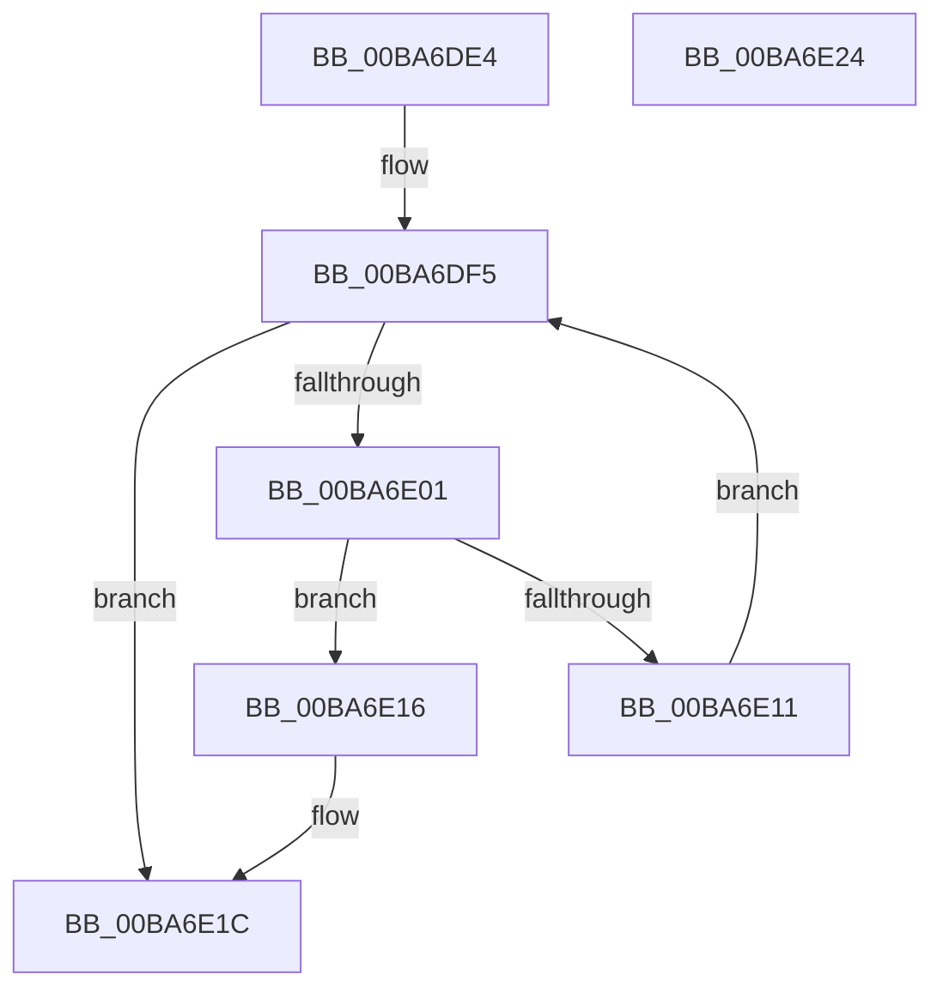

# ViFaultsIsTagPresentInList

- RVA: `0x00BA6DE4`–`0x00BA6E25` (길이 `65` bytes)
- VA: `0x0000000140BA6DE4`
- 실행 섹션: `PAGEVRFY`
- PDB 이름 있음: `예`; PDB Function 태그: `아니요`
- unwind 정보 RVA: `0x0005C788`
- 디코드: `19`개 명령, `65/65` bytes 표시
- 미해석 바이트: `0` (있으면 어셈블리에 `.byte`로 보존)

> 이 문서는 커널 이미지의 기계어와 PDB 기호를 분석해 생성했습니다. 4번과 5번은 함수 원형과 자료형을 바이너리 사용 방식에서 추정한 C 해석이며 원본 소스 복구 결과는 아닙니다.

## 1. Dependencies

- 직접 호출 지점: **1**; 고유 호출 대상: **1**
- 직접 호출자로 확인된 함수: **2**
- RIP 상대 이미지 참조: **1**

### Outgoing calls
- `0x00BA6E08` → [ExCheckSingleFilter](../../text/40/ExCheckSingleFilter_function_0040014C.md) (function, `0x0040014C`)

### Direct callers
- [VfFaultsInjectPoolAllocationFailure](VfFaultsInjectPoolAllocationFailure_function_00BA6480.md) at `0x00BA6505`
- [ViFaultsAddTagNoDuplicates](ViFaultsAddTagNoDuplicates_function_00BA6AE4.md) at `0x00BA6B62`

### Static image references
- `0x00BA6DE8` → RVA `0x00F044E0` (`.data`; read)

## 2. Other-region calls and transfers

- 다른 실행 섹션으로 향하는 call: **1**
  - `0x00BA6E08` → [ExCheckSingleFilter](../../text/40/ExCheckSingleFilter_function_0040014C.md) (`PAGEVRFY` → `.text`)
- 별도 외부 분기/꼬리 이동을 확인하지 못했습니다.

## 3. Assembly (complete function range)

```asm
00BA6DE4  48 83 EC 28                     sub rsp, 0x28
00BA6DE8  4C 8B 05 F1 D6 35 00            mov r8, qword ptr [rip + 0x35d6f1]
00BA6DEF  44 8B D1                        mov r10d, ecx
00BA6DF2  45 33 C9                        xor r9d, r9d
00BA6DF5  48 8D 05 E4 D6 35 00            lea rax, [rip + 0x35d6e4]
00BA6DFC  4C 3B C0                        cmp r8, rax
00BA6DFF  74 1B                           je 0x140ba6e1c
00BA6E01  41 8B 50 10                     mov edx, dword ptr [r8 + 0x10]
00BA6E05  41 8B CA                        mov ecx, r10d
00BA6E08  E8 3F 93 85 FF                  call 0x14040014c
00BA6E0D  85 C0                           test eax, eax
00BA6E0F  75 05                           jne 0x140ba6e16
00BA6E11  4D 8B 00                        mov r8, qword ptr [r8]
00BA6E14  EB DF                           jmp 0x140ba6df5
00BA6E16  41 B9 01 00 00 00               mov r9d, 1
00BA6E1C  41 8B C1                        mov eax, r9d
00BA6E1F  48 83 C4 28                     add rsp, 0x28
00BA6E23  C3                              ret
00BA6E24  CC                              int3
```

## 4. C-style interpretation (structured pseudocode)

```c
__int64 __fastcall ViFaultsIsTagPresentInList(int a1, __int64 a2, __int64 a3, int a4)
{
    __int64 result;
    __int64 v_rsp;

    v_rsp = (v_rsp) - (40);
    a4 = 0;
loc_00BA6DF5:
    if ((*(unsigned __int64 *)(v_rip + 3528433)) == (v_rip + 3528420)) goto loc_00BA6E1C;
    result = ExCheckSingleFilter((unsigned int)((unsigned int)((unsigned int)(a1))), (unsigned int)(*(unsigned int *)(*(unsigned __int64 *)(v_rip + 3528433) + 16)), *(unsigned __int64 *)(v_rip + 3528433), a4);
    if ((unsigned int)(result) != 0) goto loc_00BA6E16;
    goto loc_00BA6DF5;
loc_00BA6E16:
loc_00BA6E1C:
    v_rsp = (v_rsp) + (40);
    return 1;
}
```

## 5. (Beta) C Style

```c
int64_t ViFaultsIsTagPresentInList(int32_t Arg1, int64_t Arg2, int64_t Arg3, int32_t Arg4)
{
    int64_t result;
    int64_t local_rsp;

    local_rsp = (local_rsp) - (40);
    Arg4 = 0;
loc_00BA6DF5:
    if ((*(uint64_t *)(v_rip + 0x35D6F1)) == (v_rip + 3528420)) goto loc_00BA6E1C;
    result = ExCheckSingleFilter((uint32_t)((uint32_t)((uint32_t)(Arg1))), (uint32_t)(*(uint32_t *)(*(uint64_t *)(v_rip + 0x35D6F1) + 0x10)), *(uint64_t *)(v_rip + 0x35D6F1), Arg4);
    if ((uint32_t)(result) != 0) goto loc_00BA6E16;
    goto loc_00BA6DF5;
loc_00BA6E16:
loc_00BA6E1C:
    local_rsp = (local_rsp) + (40);
    return 1;
}
```

## 6. Execution-region graph

[열기: 2D/3D 그래프와 함수 탐색 컨트롤 패널](../../../control-panel.html?section=pagevrfy&rva=0x00BA6DE4&view=graph)

- 2D 그래프는 위에서 아래로 흐르고, 3D 그래프는 빈 공간을 드래그해 회전합니다. Shift+드래그는 이동, 휠은 확대·축소, 함수 노드 선택은 대상 보고서 이동입니다.

### Static fallback


