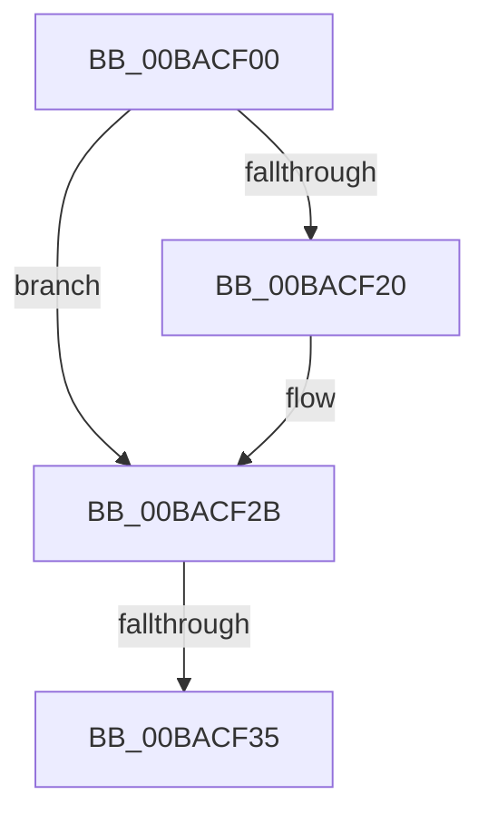

# ViFilterDeviceUsageNotificationCompletion

- RVA: `0x00BACF00`–`0x00BACF40` (길이 `64` bytes)
- VA: `0x0000000140BACF00`
- 실행 섹션: `PAGEVRFY`
- PDB 이름 있음: `예`; PDB Function 태그: `아니요`
- unwind 정보 RVA: `0x000D2830`
- 디코드: `16`개 명령, `64/64` bytes 표시
- 미해석 바이트: `0` (있으면 어셈블리에 `.byte`로 보존)

> 이 문서는 커널 이미지의 기계어와 PDB 기호를 분석해 생성했습니다. 4번과 5번은 함수 원형과 자료형을 바이너리 사용 방식에서 추정한 C 해석이며 원본 소스 복구 결과는 아닙니다.

## 1. Dependencies

- 직접 호출 지점: **0**; 고유 호출 대상: **0**
- 직접 호출자로 확인된 함수: **0**
- RIP 상대 이미지 참조: **0**

### Outgoing calls
- 직접 디코드된 call 명령이 없습니다.

### Direct callers
- 이 함수 시작 RVA로 연결되는 직접 call은 확인되지 않았습니다. 간접 호출은 완전히 역산할 수 없습니다.

### Static image references
- 디코드된 RIP-relative 메모리 참조가 없습니다.

## 2. Other-region calls and transfers

- 다른 실행 섹션으로 향하는 call: **0**
- call이 아닌 외부 분기/꼬리 이동: **1**
  - `0x00BACF33` → [sub_00BACF95](Unknown_function_00BACF95.md) (`tail-transfer`)

## 3. Assembly (complete function range)

```asm
00BACF00  48 89 5C 24 10                  mov qword ptr [rsp + 0x10], rbx
00BACF05  48 89 6C 24 18                  mov qword ptr [rsp + 0x18], rbp
00BACF0A  48 89 74 24 20                  mov qword ptr [rsp + 0x20], rsi
00BACF0F  57                              push rdi
00BACF10  48 83 EC 20                     sub rsp, 0x20
00BACF14  80 7A 41 00                     cmp byte ptr [rdx + 0x41], 0
00BACF18  48 8B EA                        mov rbp, rdx
00BACF1B  48 8B F1                        mov rsi, rcx
00BACF1E  74 0B                           je 0x140bacf2b
00BACF20  48 8B 82 B8 00 00 00            mov rax, qword ptr [rdx + 0xb8]
00BACF27  80 48 03 01                     or byte ptr [rax + 3], 1
00BACF2B  83 7A 30 00                     cmp dword ptr [rdx + 0x30], 0
00BACF2F  48 8B 79 40                     mov rdi, qword ptr [rcx + 0x40]
00BACF33  7C 60                           jl 0x140bacf95
00BACF35  48 8B 9A B8 00 00 00            mov rbx, qword ptr [rdx + 0xb8]
00BACF3C  48 8D 4F 58                     lea rcx, [rdi + 0x58]
```

## 4. C-style interpretation (structured pseudocode)

```c
__int64 __fastcall ViFilterDeviceUsageNotificationCompletion(__int64 a1, __int64 a2)
{
    __int64 result;
    __int64 v_rsp;
    unsigned __int64 v_stack_p10;
    unsigned __int64 v_stack_p18;
    unsigned __int64 v_stack_p20;

    v_stack_p10 = v_rbx;
    v_stack_p18 = v_rbp;
    v_stack_p20 = v_rsi;
    v_rsp = (v_rsp) - (32);
    if ((*(unsigned __int8 *)(a2 + 65)) != 0) {
        result = *(unsigned __int64 *)(a2 + 184);
    }
    return result;
}
```

## 5. (Beta) C Style

```c
int64_t ViFilterDeviceUsageNotificationCompletion(void *Arg1, void *Arg2)
{
    uint8_t *arg1 = (uint8_t *)Arg1;
    uint8_t *arg2 = (uint8_t *)Arg2;

    int64_t result;
    int64_t local_rsp;
    uint64_t v_stack_p10;
    uint64_t v_stack_p18;
    uint64_t v_stack_p20;

    v_stack_p10 = local_rbx;
    v_stack_p18 = local_rbp;
    v_stack_p20 = local_rsi;
    local_rsp = (local_rsp) - (32);
    if ((*(uint8_t *)(arg2 + 0x41)) != 0) {
        result = *(uint64_t *)(arg2 + 0xB8);
    }
    return result;
}
```

### 관측된 메모리 오프셋

구조체 형식이 확인되지 않은 접근은 인자 기준의 오프셋으로만 기록했습니다.

| 기준 인자 | 오프셋 표현 | 폭 (bit) | 접근 |
|---|---:|---:|---|
| `Arg1` | `+ 0x40` | `64` | `R` |
| `Arg2` | `+ 0x30` | `32` | `R` |
| `Arg2` | `+ 0x41` | `8` | `R` |
| `Arg2` | `+ 0xB8` | `64` | `R` |

## 6. Execution-region graph

[열기: 2D/3D 그래프와 함수 탐색 컨트롤 패널](../../../control-panel.html?section=pagevrfy&rva=0x00BACF00&view=graph)

- 2D 그래프는 위에서 아래로 흐르고, 3D 그래프는 빈 공간을 드래그해 회전합니다. Shift+드래그는 이동, 휠은 확대·축소, 함수 노드 선택은 대상 보고서 이동입니다.

### Static fallback


