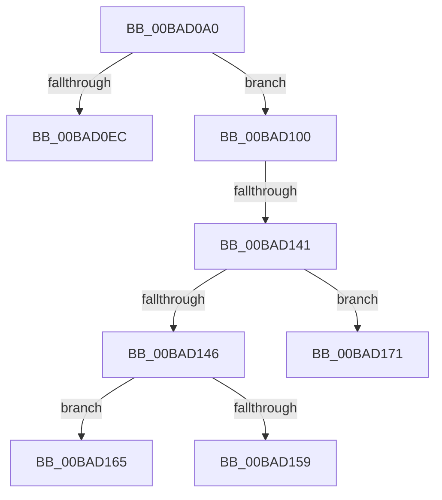

# ViFilterDispatchPnp

- RVA: `0x00BAD0A0`–`0x00BAD17D` (길이 `221` bytes)
- VA: `0x0000000140BAD0A0`
- 실행 섹션: `PAGEVRFY`
- PDB 이름 있음: `예`; PDB Function 태그: `아니요`
- unwind 정보 RVA: `0x000D286C`
- 디코드: `53`개 명령, `221/221` bytes 표시
- 미해석 바이트: `0` (있으면 어셈블리에 `.byte`로 보존)

> 이 문서는 커널 이미지의 기계어와 PDB 기호를 분석해 생성했습니다. 4번과 5번은 함수 원형과 자료형을 바이너리 사용 방식에서 추정한 C 해석이며 원본 소스 복구 결과는 아닙니다.

## 1. Dependencies

- 직접 호출 지점: **3**; 고유 호출 대상: **3**
- 직접 호출자로 확인된 함수: **0**
- RIP 상대 이미지 참조: **3**

### Outgoing calls
- `0x00BAD0BE` → [ViFilterYieldInitialization](../../text/61/ViFilterYieldInitialization_function_00616D80.md) (function, `0x00616D80`)
- `0x00BAD0E1` → [IoAcquireRemoveLockEx](../../text/43/IoAcquireRemoveLockEx_function_00433420.md) (function, `0x00433420`)
- `0x00BAD0F4` → [IofCompleteRequest](../../text/29/IofCompleteRequest_function_0029B5C0.md) (function, `0x0029B5C0`)

### Direct callers
- 이 함수 시작 RVA로 연결되는 직접 call은 확인되지 않았습니다. 간접 호출은 완전히 역산할 수 없습니다.

### Static image references
- `0x00BAD0C8` → RVA `0x00BBB240` (` ?? ::JKADOLAD::`string'`; read)
- `0x00BAD159` → RVA `0x00BAD430` (`ViFilterGenericCompletionRoutine`; read)
- `0x00BAD165` → RVA `0x00BACF00` (`ViFilterDeviceUsageNotificationCompletion`; read)

## 2. Other-region calls and transfers

- 다른 실행 섹션으로 향하는 call: **3**
  - `0x00BAD0BE` → [ViFilterYieldInitialization](../../text/61/ViFilterYieldInitialization_function_00616D80.md) (`PAGEVRFY` → `.text`)
  - `0x00BAD0E1` → [IoAcquireRemoveLockEx](../../text/43/IoAcquireRemoveLockEx_function_00433420.md) (`PAGEVRFY` → `.text`)
  - `0x00BAD0F4` → [IofCompleteRequest](../../text/29/IofCompleteRequest_function_0029B5C0.md) (`PAGEVRFY` → `.text`)
- call이 아닌 외부 분기/꼬리 이동: **4**
  - `0x00BAD0FB` → [sub_00BAD218 + 0x2A](Unknown_function_00BAD218.md) (`tail-transfer`)
  - `0x00BAD13B` → [sub_00BAD218](Unknown_function_00BAD218.md) (`tail-transfer`)
  - `0x00BAD160` → [sub_00BAD218 + 0x15](Unknown_function_00BAD218.md) (`tail-transfer`)
  - `0x00BAD16C` → [sub_00BAD218 + 0x15](Unknown_function_00BAD218.md) (`tail-transfer`)

## 3. Assembly (complete function range)

```asm
00BAD0A0  48 89 5C 24 18                  mov qword ptr [rsp + 0x18], rbx
00BAD0A5  48 89 6C 24 20                  mov qword ptr [rsp + 0x20], rbp
00BAD0AA  57                              push rdi
00BAD0AB  48 83 EC 30                     sub rsp, 0x30
00BAD0AF  48 8B E9                        mov rbp, rcx
00BAD0B2  48 8B DA                        mov rbx, rdx
00BAD0B5  48 8B 49 40                     mov rcx, qword ptr [rcx + 0x40]
00BAD0B9  48 89 4C 24 40                  mov qword ptr [rsp + 0x40], rcx
00BAD0BE  E8 BD 9C A6 FF                  call 0x140616d80
00BAD0C3  48 8B 4C 24 40                  mov rcx, qword ptr [rsp + 0x40]
00BAD0C8  4C 8D 05 71 E1 00 00            lea r8, [rip + 0xe171]
00BAD0CF  48 83 C1 20                     add rcx, 0x20
00BAD0D3  C7 44 24 20 20 00 00 00         mov dword ptr [rsp + 0x20], 0x20
00BAD0DB  41 B9 01 00 00 00               mov r9d, 1
00BAD0E1  E8 3A 63 88 FF                  call 0x140433420
00BAD0E6  8B F8                           mov edi, eax
00BAD0E8  85 C0                           test eax, eax
00BAD0EA  79 14                           jns 0x140bad100
00BAD0EC  33 D2                           xor edx, edx
00BAD0EE  89 43 30                        mov dword ptr [rbx + 0x30], eax
00BAD0F1  48 8B CB                        mov rcx, rbx
00BAD0F4  E8 C7 E4 6E FF                  call 0x14029b5c0
00BAD0F9  8B C7                           mov eax, edi
00BAD0FB  E9 42 01 00 00                  jmp 0x140bad242
00BAD100  48 8B 44 24 40                  mov rax, qword ptr [rsp + 0x40]
00BAD105  48 8B 78 08                     mov rdi, qword ptr [rax + 8]
00BAD109  48 8B 83 B8 00 00 00            mov rax, qword ptr [rbx + 0xb8]
00BAD110  0F 10 00                        movups xmm0, xmmword ptr [rax]
00BAD113  0F B6 48 01                     movzx ecx, byte ptr [rax + 1]
00BAD117  0F 11 40 B8                     movups xmmword ptr [rax - 0x48], xmm0
00BAD11B  0F 10 48 10                     movups xmm1, xmmword ptr [rax + 0x10]
00BAD11F  0F 11 48 C8                     movups xmmword ptr [rax - 0x38], xmm1
00BAD123  0F 10 40 20                     movups xmm0, xmmword ptr [rax + 0x20]
00BAD127  0F 11 40 D8                     movups xmmword ptr [rax - 0x28], xmm0
00BAD12B  F2 0F 10 48 30                  movsd xmm1, qword ptr [rax + 0x30]
00BAD130  F2 0F 11 48 E8                  movsd qword ptr [rax - 0x18], xmm1
00BAD135  C6 40 BB 00                     mov byte ptr [rax - 0x45], 0
00BAD139  84 C9                           test cl, cl
00BAD13B  0F 84 D7 00 00 00               je 0x140bad218
00BAD141  80 F9 02                        cmp cl, 2
00BAD144  74 2B                           je 0x140bad171
00BAD146  48 8B 83 B8 00 00 00            mov rax, qword ptr [rbx + 0xb8]
00BAD14D  48 8B D3                        mov rdx, rbx
00BAD150  C6 40 BB E0                     mov byte ptr [rax - 0x45], 0xe0
00BAD154  80 F9 16                        cmp cl, 0x16
00BAD157  74 0C                           je 0x140bad165
00BAD159  48 8D 0D D0 02 00 00            lea rcx, [rip + 0x2d0]
00BAD160  E9 C8 00 00 00                  jmp 0x140bad22d
00BAD165  48 8D 0D 94 FD FF FF            lea rcx, [rip - 0x26c]
00BAD16C  E9 BC 00 00 00                  jmp 0x140bad22d
00BAD171  48 8B 4C 24 40                  mov rcx, qword ptr [rsp + 0x40]
00BAD176  45 33 C0                        xor r8d, r8d
00BAD179  48 83 C1 40                     add rcx, 0x40
```

## 4. C-style interpretation (structured pseudocode)

```c
__int64 __fastcall ViFilterDispatchPnp(__int64 a1, __int64 a2)
{
    __int64 result;
    __int64 v_rsp;
    unsigned int v_stack_m18;
    unsigned __int64 v_stack_p18;
    unsigned __int64 v_stack_p20;
    unsigned __int64 v_stack_p8;

    v_stack_p18 = v_rbx;
    v_stack_p20 = v_rbp;
    v_rsp = (v_rsp) - (48);
    v_stack_p8 = *(unsigned __int64 *)(a1 + 64);
    result = ViFilterYieldInitialization(*(unsigned __int64 *)(a1 + 64), a2, a3, a4);
    a1 = (v_stack_p8) + (32);
    v_stack_m18 = 32;
    result = IoAcquireRemoveLockEx(a1, a2, v_rip + 57713, 1);
    if (!sign_flag) goto loc_00BAD100;
    a2 = 0;
    *(unsigned int *)(a2 + 48) = (unsigned int)(result);
    result = IofCompleteRequest(0, a2, v_rip + 57713, 1);
loc_00BAD100:
    *(unsigned __int64 *)(*(unsigned __int64 *)(a2 + 184) - 72) = v_xmm0;
    *(unsigned __int64 *)(*(unsigned __int64 *)(a2 + 184) - 56) = v_xmm1;
    *(unsigned __int64 *)(*(unsigned __int64 *)(a2 + 184) - 40) = v_xmm0;
    *(unsigned __int64 *)(*(unsigned __int64 *)(a2 + 184) - 24) = v_xmm1;
    *(unsigned __int8 *)(*(unsigned __int64 *)(a2 + 184) - 69) = 0;
    if (((unsigned __int8)(*(unsigned __int8 *)(*(unsigned __int64 *)(a2 + 184) + 1))) == 2) goto loc_00BAD171;
    *(unsigned __int8 *)(*(unsigned __int64 *)(a2 + 184) - 69) = 224;
    if (((unsigned __int8)(*(unsigned __int8 *)(*(unsigned __int64 *)(a2 + 184) + 1))) == 22) goto loc_00BAD165;
loc_00BAD165:
loc_00BAD171:
    a3 = 0;
    a1 = (v_stack_p8) + (64);
    return *(unsigned __int64 *)(a2 + 184);
}
```

## 5. (Beta) C Style

```c
int64_t ViFilterDispatchPnp(void *Arg1, void *Arg2)
{
    uint8_t *arg1 = (uint8_t *)Arg1;
    uint8_t *arg2 = (uint8_t *)Arg2;

    int64_t result;
    int64_t local_rsp;
    uint32_t v_stack_m18;
    uint64_t v_stack_p18;
    uint64_t v_stack_p20;
    uint64_t v_stack_p8;

    v_stack_p18 = local_rbx;
    v_stack_p20 = local_rbp;
    local_rsp = (local_rsp) - (48);
    v_stack_p8 = *(uint64_t *)(arg1 + 0x40);
    result = ViFilterYieldInitialization(*(uint64_t *)(arg1 + 0x40), Arg2, a3, a4);
    Arg1 = (v_stack_p8) + (32);
    v_stack_m18 = 32;
    result = IoAcquireRemoveLockEx(Arg1, Arg2, v_rip + 57713, 1);
    if (!sign_flag) goto loc_00BAD100;
    Arg2 = 0;
    *(uint32_t *)(arg2 + 0x30) = (uint32_t)(result);
    result = IofCompleteRequest(0, Arg2, v_rip + 57713, 1);
loc_00BAD100:
    *(uint64_t *)(*(uint64_t *)(arg2 + 0xB8) - 0x48) = v_xmm0;
    *(uint64_t *)(*(uint64_t *)(arg2 + 0xB8) - 0x38) = v_xmm1;
    *(uint64_t *)(*(uint64_t *)(arg2 + 0xB8) - 0x28) = v_xmm0;
    *(uint64_t *)(*(uint64_t *)(arg2 + 0xB8) - 0x18) = v_xmm1;
    *(uint8_t *)(*(uint64_t *)(arg2 + 0xB8) - 0x45) = 0;
    if (((uint8_t)(*(uint8_t *)(*(uint64_t *)(arg2 + 0xB8) + 0x1))) == 2) goto loc_00BAD171;
    *(uint8_t *)(*(uint64_t *)(arg2 + 0xB8) - 0x45) = 224;
    if (((uint8_t)(*(uint8_t *)(*(uint64_t *)(arg2 + 0xB8) + 0x1))) == 22) goto loc_00BAD165;
loc_00BAD165:
loc_00BAD171:
    a3 = 0;
    Arg1 = (v_stack_p8) + (64);
    return *(uint64_t *)(arg2 + 0xB8);
}
```

### 관측된 메모리 오프셋

구조체 형식이 확인되지 않은 접근은 인자 기준의 오프셋으로만 기록했습니다.

| 기준 인자 | 오프셋 표현 | 폭 (bit) | 접근 |
|---|---:|---:|---|
| `Arg1` | `+ 0x40` | `64` | `R` |
| `Arg2` | `+ 0x30` | `32` | `W` |
| `Arg2` | `+ 0xB8` | `64` | `R` |

## 6. Execution-region graph

[열기: 2D/3D 그래프와 함수 탐색 컨트롤 패널](../../../control-panel.html?section=pagevrfy&rva=0x00BAD0A0&view=graph)

- 2D 그래프는 위에서 아래로 흐르고, 3D 그래프는 빈 공간을 드래그해 회전합니다. Shift+드래그는 이동, 휠은 확대·축소, 함수 노드 선택은 대상 보고서 이동입니다.

### Static fallback


