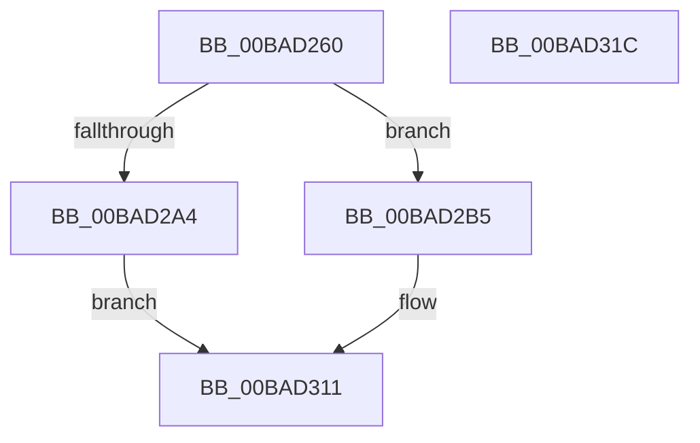

# ViFilterDispatchPower

- RVA: `0x00BAD260`–`0x00BAD31D` (길이 `189` bytes)
- VA: `0x0000000140BAD260`
- 실행 섹션: `PAGEVRFY`
- PDB 이름 있음: `예`; PDB Function 태그: `아니요`
- unwind 정보 RVA: `0x0008A658`
- 디코드: `47`개 명령, `189/189` bytes 표시
- 미해석 바이트: `0` (있으면 어셈블리에 `.byte`로 보존)

> 이 문서는 커널 이미지의 기계어와 PDB 기호를 분석해 생성했습니다. 4번과 5번은 함수 원형과 자료형을 바이너리 사용 방식에서 추정한 C 해석이며 원본 소스 복구 결과는 아닙니다.

## 1. Dependencies

- 직접 호출 지점: **4**; 고유 호출 대상: **4**
- 직접 호출자로 확인된 함수: **0**
- RIP 상대 이미지 참조: **2**

### Outgoing calls
- `0x00BAD276` → [ViFilterYieldInitialization](../../text/61/ViFilterYieldInitialization_function_00616D80.md) (function, `0x00616D80`)
- `0x00BAD299` → [IoAcquireRemoveLockEx](../../text/43/IoAcquireRemoveLockEx_function_00433420.md) (function, `0x00433420`)
- `0x00BAD2AC` → [IofCompleteRequest](../../text/29/IofCompleteRequest_function_0029B5C0.md) (function, `0x0029B5C0`)
- `0x00BAD30C` → [IoCallDriver](../../text/49/IoCallDriver_function_0049FE30.md) (function, `0x0049FE30`)

### Direct callers
- 이 함수 시작 RVA로 연결되는 직접 call은 확인되지 않았습니다. 간접 호출은 완전히 역산할 수 없습니다.

### Static image references
- `0x00BAD280` → RVA `0x00BBB240` (` ?? ::JKADOLAD::`string'`; read)
- `0x00BAD2BC` → RVA `0x00BAD430` (`ViFilterGenericCompletionRoutine`; read)

## 2. Other-region calls and transfers

- 다른 실행 섹션으로 향하는 call: **4**
  - `0x00BAD276` → [ViFilterYieldInitialization](../../text/61/ViFilterYieldInitialization_function_00616D80.md) (`PAGEVRFY` → `.text`)
  - `0x00BAD299` → [IoAcquireRemoveLockEx](../../text/43/IoAcquireRemoveLockEx_function_00433420.md) (`PAGEVRFY` → `.text`)
  - `0x00BAD2AC` → [IofCompleteRequest](../../text/29/IofCompleteRequest_function_0029B5C0.md) (`PAGEVRFY` → `.text`)
  - `0x00BAD30C` → [IoCallDriver](../../text/49/IoCallDriver_function_0049FE30.md) (`PAGEVRFY` → `.text`)
- 별도 외부 분기/꼬리 이동을 확인하지 못했습니다.

## 3. Assembly (complete function range)

```asm
00BAD260  48 89 5C 24 10                  mov qword ptr [rsp + 0x10], rbx
00BAD265  57                              push rdi
00BAD266  48 83 EC 30                     sub rsp, 0x30
00BAD26A  48 8B 49 40                     mov rcx, qword ptr [rcx + 0x40]
00BAD26E  48 8B DA                        mov rbx, rdx
00BAD271  48 89 4C 24 40                  mov qword ptr [rsp + 0x40], rcx
00BAD276  E8 05 9B A6 FF                  call 0x140616d80
00BAD27B  48 8B 4C 24 40                  mov rcx, qword ptr [rsp + 0x40]
00BAD280  4C 8D 05 B9 DF 00 00            lea r8, [rip + 0xdfb9]
00BAD287  48 83 C1 20                     add rcx, 0x20
00BAD28B  C7 44 24 20 20 00 00 00         mov dword ptr [rsp + 0x20], 0x20
00BAD293  41 B9 01 00 00 00               mov r9d, 1
00BAD299  E8 82 61 88 FF                  call 0x140433420
00BAD29E  8B F8                           mov edi, eax
00BAD2A0  85 C0                           test eax, eax
00BAD2A2  79 11                           jns 0x140bad2b5
00BAD2A4  33 D2                           xor edx, edx
00BAD2A6  89 43 30                        mov dword ptr [rbx + 0x30], eax
00BAD2A9  48 8B CB                        mov rcx, rbx
00BAD2AC  E8 0F E3 6E FF                  call 0x14029b5c0
00BAD2B1  8B C7                           mov eax, edi
00BAD2B3  EB 5C                           jmp 0x140bad311
00BAD2B5  48 8B 83 B8 00 00 00            mov rax, qword ptr [rbx + 0xb8]
00BAD2BC  48 8D 0D 6D 01 00 00            lea rcx, [rip + 0x16d]
00BAD2C3  48 8B D3                        mov rdx, rbx
00BAD2C6  0F 10 00                        movups xmm0, xmmword ptr [rax]
00BAD2C9  0F 11 40 B8                     movups xmmword ptr [rax - 0x48], xmm0
00BAD2CD  0F 10 48 10                     movups xmm1, xmmword ptr [rax + 0x10]
00BAD2D1  0F 11 48 C8                     movups xmmword ptr [rax - 0x38], xmm1
00BAD2D5  0F 10 40 20                     movups xmm0, xmmword ptr [rax + 0x20]
00BAD2D9  0F 11 40 D8                     movups xmmword ptr [rax - 0x28], xmm0
00BAD2DD  F2 0F 10 48 30                  movsd xmm1, qword ptr [rax + 0x30]
00BAD2E2  F2 0F 11 48 E8                  movsd qword ptr [rax - 0x18], xmm1
00BAD2E7  C6 40 BB 00                     mov byte ptr [rax - 0x45], 0
00BAD2EB  48 8B 83 B8 00 00 00            mov rax, qword ptr [rbx + 0xb8]
00BAD2F2  48 89 48 F0                     mov qword ptr [rax - 0x10], rcx
00BAD2F6  48 8D 4C 24 40                  lea rcx, [rsp + 0x40]
00BAD2FB  48 89 48 F8                     mov qword ptr [rax - 8], rcx
00BAD2FF  C6 40 BB E0                     mov byte ptr [rax - 0x45], 0xe0
00BAD303  48 8B 4C 24 40                  mov rcx, qword ptr [rsp + 0x40]
00BAD308  48 8B 49 08                     mov rcx, qword ptr [rcx + 8]
00BAD30C  E8 1F 2B 8F FF                  call 0x14049fe30
00BAD311  48 8B 5C 24 48                  mov rbx, qword ptr [rsp + 0x48]
00BAD316  48 83 C4 30                     add rsp, 0x30
00BAD31A  5F                              pop rdi
00BAD31B  C3                              ret
00BAD31C  CC                              int3
```

## 4. C-style interpretation (structured pseudocode)

```c
__int64 __fastcall ViFilterDispatchPower(__int64 a1, __int64 a2)
{
    __int64 result;
    __int64 v_rsp;
    unsigned int v_stack_m18;
    unsigned __int64 v_stack_p10;
    unsigned __int64 v_stack_p8;

    v_stack_p10 = v_rbx;
    v_rsp = (v_rsp) - (48);
    v_stack_p8 = *(unsigned __int64 *)(a1 + 64);
    result = ViFilterYieldInitialization(*(unsigned __int64 *)(a1 + 64), a2, a3, a4);
    a1 = (v_stack_p8) + (32);
    v_stack_m18 = 32;
    result = IoAcquireRemoveLockEx(a1, a2, v_rip + 57273, 1);
    if (!sign_flag) goto loc_00BAD2B5;
    a2 = 0;
    *(unsigned int *)(a2 + 48) = (unsigned int)(result);
    result = IofCompleteRequest(0, a2, v_rip + 57273, 1);
    goto loc_00BAD311;
loc_00BAD2B5:
    *(unsigned __int64 *)(*(unsigned __int64 *)(a2 + 184) - 72) = v_xmm0;
    *(unsigned __int64 *)(*(unsigned __int64 *)(a2 + 184) - 56) = v_xmm1;
    *(unsigned __int64 *)(*(unsigned __int64 *)(a2 + 184) - 40) = v_xmm0;
    *(unsigned __int64 *)(*(unsigned __int64 *)(a2 + 184) - 24) = v_xmm1;
    *(unsigned __int8 *)(*(unsigned __int64 *)(a2 + 184) - 69) = 0;
    *(unsigned __int64 *)(*(unsigned __int64 *)(a2 + 184) - 16) = v_rip + 365;
    *(unsigned __int64 *)(*(unsigned __int64 *)(a2 + 184) - 8) = v_stack_p8;
    *(unsigned __int8 *)(*(unsigned __int64 *)(a2 + 184) - 69) = 224;
    result = IoCallDriver(*(unsigned __int64 *)(v_stack_p8 + 8), 0, v_rip + 57273, 1);
loc_00BAD311:
    v_rsp = (v_rsp) + (48);
    return result;
}
```

## 5. (Beta) C Style

```c
int64_t ViFilterDispatchPower(void *Arg1, void *Arg2)
{
    uint8_t *arg1 = (uint8_t *)Arg1;
    uint8_t *arg2 = (uint8_t *)Arg2;

    int64_t result;
    int64_t local_rsp;
    uint32_t v_stack_m18;
    uint64_t v_stack_p10;
    uint64_t v_stack_p8;

    v_stack_p10 = local_rbx;
    local_rsp = (local_rsp) - (48);
    v_stack_p8 = *(uint64_t *)(arg1 + 0x40);
    result = ViFilterYieldInitialization(*(uint64_t *)(arg1 + 0x40), Arg2, a3, a4);
    Arg1 = (v_stack_p8) + (32);
    v_stack_m18 = 32;
    result = IoAcquireRemoveLockEx(Arg1, Arg2, v_rip + 57273, 1);
    if (!sign_flag) goto loc_00BAD2B5;
    Arg2 = 0;
    *(uint32_t *)(arg2 + 0x30) = (uint32_t)(result);
    result = IofCompleteRequest(0, Arg2, v_rip + 57273, 1);
    goto loc_00BAD311;
loc_00BAD2B5:
    *(uint64_t *)(*(uint64_t *)(arg2 + 0xB8) - 0x48) = v_xmm0;
    *(uint64_t *)(*(uint64_t *)(arg2 + 0xB8) - 0x38) = v_xmm1;
    *(uint64_t *)(*(uint64_t *)(arg2 + 0xB8) - 0x28) = v_xmm0;
    *(uint64_t *)(*(uint64_t *)(arg2 + 0xB8) - 0x18) = v_xmm1;
    *(uint8_t *)(*(uint64_t *)(arg2 + 0xB8) - 0x45) = 0;
    *(uint64_t *)(*(uint64_t *)(arg2 + 0xB8) - 0x10) = v_rip + 365;
    *(uint64_t *)(*(uint64_t *)(arg2 + 0xB8) - 0x8) = v_stack_p8;
    *(uint8_t *)(*(uint64_t *)(arg2 + 0xB8) - 0x45) = 224;
    result = IoCallDriver(*(uint64_t *)(v_stack_p8 + 0x8), 0, v_rip + 57273, 1);
loc_00BAD311:
    local_rsp = (local_rsp) + (48);
    return result;
}
```

### 관측된 메모리 오프셋

구조체 형식이 확인되지 않은 접근은 인자 기준의 오프셋으로만 기록했습니다.

| 기준 인자 | 오프셋 표현 | 폭 (bit) | 접근 |
|---|---:|---:|---|
| `Arg1` | `+ 0x40` | `64` | `R` |
| `Arg2` | `+ 0x30` | `32` | `W` |
| `Arg2` | `+ 0xB8` | `64` | `R` |

## 6. Execution-region graph

[열기: 2D/3D 그래프와 함수 탐색 컨트롤 패널](../../../control-panel.html?section=pagevrfy&rva=0x00BAD260&view=graph)

- 2D 그래프는 위에서 아래로 흐르고, 3D 그래프는 빈 공간을 드래그해 회전합니다. Shift+드래그는 이동, 휠은 확대·축소, 함수 노드 선택은 대상 보고서 이동입니다.

### Static fallback


