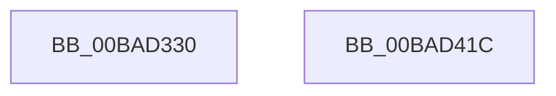

# ViFilterDriverEntry

- RVA: `0x00BAD330`–`0x00BAD41D` (길이 `237` bytes)
- VA: `0x0000000140BAD330`
- 실행 섹션: `PAGEVRFY`
- PDB 이름 있음: `예`; PDB Function 태그: `아니요`
- unwind 정보 RVA: `0x000DB714`
- 디코드: `38`개 명령, `237/237` bytes 표시
- 미해석 바이트: `0` (있으면 어셈블리에 `.byte`로 보존)

> 이 문서는 커널 이미지의 기계어와 PDB 기호를 분석해 생성했습니다. 4번과 5번은 함수 원형과 자료형을 바이너리 사용 방식에서 추정한 C 해석이며 원본 소스 복구 결과는 아닙니다.

## 1. Dependencies

- 직접 호출 지점: **0**; 고유 호출 대상: **0**
- 직접 호출자로 확인된 함수: **0**
- RIP 상대 이미지 참조: **5**

### Outgoing calls
- 직접 디코드된 call 명령이 없습니다.

### Direct callers
- 이 함수 시작 RVA로 연결되는 직접 call은 확인되지 않았습니다. 간접 호출은 완전히 역산할 수 없습니다.

### Static image references
- `0x00BAD334` → RVA `0x00BACEF0` (`ViFilterAddDevice`; read)
- `0x00BAD33B` → RVA `0x00F048D8` (`.data`; write)
- `0x00BAD346` → RVA `0x00BACFD0` (`ViFilterDispatchGeneric`; read)
- `0x00BAD3FD` → RVA `0x00BAD0A0` (`ViFilterDispatchPnp`; read)
- `0x00BAD40B` → RVA `0x00BAD260` (`ViFilterDispatchPower`; read)

## 2. Other-region calls and transfers

- 다른 실행 섹션으로 향하는 call: **0**
- 별도 외부 분기/꼬리 이동을 확인하지 못했습니다.

## 3. Assembly (complete function range)

```asm
00BAD330  48 8B 41 30                     mov rax, qword ptr [rcx + 0x30]
00BAD334  48 8D 15 B5 FB FF FF            lea rdx, [rip - 0x44b]
00BAD33B  48 89 0D 96 75 35 00            mov qword ptr [rip + 0x357596], rcx
00BAD342  48 89 50 08                     mov qword ptr [rax + 8], rdx
00BAD346  48 8D 05 83 FC FF FF            lea rax, [rip - 0x37d]
00BAD34D  48 89 41 70                     mov qword ptr [rcx + 0x70], rax
00BAD351  48 89 41 78                     mov qword ptr [rcx + 0x78], rax
00BAD355  48 89 81 80 00 00 00            mov qword ptr [rcx + 0x80], rax
00BAD35C  48 89 81 88 00 00 00            mov qword ptr [rcx + 0x88], rax
00BAD363  48 89 81 90 00 00 00            mov qword ptr [rcx + 0x90], rax
00BAD36A  48 89 81 98 00 00 00            mov qword ptr [rcx + 0x98], rax
00BAD371  48 89 81 A0 00 00 00            mov qword ptr [rcx + 0xa0], rax
00BAD378  48 89 81 A8 00 00 00            mov qword ptr [rcx + 0xa8], rax
00BAD37F  48 89 81 B0 00 00 00            mov qword ptr [rcx + 0xb0], rax
00BAD386  48 89 81 B8 00 00 00            mov qword ptr [rcx + 0xb8], rax
00BAD38D  48 89 81 C0 00 00 00            mov qword ptr [rcx + 0xc0], rax
00BAD394  48 89 81 C8 00 00 00            mov qword ptr [rcx + 0xc8], rax
00BAD39B  48 89 81 D0 00 00 00            mov qword ptr [rcx + 0xd0], rax
00BAD3A2  48 89 81 D8 00 00 00            mov qword ptr [rcx + 0xd8], rax
00BAD3A9  48 89 81 E0 00 00 00            mov qword ptr [rcx + 0xe0], rax
00BAD3B0  48 89 81 E8 00 00 00            mov qword ptr [rcx + 0xe8], rax
00BAD3B7  48 89 81 F0 00 00 00            mov qword ptr [rcx + 0xf0], rax
00BAD3BE  48 89 81 F8 00 00 00            mov qword ptr [rcx + 0xf8], rax
00BAD3C5  48 89 81 00 01 00 00            mov qword ptr [rcx + 0x100], rax
00BAD3CC  48 89 81 08 01 00 00            mov qword ptr [rcx + 0x108], rax
00BAD3D3  48 89 81 10 01 00 00            mov qword ptr [rcx + 0x110], rax
00BAD3DA  48 89 81 18 01 00 00            mov qword ptr [rcx + 0x118], rax
00BAD3E1  48 89 81 28 01 00 00            mov qword ptr [rcx + 0x128], rax
00BAD3E8  48 89 81 30 01 00 00            mov qword ptr [rcx + 0x130], rax
00BAD3EF  48 89 81 38 01 00 00            mov qword ptr [rcx + 0x138], rax
00BAD3F6  48 89 81 40 01 00 00            mov qword ptr [rcx + 0x140], rax
00BAD3FD  48 8D 05 9C FC FF FF            lea rax, [rip - 0x364]
00BAD404  48 89 81 48 01 00 00            mov qword ptr [rcx + 0x148], rax
00BAD40B  48 8D 05 4E FE FF FF            lea rax, [rip - 0x1b2]
00BAD412  48 89 81 20 01 00 00            mov qword ptr [rcx + 0x120], rax
00BAD419  33 C0                           xor eax, eax
00BAD41B  C3                              ret
00BAD41C  CC                              int3
```

## 4. C-style interpretation (structured pseudocode)

```c
__int64 __fastcall ViFilterDriverEntry(__int64 a1)
{
    __int64 result;

    *(unsigned __int64 *)(v_rip + 3503510) = a1;
    *(unsigned __int64 *)(*(unsigned __int64 *)(a1 + 48) + 8) = v_rip - 1099;
    *(unsigned __int64 *)(a1 + 112) = v_rip - 893;
    *(unsigned __int64 *)(a1 + 120) = v_rip - 893;
    *(unsigned __int64 *)(a1 + 128) = v_rip - 893;
    *(unsigned __int64 *)(a1 + 136) = v_rip - 893;
    *(unsigned __int64 *)(a1 + 144) = v_rip - 893;
    *(unsigned __int64 *)(a1 + 152) = v_rip - 893;
    *(unsigned __int64 *)(a1 + 160) = v_rip - 893;
    *(unsigned __int64 *)(a1 + 168) = v_rip - 893;
    *(unsigned __int64 *)(a1 + 176) = v_rip - 893;
    *(unsigned __int64 *)(a1 + 184) = v_rip - 893;
    *(unsigned __int64 *)(a1 + 192) = v_rip - 893;
    *(unsigned __int64 *)(a1 + 200) = v_rip - 893;
    *(unsigned __int64 *)(a1 + 208) = v_rip - 893;
    *(unsigned __int64 *)(a1 + 216) = v_rip - 893;
    *(unsigned __int64 *)(a1 + 224) = v_rip - 893;
    *(unsigned __int64 *)(a1 + 232) = v_rip - 893;
    *(unsigned __int64 *)(a1 + 240) = v_rip - 893;
    *(unsigned __int64 *)(a1 + 248) = v_rip - 893;
    *(unsigned __int64 *)(a1 + 256) = v_rip - 893;
    *(unsigned __int64 *)(a1 + 264) = v_rip - 893;
    *(unsigned __int64 *)(a1 + 272) = v_rip - 893;
    *(unsigned __int64 *)(a1 + 280) = v_rip - 893;
    *(unsigned __int64 *)(a1 + 296) = v_rip - 893;
    *(unsigned __int64 *)(a1 + 304) = v_rip - 893;
    *(unsigned __int64 *)(a1 + 312) = v_rip - 893;
    *(unsigned __int64 *)(a1 + 320) = v_rip - 893;
    *(unsigned __int64 *)(a1 + 328) = v_rip - 868;
    *(unsigned __int64 *)(a1 + 288) = v_rip - 434;
    result = 0;
    return result;
}
```

## 5. (Beta) C Style

```c
int64_t ViFilterDriverEntry(void *Arg1)
{
    uint8_t *arg1 = (uint8_t *)Arg1;

    int64_t result;

    *(void **)(v_rip + 0x357596) = Arg1;
    *(uint64_t *)(*(uint64_t *)(arg1 + 0x30) + 0x8) = v_rip - 1099;
    *(uint64_t *)(arg1 + 0x70) = v_rip - 893;
    *(uint64_t *)(arg1 + 0x78) = v_rip - 893;
    *(uint64_t *)(arg1 + 0x80) = v_rip - 893;
    *(uint64_t *)(arg1 + 0x88) = v_rip - 893;
    *(uint64_t *)(arg1 + 0x90) = v_rip - 893;
    *(uint64_t *)(arg1 + 0x98) = v_rip - 893;
    *(uint64_t *)(arg1 + 0xA0) = v_rip - 893;
    *(uint64_t *)(arg1 + 0xA8) = v_rip - 893;
    *(uint64_t *)(arg1 + 0xB0) = v_rip - 893;
    *(uint64_t *)(arg1 + 0xB8) = v_rip - 893;
    *(uint64_t *)(arg1 + 0xC0) = v_rip - 893;
    *(uint64_t *)(arg1 + 0xC8) = v_rip - 893;
    *(uint64_t *)(arg1 + 0xD0) = v_rip - 893;
    *(uint64_t *)(arg1 + 0xD8) = v_rip - 893;
    *(uint64_t *)(arg1 + 0xE0) = v_rip - 893;
    *(uint64_t *)(arg1 + 0xE8) = v_rip - 893;
    *(uint64_t *)(arg1 + 0xF0) = v_rip - 893;
    *(uint64_t *)(arg1 + 0xF8) = v_rip - 893;
    *(uint64_t *)(arg1 + 0x100) = v_rip - 893;
    *(uint64_t *)(arg1 + 0x108) = v_rip - 893;
    *(uint64_t *)(arg1 + 0x110) = v_rip - 893;
    *(uint64_t *)(arg1 + 0x118) = v_rip - 893;
    *(uint64_t *)(arg1 + 0x128) = v_rip - 893;
    *(uint64_t *)(arg1 + 0x130) = v_rip - 893;
    *(uint64_t *)(arg1 + 0x138) = v_rip - 893;
    *(uint64_t *)(arg1 + 0x140) = v_rip - 893;
    *(uint64_t *)(arg1 + 0x148) = v_rip - 868;
    *(uint64_t *)(arg1 + 0x120) = v_rip - 434;
    result = 0;
    return result;
}
```

### 관측된 메모리 오프셋

구조체 형식이 확인되지 않은 접근은 인자 기준의 오프셋으로만 기록했습니다.

| 기준 인자 | 오프셋 표현 | 폭 (bit) | 접근 |
|---|---:|---:|---|
| `Arg1` | `+ 0x30` | `64` | `R` |
| `Arg1` | `+ 0x70` | `64` | `W` |
| `Arg1` | `+ 0x78` | `64` | `W` |
| `Arg1` | `+ 0x80` | `64` | `W` |
| `Arg1` | `+ 0x88` | `64` | `W` |
| `Arg1` | `+ 0x90` | `64` | `W` |
| `Arg1` | `+ 0x98` | `64` | `W` |
| `Arg1` | `+ 0xA0` | `64` | `W` |
| `Arg1` | `+ 0xA8` | `64` | `W` |
| `Arg1` | `+ 0xB0` | `64` | `W` |
| `Arg1` | `+ 0xB8` | `64` | `W` |
| `Arg1` | `+ 0xC0` | `64` | `W` |
| `Arg1` | `+ 0xC8` | `64` | `W` |
| `Arg1` | `+ 0xD0` | `64` | `W` |
| `Arg1` | `+ 0xD8` | `64` | `W` |
| `Arg1` | `+ 0xE0` | `64` | `W` |
| `Arg1` | `+ 0xE8` | `64` | `W` |
| `Arg1` | `+ 0xF0` | `64` | `W` |
| `Arg1` | `+ 0xF8` | `64` | `W` |
| `Arg1` | `+ 0x100` | `64` | `W` |
| `Arg1` | `+ 0x108` | `64` | `W` |
| `Arg1` | `+ 0x110` | `64` | `W` |
| `Arg1` | `+ 0x118` | `64` | `W` |
| `Arg1` | `+ 0x120` | `64` | `W` |
| `Arg1` | `+ 0x128` | `64` | `W` |
| `Arg1` | `+ 0x130` | `64` | `W` |
| `Arg1` | `+ 0x138` | `64` | `W` |
| `Arg1` | `+ 0x140` | `64` | `W` |
| `Arg1` | `+ 0x148` | `64` | `W` |

## 6. Execution-region graph

[열기: 2D/3D 그래프와 함수 탐색 컨트롤 패널](../../../control-panel.html?section=pagevrfy&rva=0x00BAD330&view=graph)

- 2D 그래프는 위에서 아래로 흐르고, 3D 그래프는 빈 공간을 드래그해 회전합니다. Shift+드래그는 이동, 휠은 확대·축소, 함수 노드 선택은 대상 보고서 이동입니다.

### Static fallback


