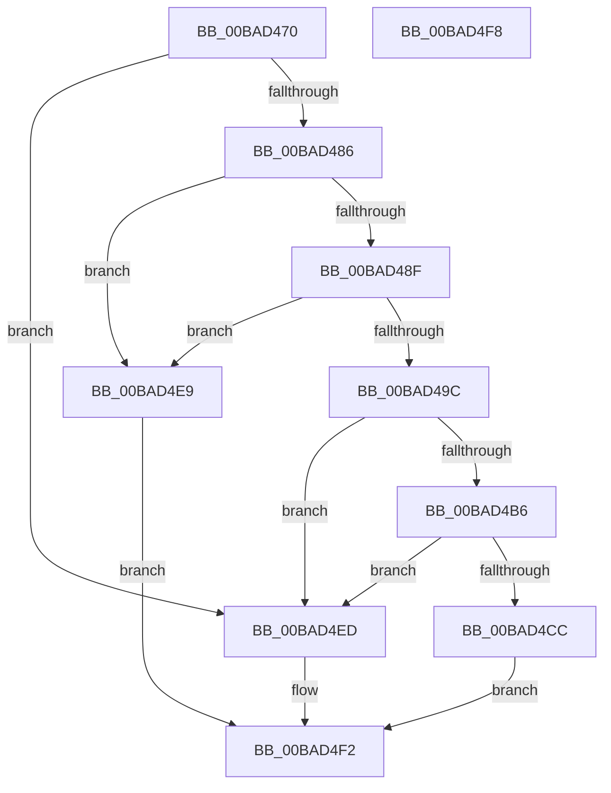

# ViFilterIsDeviceExcluded

- RVA: `0x00BAD470`–`0x00BAD4F9` (길이 `137` bytes)
- VA: `0x0000000140BAD470`
- 실행 섹션: `PAGEVRFY`
- PDB 이름 있음: `예`; PDB Function 태그: `아니요`
- unwind 정보 RVA: `0x0005CF00`
- 디코드: `42`개 명령, `137/137` bytes 표시
- 미해석 바이트: `0` (있으면 어셈블리에 `.byte`로 보존)

> 이 문서는 커널 이미지의 기계어와 PDB 기호를 분석해 생성했습니다. 4번과 5번은 함수 원형과 자료형을 바이너리 사용 방식에서 추정한 C 해석이며 원본 소스 복구 결과는 아닙니다.

## 1. Dependencies

- 직접 호출 지점: **4**; 고유 호출 대상: **2**
- 직접 호출자로 확인된 함수: **1**
- RIP 상대 이미지 참조: **4**

### Outgoing calls
- `0x00BAD486` → [HviIsAnyHypervisorPresent](../../text/4A/HviIsAnyHypervisorPresent_function_004ADC50.md) (function, `0x004ADC50`)
- `0x00BAD4AD` → [RtlEqualUnicodeString](../../page/93/RtlEqualUnicodeString_function_00932A20.md) (function, `0x00932A20`)
- `0x00BAD4C3` → [RtlEqualUnicodeString](../../page/93/RtlEqualUnicodeString_function_00932A20.md) (function, `0x00932A20`)
- `0x00BAD4D9` → [RtlEqualUnicodeString](../../page/93/RtlEqualUnicodeString_function_00932A20.md) (function, `0x00932A20`)

### Direct callers
- [VfFilterAttach](VfFilterAttach_function_00BACD80.md) at `0x00BACE06`

### Static image references
- `0x00BAD476` → RVA `0x00F048D8` (`.data`; read)
- `0x00BAD4A6` → RVA `0x00B8B130` (`VfVidName`; read)
- `0x00BAD4B9` → RVA `0x00B8B110` (`VfSynth3DvscName`; read)
- `0x00BAD4CF` → RVA `0x00B8B120` (`VfSynth3DvspName`; read)

## 2. Other-region calls and transfers

- 다른 실행 섹션으로 향하는 call: **4**
  - `0x00BAD486` → [HviIsAnyHypervisorPresent](../../text/4A/HviIsAnyHypervisorPresent_function_004ADC50.md) (`PAGEVRFY` → `.text`)
  - `0x00BAD4AD` → [RtlEqualUnicodeString](../../page/93/RtlEqualUnicodeString_function_00932A20.md) (`PAGEVRFY` → `PAGE`)
  - `0x00BAD4C3` → [RtlEqualUnicodeString](../../page/93/RtlEqualUnicodeString_function_00932A20.md) (`PAGEVRFY` → `PAGE`)
  - `0x00BAD4D9` → [RtlEqualUnicodeString](../../page/93/RtlEqualUnicodeString_function_00932A20.md) (`PAGEVRFY` → `PAGE`)
- 별도 외부 분기/꼬리 이동을 확인하지 못했습니다.

## 3. Assembly (complete function range)

```asm
00BAD470  40 53                           push rbx
00BAD472  48 83 EC 20                     sub rsp, 0x20
00BAD476  48 8B 05 5B 74 35 00            mov rax, qword ptr [rip + 0x35745b]
00BAD47D  48 8B D9                        mov rbx, rcx
00BAD480  48 39 41 08                     cmp qword ptr [rcx + 8], rax
00BAD484  74 67                           je 0x140bad4ed
00BAD486  E8 C5 07 90 FF                  call 0x1404adc50
00BAD48B  84 C0                           test al, al
00BAD48D  74 5A                           je 0x140bad4e9
00BAD48F  48 8B 43 08                     mov rax, qword ptr [rbx + 8]
00BAD493  48 8B 48 28                     mov rcx, qword ptr [rax + 0x28]
00BAD497  48 85 C9                        test rcx, rcx
00BAD49A  74 4D                           je 0x140bad4e9
00BAD49C  48 8D 59 58                     lea rbx, [rcx + 0x58]
00BAD4A0  41 B0 01                        mov r8b, 1
00BAD4A3  48 8B D3                        mov rdx, rbx
00BAD4A6  48 8D 0D 83 DC FD FF            lea rcx, [rip - 0x2237d]
00BAD4AD  E8 6E 55 D8 FF                  call 0x140932a20
00BAD4B2  84 C0                           test al, al
00BAD4B4  75 37                           jne 0x140bad4ed
00BAD4B6  41 B0 01                        mov r8b, 1
00BAD4B9  48 8D 0D 50 DC FD FF            lea rcx, [rip - 0x223b0]
00BAD4C0  48 8B D3                        mov rdx, rbx
00BAD4C3  E8 58 55 D8 FF                  call 0x140932a20
00BAD4C8  84 C0                           test al, al
00BAD4CA  75 21                           jne 0x140bad4ed
00BAD4CC  41 B0 01                        mov r8b, 1
00BAD4CF  48 8D 0D 4A DC FD FF            lea rcx, [rip - 0x223b6]
00BAD4D6  48 8B D3                        mov rdx, rbx
00BAD4D9  E8 42 55 D8 FF                  call 0x140932a20
00BAD4DE  33 C9                           xor ecx, ecx
00BAD4E0  84 C0                           test al, al
00BAD4E2  0F 95 C1                        setne cl
00BAD4E5  8B C1                           mov eax, ecx
00BAD4E7  EB 09                           jmp 0x140bad4f2
00BAD4E9  33 C0                           xor eax, eax
00BAD4EB  EB 05                           jmp 0x140bad4f2
00BAD4ED  B8 01 00 00 00                  mov eax, 1
00BAD4F2  48 83 C4 20                     add rsp, 0x20
00BAD4F6  5B                              pop rbx
00BAD4F7  C3                              ret
00BAD4F8  CC                              int3
```

## 4. C-style interpretation (structured pseudocode)

```c
__int64 __fastcall ViFilterIsDeviceExcluded(__int64 a1)
{
    __int64 result;
    __int64 v_rsp;

    v_rsp = (v_rsp) - (32);
    if ((*(unsigned __int64 *)(a1 + 8)) == (*(unsigned __int64 *)(v_rip + 3503195))) goto loc_00BAD4ED;
    result = HviIsAnyHypervisorPresent(a1, a2, a3, a4);
    if ((unsigned __int8)(result) == 0) goto loc_00BAD4E9;
    if (*(unsigned __int64 *)(*(unsigned __int64 *)(a1 + 8) + 40) == 0) goto loc_00BAD4E9;
    result = RtlEqualUnicodeString(v_rip - 140157, *(unsigned __int64 *)(*(unsigned __int64 *)(a1 + 8) + 40) + 88, 1, a4);
    if ((unsigned __int8)(result) != 0) goto loc_00BAD4ED;
    result = RtlEqualUnicodeString(v_rip - 140208, *(unsigned __int64 *)(*(unsigned __int64 *)(a1 + 8) + 40) + 88, 1, a4);
    if ((unsigned __int8)(result) != 0) goto loc_00BAD4ED;
    result = RtlEqualUnicodeString(v_rip - 140214, *(unsigned __int64 *)(*(unsigned __int64 *)(a1 + 8) + 40) + 88, 1, a4);
    a1 = 0;
    a1 = ((unsigned __int8)(result) != 0) ? 1 : 0;
    goto loc_00BAD4F2;
loc_00BAD4E9:
    result = 0;
    goto loc_00BAD4F2;
loc_00BAD4ED:
loc_00BAD4F2:
    v_rsp = (v_rsp) + (32);
    return 1;
}
```

## 5. (Beta) C Style

```c
int64_t ViFilterIsDeviceExcluded(void *Arg1)
{
    uint8_t *arg1 = (uint8_t *)Arg1;

    int64_t result;
    int64_t local_rsp;

    local_rsp = (local_rsp) - (32);
    if ((*(uint64_t *)(arg1 + 0x8)) == (*(uint64_t *)(v_rip + 0x35745B))) goto loc_00BAD4ED;
    result = HviIsAnyHypervisorPresent(Arg1, a2, a3, a4);
    if ((uint8_t)(result) == 0) goto loc_00BAD4E9;
    if (*(uint64_t *)(*(uint64_t *)(arg1 + 0x8) + 0x28) == 0) goto loc_00BAD4E9;
    result = RtlEqualUnicodeString(v_rip - 140157, *(uint64_t *)(*(uint64_t *)(arg1 + 0x8) + 0x28) + 88, 1, a4);
    if ((uint8_t)(result) != 0) goto loc_00BAD4ED;
    result = RtlEqualUnicodeString(v_rip - 140208, *(uint64_t *)(*(uint64_t *)(arg1 + 0x8) + 0x28) + 88, 1, a4);
    if ((uint8_t)(result) != 0) goto loc_00BAD4ED;
    result = RtlEqualUnicodeString(v_rip - 140214, *(uint64_t *)(*(uint64_t *)(arg1 + 0x8) + 0x28) + 88, 1, a4);
    Arg1 = 0;
    Arg1 = ((uint8_t)(result) != 0) ? 1 : 0;
    goto loc_00BAD4F2;
loc_00BAD4E9:
    result = 0;
    goto loc_00BAD4F2;
loc_00BAD4ED:
loc_00BAD4F2:
    local_rsp = (local_rsp) + (32);
    return 1;
}
```

### 관측된 메모리 오프셋

구조체 형식이 확인되지 않은 접근은 인자 기준의 오프셋으로만 기록했습니다.

| 기준 인자 | 오프셋 표현 | 폭 (bit) | 접근 |
|---|---:|---:|---|
| `Arg1` | `+ 0x8` | `64` | `R` |

## 6. Execution-region graph

[열기: 2D/3D 그래프와 함수 탐색 컨트롤 패널](../../../control-panel.html?section=pagevrfy&rva=0x00BAD470&view=graph)

- 2D 그래프는 위에서 아래로 흐르고, 3D 그래프는 빈 공간을 드래그해 회전합니다. Shift+드래그는 이동, 휠은 확대·축소, 함수 노드 선택은 대상 보고서 이동입니다.

### Static fallback


