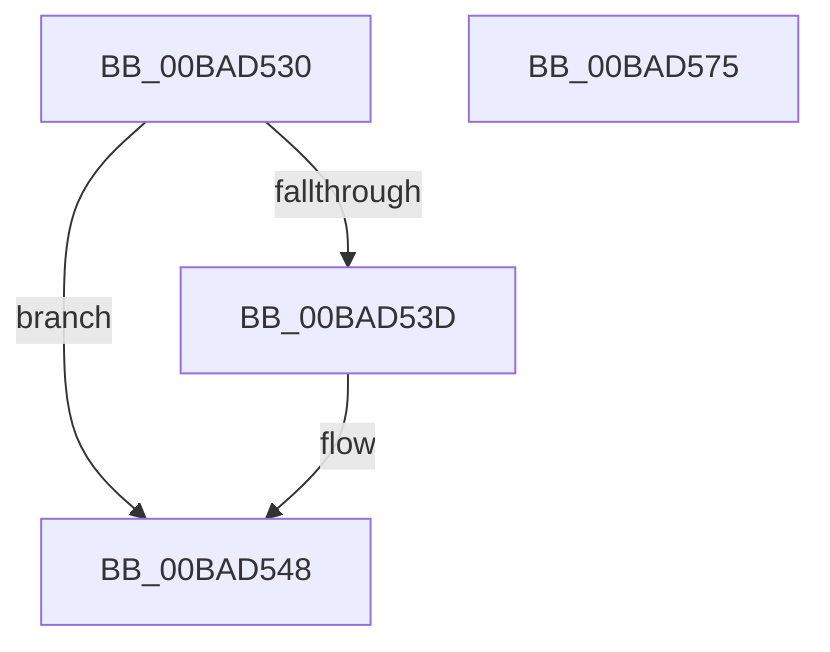

# ViFilterStartCompletionRoutine

- RVA: `0x00BAD530`–`0x00BAD576` (길이 `70` bytes)
- VA: `0x0000000140BAD530`
- 실행 섹션: `PAGEVRFY`
- PDB 이름 있음: `예`; PDB Function 태그: `아니요`
- unwind 정보 RVA: `0x0005C788`
- 디코드: `18`개 명령, `70/70` bytes 표시
- 미해석 바이트: `0` (있으면 어셈블리에 `.byte`로 보존)

> 이 문서는 커널 이미지의 기계어와 PDB 기호를 분석해 생성했습니다. 4번과 5번은 함수 원형과 자료형을 바이너리 사용 방식에서 추정한 C 해석이며 원본 소스 복구 결과는 아닙니다.

## 1. Dependencies

- 직접 호출 지점: **1**; 고유 호출 대상: **1**
- 직접 호출자로 확인된 함수: **0**
- RIP 상대 이미지 참조: **0**

### Outgoing calls
- `0x00BAD569` → [IoReleaseRemoveLockEx](../../text/33/IoReleaseRemoveLockEx_function_0033D330.md) (function, `0x0033D330`)

### Direct callers
- 이 함수 시작 RVA로 연결되는 직접 call은 확인되지 않았습니다. 간접 호출은 완전히 역산할 수 없습니다.

### Static image references
- 디코드된 RIP-relative 메모리 참조가 없습니다.

## 2. Other-region calls and transfers

- 다른 실행 섹션으로 향하는 call: **1**
  - `0x00BAD569` → [IoReleaseRemoveLockEx](../../text/33/IoReleaseRemoveLockEx_function_0033D330.md) (`PAGEVRFY` → `.text`)
- 별도 외부 분기/꼬리 이동을 확인하지 못했습니다.

## 3. Assembly (complete function range)

```asm
00BAD530  48 83 EC 28                     sub rsp, 0x28
00BAD534  80 7A 41 00                     cmp byte ptr [rdx + 0x41], 0
00BAD538  4C 8B C9                        mov r9, rcx
00BAD53B  74 0B                           je 0x140bad548
00BAD53D  48 8B 82 B8 00 00 00            mov rax, qword ptr [rdx + 0xb8]
00BAD544  80 48 03 01                     or byte ptr [rax + 3], 1
00BAD548  48 8B 49 40                     mov rcx, qword ptr [rcx + 0x40]
00BAD54C  48 8B 41 08                     mov rax, qword ptr [rcx + 8]
00BAD550  48 83 C1 20                     add rcx, 0x20
00BAD554  44 8B 40 34                     mov r8d, dword ptr [rax + 0x34]
00BAD558  41 81 E0 0F 01 05 00            and r8d, 0x5010f
00BAD55F  45 09 41 34                     or dword ptr [r9 + 0x34], r8d
00BAD563  41 B8 20 00 00 00               mov r8d, 0x20
00BAD569  E8 C2 FD 78 FF                  call 0x14033d330
00BAD56E  33 C0                           xor eax, eax
00BAD570  48 83 C4 28                     add rsp, 0x28
00BAD574  C3                              ret
00BAD575  CC                              int3
```

## 4. C-style interpretation (structured pseudocode)

```c
__int64 __fastcall ViFilterStartCompletionRoutine(__int64 a1, __int64 a2)
{
    __int64 result;
    __int64 v_rsp;

    v_rsp = (v_rsp) - (40);
    if ((*(unsigned __int8 *)(a2 + 65)) != 0) {
        result = *(unsigned __int64 *)(a2 + 184);
    }
    a1 = (*(unsigned __int64 *)(a1 + 64)) + (32);
    a3 = (unsigned int)(((unsigned int)(*(unsigned int *)(*(unsigned __int64 *)(*(unsigned __int64 *)(a1 + 64) + 8) + 52))) & (0x5010FULL));
    result = IoReleaseRemoveLockEx(a1, a2, 32, a1);
    result = 0;
    v_rsp = (v_rsp) + (40);
    return result;
}
```

## 5. (Beta) C Style

```c
int64_t ViFilterStartCompletionRoutine(void *Arg1, void *Arg2)
{
    uint8_t *arg1 = (uint8_t *)Arg1;
    uint8_t *arg2 = (uint8_t *)Arg2;

    int64_t result;
    int64_t local_rsp;

    local_rsp = (local_rsp) - (40);
    if ((*(uint8_t *)(arg2 + 0x41)) != 0) {
        result = *(uint64_t *)(arg2 + 0xB8);
    }
    Arg1 = (*(uint64_t *)(arg1 + 0x40)) + (32);
    a3 = (uint32_t)(((uint32_t)(*(uint32_t *)(*(uint64_t *)(*(uint64_t *)(arg1 + 0x40) + 0x8) + 0x34))) & (0x5010FULL));
    result = IoReleaseRemoveLockEx(Arg1, Arg2, 32, Arg1);
    result = 0;
    local_rsp = (local_rsp) + (40);
    return result;
}
```

### 관측된 메모리 오프셋

구조체 형식이 확인되지 않은 접근은 인자 기준의 오프셋으로만 기록했습니다.

| 기준 인자 | 오프셋 표현 | 폭 (bit) | 접근 |
|---|---:|---:|---|
| `Arg1` | `+ 0x34` | `32` | `R/W` |
| `Arg1` | `+ 0x40` | `64` | `R` |
| `Arg2` | `+ 0x41` | `8` | `R` |
| `Arg2` | `+ 0xB8` | `64` | `R` |

## 6. Execution-region graph

[열기: 2D/3D 그래프와 함수 탐색 컨트롤 패널](../../../control-panel.html?section=pagevrfy&rva=0x00BAD530&view=graph)

- 2D 그래프는 위에서 아래로 흐르고, 3D 그래프는 빈 공간을 드래그해 회전합니다. Shift+드래그는 이동, 휠은 확대·축소, 함수 노드 선택은 대상 보고서 이동입니다.

### Static fallback


