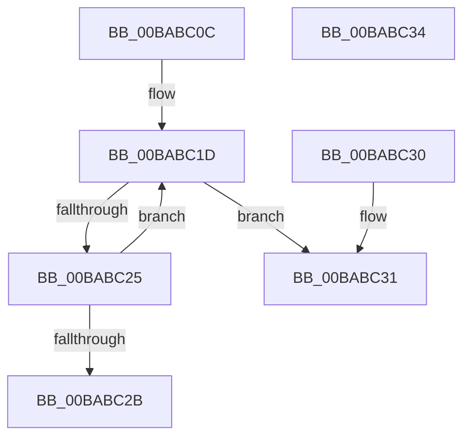

# ViIrpLogDatabaseFindPointer

- RVA: `0x00BABC0C`–`0x00BABC35` (길이 `41` bytes)
- VA: `0x0000000140BABC0C`
- 실행 섹션: `PAGEVRFY`
- PDB 이름 있음: `예`; PDB Function 태그: `아니요`
- unwind 정보 RVA: `0x000DB714`
- 디코드: `15`개 명령, `41/41` bytes 표시
- 미해석 바이트: `0` (있으면 어셈블리에 `.byte`로 보존)

> 이 문서는 커널 이미지의 기계어와 PDB 기호를 분석해 생성했습니다. 4번과 5번은 함수 원형과 자료형을 바이너리 사용 방식에서 추정한 C 해석이며 원본 소스 복구 결과는 아닙니다.

## 1. Dependencies

- 직접 호출 지점: **0**; 고유 호출 대상: **0**
- 직접 호출자로 확인된 함수: **2**
- RIP 상대 이미지 참조: **1**

### Outgoing calls
- 직접 디코드된 call 명령이 없습니다.

### Direct callers
- [VfIrpLogDeleteDeviceLogs](VfIrpLogDeleteDeviceLogs_function_00BAB58C.md) at `0x00BAB5B6`
- [VfIrpLogRecordEvent](VfIrpLogRecordEvent_function_00BAB674.md) at `0x00BAB73D`

### Static image references
- `0x00BABC0C` → RVA `0x00F04868` (`.data`; read)

## 2. Other-region calls and transfers

- 다른 실행 섹션으로 향하는 call: **0**
- 별도 외부 분기/꼬리 이동을 확인하지 못했습니다.

## 3. Assembly (complete function range)

```asm
00BABC0C  48 8B 05 55 8C 35 00            mov rax, qword ptr [rip + 0x358c55]
00BABC13  48 89 02                        mov qword ptr [rdx], rax
00BABC16  4C 8D 40 08                     lea r8, [rax + 8]
00BABC1A  49 8B C0                        mov rax, r8
00BABC1D  48 8B 00                        mov rax, qword ptr [rax]
00BABC20  49 3B C0                        cmp rax, r8
00BABC23  74 0C                           je 0x140babc31
00BABC25  48 39 48 F8                     cmp qword ptr [rax - 8], rcx
00BABC29  75 F2                           jne 0x140babc1d
00BABC2B  48 83 C0 F8                     add rax, -8
00BABC2F  C3                              ret
00BABC30  CC                              int3
00BABC31  33 C0                           xor eax, eax
00BABC33  C3                              ret
00BABC34  CC                              int3
```

## 4. C-style interpretation (structured pseudocode)

```c
__int64 __fastcall ViIrpLogDatabaseFindPointer(__int64 a1, __int64 a2)
{
    __int64 result;

    *(unsigned __int64 *)(a2) = *(unsigned __int64 *)(v_rip + 3509333);
loc_00BABC1D:
    if ((*(unsigned __int64 *)(*(unsigned __int64 *)(v_rip + 3509333) + 8)) == (*(unsigned __int64 *)(v_rip + 3509333) + 8)) goto loc_00BABC31;
    if ((*(unsigned __int64 *)(*(unsigned __int64 *)(*(unsigned __int64 *)(v_rip + 3509333) + 8) - 8)) != a1) goto loc_00BABC1D;
    result = (*(unsigned __int64 *)(*(unsigned __int64 *)(v_rip + 3509333) + 8)) + (-8);
    return result;
loc_00BABC31:
    result = 0;
    return result;
}
```

## 5. (Beta) C Style

```c
int64_t ViIrpLogDatabaseFindPointer(int64_t Arg1, void *Arg2)
{
    uint8_t *arg2 = (uint8_t *)Arg2;

    int64_t result;

    *(uint64_t *)(arg2) = *(uint64_t *)(v_rip + 0x358C55);
loc_00BABC1D:
    if ((*(uint64_t *)(*(uint64_t *)(v_rip + 0x358C55) + 0x8)) == (*(uint64_t *)(v_rip + 0x358C55) + 8)) goto loc_00BABC31;
    if ((*(uint64_t *)(*(uint64_t *)(*(uint64_t *)(v_rip + 0x358C55) + 0x8) - 0x8)) != Arg1) goto loc_00BABC1D;
    result = (*(uint64_t *)(*(uint64_t *)(v_rip + 0x358C55) + 0x8)) + (-8);
    return result;
loc_00BABC31:
    result = 0;
    return result;
}
```

### 관측된 메모리 오프셋

구조체 형식이 확인되지 않은 접근은 인자 기준의 오프셋으로만 기록했습니다.

| 기준 인자 | 오프셋 표현 | 폭 (bit) | 접근 |
|---|---:|---:|---|
| `Arg2` | `+ 0x0` | `64` | `W` |

## 6. Execution-region graph

[열기: 2D/3D 그래프와 함수 탐색 컨트롤 패널](../../../control-panel.html?section=pagevrfy&rva=0x00BABC0C&view=graph)

- 2D 그래프는 위에서 아래로 흐르고, 3D 그래프는 빈 공간을 드래그해 회전합니다. Shift+드래그는 이동, 휠은 확대·축소, 함수 노드 선택은 대상 보고서 이동입니다.

### Static fallback


