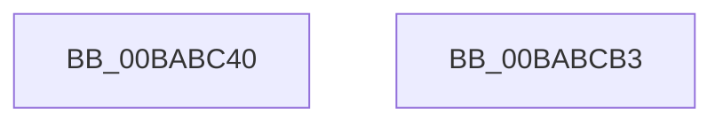

# ViIrpLogExposeWmiCallback

- RVA: `0x00BABC40`–`0x00BABCB4` (길이 `116` bytes)
- VA: `0x0000000140BABC40`
- 실행 섹션: `PAGEVRFY`
- PDB 이름 있음: `예`; PDB Function 태그: `아니요`
- unwind 정보 RVA: `0x00064C80`
- 디코드: `25`개 명령, `116/116` bytes 표시
- 미해석 바이트: `0` (있으면 어셈블리에 `.byte`로 보존)

> 이 문서는 커널 이미지의 기계어와 PDB 기호를 분석해 생성했습니다. 4번과 5번은 함수 원형과 자료형을 바이너리 사용 방식에서 추정한 C 해석이며 원본 소스 복구 결과는 아닙니다.

## 1. Dependencies

- 직접 호출 지점: **5**; 고유 호출 대상: **3**
- 직접 호출자로 확인된 함수: **0**
- RIP 상대 이미지 참조: **6**

### Outgoing calls
- `0x00BABC5F` → [RtlInitUnicodeString](../../text/42/RtlInitUnicodeString_function_0042A780.md) (function, `0x0042A780`)
- `0x00BABC72` → [RtlInitUnicodeString](../../text/42/RtlInitUnicodeString_function_0042A780.md) (function, `0x0042A780`)
- `0x00BABC83` → [RtlInitUnicodeString](../../text/42/RtlInitUnicodeString_function_0042A780.md) (function, `0x0042A780`)
- `0x00BABC94` → [IoCreateDriver](../../page/AC/IoCreateDriver_function_00AC9D70.md) (function, `0x00AC9D70`)
- `0x00BABCA8` → [ExFreePoolWithTag](../../poolcode/B8/ExFreePoolWithTag_function_00B82870.md) (function, `0x00B82870`)

### Direct callers
- 이 함수 시작 RVA로 연결되는 직접 call은 확인되지 않았습니다. 간접 호출은 완전히 역산할 수 없습니다.

### Static image references
- `0x00BABC49` → RVA `0x00BB9A70` (` ?? ::JKADOLAD::`string'`; read)
- `0x00BABC53` → RVA `0x00FFF040` (`PAGEVRFD`; read)
- `0x00BABC6B` → RVA `0x00FFF030` (`PAGEVRFD`; read)
- `0x00BABC77` → RVA `0x00B8B1B0` (`VerifierDdiDriverName`; read)
- `0x00BABC88` → RVA `0x00B94740` (`ViDdiDriverEntry`; read)
- `0x00BABC9B` → RVA `0x00E681A8` (`.data`; write)

## 2. Other-region calls and transfers

- 다른 실행 섹션으로 향하는 call: **5**
  - `0x00BABC5F` → [RtlInitUnicodeString](../../text/42/RtlInitUnicodeString_function_0042A780.md) (`PAGEVRFY` → `.text`)
  - `0x00BABC72` → [RtlInitUnicodeString](../../text/42/RtlInitUnicodeString_function_0042A780.md) (`PAGEVRFY` → `.text`)
  - `0x00BABC83` → [RtlInitUnicodeString](../../text/42/RtlInitUnicodeString_function_0042A780.md) (`PAGEVRFY` → `.text`)
  - `0x00BABC94` → [IoCreateDriver](../../page/AC/IoCreateDriver_function_00AC9D70.md) (`PAGEVRFY` → `PAGE`)
  - `0x00BABCA8` → [ExFreePoolWithTag](../../poolcode/B8/ExFreePoolWithTag_function_00B82870.md) (`PAGEVRFY` → `POOLCODE`)
- 별도 외부 분기/꼬리 이동을 확인하지 못했습니다.

## 3. Assembly (complete function range)

```asm
00BABC40  40 53                           push rbx
00BABC42  48 83 EC 30                     sub rsp, 0x30
00BABC46  48 8B D9                        mov rbx, rcx
00BABC49  48 8D 15 20 DE 00 00            lea rdx, [rip + 0xde20]
00BABC50  0F 57 C0                        xorps xmm0, xmm0
00BABC53  48 8D 0D E6 33 45 00            lea rcx, [rip + 0x4533e6]
00BABC5A  0F 11 44 24 20                  movups xmmword ptr [rsp + 0x20], xmm0
00BABC5F  E8 1C EB 87 FF                  call 0x14042a780
00BABC64  48 8D 15 05 DE 00 00            lea rdx, [rip + 0xde05]
00BABC6B  48 8D 0D BE 33 45 00            lea rcx, [rip + 0x4533be]
00BABC72  E8 09 EB 87 FF                  call 0x14042a780
00BABC77  48 8D 15 32 F5 FD FF            lea rdx, [rip - 0x20ace]
00BABC7E  48 8D 4C 24 20                  lea rcx, [rsp + 0x20]
00BABC83  E8 F8 EA 87 FF                  call 0x14042a780
00BABC88  48 8D 15 B1 8A FE FF            lea rdx, [rip - 0x1754f]
00BABC8F  48 8D 4C 24 20                  lea rcx, [rsp + 0x20]
00BABC94  E8 D7 E0 F1 FF                  call 0x140ac9d70
00BABC99  33 D2                           xor edx, edx
00BABC9B  C7 05 03 C5 2B 00 02 00 00 00   mov dword ptr [rip + 0x2bc503], 2
00BABCA5  48 8B CB                        mov rcx, rbx
00BABCA8  E8 C3 6B FD FF                  call 0x140b82870
00BABCAD  48 83 C4 30                     add rsp, 0x30
00BABCB1  5B                              pop rbx
00BABCB2  C3                              ret
00BABCB3  CC                              int3
```

## 4. C-style interpretation (structured pseudocode)

```c
__int64 __fastcall ViIrpLogExposeWmiCallback(__int64 a1)
{
    __int64 result;
    __int64 v_rsp;
    unsigned __int64 v_stack_m18;

    v_rsp = (v_rsp) - (48);
    v_stack_m18 = v_xmm0;
    result = RtlInitUnicodeString(v_rip + 4535270, v_rip + 56864, a3, a4);
    result = RtlInitUnicodeString(v_rip + 4535230, v_rip + 56837, a3, a4);
    result = RtlInitUnicodeString(v_stack_m18, v_rip - 133838, a3, a4);
    result = IoCreateDriver(v_stack_m18, v_rip - 95567, a3, a4);
    a2 = 0;
    *(unsigned int *)(v_rip + 2868483) = 2;
    result = ExFreePoolWithTag(a1, a2, a3, a4);
    v_rsp = (v_rsp) + (48);
    return result;
}
```

## 5. (Beta) C Style

```c
int64_t ViIrpLogExposeWmiCallback(int64_t Arg1)
{
    int64_t result;
    int64_t local_rsp;
    uint64_t v_stack_m18;

    local_rsp = (local_rsp) - (48);
    v_stack_m18 = v_xmm0;
    result = RtlInitUnicodeString(v_rip + 4535270, v_rip + 56864, a3, a4);
    result = RtlInitUnicodeString(v_rip + 4535230, v_rip + 56837, a3, a4);
    result = RtlInitUnicodeString(v_stack_m18, v_rip - 133838, a3, a4);
    result = IoCreateDriver(v_stack_m18, v_rip - 95567, a3, a4);
    a2 = 0;
    *(uint32_t *)(v_rip + 0x2BC503) = 2;
    result = ExFreePoolWithTag(Arg1, a2, a3, a4);
    local_rsp = (local_rsp) + (48);
    return result;
}
```

## 6. Execution-region graph

[열기: 2D/3D 그래프와 함수 탐색 컨트롤 패널](../../../control-panel.html?section=pagevrfy&rva=0x00BABC40&view=graph)

- 2D 그래프는 위에서 아래로 흐르고, 3D 그래프는 빈 공간을 드래그해 회전합니다. Shift+드래그는 이동, 휠은 확대·축소, 함수 노드 선택은 대상 보고서 이동입니다.

### Static fallback


