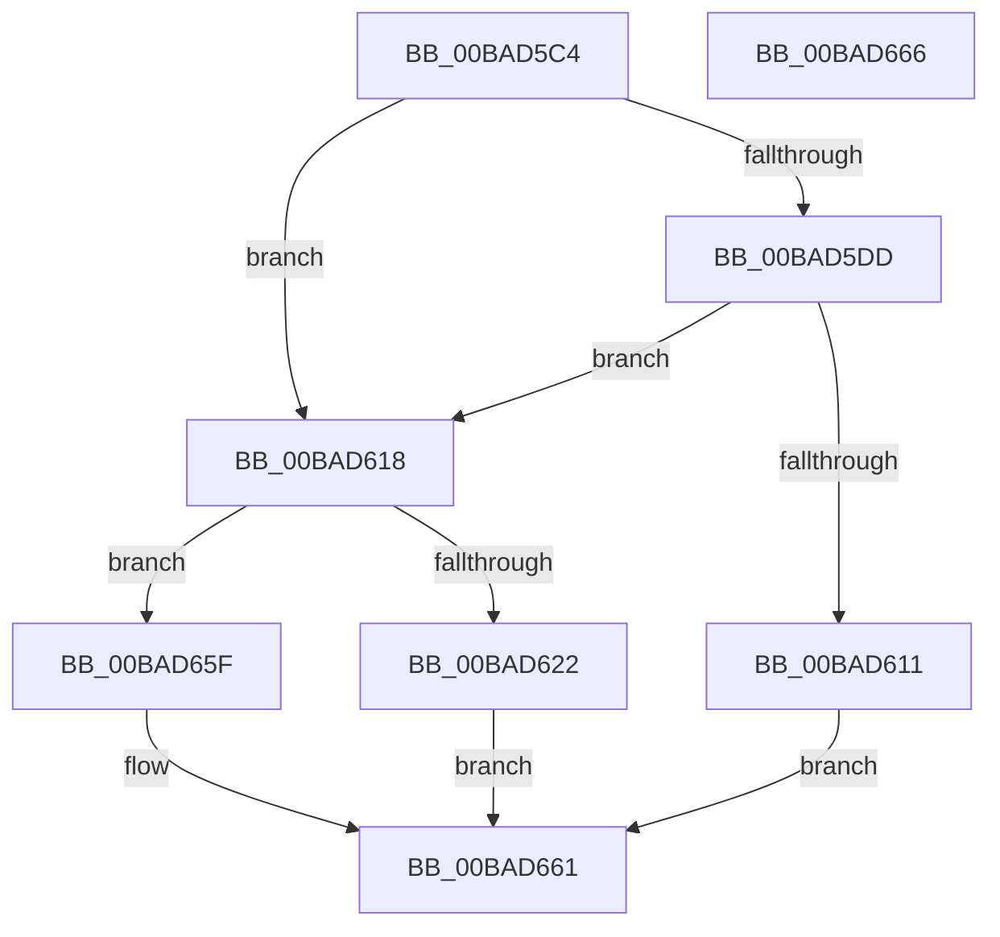

# ViIrqlInit

- RVA: `0x00BAD5C4`–`0x00BAD667` (길이 `163` bytes)
- VA: `0x0000000140BAD5C4`
- 실행 섹션: `PAGEVRFY`
- PDB 이름 있음: `예`; PDB Function 태그: `아니요`
- unwind 정보 RVA: `0x0005D2F4`
- 디코드: `36`개 명령, `163/163` bytes 표시
- 미해석 바이트: `0` (있으면 어셈블리에 `.byte`로 보존)

> 이 문서는 커널 이미지의 기계어와 PDB 기호를 분석해 생성했습니다. 4번과 5번은 함수 원형과 자료형을 바이너리 사용 방식에서 추정한 C 해석이며 원본 소스 복구 결과는 아닙니다.

## 1. Dependencies

- 직접 호출 지점: **2**; 고유 호출 대상: **1**
- 직접 호출자로 확인된 함수: **1**
- RIP 상대 이미지 참조: **8**

### Outgoing calls
- `0x00BAD600` → [ExAllocatePool3](../../poolcode/B8/ExAllocatePool3_function_00B84270.md) (function, `0x00B84270`)
- `0x00BAD645` → [ExAllocatePool3](../../poolcode/B8/ExAllocatePool3_function_00B84270.md) (function, `0x00B84270`)

### Direct callers
- [VfIrqlPluginEntry](../../text/61/VfIrqlPluginEntry_function_00616DA0.md) at `0x00616FE7`

### Static image references
- `0x00BAD5CD` → RVA `0x00FFDA24` (`PAGEVRFD`; read/write)
- `0x00BAD5D3` → RVA `0x00FFDA68` (`PAGEVRFD`; read)
- `0x00BAD5DD` → RVA `0x00FF401C` (`PAGEVRFD`; read)
- `0x00BAD5E3` → RVA `0x00E681B0` (`.data`; read)
- `0x00BAD605` → RVA `0x00FFDA68` (`PAGEVRFD`; write)
- `0x00BAD618` → RVA `0x00FFDA60` (`PAGEVRFD`; read)
- `0x00BAD622` → RVA `0x00FF4018` (`PAGEVRFD`; read)
- `0x00BAD64A` → RVA `0x00FFDA60` (`PAGEVRFD`; write)

## 2. Other-region calls and transfers

- 다른 실행 섹션으로 향하는 call: **2**
  - `0x00BAD600` → [ExAllocatePool3](../../poolcode/B8/ExAllocatePool3_function_00B84270.md) (`PAGEVRFY` → `POOLCODE`)
  - `0x00BAD645` → [ExAllocatePool3](../../poolcode/B8/ExAllocatePool3_function_00B84270.md) (`PAGEVRFY` → `POOLCODE`)
- 별도 외부 분기/꼬리 이동을 확인하지 못했습니다.

## 3. Assembly (complete function range)

```asm
00BAD5C4  48 83 EC 38                     sub rsp, 0x38
00BAD5C8  B8 01 00 00 00                  mov eax, 1
00BAD5CD  87 05 51 04 45 00               xchg dword ptr [rip + 0x450451], eax
00BAD5D3  48 83 3D 8D 04 45 00 00         cmp qword ptr [rip + 0x45048d], 0
00BAD5DB  75 3B                           jne 0x140bad618
00BAD5DD  8B 05 39 6A 44 00               mov eax, dword ptr [rip + 0x446a39]
00BAD5E3  4C 8D 0D C6 AB 2B 00            lea r9, [rip + 0x2babc6]
00BAD5EA  6B D0 38                        imul edx, eax, 0x38
00BAD5ED  B9 40 00 00 00                  mov ecx, 0x40
00BAD5F2  41 B8 49 72 71 6C               mov r8d, 0x6c717249
00BAD5F8  C7 44 24 20 01 00 00 00         mov dword ptr [rsp + 0x20], 1
00BAD600  E8 6B 6C FD FF                  call 0x140b84270
00BAD605  48 89 05 5C 04 45 00            mov qword ptr [rip + 0x45045c], rax
00BAD60C  48 85 C0                        test rax, rax
00BAD60F  75 07                           jne 0x140bad618
00BAD611  B8 17 00 00 C0                  mov eax, 0xc0000017
00BAD616  EB 49                           jmp 0x140bad661
00BAD618  48 83 3D 40 04 45 00 00         cmp qword ptr [rip + 0x450440], 0
00BAD620  75 3D                           jne 0x140bad65f
00BAD622  8B 15 F0 69 44 00               mov edx, dword ptr [rip + 0x4469f0]
00BAD628  4C 8D 0D 81 AB 2B 00            lea r9, [rip + 0x2bab81]
00BAD62F  C1 E2 06                        shl edx, 6
00BAD632  B9 40 00 00 00                  mov ecx, 0x40
00BAD637  41 B8 56 66 43 52               mov r8d, 0x52436656
00BAD63D  C7 44 24 20 01 00 00 00         mov dword ptr [rsp + 0x20], 1
00BAD645  E8 26 6C FD FF                  call 0x140b84270
00BAD64A  48 89 05 0F 04 45 00            mov qword ptr [rip + 0x45040f], rax
00BAD651  48 F7 D8                        neg rax
00BAD654  1B C0                           sbb eax, eax
00BAD656  F7 D0                           not eax
00BAD658  25 17 00 00 C0                  and eax, 0xc0000017
00BAD65D  EB 02                           jmp 0x140bad661
00BAD65F  33 C0                           xor eax, eax
00BAD661  48 83 C4 38                     add rsp, 0x38
00BAD665  C3                              ret
00BAD666  CC                              int3
```

## 4. C-style interpretation (structured pseudocode)

```c
__int64 __fastcall ViIrqlInit(void)
{
    __int64 result;
    __int64 v_rsp;
    unsigned int v_stack_m18;

    v_rsp = (v_rsp) - (56);
    if ((*(unsigned __int64 *)(v_rip + 4523149)) != 0) goto loc_00BAD618;
    a2 = (unsigned int)((a2) * ((unsigned int)((unsigned int)(*(unsigned int *)(v_rip + 4483641)))));
    v_stack_m18 = 1;
    result = ExAllocatePool3(64, a2, (unsigned int)(0x6C717249ULL), v_rip + 2862022);
    *(unsigned __int64 *)(v_rip + 4523100) = result;
    if (result != 0) goto loc_00BAD618;
    goto loc_00BAD661;
loc_00BAD618:
    if ((*(unsigned __int64 *)(v_rip + 4523072)) != 0) goto loc_00BAD65F;
    a2 = (unsigned int)(((unsigned int)(*(unsigned int *)(v_rip + 4483568))) << (6));
    v_stack_m18 = 1;
    result = ExAllocatePool3(64, a2, (unsigned int)(0x52436656ULL), v_rip + 2861953);
    *(unsigned __int64 *)(v_rip + 4523023) = result;
    result = -(result);
    result = (unsigned int)(~(result));
    result = (unsigned int)((result) & (0xC0000017ULL));
    goto loc_00BAD661;
loc_00BAD65F:
    result = 0;
loc_00BAD661:
    v_rsp = (v_rsp) + (56);
    return result;
}
```

## 5. (Beta) C Style

```c
void ViIrqlInit(void)
{
    int64_t result;
    int64_t local_rsp;
    uint32_t v_stack_m18;

    local_rsp = (local_rsp) - (56);
    if ((*(uint64_t *)(v_rip + 0x45048D)) != 0) goto loc_00BAD618;
    a2 = (uint32_t)((a2) * ((uint32_t)((uint32_t)(*(uint32_t *)(v_rip + 0x446A39)))));
    v_stack_m18 = 1;
    result = ExAllocatePool3(64, a2, (uint32_t)(0x6C717249ULL), v_rip + 2862022);
    *(uint64_t *)(v_rip + 0x45045C) = result;
    if (result != 0) goto loc_00BAD618;
    goto loc_00BAD661;
loc_00BAD618:
    if ((*(uint64_t *)(v_rip + 0x450440)) != 0) goto loc_00BAD65F;
    a2 = (uint32_t)(((uint32_t)(*(uint32_t *)(v_rip + 0x4469F0))) << (6));
    v_stack_m18 = 1;
    result = ExAllocatePool3(64, a2, (uint32_t)(0x52436656ULL), v_rip + 2861953);
    *(uint64_t *)(v_rip + 0x45040F) = result;
    result = -(result);
    result = (uint32_t)(~(result));
    result = (uint32_t)((result) & (0xC0000017ULL));
    goto loc_00BAD661;
loc_00BAD65F:
    result = 0;
loc_00BAD661:
    local_rsp = (local_rsp) + (56);
    return result;
}
```

## 6. Execution-region graph

[열기: 2D/3D 그래프와 함수 탐색 컨트롤 패널](../../../control-panel.html?section=pagevrfy&rva=0x00BAD5C4&view=graph)

- 2D 그래프는 위에서 아래로 흐르고, 3D 그래프는 빈 공간을 드래그해 회전합니다. Shift+드래그는 이동, 휠은 확대·축소, 함수 노드 선택은 대상 보고서 이동입니다.

### Static fallback


