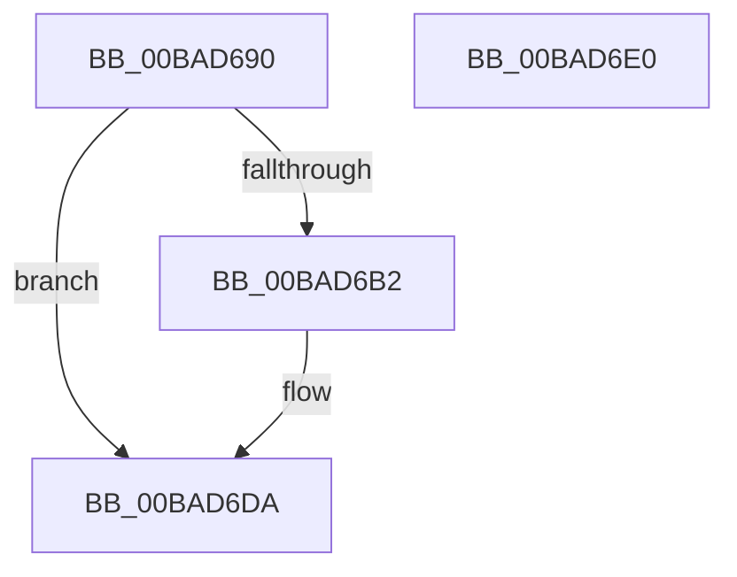

# ViIrqlKeLeaveCriticalRegion_Entry

- RVA: `0x00BAD690`–`0x00BAD6E1` (길이 `81` bytes)
- VA: `0x0000000140BAD690`
- 실행 섹션: `PAGEVRFY`
- PDB 이름 있음: `예`; PDB Function 태그: `아니요`
- unwind 정보 RVA: `0x000697A4`
- 디코드: `21`개 명령, `81/81` bytes 표시
- 미해석 바이트: `0` (있으면 어셈블리에 `.byte`로 보존)

> 이 문서는 커널 이미지의 기계어와 PDB 기호를 분석해 생성했습니다. 4번과 5번은 함수 원형과 자료형을 바이너리 사용 방식에서 추정한 C 해석이며 원본 소스 복구 결과는 아닙니다.

## 1. Dependencies

- 직접 호출 지점: **2**; 고유 호출 대상: **2**
- 직접 호출자로 확인된 함수: **0**
- RIP 상대 이미지 참조: **0**

### Outgoing calls
- `0x00BAD699` → [ViIrqlLogCRStackTrace](ViIrqlLogCRStackTrace_function_00BAD6E8.md) (function, `0x00BAD6E8`)
- `0x00BAD6D5` → [CarReportRuleViolationFromNt](../B9/CarReportRuleViolationFromNt_function_00B9D904.md) (function, `0x00B9D904`)

### Direct callers
- 이 함수 시작 RVA로 연결되는 직접 call은 확인되지 않았습니다. 간접 호출은 완전히 역산할 수 없습니다.

### Static image references
- 디코드된 RIP-relative 메모리 참조가 없습니다.

## 2. Other-region calls and transfers

- 다른 실행 섹션으로 향하는 call: **0**
- 별도 외부 분기/꼬리 이동을 확인하지 못했습니다.

## 3. Assembly (complete function range)

```asm
00BAD690  40 53                           push rbx
00BAD692  48 83 EC 40                     sub rsp, 0x40
00BAD696  48 8B D9                        mov rbx, rcx
00BAD699  E8 4A 00 00 00                  call 0x140bad6e8
00BAD69E  65 48 8B 04 25 88 01 00 00      mov rax, qword ptr gs:[0x188]
00BAD6A7  33 C9                           xor ecx, ecx
00BAD6A9  66 39 88 E4 01 00 00            cmp word ptr [rax + 0x1e4], cx
00BAD6B0  7E 28                           jle 0x140bad6da
00BAD6B2  48 8B 03                        mov rax, qword ptr [rbx]
00BAD6B5  8D 51 3E                        lea edx, [rcx + 0x3e]
00BAD6B8  48 89 44 24 30                  mov qword ptr [rsp + 0x30], rax
00BAD6BD  45 33 C9                        xor r9d, r9d
00BAD6C0  C7 44 24 28 01 00 00 00         mov dword ptr [rsp + 0x28], 1
00BAD6C8  45 33 C0                        xor r8d, r8d
00BAD6CB  48 89 4C 24 20                  mov qword ptr [rsp + 0x20], rcx
00BAD6D0  B9 C4 00 00 00                  mov ecx, 0xc4
00BAD6D5  E8 2A 02 FF FF                  call 0x140b9d904
00BAD6DA  48 83 C4 40                     add rsp, 0x40
00BAD6DE  5B                              pop rbx
00BAD6DF  C3                              ret
00BAD6E0  CC                              int3
```

## 4. C-style interpretation (structured pseudocode)

```c
__int64 __fastcall ViIrqlKeLeaveCriticalRegion_Entry(__int64 a1, __int64 a2, int a3, int a4)
{
    __int64 result;
    __int64 v_rsp;
    unsigned __int64 v_stack_m18;
    unsigned int v_stack_m20;
    unsigned __int64 v_stack_m28;

    v_rsp = (v_rsp) - (64);
    result = ViIrqlLogCRStackTrace(a1, a2, a3, a4);
    a1 = 0;
    result = *(unsigned __int64 *)(gs_base + (0 + 392));
    if ((*(unsigned __int16 *)(*(unsigned __int64 *)(gs_base + (0 + 392)) + 484)) >= = 0) {
        result = *(unsigned __int64 *)(a1);
        a2 = a1 + 62;
        v_stack_m18 = result;
        a4 = 0;
        v_stack_m20 = 1;
        a3 = 0;
        v_stack_m28 = 0;
        a1 = 196;
        result = CarReportRuleViolationFromNt(a1, a2, a3, a4);
    }
    v_rsp = (v_rsp) + (64);
    return result;
}
```

## 5. (Beta) C Style

```c
int64_t ViIrqlKeLeaveCriticalRegion_Entry(void *Arg1, int64_t Arg2, int32_t Arg3, int32_t Arg4)
{
    uint8_t *arg1 = (uint8_t *)Arg1;

    int64_t result;
    int64_t local_rsp;
    uint64_t v_stack_m18;
    uint32_t v_stack_m20;
    uint64_t v_stack_m28;

    local_rsp = (local_rsp) - (64);
    result = ViIrqlLogCRStackTrace(Arg1, Arg2, Arg3, Arg4);
    Arg1 = 0;
    result = *(uint64_t *)(gs_base + (0 + 0x188));
    if ((*(uint16_t *)(*(uint64_t *)(gs_base + (0 + 0x188)) + 0x1E4)) >= = 0) {
        result = *(uint64_t *)(arg1);
        Arg2 = Arg1 + 62;
        v_stack_m18 = result;
        Arg4 = 0;
        v_stack_m20 = 1;
        Arg3 = 0;
        v_stack_m28 = 0;
        Arg1 = 196;
        result = CarReportRuleViolationFromNt(Arg1, Arg2, Arg3, Arg4);
    }
    local_rsp = (local_rsp) + (64);
    return result;
}
```

### 관측된 메모리 오프셋

구조체 형식이 확인되지 않은 접근은 인자 기준의 오프셋으로만 기록했습니다.

| 기준 인자 | 오프셋 표현 | 폭 (bit) | 접근 |
|---|---:|---:|---|
| `Arg1` | `+ 0x0` | `64` | `R` |

## 6. Execution-region graph

[열기: 2D/3D 그래프와 함수 탐색 컨트롤 패널](../../../control-panel.html?section=pagevrfy&rva=0x00BAD690&view=graph)

- 2D 그래프는 위에서 아래로 흐르고, 3D 그래프는 빈 공간을 드래그해 회전합니다. Shift+드래그는 이동, 휠은 확대·축소, 함수 노드 선택은 대상 보고서 이동입니다.

### Static fallback


