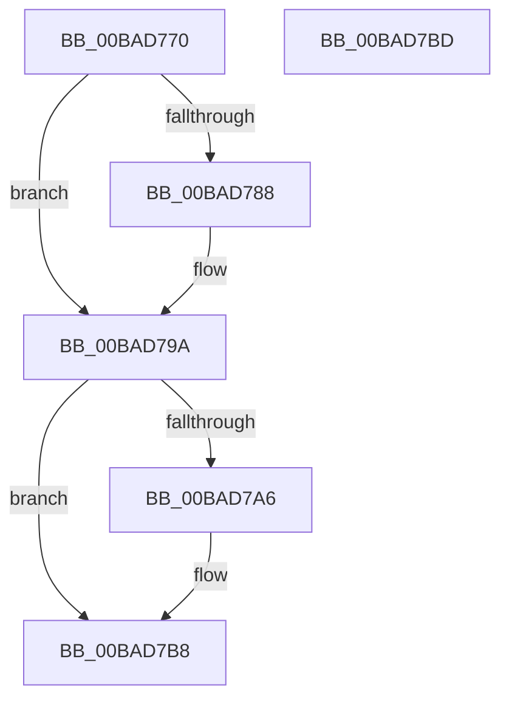

# ViIrqlPluginUnload

- RVA: `0x00BAD770`–`0x00BAD7BE` (길이 `78` bytes)
- VA: `0x0000000140BAD770`
- 실행 섹션: `PAGEVRFY`
- PDB 이름 있음: `예`; PDB Function 태그: `아니요`
- unwind 정보 RVA: `0x0005C788`
- 디코드: `18`개 명령, `78/78` bytes 표시
- 미해석 바이트: `0` (있으면 어셈블리에 `.byte`로 보존)

> 이 문서는 커널 이미지의 기계어와 PDB 기호를 분석해 생성했습니다. 4번과 5번은 함수 원형과 자료형을 바이너리 사용 방식에서 추정한 C 해석이며 원본 소스 복구 결과는 아닙니다.

## 1. Dependencies

- 직접 호출 지점: **2**; 고유 호출 대상: **1**
- 직접 호출자로 확인된 함수: **0**
- RIP 상대 이미지 참조: **5**

### Outgoing calls
- `0x00BAD78D` → [ExFreePoolWithTag](../../poolcode/B8/ExFreePoolWithTag_function_00B82870.md) (function, `0x00B82870`)
- `0x00BAD7AB` → [ExFreePoolWithTag](../../poolcode/B8/ExFreePoolWithTag_function_00B82870.md) (function, `0x00B82870`)

### Direct callers
- 이 함수 시작 RVA로 연결되는 직접 call은 확인되지 않았습니다. 간접 호출은 완전히 역산할 수 없습니다.

### Static image references
- `0x00BAD776` → RVA `0x00FFDA24` (`PAGEVRFD`; read/write)
- `0x00BAD77C` → RVA `0x00FFDA68` (`PAGEVRFD`; read)
- `0x00BAD792` → RVA `0x00FFDA68` (`PAGEVRFD`; read/write)
- `0x00BAD79A` → RVA `0x00FFDA60` (`PAGEVRFD`; read)
- `0x00BAD7B0` → RVA `0x00FFDA60` (`PAGEVRFD`; read/write)

## 2. Other-region calls and transfers

- 다른 실행 섹션으로 향하는 call: **2**
  - `0x00BAD78D` → [ExFreePoolWithTag](../../poolcode/B8/ExFreePoolWithTag_function_00B82870.md) (`PAGEVRFY` → `POOLCODE`)
  - `0x00BAD7AB` → [ExFreePoolWithTag](../../poolcode/B8/ExFreePoolWithTag_function_00B82870.md) (`PAGEVRFY` → `POOLCODE`)
- 별도 외부 분기/꼬리 이동을 확인하지 못했습니다.

## 3. Assembly (complete function range)

```asm
00BAD770  48 83 EC 28                     sub rsp, 0x28
00BAD774  33 C0                           xor eax, eax
00BAD776  87 05 A8 02 45 00               xchg dword ptr [rip + 0x4502a8], eax
00BAD77C  48 8B 0D E5 02 45 00            mov rcx, qword ptr [rip + 0x4502e5]
00BAD783  48 85 C9                        test rcx, rcx
00BAD786  74 12                           je 0x140bad79a
00BAD788  BA 49 72 71 6C                  mov edx, 0x6c717249
00BAD78D  E8 DE 50 FD FF                  call 0x140b82870
00BAD792  48 83 25 CE 02 45 00 00         and qword ptr [rip + 0x4502ce], 0
00BAD79A  48 8B 0D BF 02 45 00            mov rcx, qword ptr [rip + 0x4502bf]
00BAD7A1  48 85 C9                        test rcx, rcx
00BAD7A4  74 12                           je 0x140bad7b8
00BAD7A6  BA 56 66 43 52                  mov edx, 0x52436656
00BAD7AB  E8 C0 50 FD FF                  call 0x140b82870
00BAD7B0  48 83 25 A8 02 45 00 00         and qword ptr [rip + 0x4502a8], 0
00BAD7B8  48 83 C4 28                     add rsp, 0x28
00BAD7BC  C3                              ret
00BAD7BD  CC                              int3
```

## 4. C-style interpretation (structured pseudocode)

```c
__int64 __fastcall ViIrqlPluginUnload(void)
{
    __int64 result;
    __int64 v_rsp;

    v_rsp = (v_rsp) - (40);
    result = 0;
    if (*(unsigned __int64 *)(v_rip + 4522725) != 0) {
        a2 = 0x6C717249ULL;
        result = ExFreePoolWithTag(*(unsigned __int64 *)(v_rip + 4522725), a2, a3, a4);
    }
    if (*(unsigned __int64 *)(v_rip + 4522687) != 0) {
        a2 = 0x52436656ULL;
        result = ExFreePoolWithTag(*(unsigned __int64 *)(v_rip + 4522687), a2, a3, a4);
    }
    v_rsp = (v_rsp) + (40);
    return result;
}
```

## 5. (Beta) C Style

```c
void ViIrqlPluginUnload(void)
{
    int64_t result;
    int64_t local_rsp;

    local_rsp = (local_rsp) - (40);
    result = 0;
    if (*(uint64_t *)(v_rip + 0x4502E5) != 0) {
        a2 = 0x6C717249ULL;
        result = ExFreePoolWithTag(*(uint64_t *)(v_rip + 0x4502E5), a2, a3, a4);
    }
    if (*(uint64_t *)(v_rip + 0x4502BF) != 0) {
        a2 = 0x52436656ULL;
        result = ExFreePoolWithTag(*(uint64_t *)(v_rip + 0x4502BF), a2, a3, a4);
    }
    local_rsp = (local_rsp) + (40);
    return result;
}
```

## 6. Execution-region graph

[열기: 2D/3D 그래프와 함수 탐색 컨트롤 패널](../../../control-panel.html?section=pagevrfy&rva=0x00BAD770&view=graph)

- 2D 그래프는 위에서 아래로 흐르고, 3D 그래프는 빈 공간을 드래그해 회전합니다. Shift+드래그는 이동, 휠은 확대·축소, 함수 노드 선택은 대상 보고서 이동입니다.

### Static fallback


