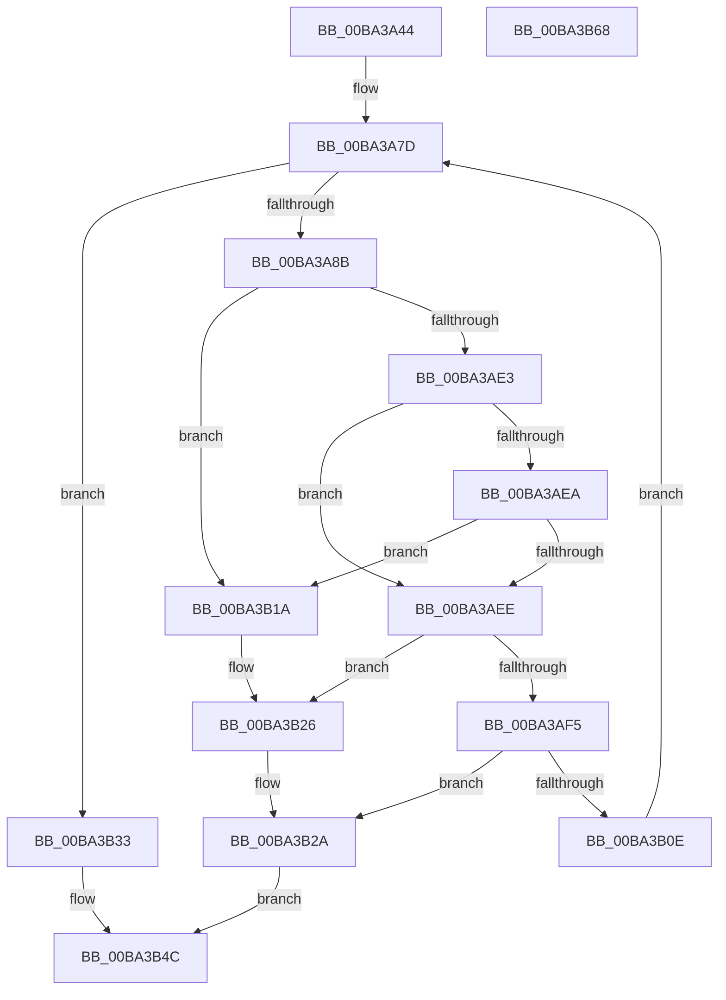

# ViIsBTSSupported

- RVA: `0x00BA3A44`–`0x00BA3B69` (길이 `293` bytes)
- VA: `0x0000000140BA3A44`
- 실행 섹션: `PAGEVRFY`
- PDB 이름 있음: `예`; PDB Function 태그: `아니요`
- unwind 정보 RVA: `0x000BEC6C`
- 디코드: `73`개 명령, `293/293` bytes 표시
- 미해석 바이트: `0` (있으면 어셈블리에 `.byte`로 보존)

> 이 문서는 커널 이미지의 기계어와 PDB 기호를 분석해 생성했습니다. 4번과 5번은 함수 원형과 자료형을 바이너리 사용 방식에서 추정한 C 해석이며 원본 소스 복구 결과는 아닙니다.

## 1. Dependencies

- 직접 호출 지점: **5**; 고유 호출 대상: **4**
- 직접 호출자로 확인된 함수: **1**
- RIP 상대 이미지 참조: **6**

### Outgoing calls
- `0x00BA3ABC` → [KeSetSystemGroupAffinityThread](../../text/39/KeSetSystemGroupAffinityThread_function_00399140.md) (function, `0x00399140`)
- `0x00BA3B0E` → [KeRevertToUserGroupAffinityThread](../../text/39/KeRevertToUserGroupAffinityThread_function_00398EC0.md) (function, `0x00398EC0`)
- `0x00BA3B21` → [DbgPrint](../../text/35/DbgPrint_function_00358CB0.md) (function, `0x00358CB0`)
- `0x00BA3B2A` → [KeRevertToUserGroupAffinityThread](../../text/39/KeRevertToUserGroupAffinityThread_function_00398EC0.md) (function, `0x00398EC0`)
- `0x00BA3B53` → [_security_check_cookie](../../text/6A/_security_check_cookie_function_006AC640.md) (function, `0x006AC640`)

### Direct callers
- [VfBranchTracingPluginEntry](VfBranchTracingPluginEntry_function_00BA37D0.md) at `0x00BA3804`

### Static image references
- `0x00BA3A56` → RVA `0x00E0A740` (`.data`; read)
- `0x00BA3A7D` → RVA `0x00FC6A80` (`ALMOSTRO`; read)
- `0x00BA3A8B` → RVA `0x00F231B0` (`.data`; read)
- `0x00BA3B1A` → RVA `0x00BBA9B0` (` ?? ::JKADOLAD::`string'`; read)
- `0x00BA3B3C` → RVA `0x00FF402C` (`PAGEVRFD`; write)
- `0x00BA3B42` → RVA `0x00FFDAE8` (`PAGEVRFD`; write)

## 2. Other-region calls and transfers

- 다른 실행 섹션으로 향하는 call: **5**
  - `0x00BA3ABC` → [KeSetSystemGroupAffinityThread](../../text/39/KeSetSystemGroupAffinityThread_function_00399140.md) (`PAGEVRFY` → `.text`)
  - `0x00BA3B0E` → [KeRevertToUserGroupAffinityThread](../../text/39/KeRevertToUserGroupAffinityThread_function_00398EC0.md) (`PAGEVRFY` → `.text`)
  - `0x00BA3B21` → [DbgPrint](../../text/35/DbgPrint_function_00358CB0.md) (`PAGEVRFY` → `.text`)
  - `0x00BA3B2A` → [KeRevertToUserGroupAffinityThread](../../text/39/KeRevertToUserGroupAffinityThread_function_00398EC0.md) (`PAGEVRFY` → `.text`)
  - `0x00BA3B53` → [_security_check_cookie](../../text/6A/_security_check_cookie_function_006AC640.md) (`PAGEVRFY` → `.text`)
- 별도 외부 분기/꼬리 이동을 확인하지 못했습니다.

## 3. Assembly (complete function range)

```asm
00BA3A44  48 89 5C 24 08                  mov qword ptr [rsp + 8], rbx
00BA3A49  48 89 7C 24 10                  mov qword ptr [rsp + 0x10], rdi
00BA3A4E  55                              push rbp
00BA3A4F  48 8B EC                        mov rbp, rsp
00BA3A52  48 83 EC 50                     sub rsp, 0x50
00BA3A56  48 8B 05 E3 6C 26 00            mov rax, qword ptr [rip + 0x266ce3]
00BA3A5D  48 33 C4                        xor rax, rsp
00BA3A60  48 89 45 F0                     mov qword ptr [rbp - 0x10], rax
00BA3A64  65 48 8B 3C 25 20 00 00 00      mov rdi, qword ptr gs:[0x20]
00BA3A6D  0F 57 C0                        xorps xmm0, xmm0
00BA3A70  0F 57 C9                        xorps xmm1, xmm1
00BA3A73  33 DB                           xor ebx, ebx
00BA3A75  0F 11 45 D0                     movups xmmword ptr [rbp - 0x30], xmm0
00BA3A79  0F 11 4D E0                     movups xmmword ptr [rbp - 0x20], xmm1
00BA3A7D  8B 05 FD 2F 42 00               mov eax, dword ptr [rip + 0x422ffd]
00BA3A83  3B D8                           cmp ebx, eax
00BA3A85  0F 83 A8 00 00 00               jae 0x140ba3b33
00BA3A8B  48 8B 05 1E F7 37 00            mov rax, qword ptr [rip + 0x37f71e]
00BA3A92  33 D2                           xor edx, edx
00BA3A94  89 55 DA                        mov dword ptr [rbp - 0x26], edx
00BA3A97  66 89 55 DE                     mov word ptr [rbp - 0x22], dx
00BA3A9B  8B 0C 98                        mov ecx, dword ptr [rax + rbx*4]
00BA3A9E  8B C1                           mov eax, ecx
00BA3AA0  C1 E8 06                        shr eax, 6
00BA3AA3  83 E1 3F                        and ecx, 0x3f
00BA3AA6  66 89 45 D8                     mov word ptr [rbp - 0x28], ax
00BA3AAA  8D 42 01                        lea eax, [rdx + 1]
00BA3AAD  48 D3 E0                        shl rax, cl
00BA3AB0  48 8D 55 E0                     lea rdx, [rbp - 0x20]
00BA3AB4  48 8D 4D D0                     lea rcx, [rbp - 0x30]
00BA3AB8  48 89 45 D0                     mov qword ptr [rbp - 0x30], rax
00BA3ABC  E8 7F 56 7F FF                  call 0x140399140
00BA3AC1  65 48 8B 04 25 20 00 00 00      mov rax, qword ptr gs:[0x20]
00BA3ACA  48 8B 88 A0 8F 00 00            mov rcx, qword ptr [rax + 0x8fa0]
00BA3AD1  65 48 8B 04 25 20 00 00 00      mov rax, qword ptr gs:[0x20]
00BA3ADA  80 B8 8D 00 00 00 02            cmp byte ptr [rax + 0x8d], 2
00BA3AE1  75 37                           jne 0x140ba3b1a
00BA3AE3  8A 47 40                        mov al, byte ptr [rdi + 0x40]
00BA3AE6  3C 0F                           cmp al, 0xf
00BA3AE8  74 04                           je 0x140ba3aee
00BA3AEA  3C 06                           cmp al, 6
00BA3AEC  75 2C                           jne 0x140ba3b1a
00BA3AEE  48 0F BA E1 09                  bt rcx, 9
00BA3AF3  73 31                           jae 0x140ba3b26
00BA3AF5  B9 A0 01 00 00                  mov ecx, 0x1a0
00BA3AFA  0F 32                           rdmsr
00BA3AFC  48 C1 E2 20                     shl rdx, 0x20
00BA3B00  48 8D 4D E0                     lea rcx, [rbp - 0x20]
00BA3B04  48 0B C2                        or rax, rdx
00BA3B07  48 0F BA E0 0B                  bt rax, 0xb
00BA3B0C  72 1C                           jb 0x140ba3b2a
00BA3B0E  E8 AD 53 7F FF                  call 0x140398ec0
00BA3B13  FF C3                           inc ebx
00BA3B15  E9 63 FF FF FF                  jmp 0x140ba3a7d
00BA3B1A  48 8D 0D 8F 6E 01 00            lea rcx, [rip + 0x16e8f]
00BA3B21  E8 8A 51 7B FF                  call 0x140358cb0
00BA3B26  48 8D 4D E0                     lea rcx, [rbp - 0x20]
00BA3B2A  E8 91 53 7F FF                  call 0x140398ec0
00BA3B2F  33 C0                           xor eax, eax
00BA3B31  EB 19                           jmp 0x140ba3b4c
00BA3B33  0F BE 4F 40                     movsx ecx, byte ptr [rdi + 0x40]
00BA3B37  B8 01 00 00 00                  mov eax, 1
00BA3B3C  89 0D EA 04 45 00               mov dword ptr [rip + 0x4504ea], ecx
00BA3B42  C7 05 9C 9F 45 00 01 00 00 00   mov dword ptr [rip + 0x459f9c], 1
00BA3B4C  48 8B 4D F0                     mov rcx, qword ptr [rbp - 0x10]
00BA3B50  48 33 CC                        xor rcx, rsp
00BA3B53  E8 E8 8A B0 FF                  call 0x1406ac640
00BA3B58  48 8B 5C 24 60                  mov rbx, qword ptr [rsp + 0x60]
00BA3B5D  48 8B 7C 24 68                  mov rdi, qword ptr [rsp + 0x68]
00BA3B62  48 83 C4 50                     add rsp, 0x50
00BA3B66  5D                              pop rbp
00BA3B67  C3                              ret
00BA3B68  CC                              int3
```

## 4. C-style interpretation (structured pseudocode)

```c
__int64 __fastcall ViIsBTSSupported(__int64 a1, int a2)
{
    __int64 result;
    __int64 v_rbx;
    __int64 v_rsp;
    unsigned __int64 v_stack_m18;
    unsigned __int64 v_stack_m28;
    unsigned __int16 v_stack_m2A;
    unsigned int v_stack_m2E;
    unsigned __int16 v_stack_m30;
    unsigned __int64 v_stack_m38;
    unsigned __int64 v_stack_p10;
    unsigned __int64 v_stack_p8;

    v_stack_p8 = v_rbx;
    v_stack_p10 = v_rdi;
    v_rsp = (v_rsp) - (80);
    result = (*(unsigned __int64 *)(v_rip + 2518243)) ^ (v_rsp);
    v_stack_m18 = result;
    v_rbx = 0;
    v_stack_m38 = v_xmm0;
    v_stack_m28 = v_xmm1;
loc_00BA3A7D:
    if (0 >= ((unsigned int)((unsigned int)(*(unsigned int *)(v_rip + 4337661))))) goto loc_00BA3B33;
    a2 = 0;
    v_stack_m2E = 0;
    v_stack_m2A = 0;
    result = (unsigned int)(((unsigned int)((unsigned int)((unsigned int)(*(unsigned int *)(*(unsigned __int64 *)(v_rip + 3667742) + v_rbx * 4))))) >> (6));
    a1 = (unsigned int)(((unsigned int)(*(unsigned int *)(*(unsigned __int64 *)(v_rip + 3667742) + v_rbx * 4))) & (63));
    v_stack_m30 = (unsigned __int16)(result);
    result = (a2 + 1) << ((unsigned __int8)(a1));
    v_stack_m38 = result;
    result = KeSetSystemGroupAffinityThread(v_stack_m38, v_stack_m28, a3, a4);
    if ((*(unsigned __int8 *)(*(unsigned __int64 *)(gs_base + (0 + 32)) + 141)) != 2) goto loc_00BA3B1A;
    if (((unsigned __int8)(*(unsigned __int8 *)(*(unsigned __int64 *)(gs_base + (0 + 32)) + 64))) == 15) goto loc_00BA3AEE;
    if (((unsigned __int8)(*(unsigned __int8 *)(*(unsigned __int64 *)(gs_base + (0 + 32)) + 64))) != 6) goto loc_00BA3B1A;
loc_00BA3AEE:
    if (((unsigned __int8)(*(unsigned __int8 *)(*(unsigned __int64 *)(gs_base + (0 + 32)) + 64))) >= 6) goto loc_00BA3B26;
    a2 = (v_stack_m28) << (32);
    result = (*(unsigned __int8 *)(*(unsigned __int64 *)(gs_base + (0 + 32)) + 64)) | (a2);
    if (condition_is_below) goto loc_00BA3B2A;
    result = KeRevertToUserGroupAffinityThread(v_stack_m28, a2, a3, a4);
    v_rbx = (unsigned int)((v_rbx) + 1);
    goto loc_00BA3A7D;
loc_00BA3B1A:
    result = DbgPrint(v_rip + 93839, a2, a3, a4);
loc_00BA3B26:
loc_00BA3B2A:
    result = KeRevertToUserGroupAffinityThread(v_stack_m28, a2, a3, a4);
    result = 0;
    goto loc_00BA3B4C;
loc_00BA3B33:
    *(unsigned int *)(v_rip + 4523242) = (unsigned int)((__int8)(*(unsigned __int8 *)(*(unsigned __int64 *)(gs_base + (0 + 32)) + 64)));
    *(unsigned int *)(v_rip + 4562844) = 1;
loc_00BA3B4C:
    a1 = (v_stack_m18) ^ (v_rsp);
    result = _security_check_cookie(a1, a2, a3, a4);
    v_rsp = (v_rsp) + (80);
    return result;
}
```

## 5. (Beta) C Style

```c
int64_t ViIsBTSSupported(int64_t Arg1, int32_t Arg2)
{
    int64_t result;
    int64_t local_rbx;
    int64_t local_rsp;
    uint64_t v_stack_m18;
    uint64_t v_stack_m28;
    uint16_t v_stack_m2A;
    uint32_t v_stack_m2E;
    uint16_t v_stack_m30;
    uint64_t v_stack_m38;
    uint64_t v_stack_p10;
    uint64_t v_stack_p8;

    v_stack_p8 = local_rbx;
    v_stack_p10 = local_rdi;
    local_rsp = (local_rsp) - (80);
    result = (*(uint64_t *)(v_rip + 0x266CE3)) ^ (local_rsp);
    v_stack_m18 = result;
    local_rbx = 0;
    v_stack_m38 = v_xmm0;
    v_stack_m28 = v_xmm1;
loc_00BA3A7D:
    if (0 >= ((uint32_t)((uint32_t)(*(uint32_t *)(v_rip + 0x422FFD))))) goto loc_00BA3B33;
    Arg2 = 0;
    v_stack_m2E = 0;
    v_stack_m2A = 0;
    result = (uint32_t)(((uint32_t)((uint32_t)((uint32_t)(*(uint32_t *)(*(uint64_t *)(v_rip + 0x37F71E) + local_rbx * 4))))) >> (6));
    Arg1 = (uint32_t)(((uint32_t)(*(uint32_t *)(*(uint64_t *)(v_rip + 0x37F71E) + local_rbx * 4))) & (63));
    v_stack_m30 = (uint16_t)(result);
    result = (Arg2 + 1) << ((uint8_t)(Arg1));
    v_stack_m38 = result;
    result = KeSetSystemGroupAffinityThread(v_stack_m38, v_stack_m28, a3, a4);
    if ((*(uint8_t *)(*(uint64_t *)(gs_base + (0 + 0x20)) + 0x8D)) != 2) goto loc_00BA3B1A;
    if (((uint8_t)(*(uint8_t *)(*(uint64_t *)(gs_base + (0 + 0x20)) + 0x40))) == 15) goto loc_00BA3AEE;
    if (((uint8_t)(*(uint8_t *)(*(uint64_t *)(gs_base + (0 + 0x20)) + 0x40))) != 6) goto loc_00BA3B1A;
loc_00BA3AEE:
    if (((uint8_t)(*(uint8_t *)(*(uint64_t *)(gs_base + (0 + 0x20)) + 0x40))) >= 6) goto loc_00BA3B26;
    Arg2 = (v_stack_m28) << (32);
    result = (*(uint8_t *)(*(uint64_t *)(gs_base + (0 + 0x20)) + 0x40)) | (Arg2);
    if (condition_is_below) goto loc_00BA3B2A;
    result = KeRevertToUserGroupAffinityThread(v_stack_m28, Arg2, a3, a4);
    local_rbx = (uint32_t)((local_rbx) + 1);
    goto loc_00BA3A7D;
loc_00BA3B1A:
    result = DbgPrint(v_rip + 93839, Arg2, a3, a4);
loc_00BA3B26:
loc_00BA3B2A:
    result = KeRevertToUserGroupAffinityThread(v_stack_m28, Arg2, a3, a4);
    result = 0;
    goto loc_00BA3B4C;
loc_00BA3B33:
    *(uint32_t *)(v_rip + 0x4504EA) = (uint32_t)((int8_t)(*(uint8_t *)(*(uint64_t *)(gs_base + (0 + 0x20)) + 0x40)));
    *(uint32_t *)(v_rip + 0x459F9C) = 1;
loc_00BA3B4C:
    Arg1 = (v_stack_m18) ^ (local_rsp);
    result = _security_check_cookie(Arg1, Arg2, a3, a4);
    local_rsp = (local_rsp) + (80);
    return result;
}
```

## 6. Execution-region graph

[열기: 2D/3D 그래프와 함수 탐색 컨트롤 패널](../../../control-panel.html?section=pagevrfy&rva=0x00BA3A44&view=graph)

- 2D 그래프는 위에서 아래로 흐르고, 3D 그래프는 빈 공간을 드래그해 회전합니다. Shift+드래그는 이동, 휠은 확대·축소, 함수 노드 선택은 대상 보고서 이동입니다.

### Static fallback


