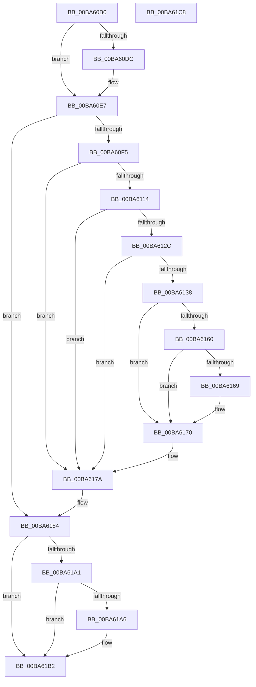

# ViKeAcquireSpinLockCommon

- RVA: `0x00BA60B0`–`0x00BA61C9` (길이 `281` bytes)
- VA: `0x0000000140BA60B0`
- 실행 섹션: `PAGEVRFY`
- PDB 이름 있음: `예`; PDB Function 태그: `아니요`
- unwind 정보 RVA: `0x000BCAF8`
- 디코드: `71`개 명령, `281/281` bytes 표시
- 미해석 바이트: `0` (있으면 어셈블리에 `.byte`로 보존)

> 이 문서는 커널 이미지의 기계어와 PDB 기호를 분석해 생성했습니다. 4번과 5번은 함수 원형과 자료형을 바이너리 사용 방식에서 추정한 C 해석이며 원본 소스 복구 결과는 아닙니다.

## 1. Dependencies

- 직접 호출 지점: **8**; 고유 호출 대상: **8**
- 직접 호출자로 확인된 함수: **1**
- RIP 상대 이미지 참조: **6**

### Outgoing calls
- `0x00BA60E2` → [VfMiscCheckKernelAddress](../../text/4B/VfMiscCheckKernelAddress_function_004BC694.md) (function, `0x004BC694`)
- `0x00BA6123` → [ViTargetUpdateTreeAllowed](../B9/ViTargetUpdateTreeAllowed_function_00B9BC04.md) (function, `0x00B9BC04`)
- `0x00BA612F` → [VfDriverIsKernelImageAddress](../BB/VfDriverIsKernelImageAddress_function_00BB7EBC.md) (function, `0x00BB7EBC`)
- `0x00BA613F` → [VfAvlInitializeLockContext](../../text/4A/VfAvlInitializeLockContext_function_004A686C.md) (function, `0x004A686C`)
- `0x00BA6156` → [VfAvlLookupTreeNode](../../text/3E/VfAvlLookupTreeNode_function_003EF1B4.md) (function, `0x003EF1B4`)
- `0x00BA6175` → [VfAvlCleanupLockContext](../../text/3E/VfAvlCleanupLockContext_function_003EF56C.md) (function, `0x003EF56C`)
- `0x00BA617C` → [ViKeIrqlLogAndTrimMemory](../BB/ViKeIrqlLogAndTrimMemory_function_00BB7F58.md) (function, `0x00BB7F58`)
- `0x00BA618E` → [guard_dispatch_icall](../../text/6B/guard_dispatch_icall_function_006BAAD0.md) (function, `0x006BAAD0`)

### Direct callers
- [VerifierPortKeAcquireSpinLock](VerifierPortKeAcquireSpinLock_function_00BA5E60.md) at `0x00BA5E6D`

### Static image references
- `0x00BA60CA` → RVA `0x00E681A0` (`.data`; read)
- `0x00BA60F5` → RVA `0x00F04A28` (`.data`; read)
- `0x00BA6102` → RVA `0x00F04A20` (`.data`; read)
- `0x00BA610C` → RVA `0x00F04A28` (`.data`; write)
- `0x00BA614F` → RVA `0x00F049A0` (`.data`; read)
- `0x00BA6184` → RVA `0x00FFDBA8` (`PAGEVRFD`; read)

## 2. Other-region calls and transfers

- 다른 실행 섹션으로 향하는 call: **5**
  - `0x00BA60E2` → [VfMiscCheckKernelAddress](../../text/4B/VfMiscCheckKernelAddress_function_004BC694.md) (`PAGEVRFY` → `.text`)
  - `0x00BA613F` → [VfAvlInitializeLockContext](../../text/4A/VfAvlInitializeLockContext_function_004A686C.md) (`PAGEVRFY` → `.text`)
  - `0x00BA6156` → [VfAvlLookupTreeNode](../../text/3E/VfAvlLookupTreeNode_function_003EF1B4.md) (`PAGEVRFY` → `.text`)
  - `0x00BA6175` → [VfAvlCleanupLockContext](../../text/3E/VfAvlCleanupLockContext_function_003EF56C.md) (`PAGEVRFY` → `.text`)
  - `0x00BA618E` → [guard_dispatch_icall](../../text/6B/guard_dispatch_icall_function_006BAAD0.md) (`PAGEVRFY` → `.text`)
- 별도 외부 분기/꼬리 이동을 확인하지 못했습니다.

## 3. Assembly (complete function range)

```asm
00BA60B0  48 89 5C 24 08                  mov qword ptr [rsp + 8], rbx
00BA60B5  48 89 74 24 10                  mov qword ptr [rsp + 0x10], rsi
00BA60BA  48 89 7C 24 18                  mov qword ptr [rsp + 0x18], rdi
00BA60BF  41 56                           push r14
00BA60C1  48 83 EC 40                     sub rsp, 0x40
00BA60C5  33 DB                           xor ebx, ebx
00BA60C7  4D 8B F0                        mov r14, r8
00BA60CA  F7 05 CC 20 2C 00 00 08 00 00   test dword ptr [rip + 0x2c20cc], 0x800
00BA60D4  48 8B FA                        mov rdi, rdx
00BA60D7  48 8B F1                        mov rsi, rcx
00BA60DA  74 0B                           je 0x140ba60e7
00BA60DC  4C 8B C2                        mov r8, rdx
00BA60DF  8D 53 08                        lea edx, [rbx + 8]
00BA60E2  E8 AD 65 91 FF                  call 0x1404bc694
00BA60E7  8B 05 B3 20 2C 00               mov eax, dword ptr [rip + 0x2c20b3]
00BA60ED  A8 02                           test al, 2
00BA60EF  0F 84 8F 00 00 00               je 0x140ba6184
00BA60F5  8B 05 2D E9 35 00               mov eax, dword ptr [rip + 0x35e92d]
00BA60FB  BB 01 00 00 00                  mov ebx, 1
00BA6100  03 C3                           add eax, ebx
00BA6102  F7 05 14 E9 35 00 00 10 00 00   test dword ptr [rip + 0x35e914], 0x1000
00BA610C  89 05 16 E9 35 00               mov dword ptr [rip + 0x35e916], eax
00BA6112  74 66                           je 0x140ba617a
00BA6114  33 C0                           xor eax, eax
00BA6116  0F 57 C0                        xorps xmm0, xmm0
00BA6119  0F 11 44 24 20                  movups xmmword ptr [rsp + 0x20], xmm0
00BA611E  48 89 44 24 30                  mov qword ptr [rsp + 0x30], rax
00BA6123  E8 DC 5A FF FF                  call 0x140b9bc04
00BA6128  85 C0                           test eax, eax
00BA612A  74 4E                           je 0x140ba617a
00BA612C  48 8B CF                        mov rcx, rdi
00BA612F  E8 88 1D 01 00                  call 0x140bb7ebc
00BA6134  85 C0                           test eax, eax
00BA6136  75 42                           jne 0x140ba617a
00BA6138  8B D3                           mov edx, ebx
00BA613A  48 8D 4C 24 20                  lea rcx, [rsp + 0x20]
00BA613F  E8 28 07 90 FF                  call 0x1404a686c
00BA6144  44 8B CB                        mov r9d, ebx
00BA6147  48 8D 54 24 20                  lea rdx, [rsp + 0x20]
00BA614C  4C 8B C7                        mov r8, rdi
00BA614F  48 8D 0D 4A E8 35 00            lea rcx, [rip + 0x35e84a]
00BA6156  E8 59 90 84 FF                  call 0x1403ef1b4
00BA615B  48 85 C0                        test rax, rax
00BA615E  74 10                           je 0x140ba6170
00BA6160  48 8B 40 40                     mov rax, qword ptr [rax + 0x40]
00BA6164  48 85 C0                        test rax, rax
00BA6167  74 07                           je 0x140ba6170
00BA6169  F0 01 98 A4 00 00 00            lock add dword ptr [rax + 0xa4], ebx
00BA6170  48 8D 4C 24 20                  lea rcx, [rsp + 0x20]
00BA6175  E8 F2 93 84 FF                  call 0x1403ef56c
00BA617A  B1 02                           mov cl, 2
00BA617C  E8 D7 1D 01 00                  call 0x140bb7f58
00BA6181  48 8B D8                        mov rbx, rax
00BA6184  48 8B 05 1D 7A 45 00            mov rax, qword ptr [rip + 0x457a1d]
00BA618B  48 8B CE                        mov rcx, rsi
00BA618E  E8 3D 49 B1 FF                  call 0x1406baad0
00BA6193  41 88 06                        mov byte ptr [r14], al
00BA6196  8B 0D 04 20 2C 00               mov ecx, dword ptr [rip + 0x2c2004]
00BA619C  F6 C1 02                        test cl, 2
00BA619F  74 11                           je 0x140ba61b2
00BA61A1  48 85 DB                        test rbx, rbx
00BA61A4  74 0C                           je 0x140ba61b2
00BA61A6  65 8B 04 25 A4 01 00 00         mov eax, dword ptr gs:[0x1a4]
00BA61AE  66 89 43 0A                     mov word ptr [rbx + 0xa], ax
00BA61B2  48 8B 5C 24 50                  mov rbx, qword ptr [rsp + 0x50]
00BA61B7  48 8B 74 24 58                  mov rsi, qword ptr [rsp + 0x58]
00BA61BC  48 8B 7C 24 60                  mov rdi, qword ptr [rsp + 0x60]
00BA61C1  48 83 C4 40                     add rsp, 0x40
00BA61C5  41 5E                           pop r14
00BA61C7  C3                              ret
00BA61C8  CC                              int3
```

## 4. C-style interpretation (structured pseudocode)

```c
__int64 __fastcall ViKeAcquireSpinLockCommon(__int64 a1, __int64 a2, __int64 a3)
{
    __int64 result;
    __int64 v_rbx;
    __int64 v_rsp;
    unsigned __int64 v_stack_m18;
    unsigned __int64 v_stack_m28;
    unsigned __int64 v_stack_p10;
    unsigned __int64 v_stack_p18;
    unsigned __int64 v_stack_p8;

    v_stack_p8 = v_rbx;
    v_stack_p10 = v_rsi;
    v_stack_p18 = v_rdi;
    v_rsp = (v_rsp) - (64);
    v_rbx = 0;
    if (((*(unsigned int *)(v_rip + 2891980)) & (0x800ULL)) != 0) {
        a3 = a2;
        a2 = v_rbx + 8;
        result = VfMiscCheckKernelAddress(a1, a2, a3, a4);
    }
    if ((((unsigned __int8)((unsigned int)(*(unsigned int *)(v_rip + 2891955)))) & (2)) == 0) goto loc_00BA6184;
    result = (unsigned int)(((unsigned int)(*(unsigned int *)(v_rip + 3533101))) + (1));
    *(unsigned int *)(v_rip + 3533078) = (unsigned int)(result);
    if (((*(unsigned int *)(v_rip + 3533076)) & (0x1000ULL)) == 0) goto loc_00BA617A;
    result = 0;
    v_stack_m28 = v_xmm0;
    v_stack_m18 = 0;
    result = ViTargetUpdateTreeAllowed(a1, a2, a3, a4);
    if ((unsigned int)(result) == 0) goto loc_00BA617A;
    result = VfDriverIsKernelImageAddress(a2, a2, a3, a4);
    if ((unsigned int)(result) != 0) goto loc_00BA617A;
    result = VfAvlInitializeLockContext(v_stack_m28, 1, a3, a4);
    result = VfAvlLookupTreeNode(v_rip + 3532874, v_stack_m28, a2, 1);
    if (result == 0) goto loc_00BA6170;
    if (*(unsigned __int64 *)(result + 64) != 0) {
    }
    result = VfAvlCleanupLockContext(v_stack_m28, v_stack_m28, a2, 1);
loc_00BA617A:
    result = ViKeIrqlLogAndTrimMemory(2, v_stack_m28, a2, 1);
loc_00BA6184:
    result = guard_dispatch_icall(a1, v_stack_m28, a2, 1);
    *(unsigned __int8 *)(a3) = (unsigned __int8)(result);
    if ((((unsigned __int8)((unsigned int)(*(unsigned int *)(v_rip + 2891780)))) & (2)) == 0) goto loc_00BA61B2;
    if (result != 0) {
        result = *(unsigned int *)(gs_base + (0 + 420));
        *(unsigned __int16 *)(result + 10) = (unsigned __int16)(result);
    }
    v_rsp = (v_rsp) + (64);
    return result;
}
```

## 5. (Beta) C Style

```c
int64_t ViKeAcquireSpinLockCommon(int64_t Arg1, int64_t Arg2, void *Arg3)
{
    uint8_t *arg3 = (uint8_t *)Arg3;

    int64_t result;
    int64_t local_rbx;
    int64_t local_rsp;
    uint64_t v_stack_m18;
    uint64_t v_stack_m28;
    uint64_t v_stack_p10;
    uint64_t v_stack_p18;
    uint64_t v_stack_p8;

    v_stack_p8 = local_rbx;
    v_stack_p10 = local_rsi;
    v_stack_p18 = local_rdi;
    local_rsp = (local_rsp) - (64);
    local_rbx = 0;
    if (((*(uint32_t *)(v_rip + 0x2C20CC)) & (0x800ULL)) != 0) {
        Arg3 = Arg2;
        Arg2 = local_rbx + 8;
        result = VfMiscCheckKernelAddress(Arg1, Arg2, Arg3, a4);
    }
    if ((((uint8_t)((uint32_t)(*(uint32_t *)(v_rip + 0x2C20B3)))) & (2)) == 0) goto loc_00BA6184;
    result = (uint32_t)(((uint32_t)(*(uint32_t *)(v_rip + 0x35E92D))) + (1));
    *(uint32_t *)(v_rip + 0x35E916) = (uint32_t)(result);
    if (((*(uint32_t *)(v_rip + 0x35E914)) & (0x1000ULL)) == 0) goto loc_00BA617A;
    result = 0;
    v_stack_m28 = v_xmm0;
    v_stack_m18 = 0;
    result = ViTargetUpdateTreeAllowed(Arg1, Arg2, Arg3, a4);
    if ((uint32_t)(result) == 0) goto loc_00BA617A;
    result = VfDriverIsKernelImageAddress(Arg2, Arg2, Arg3, a4);
    if ((uint32_t)(result) != 0) goto loc_00BA617A;
    result = VfAvlInitializeLockContext(v_stack_m28, 1, Arg3, a4);
    result = VfAvlLookupTreeNode(v_rip + 3532874, v_stack_m28, Arg2, 1);
    if (result == 0) goto loc_00BA6170;
    if (*(uint64_t *)(result + 0x40) != 0) {
    }
    result = VfAvlCleanupLockContext(v_stack_m28, v_stack_m28, Arg2, 1);
loc_00BA617A:
    result = ViKeIrqlLogAndTrimMemory(2, v_stack_m28, Arg2, 1);
loc_00BA6184:
    result = guard_dispatch_icall(Arg1, v_stack_m28, Arg2, 1);
    *(uint8_t *)(arg3) = (uint8_t)(result);
    if ((((uint8_t)((uint32_t)(*(uint32_t *)(v_rip + 0x2C2004)))) & (2)) == 0) goto loc_00BA61B2;
    if (result != 0) {
        result = *(uint32_t *)(gs_base + (0 + 0x1A4));
        *(uint16_t *)(result + 0xA) = (uint16_t)(result);
    }
    local_rsp = (local_rsp) + (64);
    return result;
}
```

### 관측된 메모리 오프셋

구조체 형식이 확인되지 않은 접근은 인자 기준의 오프셋으로만 기록했습니다.

| 기준 인자 | 오프셋 표현 | 폭 (bit) | 접근 |
|---|---:|---:|---|
| `Arg3` | `+ 0x0` | `8` | `W` |

## 6. Execution-region graph

[열기: 2D/3D 그래프와 함수 탐색 컨트롤 패널](../../../control-panel.html?section=pagevrfy&rva=0x00BA60B0&view=graph)

- 2D 그래프는 위에서 아래로 흐르고, 3D 그래프는 빈 공간을 드래그해 회전합니다. Shift+드래그는 이동, 휠은 확대·축소, 함수 노드 선택은 대상 보고서 이동입니다.

### Static fallback


