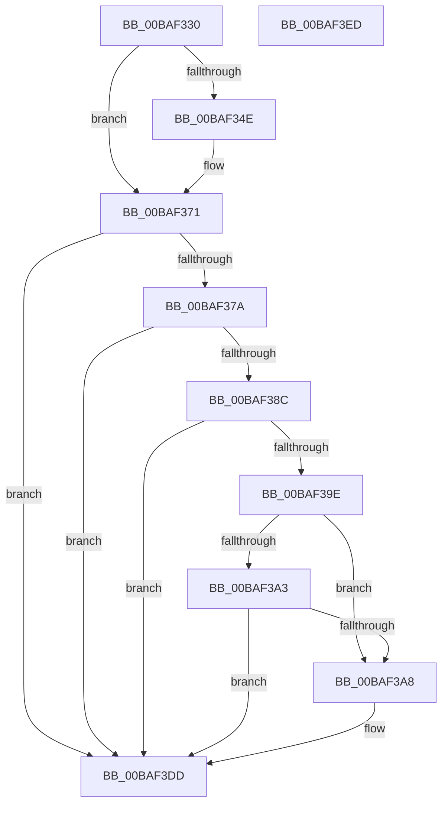

# ViMiscCheckResourceAcquire

- RVA: `0x00BAF330`–`0x00BAF3EE` (길이 `190` bytes)
- VA: `0x0000000140BAF330`
- 실행 섹션: `PAGEVRFY`
- PDB 이름 있음: `예`; PDB Function 태그: `아니요`
- unwind 정보 RVA: `0x000718AC`
- 디코드: `46`개 명령, `190/190` bytes 표시
- 미해석 바이트: `0` (있으면 어셈블리에 `.byte`로 보존)

> 이 문서는 커널 이미지의 기계어와 PDB 기호를 분석해 생성했습니다. 4번과 5번은 함수 원형과 자료형을 바이너리 사용 방식에서 추정한 C 해석이며 원본 소스 복구 결과는 아닙니다.

## 1. Dependencies

- 직접 호출 지점: **2**; 고유 호출 대상: **1**
- 직접 호출자로 확인된 함수: **1**
- RIP 상대 이미지 참조: **0**

### Outgoing calls
- `0x00BAF36C` → [CarReportRuleViolationFromNt](../B9/CarReportRuleViolationFromNt_function_00B9D904.md) (function, `0x00B9D904`)
- `0x00BAF3D8` → [CarReportRuleViolationFromNt](../B9/CarReportRuleViolationFromNt_function_00B9D904.md) (function, `0x00B9D904`)

### Direct callers
- [VfMiscExAcquireResourceExclusiveLite_Entry](VfMiscExAcquireResourceExclusiveLite_Entry_function_00BAD800.md) at `0x00BAD80E`

### Static image references
- 디코드된 RIP-relative 메모리 참조가 없습니다.

## 2. Other-region calls and transfers

- 다른 실행 섹션으로 향하는 call: **0**
- 별도 외부 분기/꼬리 이동을 확인하지 못했습니다.

## 3. Assembly (complete function range)

```asm
00BAF330  48 8B C4                        mov rax, rsp
00BAF333  48 89 58 08                     mov qword ptr [rax + 8], rbx
00BAF337  48 89 70 10                     mov qword ptr [rax + 0x10], rsi
00BAF33B  57                              push rdi
00BAF33C  48 83 EC 40                     sub rsp, 0x40
00BAF340  49 8B F8                        mov rdi, r8
00BAF343  40 8A F2                        mov sil, dl
00BAF346  48 8B D9                        mov rbx, rcx
00BAF349  F6 C1 07                        test cl, 7
00BAF34C  74 23                           je 0x140baf371
00BAF34E  4C 89 40 E8                     mov qword ptr [rax - 0x18], r8
00BAF352  45 33 C9                        xor r9d, r9d
00BAF355  C7 40 E0 0B 00 00 00            mov dword ptr [rax - 0x20], 0xb
00BAF35C  45 33 C0                        xor r8d, r8d
00BAF35F  48 89 48 D8                     mov qword ptr [rax - 0x28], rcx
00BAF363  B9 C4 00 00 00                  mov ecx, 0xc4
00BAF368  41 8D 51 3D                     lea edx, [r9 + 0x3d]
00BAF36C  E8 93 E5 FE FF                  call 0x140b9d904
00BAF371  44 0F 20 C2                     mov rdx, cr8
00BAF375  80 FA 01                        cmp dl, 1
00BAF378  74 63                           je 0x140baf3dd
00BAF37A  65 48 8B 04 25 88 01 00 00      mov rax, qword ptr gs:[0x188]
00BAF383  F7 40 74 00 04 00 00            test dword ptr [rax + 0x74], 0x400
00BAF38A  75 51                           jne 0x140baf3dd
00BAF38C  65 48 8B 04 25 88 01 00 00      mov rax, qword ptr gs:[0x188]
00BAF395  83 B8 E4 01 00 00 00            cmp dword ptr [rax + 0x1e4], 0
00BAF39C  75 3F                           jne 0x140baf3dd
00BAF39E  80 FA 02                        cmp dl, 2
00BAF3A1  75 05                           jne 0x140baf3a8
00BAF3A3  40 84 F6                        test sil, sil
00BAF3A6  74 35                           je 0x140baf3dd
00BAF3A8  65 48 8B 04 25 88 01 00 00      mov rax, qword ptr gs:[0x188]
00BAF3B1  B9 C4 00 00 00                  mov ecx, 0xc4
00BAF3B6  44 0F B6 C2                     movzx r8d, dl
00BAF3BA  BA 37 00 00 00                  mov edx, 0x37
00BAF3BF  48 89 7C 24 30                  mov qword ptr [rsp + 0x30], rdi
00BAF3C4  C7 44 24 28 0B 00 00 00         mov dword ptr [rsp + 0x28], 0xb
00BAF3CC  44 8B 88 E4 01 00 00            mov r9d, dword ptr [rax + 0x1e4]
00BAF3D3  48 89 5C 24 20                  mov qword ptr [rsp + 0x20], rbx
00BAF3D8  E8 27 E5 FE FF                  call 0x140b9d904
00BAF3DD  48 8B 5C 24 50                  mov rbx, qword ptr [rsp + 0x50]
00BAF3E2  48 8B 74 24 58                  mov rsi, qword ptr [rsp + 0x58]
00BAF3E7  48 83 C4 40                     add rsp, 0x40
00BAF3EB  5F                              pop rdi
00BAF3EC  C3                              ret
00BAF3ED  CC                              int3
```

## 4. C-style interpretation (structured pseudocode)

```c
__int64 __fastcall ViMiscCheckResourceAcquire(__int64 a1, unsigned __int8 a2, __int64 a3, int a4)
{
    __int64 result;
    __int64 v_rsp;
    unsigned __int64 v_stack_m18;
    unsigned int v_stack_m20;
    unsigned __int64 v_stack_m28;
    unsigned __int64 v_stack_p10;
    unsigned __int64 v_stack_p8;

    *(unsigned __int64 *)(v_rsp + 8) = v_rbx;
    *(unsigned __int64 *)(v_rsp + 16) = v_rsi;
    v_rsp = (v_rsp) - (64);
    result = v_rsp;
    if ((((unsigned __int8)(a1)) & (7)) != 0) {
        *(unsigned __int64 *)(v_rsp - 24) = a3;
        a4 = 0;
        *(unsigned int *)(v_rsp - 32) = 11;
        a3 = 0;
        *(unsigned __int64 *)(v_rsp - 40) = a1;
        a1 = 196;
        a2 = a4 + 61;
        result = CarReportRuleViolationFromNt(a1, a2, a3, a4);
    }
    if (((unsigned __int8)(v_cr8)) == 1) goto loc_00BAF3DD;
    if (((*(unsigned int *)(*(unsigned __int64 *)(gs_base + (0 + 392)) + 116)) & (0x400ULL)) != 0) goto loc_00BAF3DD;
    if ((*(unsigned int *)(*(unsigned __int64 *)(gs_base + (0 + 392)) + 484)) != 0) goto loc_00BAF3DD;
    if (((unsigned __int8)(v_cr8)) != 2) goto loc_00BAF3A8;
    result = *(unsigned __int64 *)(gs_base + (0 + 392));
    if (a2 != 0) {
        result = *(unsigned __int64 *)(gs_base + (0 + 392));
        a1 = 196;
        a3 = (unsigned __int8)(v_cr8);
        a2 = 55;
        v_stack_m18 = a3;
        v_stack_m20 = 11;
        a4 = *(unsigned int *)(result + 484);
        v_stack_m28 = a1;
        result = CarReportRuleViolationFromNt(a1, a2, a3, a4);
    }
    v_rsp = (v_rsp) + (64);
    return result;
}
```

## 5. (Beta) C Style

```c
int64_t ViMiscCheckResourceAcquire(int64_t Arg1, uint8_t Arg2, int64_t Arg3, int32_t Arg4)
{
    int64_t result;
    int64_t local_rsp;
    uint64_t v_stack_m18;
    uint32_t v_stack_m20;
    uint64_t v_stack_m28;
    uint64_t v_stack_p10;
    uint64_t v_stack_p8;

    *(uint64_t *)(local_rsp + 0x8) = local_rbx;
    *(uint64_t *)(local_rsp + 0x10) = local_rsi;
    local_rsp = (local_rsp) - (64);
    result = local_rsp;
    if ((((uint8_t)(Arg1)) & (7)) != 0) {
        *(uint64_t *)(local_rsp - 0x18) = Arg3;
        Arg4 = 0;
        *(uint32_t *)(local_rsp - 0x20) = 11;
        Arg3 = 0;
        *(uint64_t *)(local_rsp - 0x28) = Arg1;
        Arg1 = 196;
        Arg2 = Arg4 + 61;
        result = CarReportRuleViolationFromNt(Arg1, Arg2, Arg3, Arg4);
    }
    if (((uint8_t)(v_cr8)) == 1) goto loc_00BAF3DD;
    if (((*(uint32_t *)(*(uint64_t *)(gs_base + (0 + 0x188)) + 0x74)) & (0x400ULL)) != 0) goto loc_00BAF3DD;
    if ((*(uint32_t *)(*(uint64_t *)(gs_base + (0 + 0x188)) + 0x1E4)) != 0) goto loc_00BAF3DD;
    if (((uint8_t)(v_cr8)) != 2) goto loc_00BAF3A8;
    result = *(uint64_t *)(gs_base + (0 + 0x188));
    if (Arg2 != 0) {
        result = *(uint64_t *)(gs_base + (0 + 0x188));
        Arg1 = 196;
        Arg3 = (uint8_t)(v_cr8);
        Arg2 = 55;
        v_stack_m18 = Arg3;
        v_stack_m20 = 11;
        Arg4 = *(uint32_t *)(result + 0x1E4);
        v_stack_m28 = Arg1;
        result = CarReportRuleViolationFromNt(Arg1, Arg2, Arg3, Arg4);
    }
    local_rsp = (local_rsp) + (64);
    return result;
}
```

## 6. Execution-region graph

[열기: 2D/3D 그래프와 함수 탐색 컨트롤 패널](../../../control-panel.html?section=pagevrfy&rva=0x00BAF330&view=graph)

- 2D 그래프는 위에서 아래로 흐르고, 3D 그래프는 빈 공간을 드래그해 회전합니다. Shift+드래그는 이동, 휠은 확대·축소, 함수 노드 선택은 대상 보고서 이동입니다.

### Static fallback


