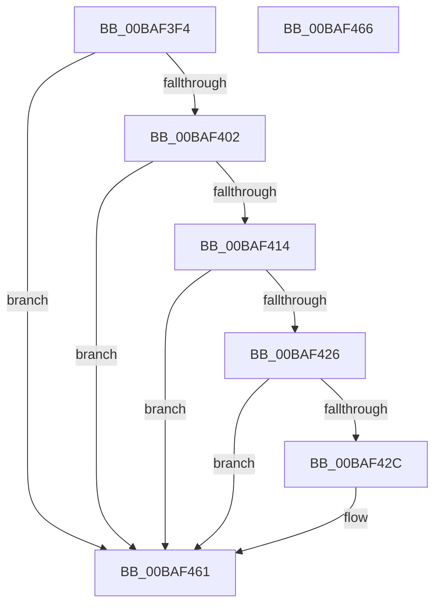

# ViMiscCheckResourceRelease

- RVA: `0x00BAF3F4`–`0x00BAF467` (길이 `115` bytes)
- VA: `0x0000000140BAF3F4`
- 실행 섹션: `PAGEVRFY`
- PDB 이름 있음: `예`; PDB Function 태그: `아니요`
- unwind 정보 RVA: `0x00063458`
- 디코드: `24`개 명령, `115/115` bytes 표시
- 미해석 바이트: `0` (있으면 어셈블리에 `.byte`로 보존)

> 이 문서는 커널 이미지의 기계어와 PDB 기호를 분석해 생성했습니다. 4번과 5번은 함수 원형과 자료형을 바이너리 사용 방식에서 추정한 C 해석이며 원본 소스 복구 결과는 아닙니다.

## 1. Dependencies

- 직접 호출 지점: **1**; 고유 호출 대상: **1**
- 직접 호출자로 확인된 함수: **2**
- RIP 상대 이미지 참조: **0**

### Outgoing calls
- `0x00BAF45C` → [CarReportRuleViolationFromNt](../B9/CarReportRuleViolationFromNt_function_00B9D904.md) (function, `0x00B9D904`)

### Direct callers
- [VfMiscExReleaseResourceAndLeaveCriticalRegion_Entry](VfMiscExReleaseResourceAndLeaveCriticalRegion_Entry_function_00BADA60.md) at `0x00BADA6B`
- [VfMiscExReleaseResourceForThreadLite_Entry](VfMiscExReleaseResourceForThreadLite_Entry_function_00BADA80.md) at `0x00BADA8B`

### Static image references
- 디코드된 RIP-relative 메모리 참조가 없습니다.

## 2. Other-region calls and transfers

- 다른 실행 섹션으로 향하는 call: **0**
- 별도 외부 분기/꼬리 이동을 확인하지 못했습니다.

## 3. Assembly (complete function range)

```asm
00BAF3F4  48 83 EC 48                     sub rsp, 0x48
00BAF3F8  45 0F 20 C2                     mov r10, cr8
00BAF3FC  41 80 FA 01                     cmp r10b, 1
00BAF400  74 5F                           je 0x140baf461
00BAF402  65 48 8B 04 25 88 01 00 00      mov rax, qword ptr gs:[0x188]
00BAF40B  F7 40 74 00 04 00 00            test dword ptr [rax + 0x74], 0x400
00BAF412  75 4D                           jne 0x140baf461
00BAF414  65 48 8B 04 25 88 01 00 00      mov rax, qword ptr gs:[0x188]
00BAF41D  83 B8 E4 01 00 00 00            cmp dword ptr [rax + 0x1e4], 0
00BAF424  75 3B                           jne 0x140baf461
00BAF426  41 80 FA 02                     cmp r10b, 2
00BAF42A  74 35                           je 0x140baf461
00BAF42C  65 48 8B 04 25 88 01 00 00      mov rax, qword ptr gs:[0x188]
00BAF435  48 89 54 24 30                  mov qword ptr [rsp + 0x30], rdx
00BAF43A  BA 38 00 00 00                  mov edx, 0x38
00BAF43F  C7 44 24 28 0B 00 00 00         mov dword ptr [rsp + 0x28], 0xb
00BAF447  48 89 4C 24 20                  mov qword ptr [rsp + 0x20], rcx
00BAF44C  B9 C4 00 00 00                  mov ecx, 0xc4
00BAF451  44 8B 88 E4 01 00 00            mov r9d, dword ptr [rax + 0x1e4]
00BAF458  45 0F B6 C2                     movzx r8d, r10b
00BAF45C  E8 A3 E4 FE FF                  call 0x140b9d904
00BAF461  48 83 C4 48                     add rsp, 0x48
00BAF465  C3                              ret
00BAF466  CC                              int3
```

## 4. C-style interpretation (structured pseudocode)

```c
__int64 __fastcall ViMiscCheckResourceRelease(__int64 a1, __int64 a2)
{
    __int64 result;
    __int64 v_rsp;
    unsigned __int64 v_stack_m18;
    unsigned int v_stack_m20;
    unsigned __int64 v_stack_m28;

    v_rsp = (v_rsp) - (72);
    if (((unsigned __int8)(v_cr8)) == 1) goto loc_00BAF461;
    if (((*(unsigned int *)(*(unsigned __int64 *)(gs_base + (0 + 392)) + 116)) & (0x400ULL)) != 0) goto loc_00BAF461;
    if ((*(unsigned int *)(*(unsigned __int64 *)(gs_base + (0 + 392)) + 484)) != 0) goto loc_00BAF461;
    result = *(unsigned __int64 *)(gs_base + (0 + 392));
    if (((unsigned __int8)(v_cr8)) != 2) {
        result = *(unsigned __int64 *)(gs_base + (0 + 392));
        v_stack_m18 = a2;
        a2 = 56;
        v_stack_m20 = 11;
        v_stack_m28 = a1;
        a1 = 196;
        a4 = *(unsigned int *)(result + 484);
        a3 = (unsigned __int8)(v_cr8);
        result = CarReportRuleViolationFromNt(a1, a2, a3, a4);
    }
    v_rsp = (v_rsp) + (72);
    return result;
}
```

## 5. (Beta) C Style

```c
int64_t ViMiscCheckResourceRelease(int64_t Arg1, int64_t Arg2)
{
    int64_t result;
    int64_t local_rsp;
    uint64_t v_stack_m18;
    uint32_t v_stack_m20;
    uint64_t v_stack_m28;

    local_rsp = (local_rsp) - (72);
    if (((uint8_t)(v_cr8)) == 1) goto loc_00BAF461;
    if (((*(uint32_t *)(*(uint64_t *)(gs_base + (0 + 0x188)) + 0x74)) & (0x400ULL)) != 0) goto loc_00BAF461;
    if ((*(uint32_t *)(*(uint64_t *)(gs_base + (0 + 0x188)) + 0x1E4)) != 0) goto loc_00BAF461;
    result = *(uint64_t *)(gs_base + (0 + 0x188));
    if (((uint8_t)(v_cr8)) != 2) {
        result = *(uint64_t *)(gs_base + (0 + 0x188));
        v_stack_m18 = Arg2;
        Arg2 = 56;
        v_stack_m20 = 11;
        v_stack_m28 = Arg1;
        Arg1 = 196;
        a4 = *(uint32_t *)(result + 0x1E4);
        a3 = (uint8_t)(v_cr8);
        result = CarReportRuleViolationFromNt(Arg1, Arg2, a3, a4);
    }
    local_rsp = (local_rsp) + (72);
    return result;
}
```

## 6. Execution-region graph

[열기: 2D/3D 그래프와 함수 탐색 컨트롤 패널](../../../control-panel.html?section=pagevrfy&rva=0x00BAF3F4&view=graph)

- 2D 그래프는 위에서 아래로 흐르고, 3D 그래프는 빈 공간을 드래그해 회전합니다. Shift+드래그는 이동, 휠은 확대·축소, 함수 노드 선택은 대상 보고서 이동입니다.

### Static fallback


