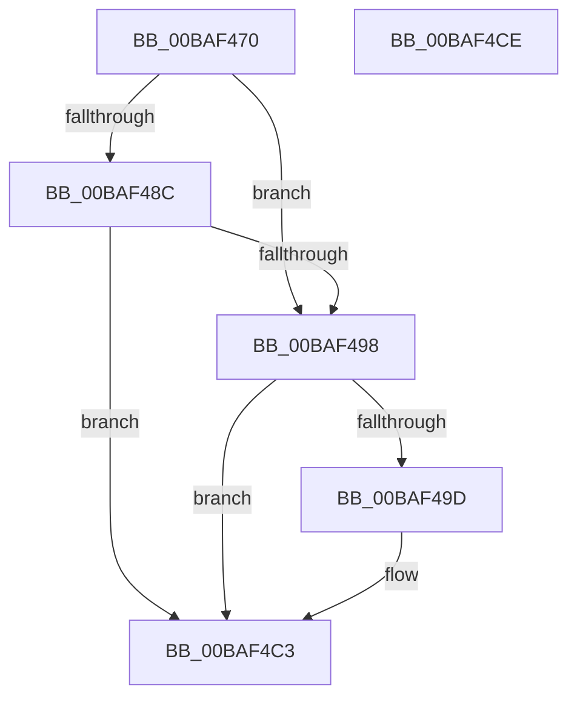

# ViMiscEnforceRule

- RVA: `0x00BAF470`–`0x00BAF4CF` (길이 `95` bytes)
- VA: `0x0000000140BAF470`
- 실행 섹션: `PAGEVRFY`
- PDB 이름 있음: `예`; PDB Function 태그: `아니요`
- unwind 정보 RVA: `0x00065960`
- 디코드: `26`개 명령, `95/95` bytes 표시
- 미해석 바이트: `0` (있으면 어셈블리에 `.byte`로 보존)

> 이 문서는 커널 이미지의 기계어와 PDB 기호를 분석해 생성했습니다. 4번과 5번은 함수 원형과 자료형을 바이너리 사용 방식에서 추정한 C 해석이며 원본 소스 복구 결과는 아닙니다.

## 1. Dependencies

- 직접 호출 지점: **2**; 고유 호출 대상: **2**
- 직접 호출자로 확인된 함수: **2**
- RIP 상대 이미지 참조: **1**

### Outgoing calls
- `0x00BAF48F` → [VfUtilIsSignedDriver](../../text/61/VfUtilIsSignedDriver_function_00612318.md) (function, `0x00612318`)
- `0x00BAF4BE` → [CarReportRuleViolationFromNt](../B9/CarReportRuleViolationFromNt_function_00B9D904.md) (function, `0x00B9D904`)

### Direct callers
- [VfMiscMmAllocateContiguousMemoryEx_Entry](VfMiscMmAllocateContiguousMemoryEx_Entry_function_00BAE090.md) at `0x00BAE0A0`
- [VfMiscMmAllocateContiguousMemory_Entry](VfMiscMmAllocateContiguousMemory_Entry_function_00BAE0C0.md) at `0x00BAE0D0`

### Static image references
- `0x00BAF47A` → RVA `0x00E681A0` (`.data`; read)

## 2. Other-region calls and transfers

- 다른 실행 섹션으로 향하는 call: **1**
  - `0x00BAF48F` → [VfUtilIsSignedDriver](../../text/61/VfUtilIsSignedDriver_function_00612318.md) (`PAGEVRFY` → `.text`)
- 별도 외부 분기/꼬리 이동을 확인하지 못했습니다.

## 3. Assembly (complete function range)

```asm
00BAF470  48 89 5C 24 08                  mov qword ptr [rsp + 8], rbx
00BAF475  57                              push rdi
00BAF476  48 83 EC 40                     sub rsp, 0x40
00BAF47A  F7 05 1C 8D 2B 00 00 00 40 00   test dword ptr [rip + 0x2b8d1c], 0x400000
00BAF484  41 8A F8                        mov dil, r8b
00BAF487  48 8B DA                        mov rbx, rdx
00BAF48A  75 0C                           jne 0x140baf498
00BAF48C  48 8B CA                        mov rcx, rdx
00BAF48F  E8 84 2E A6 FF                  call 0x140612318
00BAF494  84 C0                           test al, al
00BAF496  75 2B                           jne 0x140baf4c3
00BAF498  40 84 FF                        test dil, dil
00BAF49B  74 26                           je 0x140baf4c3
00BAF49D  BA 8B 00 00 00                  mov edx, 0x8b
00BAF4A2  48 89 5C 24 30                  mov qword ptr [rsp + 0x30], rbx
00BAF4A7  C7 44 24 28 0B 00 00 00         mov dword ptr [rsp + 0x28], 0xb
00BAF4AF  45 33 C9                        xor r9d, r9d
00BAF4B2  48 83 64 24 20 00               and qword ptr [rsp + 0x20], 0
00BAF4B8  45 33 C0                        xor r8d, r8d
00BAF4BB  8D 4A 39                        lea ecx, [rdx + 0x39]
00BAF4BE  E8 41 E4 FE FF                  call 0x140b9d904
00BAF4C3  48 8B 5C 24 50                  mov rbx, qword ptr [rsp + 0x50]
00BAF4C8  48 83 C4 40                     add rsp, 0x40
00BAF4CC  5F                              pop rdi
00BAF4CD  C3                              ret
00BAF4CE  CC                              int3
```

## 4. C-style interpretation (structured pseudocode)

```c
__int64 __fastcall ViMiscEnforceRule(__int64 a1, __int64 a2, int a3, int a4)
{
    __int64 result;
    __int64 v_rsp;
    unsigned __int64 v_stack_m18;
    unsigned int v_stack_m20;
    unsigned __int64 v_stack_m28;
    unsigned __int64 v_stack_p8;

    v_stack_p8 = v_rbx;
    v_rsp = (v_rsp) - (64);
    if (((*(unsigned int *)(v_rip + 2854172)) & (0x400000ULL)) != 0) goto loc_00BAF498;
    result = VfUtilIsSignedDriver(a2, a2, a3, a4);
    if ((unsigned __int8)(result) != 0) goto loc_00BAF4C3;
loc_00BAF498:
    if ((unsigned __int8)((unsigned __int8)(a3)) != 0) {
        a2 = 139;
        v_stack_m18 = a2;
        v_stack_m20 = 11;
        a4 = 0;
        a3 = 0;
        a1 = a2 + 57;
        result = CarReportRuleViolationFromNt(a1, a2, a3, a4);
    }
    v_rsp = (v_rsp) + (64);
    return result;
}
```

## 5. (Beta) C Style

```c
int64_t ViMiscEnforceRule(int64_t Arg1, int64_t Arg2, int32_t Arg3, int32_t Arg4)
{
    int64_t result;
    int64_t local_rsp;
    uint64_t v_stack_m18;
    uint32_t v_stack_m20;
    uint64_t v_stack_m28;
    uint64_t v_stack_p8;

    v_stack_p8 = local_rbx;
    local_rsp = (local_rsp) - (64);
    if (((*(uint32_t *)(v_rip + 0x2B8D1C)) & (0x400000ULL)) != 0) goto loc_00BAF498;
    result = VfUtilIsSignedDriver(Arg2, Arg2, Arg3, Arg4);
    if ((uint8_t)(result) != 0) goto loc_00BAF4C3;
loc_00BAF498:
    if ((uint8_t)((uint8_t)(Arg3)) != 0) {
        Arg2 = 139;
        v_stack_m18 = Arg2;
        v_stack_m20 = 11;
        Arg4 = 0;
        Arg3 = 0;
        Arg1 = Arg2 + 57;
        result = CarReportRuleViolationFromNt(Arg1, Arg2, Arg3, Arg4);
    }
    local_rsp = (local_rsp) + (64);
    return result;
}
```

## 6. Execution-region graph

[열기: 2D/3D 그래프와 함수 탐색 컨트롤 패널](../../../control-panel.html?section=pagevrfy&rva=0x00BAF470&view=graph)

- 2D 그래프는 위에서 아래로 흐르고, 3D 그래프는 빈 공간을 드래그해 회전합니다. Shift+드래그는 이동, 휠은 확대·축소, 함수 노드 선택은 대상 보고서 이동입니다.

### Static fallback


