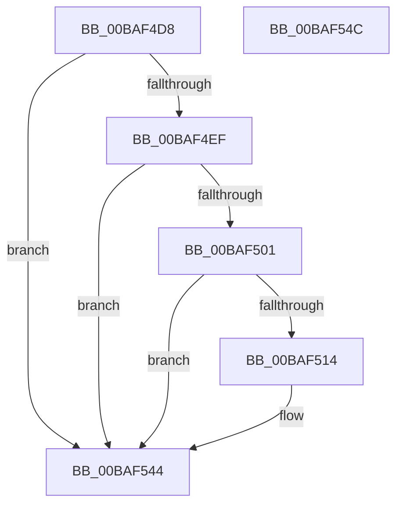

# ViMiscExCheckAPCsDisabled

- RVA: `0x00BAF4D8`–`0x00BAF54D` (길이 `117` bytes)
- VA: `0x0000000140BAF4D8`
- 실행 섹션: `PAGEVRFY`
- PDB 이름 있음: `예`; PDB Function 태그: `아니요`
- unwind 정보 RVA: `0x000697A4`
- 디코드: `27`개 명령, `117/117` bytes 표시
- 미해석 바이트: `0` (있으면 어셈블리에 `.byte`로 보존)

> 이 문서는 커널 이미지의 기계어와 PDB 기호를 분석해 생성했습니다. 4번과 5번은 함수 원형과 자료형을 바이너리 사용 방식에서 추정한 C 해석이며 원본 소스 복구 결과는 아닙니다.

## 1. Dependencies

- 직접 호출 지점: **1**; 고유 호출 대상: **1**
- 직접 호출자로 확인된 함수: **5**
- RIP 상대 이미지 참조: **0**

### Outgoing calls
- `0x00BAF53F` → [CarReportRuleViolationFromNt](../B9/CarReportRuleViolationFromNt_function_00B9D904.md) (function, `0x00B9D904`)

### Direct callers
- [VfMiscExAcquireFastMutexUnsafe_Entry](VfMiscExAcquireFastMutexUnsafe_Entry_function_00BAD7D0.md) at `0x00BAD7E0`
- [VfMiscExReleaseFastMutexUnsafe_Entry](VfMiscExReleaseFastMutexUnsafe_Entry_function_00BADA00.md) at `0x00BADA10`
- [VfMiscExReleaseFastMutex_Entry](VfMiscExReleaseFastMutex_Entry_function_00BADA30.md) at `0x00BADA40`
- [VfMiscExfAcquirePushLockExclusive_Entry](VfMiscExfAcquirePushLockExclusive_Entry_function_00BADAA0.md) at `0x00BADAB0`
- [VfMiscExfReleasePushLockShared_Entry](VfMiscExfReleasePushLockShared_Entry_function_00BADAD0.md) at `0x00BADAE0`

### Static image references
- 디코드된 RIP-relative 메모리 참조가 없습니다.

## 2. Other-region calls and transfers

- 다른 실행 섹션으로 향하는 call: **0**
- 별도 외부 분기/꼬리 이동을 확인하지 못했습니다.

## 3. Assembly (complete function range)

```asm
00BAF4D8  40 53                           push rbx
00BAF4DA  48 83 EC 40                     sub rsp, 0x40
00BAF4DE  4C 8B DA                        mov r11, rdx
00BAF4E1  4D 8B D0                        mov r10, r8
00BAF4E4  8B D1                           mov edx, ecx
00BAF4E6  44 0F 20 C3                     mov rbx, cr8
00BAF4EA  80 FB 01                        cmp bl, 1
00BAF4ED  74 55                           je 0x140baf544
00BAF4EF  65 48 8B 04 25 88 01 00 00      mov rax, qword ptr gs:[0x188]
00BAF4F8  F7 40 74 00 04 00 00            test dword ptr [rax + 0x74], 0x400
00BAF4FF  75 43                           jne 0x140baf544
00BAF501  65 4C 8B 0C 25 88 01 00 00      mov r9, qword ptr gs:[0x188]
00BAF50A  41 83 B9 E4 01 00 00 00         cmp dword ptr [r9 + 0x1e4], 0
00BAF512  75 30                           jne 0x140baf544
00BAF514  65 48 8B 0C 25 88 01 00 00      mov rcx, qword ptr gs:[0x188]
00BAF51D  4C 89 54 24 30                  mov qword ptr [rsp + 0x30], r10
00BAF522  44 0F B6 C3                     movzx r8d, bl
00BAF526  C7 44 24 28 0B 00 00 00         mov dword ptr [rsp + 0x28], 0xb
00BAF52E  44 8B 89 E4 01 00 00            mov r9d, dword ptr [rcx + 0x1e4]
00BAF535  B9 C4 00 00 00                  mov ecx, 0xc4
00BAF53A  4C 89 5C 24 20                  mov qword ptr [rsp + 0x20], r11
00BAF53F  E8 C0 E3 FE FF                  call 0x140b9d904
00BAF544  8A C3                           mov al, bl
00BAF546  48 83 C4 40                     add rsp, 0x40
00BAF54A  5B                              pop rbx
00BAF54B  C3                              ret
00BAF54C  CC                              int3
```

## 4. C-style interpretation (structured pseudocode)

```c
__int64 __fastcall ViMiscExCheckAPCsDisabled(int a1, __int64 a2, __int64 a3)
{
    __int64 result;
    __int64 v_rsp;
    unsigned __int64 v_stack_m18;
    unsigned int v_stack_m20;
    unsigned __int64 v_stack_m28;

    v_rsp = (v_rsp) - (64);
    if (((unsigned __int8)(v_cr8)) == 1) goto loc_00BAF544;
    if (((*(unsigned int *)(*(unsigned __int64 *)(gs_base + (0 + 392)) + 116)) & (0x400ULL)) != 0) goto loc_00BAF544;
    result = *(unsigned __int64 *)(gs_base + (0 + 392));
    if ((*(unsigned int *)(*(unsigned __int64 *)(gs_base + (0 + 392)) + 484)) == 0) {
        a1 = *(unsigned __int64 *)(gs_base + (0 + 392));
        v_stack_m18 = a3;
        a3 = (unsigned __int8)(v_cr8);
        v_stack_m20 = 11;
        a4 = *(unsigned int *)(a1 + 484);
        a1 = 196;
        v_stack_m28 = a2;
        result = CarReportRuleViolationFromNt(a1, (unsigned int)(a1), a3, a4);
    }
    v_rsp = (v_rsp) + (64);
    return (unsigned __int8)(v_cr8);
}
```

## 5. (Beta) C Style

```c
int64_t ViMiscExCheckAPCsDisabled(int32_t Arg1, int64_t Arg2, int64_t Arg3)
{
    int64_t result;
    int64_t local_rsp;
    uint64_t v_stack_m18;
    uint32_t v_stack_m20;
    uint64_t v_stack_m28;

    local_rsp = (local_rsp) - (64);
    if (((uint8_t)(v_cr8)) == 1) goto loc_00BAF544;
    if (((*(uint32_t *)(*(uint64_t *)(gs_base + (0 + 0x188)) + 0x74)) & (0x400ULL)) != 0) goto loc_00BAF544;
    result = *(uint64_t *)(gs_base + (0 + 0x188));
    if ((*(uint32_t *)(*(uint64_t *)(gs_base + (0 + 0x188)) + 0x1E4)) == 0) {
        Arg1 = *(uint64_t *)(gs_base + (0 + 0x188));
        v_stack_m18 = Arg3;
        Arg3 = (uint8_t)(v_cr8);
        v_stack_m20 = 11;
        a4 = *(uint32_t *)(Arg1 + 0x1E4);
        Arg1 = 196;
        v_stack_m28 = Arg2;
        result = CarReportRuleViolationFromNt(Arg1, (uint32_t)(Arg1), Arg3, a4);
    }
    local_rsp = (local_rsp) + (64);
    return (uint8_t)(v_cr8);
}
```

## 6. Execution-region graph

[열기: 2D/3D 그래프와 함수 탐색 컨트롤 패널](../../../control-panel.html?section=pagevrfy&rva=0x00BAF4D8&view=graph)

- 2D 그래프는 위에서 아래로 흐르고, 3D 그래프는 빈 공간을 드래그해 회전합니다. Shift+드래그는 이동, 휠은 확대·축소, 함수 노드 선택은 대상 보고서 이동입니다.

### Static fallback


