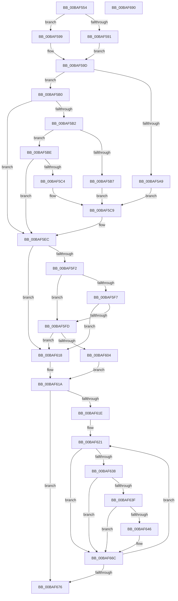

# ViMiscValidateKeWaitUsage

- RVA: `0x00BAF554`–`0x00BAF691` (길이 `317` bytes)
- VA: `0x0000000140BAF554`
- 실행 섹션: `PAGEVRFY`
- PDB 이름 있음: `예`; PDB Function 태그: `아니요`
- unwind 정보 RVA: `0x0007EE78`
- 디코드: `91`개 명령, `317/317` bytes 표시
- 미해석 바이트: `0` (있으면 어셈블리에 `.byte`로 보존)

> 이 문서는 커널 이미지의 기계어와 PDB 기호를 분석해 생성했습니다. 4번과 5번은 함수 원형과 자료형을 바이너리 사용 방식에서 추정한 C 해석이며 원본 소스 복구 결과는 아닙니다.

## 1. Dependencies

- 직접 호출 지점: **4**; 고유 호출 대상: **3**
- 직접 호출자로 확인된 함수: **2**
- RIP 상대 이미지 참조: **0**

### Outgoing calls
- `0x00BAF5E7` → [CarReportRuleViolationFromNt](../B9/CarReportRuleViolationFromNt_function_00B9D904.md) (function, `0x00B9D904`)
- `0x00BAF60E` → [RtlpGetStackLimits](../../text/2F/RtlpGetStackLimits_function_002F5F50.md) (function, `0x002F5F50`)
- `0x00BAF62F` → [ViMiscValidateSynchronizationObject](ViMiscValidateSynchronizationObject_function_00BAF698.md) (function, `0x00BAF698`)
- `0x00BAF667` → [CarReportRuleViolationFromNt](../B9/CarReportRuleViolationFromNt_function_00B9D904.md) (function, `0x00B9D904`)

### Direct callers
- [VfMiscKeWaitForMultipleObjects_Entry](VfMiscKeWaitForMultipleObjects_Entry_function_00BAE030.md) at `0x00BAE04B`
- [VfMiscKeWaitForSingleObject_Entry](VfMiscKeWaitForSingleObject_Entry_function_00BAE060.md) at `0x00BAE07D`

### Static image references
- 디코드된 RIP-relative 메모리 참조가 없습니다.

## 2. Other-region calls and transfers

- 다른 실행 섹션으로 향하는 call: **1**
  - `0x00BAF60E` → [RtlpGetStackLimits](../../text/2F/RtlpGetStackLimits_function_002F5F50.md) (`PAGEVRFY` → `.text`)
- 별도 외부 분기/꼬리 이동을 확인하지 못했습니다.

## 3. Assembly (complete function range)

```asm
00BAF554  48 8B C4                        mov rax, rsp
00BAF557  48 89 58 08                     mov qword ptr [rax + 8], rbx
00BAF55B  48 89 68 10                     mov qword ptr [rax + 0x10], rbp
00BAF55F  48 89 70 18                     mov qword ptr [rax + 0x18], rsi
00BAF563  57                              push rdi
00BAF564  41 56                           push r14
00BAF566  41 57                           push r15
00BAF568  48 83 EC 50                     sub rsp, 0x50
00BAF56C  48 83 60 D8 00                  and qword ptr [rax - 0x28], 0
00BAF571  49 8B D9                        mov rbx, r9
00BAF574  48 83 60 E0 00                  and qword ptr [rax - 0x20], 0
00BAF579  41 8A F0                        mov sil, r8b
00BAF57C  65 48 8B 3C 25 88 01 00 00      mov rdi, qword ptr gs:[0x188]
00BAF585  4C 8B F2                        mov r14, rdx
00BAF588  8B E9                           mov ebp, ecx
00BAF58A  8B 47 74                        mov eax, dword ptr [rdi + 0x74]
00BAF58D  A8 04                           test al, 4
00BAF58F  74 08                           je 0x140baf599
00BAF591  8A 87 86 01 00 00               mov al, byte ptr [rdi + 0x186]
00BAF597  EB 04                           jmp 0x140baf59d
00BAF599  44 0F 20 C0                     mov rax, cr8
00BAF59D  4C 8B BC 24 90 00 00 00         mov r15, qword ptr [rsp + 0x90]
00BAF5A5  3C 02                           cmp al, 2
00BAF5A7  76 07                           jbe 0x140baf5b0
00BAF5A9  BA 20 01 00 00                  mov edx, 0x120
00BAF5AE  EB 19                           jmp 0x140baf5c9
00BAF5B0  75 3A                           jne 0x140baf5ec
00BAF5B2  48 85 DB                        test rbx, rbx
00BAF5B5  75 07                           jne 0x140baf5be
00BAF5B7  BA 21 01 00 00                  mov edx, 0x121
00BAF5BC  EB 0B                           jmp 0x140baf5c9
00BAF5BE  49 83 39 00                     cmp qword ptr [r9], 0
00BAF5C2  74 28                           je 0x140baf5ec
00BAF5C4  BA 22 01 00 00                  mov edx, 0x122
00BAF5C9  4D 8B 0E                        mov r9, qword ptr [r14]
00BAF5CC  B9 C4 00 00 00                  mov ecx, 0xc4
00BAF5D1  4C 89 7C 24 30                  mov qword ptr [rsp + 0x30], r15
00BAF5D6  C7 44 24 28 0B 00 00 00         mov dword ptr [rsp + 0x28], 0xb
00BAF5DE  44 0F B6 C0                     movzx r8d, al
00BAF5E2  48 89 5C 24 20                  mov qword ptr [rsp + 0x20], rbx
00BAF5E7  E8 18 E3 FE FF                  call 0x140b9d904
00BAF5EC  40 80 FE 01                     cmp sil, 1
00BAF5F0  75 26                           jne 0x140baf618
00BAF5F2  48 85 DB                        test rbx, rbx
00BAF5F5  74 06                           je 0x140baf5fd
00BAF5F7  48 83 3B 00                     cmp qword ptr [rbx], 0
00BAF5FB  74 1B                           je 0x140baf618
00BAF5FD  8B 47 78                        mov eax, dword ptr [rdi + 0x78]
00BAF600  A8 40                           test al, 0x40
00BAF602  74 14                           je 0x140baf618
00BAF604  48 8D 54 24 48                  lea rdx, [rsp + 0x48]
00BAF609  48 8D 4C 24 40                  lea rcx, [rsp + 0x40]
00BAF60E  E8 3D 69 74 FF                  call 0x1402f5f50
00BAF613  0F B6 F0                        movzx esi, al
00BAF616  EB 02                           jmp 0x140baf61a
00BAF618  33 F6                           xor esi, esi
00BAF61A  85 ED                           test ebp, ebp
00BAF61C  74 58                           je 0x140baf676
00BAF61E  48 8B FD                        mov rdi, rbp
00BAF621  49 8B 1E                        mov rbx, qword ptr [r14]
00BAF624  4D 8B C7                        mov r8, r15
00BAF627  48 8B CB                        mov rcx, rbx
00BAF62A  BA 01 00 00 00                  mov edx, 1
00BAF62F  E8 64 00 00 00                  call 0x140baf698
00BAF634  85 F6                           test esi, esi
00BAF636  74 34                           je 0x140baf66c
00BAF638  48 3B 5C 24 40                  cmp rbx, qword ptr [rsp + 0x40]
00BAF63D  72 2D                           jb 0x140baf66c
00BAF63F  48 3B 5C 24 48                  cmp rbx, qword ptr [rsp + 0x48]
00BAF644  73 26                           jae 0x140baf66c
00BAF646  BA 23 01 00 00                  mov edx, 0x123
00BAF64B  4C 89 7C 24 30                  mov qword ptr [rsp + 0x30], r15
00BAF650  C7 44 24 28 0B 00 00 00         mov dword ptr [rsp + 0x28], 0xb
00BAF658  45 33 C9                        xor r9d, r9d
00BAF65B  48 83 64 24 20 00               and qword ptr [rsp + 0x20], 0
00BAF661  4C 8B C3                        mov r8, rbx
00BAF664  8D 4A A1                        lea ecx, [rdx - 0x5f]
00BAF667  E8 98 E2 FE FF                  call 0x140b9d904
00BAF66C  49 83 C6 08                     add r14, 8
00BAF670  48 83 EF 01                     sub rdi, 1
00BAF674  75 AB                           jne 0x140baf621
00BAF676  4C 8D 5C 24 50                  lea r11, [rsp + 0x50]
00BAF67B  49 8B 5B 20                     mov rbx, qword ptr [r11 + 0x20]
00BAF67F  49 8B 6B 28                     mov rbp, qword ptr [r11 + 0x28]
00BAF683  49 8B 73 30                     mov rsi, qword ptr [r11 + 0x30]
00BAF687  49 8B E3                        mov rsp, r11
00BAF68A  41 5F                           pop r15
00BAF68C  41 5E                           pop r14
00BAF68E  5F                              pop rdi
00BAF68F  C3                              ret
00BAF690  CC                              int3
```

## 4. C-style interpretation (structured pseudocode)

```c
__int64 __fastcall ViMiscValidateKeWaitUsage(int a1, __int64 a2, unsigned __int8 a3, __int64 a4, __int64 a5)
{
    __int64 result;
    __int64 v_r14;
    __int64 v_rdi;
    __int64 v_rsi;
    __int64 v_rsp;
    unsigned __int64 v_stack_m18;
    unsigned __int64 v_stack_m20;
    unsigned __int64 v_stack_m28;
    unsigned __int64 v_stack_m38;
    unsigned int v_stack_m40;
    unsigned __int64 v_stack_m48;

    *(unsigned __int64 *)(v_rsp + 8) = v_rbx;
    *(unsigned __int64 *)(v_rsp + 16) = v_rbp;
    *(unsigned __int64 *)(v_rsp + 24) = v_rsi;
    v_rsp = (v_rsp) - (80);
    if ((((unsigned __int8)((unsigned int)(*(unsigned int *)(*(unsigned __int64 *)(gs_base + (0 + 392)) + 116)))) & (4)) == 0) goto loc_00BAF599;
    goto loc_00BAF59D;
loc_00BAF599:
loc_00BAF59D:
    if (((unsigned __int8)(v_cr8)) <= 2) goto loc_00BAF5B0;
    goto loc_00BAF5C9;
loc_00BAF5B0:
    if (((unsigned __int8)(v_cr8)) != 2) goto loc_00BAF5EC;
    if (a4 != 0) goto loc_00BAF5BE;
    goto loc_00BAF5C9;
loc_00BAF5BE:
    if ((*(unsigned __int64 *)(a4)) == 0) goto loc_00BAF5EC;
loc_00BAF5C9:
    v_stack_m38 = a5;
    v_stack_m40 = 11;
    v_stack_m48 = a4;
    result = CarReportRuleViolationFromNt(196, 290, (unsigned __int8)(v_cr8), *(unsigned __int64 *)(a2));
loc_00BAF5EC:
    if (a3 != 1) goto loc_00BAF618;
    if (a4 == 0) goto loc_00BAF5FD;
    if ((*(unsigned __int64 *)(a4)) == 0) goto loc_00BAF618;
loc_00BAF5FD:
    if ((((unsigned __int8)((unsigned int)(*(unsigned int *)(*(unsigned __int64 *)(gs_base + (0 + 392)) + 120)))) & (64)) == 0) goto loc_00BAF618;
    result = RtlpGetStackLimits(v_stack_m28, v_stack_m20, (unsigned __int8)(v_cr8), *(unsigned __int64 *)(a2));
    goto loc_00BAF61A;
loc_00BAF618:
    v_rsi = 0;
loc_00BAF61A:
    if ((unsigned int)((unsigned int)(a1)) == 0) goto loc_00BAF676;
loc_00BAF621:
    result = ViMiscValidateSynchronizationObject(*(unsigned __int64 *)(a2), 1, a5, *(unsigned __int64 *)(a2));
    if (0 == 0) goto loc_00BAF66C;
    if ((*(unsigned __int64 *)(a2)) < v_stack_m28) goto loc_00BAF66C;
    if ((*(unsigned __int64 *)(a2)) < v_stack_m20) {
        a2 = 291;
        v_stack_m38 = a5;
        v_stack_m40 = 11;
        a4 = 0;
        a3 = *(unsigned __int64 *)(a2);
        a1 = a2 - 95;
        result = CarReportRuleViolationFromNt(a1, a2, a3, a4);
    }
    v_r14 = (a2) + (8);
    v_rdi = ((unsigned int)(a1)) - (1);
    if (condition_is_not_equal) goto loc_00BAF621;
loc_00BAF676:
    return result;
}
```

## 5. (Beta) C Style

```c
int64_t ViMiscValidateKeWaitUsage(int32_t Arg1, void *Arg2, uint8_t Arg3, void *Arg4, int64_t Arg5)
{
    uint8_t *arg2 = (uint8_t *)Arg2;
    uint8_t *arg4 = (uint8_t *)Arg4;

    int64_t result;
    int64_t local_r14;
    int64_t local_rdi;
    int64_t local_rsi;
    int64_t local_rsp;
    uint64_t v_stack_m18;
    uint64_t v_stack_m20;
    uint64_t v_stack_m28;
    uint64_t v_stack_m38;
    uint32_t v_stack_m40;
    uint64_t v_stack_m48;

    *(uint64_t *)(local_rsp + 0x8) = local_rbx;
    *(uint64_t *)(local_rsp + 0x10) = local_rbp;
    *(uint64_t *)(local_rsp + 0x18) = local_rsi;
    local_rsp = (local_rsp) - (80);
    if ((((uint8_t)((uint32_t)(*(uint32_t *)(*(uint64_t *)(gs_base + (0 + 0x188)) + 0x74)))) & (4)) == 0) goto loc_00BAF599;
    goto loc_00BAF59D;
loc_00BAF599:
loc_00BAF59D:
    if (((uint8_t)(v_cr8)) <= 2) goto loc_00BAF5B0;
    goto loc_00BAF5C9;
loc_00BAF5B0:
    if (((uint8_t)(v_cr8)) != 2) goto loc_00BAF5EC;
    if (Arg4 != NULL) goto loc_00BAF5BE;
    goto loc_00BAF5C9;
loc_00BAF5BE:
    if ((*(uint64_t *)(arg4)) == 0) goto loc_00BAF5EC;
loc_00BAF5C9:
    v_stack_m38 = Arg5;
    v_stack_m40 = 11;
    v_stack_m48 = Arg4;
    result = CarReportRuleViolationFromNt(196, 290, (uint8_t)(v_cr8), *(uint64_t *)(arg2));
loc_00BAF5EC:
    if (Arg3 != 1) goto loc_00BAF618;
    if (Arg4 == NULL) goto loc_00BAF5FD;
    if ((*(uint64_t *)(arg4)) == 0) goto loc_00BAF618;
loc_00BAF5FD:
    if ((((uint8_t)((uint32_t)(*(uint32_t *)(*(uint64_t *)(gs_base + (0 + 0x188)) + 0x78)))) & (64)) == 0) goto loc_00BAF618;
    result = RtlpGetStackLimits(v_stack_m28, v_stack_m20, (uint8_t)(v_cr8), *(uint64_t *)(arg2));
    goto loc_00BAF61A;
loc_00BAF618:
    local_rsi = 0;
loc_00BAF61A:
    if ((uint32_t)((uint32_t)(Arg1)) == 0) goto loc_00BAF676;
loc_00BAF621:
    result = ViMiscValidateSynchronizationObject(*(uint64_t *)(arg2), 1, Arg5, *(uint64_t *)(arg2));
    if (0 == 0) goto loc_00BAF66C;
    if ((*(uint64_t *)(arg2)) < v_stack_m28) goto loc_00BAF66C;
    if ((*(uint64_t *)(arg2)) < v_stack_m20) {
        Arg2 = 291;
        v_stack_m38 = Arg5;
        v_stack_m40 = 11;
        Arg4 = 0;
        Arg3 = *(uint64_t *)(arg2);
        Arg1 = Arg2 - 95;
        result = CarReportRuleViolationFromNt(Arg1, Arg2, Arg3, Arg4);
    }
    local_r14 = (Arg2) + (8);
    local_rdi = ((uint32_t)(Arg1)) - (1);
    if (condition_is_not_equal) goto loc_00BAF621;
loc_00BAF676:
    return result;
}
```

### 관측된 메모리 오프셋

구조체 형식이 확인되지 않은 접근은 인자 기준의 오프셋으로만 기록했습니다.

| 기준 인자 | 오프셋 표현 | 폭 (bit) | 접근 |
|---|---:|---:|---|
| `Arg2` | `+ 0x0` | `64` | `R` |
| `Arg4` | `+ 0x0` | `64` | `R` |

## 6. Execution-region graph

[열기: 2D/3D 그래프와 함수 탐색 컨트롤 패널](../../../control-panel.html?section=pagevrfy&rva=0x00BAF554&view=graph)

- 2D 그래프는 위에서 아래로 흐르고, 3D 그래프는 빈 공간을 드래그해 회전합니다. Shift+드래그는 이동, 휠은 확대·축소, 함수 노드 선택은 대상 보고서 이동입니다.

### Static fallback


