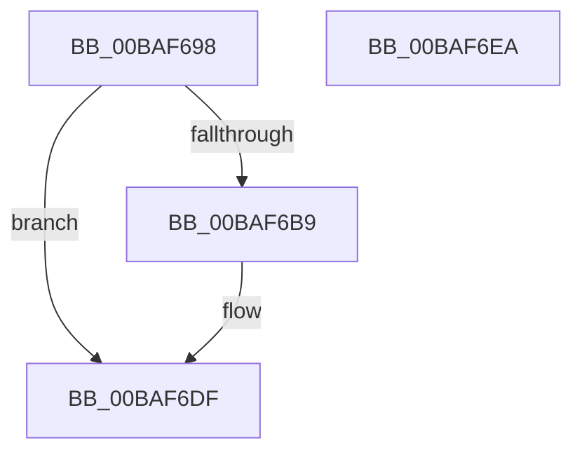

# ViMiscValidateSynchronizationObject

- RVA: `0x00BAF698`–`0x00BAF6EB` (길이 `83` bytes)
- VA: `0x0000000140BAF698`
- 실행 섹션: `PAGEVRFY`
- PDB 이름 있음: `예`; PDB Function 태그: `아니요`
- unwind 정보 RVA: `0x00065960`
- 디코드: `23`개 명령, `83/83` bytes 표시
- 미해석 바이트: `0` (있으면 어셈블리에 `.byte`로 보존)

> 이 문서는 커널 이미지의 기계어와 PDB 기호를 분석해 생성했습니다. 4번과 5번은 함수 원형과 자료형을 바이너리 사용 방식에서 추정한 C 해석이며 원본 소스 복구 결과는 아닙니다.

## 1. Dependencies

- 직접 호출 지점: **3**; 고유 호출 대상: **3**
- 직접 호출자로 확인된 함수: **8**
- RIP 상대 이미지 참조: **0**

### Outgoing calls
- `0x00BAF6A8` → [VfMiscCheckKernelAddress](../../text/4B/VfMiscCheckKernelAddress_function_004BC694.md) (function, `0x004BC694`)
- `0x00BAF6B0` → [MmIsNonPagedSystemAddressValid](../../text/4B/MmIsNonPagedSystemAddressValid_function_004B79F0.md) (function, `0x004B79F0`)
- `0x00BAF6DA` → [CarReportRuleViolationFromNt](../B9/CarReportRuleViolationFromNt_function_00B9D904.md) (function, `0x00B9D904`)

### Direct callers
- [VfMiscExInitializeLookasideListEx_Entry](VfMiscExInitializeLookasideListEx_Entry_function_00BAD8A0.md) at `0x00BAD8ED`
- [VfMiscExInitializeNPagedLookasideList_Entry](VfMiscExInitializeNPagedLookasideList_Entry_function_00BAD930.md) at `0x00BAD97D`
- [VfMiscExInitializeResourceLite_Entry](VfMiscExInitializeResourceLite_Entry_function_00BAD9A0.md) at `0x00BAD9B0`
- [VfMiscKeInitializeEvent_Entry](VfMiscKeInitializeEvent_Entry_function_00BADCE0.md) at `0x00BADCF0`
- [VfMiscKeInitializeMutant_Entry](VfMiscKeInitializeMutant_Entry_function_00BADD10.md) at `0x00BADD20`
- [VfMiscKeInitializeSemaphore_Entry](VfMiscKeInitializeSemaphore_Entry_function_00BADD40.md) at `0x00BADD50`
- [VfMiscKeInitializeTimerEx_Entry](VfMiscKeInitializeTimerEx_Entry_function_00BADD70.md) at `0x00BADD80`
- [ViMiscValidateKeWaitUsage](ViMiscValidateKeWaitUsage_function_00BAF554.md) at `0x00BAF62F`

### Static image references
- 디코드된 RIP-relative 메모리 참조가 없습니다.

## 2. Other-region calls and transfers

- 다른 실행 섹션으로 향하는 call: **2**
  - `0x00BAF6A8` → [VfMiscCheckKernelAddress](../../text/4B/VfMiscCheckKernelAddress_function_004BC694.md) (`PAGEVRFY` → `.text`)
  - `0x00BAF6B0` → [MmIsNonPagedSystemAddressValid](../../text/4B/MmIsNonPagedSystemAddressValid_function_004B79F0.md) (`PAGEVRFY` → `.text`)
- 별도 외부 분기/꼬리 이동을 확인하지 못했습니다.

## 3. Assembly (complete function range)

```asm
00BAF698  48 89 5C 24 08                  mov qword ptr [rsp + 8], rbx
00BAF69D  57                              push rdi
00BAF69E  48 83 EC 40                     sub rsp, 0x40
00BAF6A2  49 8B F8                        mov rdi, r8
00BAF6A5  48 8B D9                        mov rbx, rcx
00BAF6A8  E8 E7 CF 90 FF                  call 0x1404bc694
00BAF6AD  48 8B CB                        mov rcx, rbx
00BAF6B0  E8 3B 83 90 FF                  call 0x1404b79f0
00BAF6B5  84 C0                           test al, al
00BAF6B7  75 26                           jne 0x140baf6df
00BAF6B9  BA E1 00 00 00                  mov edx, 0xe1
00BAF6BE  48 89 7C 24 30                  mov qword ptr [rsp + 0x30], rdi
00BAF6C3  C7 44 24 28 0B 00 00 00         mov dword ptr [rsp + 0x28], 0xb
00BAF6CB  45 33 C9                        xor r9d, r9d
00BAF6CE  48 83 64 24 20 00               and qword ptr [rsp + 0x20], 0
00BAF6D4  4C 8B C3                        mov r8, rbx
00BAF6D7  8D 4A E3                        lea ecx, [rdx - 0x1d]
00BAF6DA  E8 25 E2 FE FF                  call 0x140b9d904
00BAF6DF  48 8B 5C 24 50                  mov rbx, qword ptr [rsp + 0x50]
00BAF6E4  48 83 C4 40                     add rsp, 0x40
00BAF6E8  5F                              pop rdi
00BAF6E9  C3                              ret
00BAF6EA  CC                              int3
```

## 4. C-style interpretation (structured pseudocode)

```c
__int64 __fastcall ViMiscValidateSynchronizationObject(__int64 a1, __int64 a2, __int64 a3, int a4)
{
    __int64 result;
    __int64 v_rsp;
    unsigned __int64 v_stack_m18;
    unsigned int v_stack_m20;
    unsigned __int64 v_stack_m28;
    unsigned __int64 v_stack_p8;

    v_stack_p8 = v_rbx;
    v_rsp = (v_rsp) - (64);
    result = VfMiscCheckKernelAddress(a1, a2, a3, a4);
    result = MmIsNonPagedSystemAddressValid(a1, a2, a3, a4);
    if ((unsigned __int8)(result) == 0) {
        a2 = 225;
        v_stack_m18 = a3;
        v_stack_m20 = 11;
        a4 = 0;
        a3 = a1;
        a1 = a2 - 29;
        result = CarReportRuleViolationFromNt(a1, a2, a3, a4);
    }
    v_rsp = (v_rsp) + (64);
    return result;
}
```

## 5. (Beta) C Style

```c
int64_t ViMiscValidateSynchronizationObject(int64_t Arg1, int64_t Arg2, int64_t Arg3, int32_t Arg4)
{
    int64_t result;
    int64_t local_rsp;
    uint64_t v_stack_m18;
    uint32_t v_stack_m20;
    uint64_t v_stack_m28;
    uint64_t v_stack_p8;

    v_stack_p8 = local_rbx;
    local_rsp = (local_rsp) - (64);
    result = VfMiscCheckKernelAddress(Arg1, Arg2, Arg3, Arg4);
    result = MmIsNonPagedSystemAddressValid(Arg1, Arg2, Arg3, Arg4);
    if ((uint8_t)(result) == 0) {
        Arg2 = 225;
        v_stack_m18 = Arg3;
        v_stack_m20 = 11;
        Arg4 = 0;
        Arg3 = Arg1;
        Arg1 = Arg2 - 29;
        result = CarReportRuleViolationFromNt(Arg1, Arg2, Arg3, Arg4);
    }
    local_rsp = (local_rsp) + (64);
    return result;
}
```

## 6. Execution-region graph

[열기: 2D/3D 그래프와 함수 탐색 컨트롤 패널](../../../control-panel.html?section=pagevrfy&rva=0x00BAF698&view=graph)

- 2D 그래프는 위에서 아래로 흐르고, 3D 그래프는 빈 공간을 드래그해 회전합니다. Shift+드래그는 이동, 휠은 확대·축소, 함수 노드 선택은 대상 보고서 이동입니다.

### Static fallback


