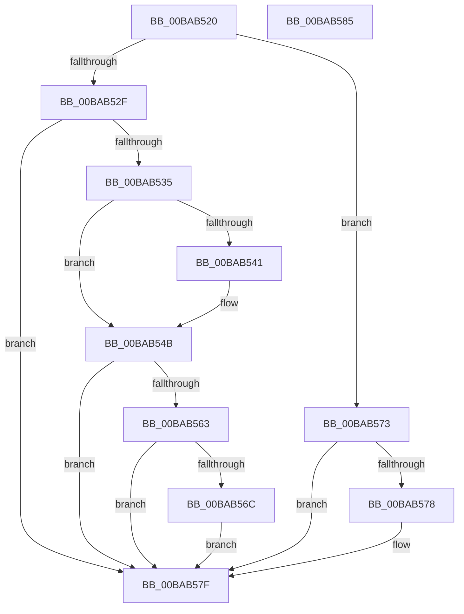

# ViPacketNotificationCallback

- RVA: `0x00BAB520`–`0x00BAB586` (길이 `102` bytes)
- VA: `0x0000000140BAB520`
- 실행 섹션: `PAGEVRFY`
- PDB 이름 있음: `예`; PDB Function 태그: `아니요`
- unwind 정보 RVA: `0x0005CF00`
- 디코드: `29`개 명령, `102/102` bytes 표시
- 미해석 바이트: `0` (있으면 어셈블리에 `.byte`로 보존)

> 이 문서는 커널 이미지의 기계어와 PDB 기호를 분석해 생성했습니다. 4번과 5번은 함수 원형과 자료형을 바이너리 사용 방식에서 추정한 C 해석이며 원본 소스 복구 결과는 아닙니다.

## 1. Dependencies

- 직접 호출 지점: **4**; 고유 호출 대상: **4**
- 직접 호출자로 확인된 함수: **0**
- RIP 상대 이미지 참조: **2**

### Outgoing calls
- `0x00BAB546` → [ExFreePoolWithTag](../../poolcode/B8/ExFreePoolWithTag_function_00B82870.md) (function, `0x00B82870`)
- `0x00BAB555` → [ExFreeToNPagedLookasideList](../../text/38/ExFreeToNPagedLookasideList_function_0038D9D0.md) (function, `0x0038D9D0`)
- `0x00BAB563` → [IovIsDisabledWithoutReboot](../../text/5A/IovIsDisabledWithoutReboot_function_005A3FFC.md) (function, `0x005A3FFC`)
- `0x00BAB56C` → [VfIrpDatabaseUninitialize](../BB/VfIrpDatabaseUninitialize_function_00BB4100.md) (function, `0x00BB4100`)

### Direct callers
- 이 함수 시작 RVA로 연결되는 직접 call은 확인되지 않았습니다. 간접 호출은 완전히 역산할 수 없습니다.

### Static image references
- `0x00BAB54E` → RVA `0x00FFF580` (`PAGEVRFD`; read)
- `0x00BAB55A` → RVA `0x00F03FFC` (`.data`; read/write)

## 2. Other-region calls and transfers

- 다른 실행 섹션으로 향하는 call: **3**
  - `0x00BAB546` → [ExFreePoolWithTag](../../poolcode/B8/ExFreePoolWithTag_function_00B82870.md) (`PAGEVRFY` → `POOLCODE`)
  - `0x00BAB555` → [ExFreeToNPagedLookasideList](../../text/38/ExFreeToNPagedLookasideList_function_0038D9D0.md) (`PAGEVRFY` → `.text`)
  - `0x00BAB563` → [IovIsDisabledWithoutReboot](../../text/5A/IovIsDisabledWithoutReboot_function_005A3FFC.md) (`PAGEVRFY` → `.text`)
- 별도 외부 분기/꼬리 이동을 확인하지 못했습니다.

## 3. Assembly (complete function range)

```asm
00BAB520  40 53                           push rbx
00BAB522  48 83 EC 20                     sub rsp, 0x20
00BAB526  48 8B D9                        mov rbx, rcx
00BAB529  41 83 E8 01                     sub r8d, 1
00BAB52D  74 44                           je 0x140bab573
00BAB52F  41 83 F8 01                     cmp r8d, 1
00BAB533  75 4A                           jne 0x140bab57f
00BAB535  48 8B 89 E0 00 00 00            mov rcx, qword ptr [rcx + 0xe0]
00BAB53C  48 85 C9                        test rcx, rcx
00BAB53F  74 0A                           je 0x140bab54b
00BAB541  BA 56 6C 64 6D                  mov edx, 0x6d646c56
00BAB546  E8 25 73 FD FF                  call 0x140b82870
00BAB54B  48 8B D3                        mov rdx, rbx
00BAB54E  48 8D 0D 2B 40 45 00            lea rcx, [rip + 0x45402b]
00BAB555  E8 76 24 7E FF                  call 0x14038d9d0
00BAB55A  F0 FF 0D 9B 8A 35 00            lock dec dword ptr [rip + 0x358a9b]
00BAB561  75 1C                           jne 0x140bab57f
00BAB563  E8 94 8A 9F FF                  call 0x1405a3ffc
00BAB568  84 C0                           test al, al
00BAB56A  74 13                           je 0x140bab57f
00BAB56C  E8 8F 8B 00 00                  call 0x140bb4100
00BAB571  EB 0C                           jmp 0x140bab57f
00BAB573  48 85 D2                        test rdx, rdx
00BAB576  74 07                           je 0x140bab57f
00BAB578  81 62 10 FF FF FF 3F            and dword ptr [rdx + 0x10], 0x3fffffff
00BAB57F  48 83 C4 20                     add rsp, 0x20
00BAB583  5B                              pop rbx
00BAB584  C3                              ret
00BAB585  CC                              int3
```

## 4. C-style interpretation (structured pseudocode)

```c
__int64 __fastcall ViPacketNotificationCallback(__int64 a1, __int64 a2, int a3)
{
    __int64 result;
    __int64 v_rsp;

    v_rsp = (v_rsp) - (32);
    a3 = (unsigned int)((a3) - (1));
    if (condition_is_equal) goto loc_00BAB573;
    if (a3 != 1) goto loc_00BAB57F;
    if (*(unsigned __int64 *)(a1 + 224) != 0) {
        a2 = 0x6D646C56ULL;
        result = ExFreePoolWithTag(*(unsigned __int64 *)(a1 + 224), a2, a3, a4);
    }
    result = ExFreeToNPagedLookasideList(v_rip + 4538411, a1, a3, a4);
    if (*(unsigned __int64 *)(a1 + 224) != 0) goto loc_00BAB57F;
    result = IovIsDisabledWithoutReboot(v_rip + 4538411, a1, a3, a4);
    if ((unsigned __int8)(result) == 0) goto loc_00BAB57F;
    result = VfIrpDatabaseUninitialize(v_rip + 4538411, a1, a3, a4);
    goto loc_00BAB57F;
loc_00BAB573:
    if (a1 != 0) {
    }
    v_rsp = (v_rsp) + (32);
    return result;
}
```

## 5. (Beta) C Style

```c
int64_t ViPacketNotificationCallback(void *Arg1, int64_t Arg2, int32_t Arg3)
{
    uint8_t *arg1 = (uint8_t *)Arg1;

    int64_t result;
    int64_t local_rsp;

    local_rsp = (local_rsp) - (32);
    Arg3 = (uint32_t)((Arg3) - (1));
    if (condition_is_equal) goto loc_00BAB573;
    if (Arg3 != 1) goto loc_00BAB57F;
    if (*(uint64_t *)(arg1 + 0xE0) != 0) {
        Arg2 = 0x6D646C56ULL;
        result = ExFreePoolWithTag(*(uint64_t *)(arg1 + 0xE0), Arg2, Arg3, a4);
    }
    result = ExFreeToNPagedLookasideList(v_rip + 4538411, Arg1, Arg3, a4);
    if (*(uint64_t *)(arg1 + 0xE0) != 0) goto loc_00BAB57F;
    result = IovIsDisabledWithoutReboot(v_rip + 4538411, Arg1, Arg3, a4);
    if ((uint8_t)(result) == 0) goto loc_00BAB57F;
    result = VfIrpDatabaseUninitialize(v_rip + 4538411, Arg1, Arg3, a4);
    goto loc_00BAB57F;
loc_00BAB573:
    if (Arg1 != NULL) {
    }
    local_rsp = (local_rsp) + (32);
    return result;
}
```

### 관측된 메모리 오프셋

구조체 형식이 확인되지 않은 접근은 인자 기준의 오프셋으로만 기록했습니다.

| 기준 인자 | 오프셋 표현 | 폭 (bit) | 접근 |
|---|---:|---:|---|
| `Arg1` | `+ 0xE0` | `64` | `R` |

## 6. Execution-region graph

[열기: 2D/3D 그래프와 함수 탐색 컨트롤 패널](../../../control-panel.html?section=pagevrfy&rva=0x00BAB520&view=graph)

- 2D 그래프는 위에서 아래로 흐르고, 3D 그래프는 빈 공간을 드래그해 회전합니다. Shift+드래그는 이동, 휠은 확대·축소, 함수 노드 선택은 대상 보고서 이동입니다.

### Static fallback


