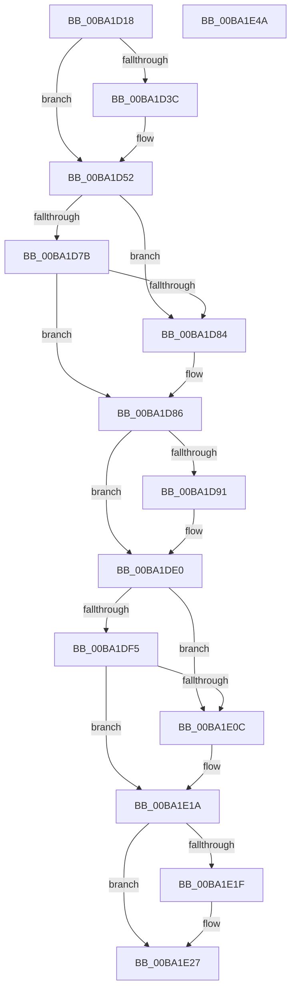

# ViPendingCompleteAfterWait

- RVA: `0x00BA1D18`–`0x00BA1E4B` (길이 `307` bytes)
- VA: `0x0000000140BA1D18`
- 실행 섹션: `PAGEVRFY`
- PDB 이름 있음: `예`; PDB Function 태그: `아니요`
- unwind 정보 RVA: `0x0009F048`
- 디코드: `84`개 명령, `307/307` bytes 표시
- 미해석 바이트: `0` (있으면 어셈블리에 `.byte`로 보존)

> 이 문서는 커널 이미지의 기계어와 PDB 기호를 분석해 생성했습니다. 4번과 5번은 함수 원형과 자료형을 바이너리 사용 방식에서 추정한 C 해석이며 원본 소스 복구 결과는 아닙니다.

## 1. Dependencies

- 직접 호출 지점: **11**; 고유 호출 대상: **10**
- 직접 호출자로 확인된 함수: **2**
- RIP 상대 이미지 참조: **1**

### Outgoing calls
- `0x00BA1D4D` → [KeWaitForSingleObject](../../text/20/KeWaitForSingleObject_function_0020E6B0.md) (function, `0x0020E6B0`)
- `0x00BA1D59` → [KeAcquireSpinLockRaiseToDpc](../../text/20/KeAcquireSpinLockRaiseToDpc_function_00208470.md) (function, `0x00208470`)
- `0x00BA1D96` → [ViIrpDatabaseAcquireLockExclusive](../../text/61/ViIrpDatabaseAcquireLockExclusive_function_006176D8.md) (function, `0x006176D8`)
- `0x00BA1DAE` → [guard_dispatch_icall](../../text/6B/guard_dispatch_icall_function_006BAAD0.md) (function, `0x006BAAD0`)
- `0x00BA1DD2` → [VfUtilAddressRangeRemoveCheckEmpty](../B9/VfUtilAddressRangeRemoveCheckEmpty_function_00B931A8.md) (function, `0x00B931A8`)
- `0x00BA1DDB` → [ViIrpDatabaseReleaseLockExclusive](../../text/61/ViIrpDatabaseReleaseLockExclusive_function_00617720.md) (function, `0x00617720`)
- `0x00BA1DE7` → [VfIrpDatabaseEntryReleaseLock](../BB/VfIrpDatabaseEntryReleaseLock_function_00BB3FD4.md) (function, `0x00BB3FD4`)
- `0x00BA1E00` → [guard_dispatch_icall](../../text/6B/guard_dispatch_icall_function_006BAAD0.md) (function, `0x006BAAD0`)
- `0x00BA1E15` → [IofCompleteRequest](../../text/29/IofCompleteRequest_function_0029B5C0.md) (function, `0x0029B5C0`)
- `0x00BA1E22` → [ObfDereferenceObject](../../text/2F/ObfDereferenceObject_function_002F9350.md) (function, `0x002F9350`)
- `0x00BA1E2C` → [ExFreePoolWithTag](../../poolcode/B8/ExFreePoolWithTag_function_00B82870.md) (function, `0x00B82870`)

### Direct callers
- [ViPendingCompleteAtDPC](ViPendingCompleteAtDPC_function_00BA1E60.md) at `0x00BA1E67`
- [ViPendingWorkerThread](ViPendingWorkerThread_function_00BA20D0.md) at `0x00BA20FB`

### Static image references
- `0x00BA1DCB` → RVA `0x00F04880` (`.data`; read)

## 2. Other-region calls and transfers

- 다른 실행 섹션으로 향하는 call: **9**
  - `0x00BA1D4D` → [KeWaitForSingleObject](../../text/20/KeWaitForSingleObject_function_0020E6B0.md) (`PAGEVRFY` → `.text`)
  - `0x00BA1D59` → [KeAcquireSpinLockRaiseToDpc](../../text/20/KeAcquireSpinLockRaiseToDpc_function_00208470.md) (`PAGEVRFY` → `.text`)
  - `0x00BA1D96` → [ViIrpDatabaseAcquireLockExclusive](../../text/61/ViIrpDatabaseAcquireLockExclusive_function_006176D8.md) (`PAGEVRFY` → `.text`)
  - `0x00BA1DAE` → [guard_dispatch_icall](../../text/6B/guard_dispatch_icall_function_006BAAD0.md) (`PAGEVRFY` → `.text`)
  - `0x00BA1DDB` → [ViIrpDatabaseReleaseLockExclusive](../../text/61/ViIrpDatabaseReleaseLockExclusive_function_00617720.md) (`PAGEVRFY` → `.text`)
  - `0x00BA1E00` → [guard_dispatch_icall](../../text/6B/guard_dispatch_icall_function_006BAAD0.md) (`PAGEVRFY` → `.text`)
  - `0x00BA1E15` → [IofCompleteRequest](../../text/29/IofCompleteRequest_function_0029B5C0.md) (`PAGEVRFY` → `.text`)
  - `0x00BA1E22` → [ObfDereferenceObject](../../text/2F/ObfDereferenceObject_function_002F9350.md) (`PAGEVRFY` → `.text`)
  - `0x00BA1E2C` → [ExFreePoolWithTag](../../poolcode/B8/ExFreePoolWithTag_function_00B82870.md) (`PAGEVRFY` → `POOLCODE`)
- 별도 외부 분기/꼬리 이동을 확인하지 못했습니다.

## 3. Assembly (complete function range)

```asm
00BA1D18  48 8B C4                        mov rax, rsp
00BA1D1B  48 89 58 10                     mov qword ptr [rax + 0x10], rbx
00BA1D1F  48 89 68 18                     mov qword ptr [rax + 0x18], rbp
00BA1D23  48 89 70 20                     mov qword ptr [rax + 0x20], rsi
00BA1D27  57                              push rdi
00BA1D28  41 56                           push r14
00BA1D2A  41 57                           push r15
00BA1D2C  48 83 EC 30                     sub rsp, 0x30
00BA1D30  83 B9 A8 00 00 00 01            cmp dword ptr [rcx + 0xa8], 1
00BA1D37  48 8B F1                        mov rsi, rcx
00BA1D3A  75 16                           jne 0x140ba1d52
00BA1D3C  48 83 60 D8 00                  and qword ptr [rax - 0x28], 0
00BA1D41  48 83 C1 68                     add rcx, 0x68
00BA1D45  45 33 C9                        xor r9d, r9d
00BA1D48  45 33 C0                        xor r8d, r8d
00BA1D4B  33 D2                           xor edx, edx
00BA1D4D  E8 5E C9 66 FF                  call 0x14020e6b0
00BA1D52  48 8B 3E                        mov rdi, qword ptr [rsi]
00BA1D55  48 8D 4F 08                     lea rcx, [rdi + 8]
00BA1D59  E8 12 67 66 FF                  call 0x140208470
00BA1D5E  4C 8B 37                        mov r14, qword ptr [rdi]
00BA1D61  48 8B AF D8 00 00 00            mov rbp, qword ptr [rdi + 0xd8]
00BA1D68  88 47 10                        mov byte ptr [rdi + 0x10], al
00BA1D6B  4D 8B BE B8 00 00 00            mov r15, qword ptr [r14 + 0xb8]
00BA1D72  83 67 38 EF                     and dword ptr [rdi + 0x38], 0xffffffef
00BA1D76  48 85 ED                        test rbp, rbp
00BA1D79  74 09                           je 0x140ba1d84
00BA1D7B  48 8B 6D 28                     mov rbp, qword ptr [rbp + 0x28]
00BA1D7F  48 85 ED                        test rbp, rbp
00BA1D82  75 02                           jne 0x140ba1d86
00BA1D84  33 ED                           xor ebp, ebp
00BA1D86  83 6F 18 01                     sub dword ptr [rdi + 0x18], 1
00BA1D8A  C6 44 24 50 00                  mov byte ptr [rsp + 0x50], 0
00BA1D8F  75 4F                           jne 0x140ba1de0
00BA1D91  48 8D 4C 24 50                  lea rcx, [rsp + 0x50]
00BA1D96  E8 3D 59 A7 FF                  call 0x1406176d8
00BA1D9B  48 8B 1F                        mov rbx, qword ptr [rdi]
00BA1D9E  41 B8 01 00 00 00               mov r8d, 1
00BA1DA4  48 8B 47 30                     mov rax, qword ptr [rdi + 0x30]
00BA1DA8  48 8B D3                        mov rdx, rbx
00BA1DAB  48 8B CF                        mov rcx, rdi
00BA1DAE  E8 1D 8D B1 FF                  call 0x1406baad0
00BA1DB3  48 83 27 00                     and qword ptr [rdi], 0
00BA1DB7  48 8B C3                        mov rax, rbx
00BA1DBA  48 C1 E8 0C                     shr rax, 0xc
00BA1DBE  48 8B D3                        mov rdx, rbx
00BA1DC1  6B C0 83                        imul eax, eax, -0x7d
00BA1DC4  0F B6 C8                        movzx ecx, al
00BA1DC7  48 C1 E1 04                     shl rcx, 4
00BA1DCB  48 03 0D AE 2A 36 00            add rcx, qword ptr [rip + 0x362aae]
00BA1DD2  E8 D1 13 FF FF                  call 0x140b931a8
00BA1DD7  8A 4C 24 50                     mov cl, byte ptr [rsp + 0x50]
00BA1DDB  E8 40 59 A7 FF                  call 0x140617720
00BA1DE0  F0 FF 4F 14                     lock dec dword ptr [rdi + 0x14]
00BA1DE4  48 8B CF                        mov rcx, rdi
00BA1DE7  E8 E8 21 01 00                  call 0x140bb3fd4
00BA1DEC  49 8B 47 F0                     mov rax, qword ptr [r15 - 0x10]
00BA1DF0  48 85 C0                        test rax, rax
00BA1DF3  74 17                           je 0x140ba1e0c
00BA1DF5  4D 8B 47 F8                     mov r8, qword ptr [r15 - 8]
00BA1DF9  49 8B D6                        mov rdx, r14
00BA1DFC  48 8B 4E 08                     mov rcx, qword ptr [rsi + 8]
00BA1E00  E8 CB 8C B1 FF                  call 0x1406baad0
00BA1E05  3D 16 00 00 C0                  cmp eax, 0xc0000016
00BA1E0A  74 0E                           je 0x140ba1e1a
00BA1E0C  8A 96 AC 00 00 00               mov dl, byte ptr [rsi + 0xac]
00BA1E12  49 8B CE                        mov rcx, r14
00BA1E15  E8 A6 97 6F FF                  call 0x14029b5c0
00BA1E1A  48 85 ED                        test rbp, rbp
00BA1E1D  74 08                           je 0x140ba1e27
00BA1E1F  48 8B CD                        mov rcx, rbp
00BA1E22  E8 29 75 75 FF                  call 0x1402f9350
00BA1E27  33 D2                           xor edx, edx
00BA1E29  48 8B CE                        mov rcx, rsi
00BA1E2C  E8 3F 0A FE FF                  call 0x140b82870
00BA1E31  48 8B 5C 24 58                  mov rbx, qword ptr [rsp + 0x58]
00BA1E36  48 8B 6C 24 60                  mov rbp, qword ptr [rsp + 0x60]
00BA1E3B  48 8B 74 24 68                  mov rsi, qword ptr [rsp + 0x68]
00BA1E40  48 83 C4 30                     add rsp, 0x30
00BA1E44  41 5F                           pop r15
00BA1E46  41 5E                           pop r14
00BA1E48  5F                              pop rdi
00BA1E49  C3                              ret
00BA1E4A  CC                              int3
```

## 4. C-style interpretation (structured pseudocode)

```c
__int64 __fastcall ViPendingCompleteAfterWait(__int64 a1, int a2, int a3, int a4)
{
    __int64 result;
    __int64 v_rbp;
    __int64 v_rbx;
    __int64 v_rsp;
    unsigned __int64 v_stack_p10;
    unsigned __int64 v_stack_p18;
    unsigned __int64 v_stack_p20;
    unsigned __int8 v_stack_p8;

    *(unsigned __int64 *)(v_rsp + 16) = v_rbx;
    *(unsigned __int64 *)(v_rsp + 24) = v_rbp;
    *(unsigned __int64 *)(v_rsp + 32) = v_rsi;
    v_rsp = (v_rsp) - (48);
    result = v_rsp;
    if ((*(unsigned int *)(a1 + 168)) == 1) {
        a1 = (a1) + (104);
        a4 = 0;
        a3 = 0;
        a2 = 0;
        result = KeWaitForSingleObject(a1, a2, a3, a4);
    }
    result = KeAcquireSpinLockRaiseToDpc(*(unsigned __int64 *)(a1) + 8, a2, a3, a4);
    *(unsigned __int8 *)(*(unsigned __int64 *)(a1) + 16) = (unsigned __int8)(result);
    if (*(unsigned __int64 *)(*(unsigned __int64 *)(a1) + 216) == 0) goto loc_00BA1D84;
    v_rbp = *(unsigned __int64 *)(*(unsigned __int64 *)(*(unsigned __int64 *)(a1) + 216) + 40);
    if (*(unsigned __int64 *)(*(unsigned __int64 *)(*(unsigned __int64 *)(a1) + 216) + 40) == 0) {
        v_rbp = 0;
    }
    v_stack_p8 = 0;
    if (!(condition_is_not_equal)) {
        a1 = v_stack_p8;
        result = ViIrpDatabaseAcquireLockExclusive(a1, a2, a3, a4);
        v_rbx = *(unsigned __int64 *)(*(unsigned __int64 *)(a1));
        a3 = 1;
        result = *(unsigned __int64 *)(*(unsigned __int64 *)(a1) + 48);
        a2 = v_rbx;
        a1 = *(unsigned __int64 *)(a1);
        result = guard_dispatch_icall(a1, a2, a3, a4);
        result = v_rbx;
        result = (result) >> (12);
        a2 = v_rbx;
        result = (unsigned int)((result) * ((unsigned int)(result)));
        a1 = (unsigned __int8)(result);
        a1 = (a1) << (4);
        a1 = (a1) + (*(unsigned __int64 *)(v_rip + 3549870));
        result = VfUtilAddressRangeRemoveCheckEmpty(a1, a2, a3, a4);
        a1 = v_stack_p8;
        result = ViIrpDatabaseReleaseLockExclusive(a1, a2, a3, a4);
    }
    result = VfIrpDatabaseEntryReleaseLock(*(unsigned __int64 *)(a1), a2, a3, a4);
    if (*(unsigned __int64 *)(*(unsigned __int64 *)(*(unsigned __int64 *)(*(unsigned __int64 *)(a1)) + 184) - 16) == 0) goto loc_00BA1E0C;
    result = guard_dispatch_icall(*(unsigned __int64 *)(a1 + 8), *(unsigned __int64 *)(*(unsigned __int64 *)(a1)), *(unsigned __int64 *)(*(unsigned __int64 *)(*(unsigned __int64 *)(*(unsigned __int64 *)(a1)) + 184) - 8), a4);
    if (((unsigned int)(result)) != 0xC0000016ULL) {
        a2 = *(unsigned __int8 *)(a1 + 172);
        a1 = *(unsigned __int64 *)(*(unsigned __int64 *)(a1));
        result = IofCompleteRequest(a1, a2, *(unsigned __int64 *)(*(unsigned __int64 *)(*(unsigned __int64 *)(*(unsigned __int64 *)(a1)) + 184) - 8), a4);
    }
    if (0 != 0) {
        a1 = 0;
        result = ObfDereferenceObject(a1, a2, *(unsigned __int64 *)(*(unsigned __int64 *)(*(unsigned __int64 *)(*(unsigned __int64 *)(a1)) + 184) - 8), a4);
    }
    a2 = 0;
    result = ExFreePoolWithTag(a1, a2, *(unsigned __int64 *)(*(unsigned __int64 *)(*(unsigned __int64 *)(*(unsigned __int64 *)(a1)) + 184) - 8), a4);
    v_rsp = (v_rsp) + (48);
    return result;
}
```

## 5. (Beta) C Style

```c
int64_t ViPendingCompleteAfterWait(void *Arg1, int32_t Arg2, int32_t Arg3, int32_t Arg4)
{
    uint8_t *arg1 = (uint8_t *)Arg1;

    int64_t result;
    int64_t local_rbp;
    int64_t local_rbx;
    int64_t local_rsp;
    uint64_t v_stack_p10;
    uint64_t v_stack_p18;
    uint64_t v_stack_p20;
    uint8_t v_stack_p8;

    *(uint64_t *)(local_rsp + 0x10) = local_rbx;
    *(uint64_t *)(local_rsp + 0x18) = local_rbp;
    *(uint64_t *)(local_rsp + 0x20) = local_rsi;
    local_rsp = (local_rsp) - (48);
    result = local_rsp;
    if ((*(uint32_t *)(arg1 + 0xA8)) == 1) {
        Arg1 = (Arg1) + (104);
        Arg4 = 0;
        Arg3 = 0;
        Arg2 = 0;
        result = KeWaitForSingleObject(Arg1, Arg2, Arg3, Arg4);
    }
    result = KeAcquireSpinLockRaiseToDpc(*(uint64_t *)(arg1) + 8, Arg2, Arg3, Arg4);
    *(uint8_t *)(*(uint64_t *)(arg1) + 0x10) = (uint8_t)(result);
    if (*(uint64_t *)(*(uint64_t *)(arg1) + 0xD8) == 0) goto loc_00BA1D84;
    local_rbp = *(uint64_t *)(*(uint64_t *)(*(uint64_t *)(arg1) + 0xD8) + 0x28);
    if (*(uint64_t *)(*(uint64_t *)(*(uint64_t *)(arg1) + 0xD8) + 0x28) == 0) {
        local_rbp = 0;
    }
    v_stack_p8 = 0;
    if (!(condition_is_not_equal)) {
        Arg1 = v_stack_p8;
        result = ViIrpDatabaseAcquireLockExclusive(Arg1, Arg2, Arg3, Arg4);
        local_rbx = *(uint64_t *)(*(uint64_t *)(arg1));
        Arg3 = 1;
        result = *(uint64_t *)(*(uint64_t *)(arg1) + 0x30);
        Arg2 = local_rbx;
        Arg1 = *(uint64_t *)(arg1);
        result = guard_dispatch_icall(Arg1, Arg2, Arg3, Arg4);
        result = local_rbx;
        result = (result) >> (12);
        Arg2 = local_rbx;
        result = (uint32_t)((result) * ((uint32_t)(result)));
        Arg1 = (uint8_t)(result);
        Arg1 = (Arg1) << (4);
        Arg1 = (Arg1) + (*(uint64_t *)(v_rip + 0x362AAE));
        result = VfUtilAddressRangeRemoveCheckEmpty(Arg1, Arg2, Arg3, Arg4);
        Arg1 = v_stack_p8;
        result = ViIrpDatabaseReleaseLockExclusive(Arg1, Arg2, Arg3, Arg4);
    }
    result = VfIrpDatabaseEntryReleaseLock(*(uint64_t *)(arg1), Arg2, Arg3, Arg4);
    if (*(uint64_t *)(*(uint64_t *)(*(uint64_t *)(*(uint64_t *)(arg1)) + 0xB8) - 0x10) == 0) goto loc_00BA1E0C;
    result = guard_dispatch_icall(*(uint64_t *)(arg1 + 0x8), *(uint64_t *)(*(uint64_t *)(arg1)), *(uint64_t *)(*(uint64_t *)(*(uint64_t *)(*(uint64_t *)(arg1)) + 0xB8) - 0x8), Arg4);
    if (((uint32_t)(result)) != 0xC0000016ULL) {
        Arg2 = *(uint8_t *)(arg1 + 0xAC);
        Arg1 = *(uint64_t *)(*(uint64_t *)(arg1));
        result = IofCompleteRequest(Arg1, Arg2, *(uint64_t *)(*(uint64_t *)(*(uint64_t *)(*(uint64_t *)(arg1)) + 0xB8) - 0x8), Arg4);
    }
    if (0 != 0) {
        Arg1 = 0;
        result = ObfDereferenceObject(Arg1, Arg2, *(uint64_t *)(*(uint64_t *)(*(uint64_t *)(*(uint64_t *)(arg1)) + 0xB8) - 0x8), Arg4);
    }
    Arg2 = 0;
    result = ExFreePoolWithTag(Arg1, Arg2, *(uint64_t *)(*(uint64_t *)(*(uint64_t *)(*(uint64_t *)(arg1)) + 0xB8) - 0x8), Arg4);
    local_rsp = (local_rsp) + (48);
    return result;
}
```

### 관측된 메모리 오프셋

구조체 형식이 확인되지 않은 접근은 인자 기준의 오프셋으로만 기록했습니다.

| 기준 인자 | 오프셋 표현 | 폭 (bit) | 접근 |
|---|---:|---:|---|
| `Arg1` | `+ 0x0` | `64` | `R` |
| `Arg1` | `+ 0x8` | `64` | `R` |
| `Arg1` | `+ 0xA8` | `32` | `R` |
| `Arg1` | `+ 0xAC` | `8` | `R` |

## 6. Execution-region graph

[열기: 2D/3D 그래프와 함수 탐색 컨트롤 패널](../../../control-panel.html?section=pagevrfy&rva=0x00BA1D18&view=graph)

- 2D 그래프는 위에서 아래로 흐르고, 3D 그래프는 빈 공간을 드래그해 회전합니다. Shift+드래그는 이동, 휠은 확대·축소, 함수 노드 선택은 대상 보고서 이동입니다.

### Static fallback


