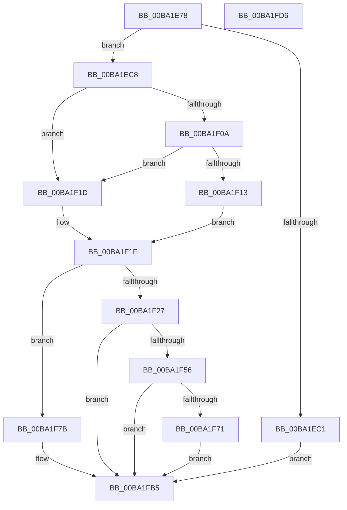

# ViPendingDelayCompletion

- RVA: `0x00BA1E78`–`0x00BA1FD7` (길이 `351` bytes)
- VA: `0x0000000140BA1E78`
- 실행 섹션: `PAGEVRFY`
- PDB 이름 있음: `예`; PDB Function 태그: `아니요`
- unwind 정보 RVA: `0x000847EC`
- 디코드: `95`개 명령, `351/351` bytes 표시
- 미해석 바이트: `0` (있으면 어셈블리에 `.byte`로 보존)

> 이 문서는 커널 이미지의 기계어와 PDB 기호를 분석해 생성했습니다. 4번과 5번은 함수 원형과 자료형을 바이너리 사용 방식에서 추정한 C 해석이며 원본 소스 복구 결과는 아닙니다.

## 1. Dependencies

- 직접 호출 지점: **10**; 고유 호출 대상: **9**
- 직접 호출자로 확인된 함수: **1**
- RIP 상대 이미지 참조: **1**

### Outgoing calls
- `0x00BA1EB4` → [ExAllocatePool2](../../poolcode/B8/ExAllocatePool2_function_00B820F0.md) (function, `0x00B820F0`)
- `0x00BA1ED1` → [KeInitializeTimerEx](../../text/45/KeInitializeTimerEx_function_004563F0.md) (function, `0x004563F0`)
- `0x00BA1F16` → [ObfReferenceObject](../../text/20/ObfReferenceObject_function_0020FA20.md) (function, `0x0020FA20`)
- `0x00BA1F43` → [KiSetTimerEx](../../text/23/KiSetTimerEx_function_00232CB0.md) (function, `0x00232CB0`)
- `0x00BA1F4B` → [ViPendingQueuePassiveLevelCompletion](ViPendingQueuePassiveLevelCompletion_function_00BA1FE0.md) (function, `0x00BA1FE0`)
- `0x00BA1F59` → [KeCancelTimer](../../text/23/KeCancelTimer_function_002327E0.md) (function, `0x002327E0`)
- `0x00BA1F63` → [ExFreePoolWithTag](../../poolcode/B8/ExFreePoolWithTag_function_00B82870.md) (function, `0x00B82870`)
- `0x00BA1F74` → [ObfDereferenceObject](../../text/2F/ObfDereferenceObject_function_002F9350.md) (function, `0x002F9350`)
- `0x00BA1F96` → [KeInitializeDpc](../../text/45/KeInitializeDpc_function_0045BBD0.md) (function, `0x0045BBD0`)
- `0x00BA1FB0` → [KiSetTimerEx](../../text/23/KiSetTimerEx_function_00232CB0.md) (function, `0x00232CB0`)

### Direct callers
- [sub_00BBC208](../BB/Unknown_function_00BBC208.md) at `0x00BBC22E`

### Static image references
- `0x00BA1F8C` → RVA `0x00BA1E60` (`ViPendingCompleteAtDPC`; read)

## 2. Other-region calls and transfers

- 다른 실행 섹션으로 향하는 call: **9**
  - `0x00BA1EB4` → [ExAllocatePool2](../../poolcode/B8/ExAllocatePool2_function_00B820F0.md) (`PAGEVRFY` → `POOLCODE`)
  - `0x00BA1ED1` → [KeInitializeTimerEx](../../text/45/KeInitializeTimerEx_function_004563F0.md) (`PAGEVRFY` → `.text`)
  - `0x00BA1F16` → [ObfReferenceObject](../../text/20/ObfReferenceObject_function_0020FA20.md) (`PAGEVRFY` → `.text`)
  - `0x00BA1F43` → [KiSetTimerEx](../../text/23/KiSetTimerEx_function_00232CB0.md) (`PAGEVRFY` → `.text`)
  - `0x00BA1F59` → [KeCancelTimer](../../text/23/KeCancelTimer_function_002327E0.md) (`PAGEVRFY` → `.text`)
  - `0x00BA1F63` → [ExFreePoolWithTag](../../poolcode/B8/ExFreePoolWithTag_function_00B82870.md) (`PAGEVRFY` → `POOLCODE`)
  - `0x00BA1F74` → [ObfDereferenceObject](../../text/2F/ObfDereferenceObject_function_002F9350.md) (`PAGEVRFY` → `.text`)
  - `0x00BA1F96` → [KeInitializeDpc](../../text/45/KeInitializeDpc_function_0045BBD0.md) (`PAGEVRFY` → `.text`)
  - `0x00BA1FB0` → [KiSetTimerEx](../../text/23/KiSetTimerEx_function_00232CB0.md) (`PAGEVRFY` → `.text`)
- 별도 외부 분기/꼬리 이동을 확인하지 못했습니다.

## 3. Assembly (complete function range)

```asm
00BA1E78  48 8B C4                        mov rax, rsp
00BA1E7B  48 89 58 08                     mov qword ptr [rax + 8], rbx
00BA1E7F  48 89 68 10                     mov qword ptr [rax + 0x10], rbp
00BA1E83  48 89 70 18                     mov qword ptr [rax + 0x18], rsi
00BA1E87  48 89 78 20                     mov qword ptr [rax + 0x20], rdi
00BA1E8B  41 54                           push r12
00BA1E8D  41 56                           push r14
00BA1E8F  41 57                           push r15
00BA1E91  48 83 EC 30                     sub rsp, 0x30
00BA1E95  4D 8B F8                        mov r15, r8
00BA1E98  48 8B EA                        mov rbp, rdx
00BA1E9B  4C 8B E1                        mov r12, rcx
00BA1E9E  BE 01 00 00 00                  mov esi, 1
00BA1EA3  BA B0 00 00 00                  mov edx, 0xb0
00BA1EA8  41 B8 49 72 70 64               mov r8d, 0x64707249
00BA1EAE  49 8B D9                        mov rbx, r9
00BA1EB1  8D 4E 3F                        lea ecx, [rsi + 0x3f]
00BA1EB4  E8 37 02 FE FF                  call 0x140b820f0
00BA1EB9  48 8B F8                        mov rdi, rax
00BA1EBC  48 85 C0                        test rax, rax
00BA1EBF  75 07                           jne 0x140ba1ec8
00BA1EC1  33 F6                           xor esi, esi
00BA1EC3  E9 ED 00 00 00                  jmp 0x140ba1fb5
00BA1EC8  4C 8D 70 68                     lea r14, [rax + 0x68]
00BA1ECC  8B D6                           mov edx, esi
00BA1ECE  49 8B CE                        mov rcx, r14
00BA1ED1  E8 1A 45 8B FF                  call 0x1404563f0
00BA1ED6  83 4D 38 10                     or dword ptr [rbp + 0x38], 0x10
00BA1EDA  48 8B 44 24 70                  mov rax, qword ptr [rsp + 0x70]
00BA1EDF  48 89 47 20                     mov qword ptr [rdi + 0x20], rax
00BA1EE3  48 89 2F                        mov qword ptr [rdi], rbp
00BA1EE6  4C 89 67 08                     mov qword ptr [rdi + 8], r12
00BA1EEA  48 89 5F 18                     mov qword ptr [rdi + 0x18], rbx
00BA1EEE  4C 89 7F 10                     mov qword ptr [rdi + 0x10], r15
00BA1EF2  8A 85 B9 00 00 00               mov al, byte ptr [rbp + 0xb9]
00BA1EF8  88 87 AC 00 00 00               mov byte ptr [rdi + 0xac], al
00BA1EFE  48 8B 9D D8 00 00 00            mov rbx, qword ptr [rbp + 0xd8]
00BA1F05  48 85 DB                        test rbx, rbx
00BA1F08  74 13                           je 0x140ba1f1d
00BA1F0A  48 8B 5B 28                     mov rbx, qword ptr [rbx + 0x28]
00BA1F0E  48 85 DB                        test rbx, rbx
00BA1F11  74 0A                           je 0x140ba1f1d
00BA1F13  48 8B CB                        mov rcx, rbx
00BA1F16  E8 05 DB 66 FF                  call 0x14020fa20
00BA1F1B  EB 02                           jmp 0x140ba1f1f
00BA1F1D  33 DB                           xor ebx, ebx
00BA1F1F  44 0F 20 C0                     mov rax, cr8
00BA1F23  3C 02                           cmp al, 2
00BA1F25  73 54                           jae 0x140ba1f7b
00BA1F27  48 83 64 24 20 00               and qword ptr [rsp + 0x20], 0
00BA1F2D  45 33 C9                        xor r9d, r9d
00BA1F30  45 33 C0                        xor r8d, r8d
00BA1F33  89 B7 A8 00 00 00               mov dword ptr [rdi + 0xa8], esi
00BA1F39  48 C7 C2 48 F4 FF FF            mov rdx, 0xfffffffffffff448
00BA1F40  49 8B CE                        mov rcx, r14
00BA1F43  E8 68 0D 69 FF                  call 0x140232cb0
00BA1F48  48 8B CF                        mov rcx, rdi
00BA1F4B  E8 90 00 00 00                  call 0x140ba1fe0
00BA1F50  8B F0                           mov esi, eax
00BA1F52  85 C0                           test eax, eax
00BA1F54  75 5F                           jne 0x140ba1fb5
00BA1F56  49 8B CE                        mov rcx, r14
00BA1F59  E8 82 08 69 FF                  call 0x1402327e0
00BA1F5E  33 D2                           xor edx, edx
00BA1F60  48 8B CF                        mov rcx, rdi
00BA1F63  E8 08 09 FE FF                  call 0x140b82870
00BA1F68  83 65 38 EF                     and dword ptr [rbp + 0x38], 0xffffffef
00BA1F6C  48 85 DB                        test rbx, rbx
00BA1F6F  74 44                           je 0x140ba1fb5
00BA1F71  48 8B CB                        mov rcx, rbx
00BA1F74  E8 D7 73 75 FF                  call 0x1402f9350
00BA1F79  EB 3A                           jmp 0x140ba1fb5
00BA1F7B  48 8D 5F 28                     lea rbx, [rdi + 0x28]
00BA1F7F  C7 87 A8 00 00 00 02 00 00 00   mov dword ptr [rdi + 0xa8], 2
00BA1F89  48 8B CB                        mov rcx, rbx
00BA1F8C  48 8D 15 CD FE FF FF            lea rdx, [rip - 0x133]
00BA1F93  4C 8B C7                        mov r8, rdi
00BA1F96  E8 35 9C 8B FF                  call 0x14045bbd0
00BA1F9B  45 33 C9                        xor r9d, r9d
00BA1F9E  48 89 5C 24 20                  mov qword ptr [rsp + 0x20], rbx
00BA1FA3  45 33 C0                        xor r8d, r8d
00BA1FA6  48 C7 C2 48 F4 FF FF            mov rdx, 0xfffffffffffff448
00BA1FAD  49 8B CE                        mov rcx, r14
00BA1FB0  E8 FB 0C 69 FF                  call 0x140232cb0
00BA1FB5  48 8B 5C 24 50                  mov rbx, qword ptr [rsp + 0x50]
00BA1FBA  8B C6                           mov eax, esi
00BA1FBC  48 8B 74 24 60                  mov rsi, qword ptr [rsp + 0x60]
00BA1FC1  48 8B 6C 24 58                  mov rbp, qword ptr [rsp + 0x58]
00BA1FC6  48 8B 7C 24 68                  mov rdi, qword ptr [rsp + 0x68]
00BA1FCB  48 83 C4 30                     add rsp, 0x30
00BA1FCF  41 5F                           pop r15
00BA1FD1  41 5E                           pop r14
00BA1FD3  41 5C                           pop r12
00BA1FD5  C3                              ret
00BA1FD6  CC                              int3
```

## 4. C-style interpretation (structured pseudocode)

```c
__int64 __fastcall ViPendingDelayCompletion(__int64 a1, __int64 a2, __int64 a3, __int64 a4, __int64 a5)
{
    __int64 result;
    __int64 v_rbx;
    __int64 v_rsi;
    __int64 v_rsp;
    unsigned __int64 v_stack_m28;
    unsigned __int64 v_stack_p10;
    unsigned __int64 v_stack_p18;
    unsigned __int64 v_stack_p20;
    unsigned __int64 v_stack_p8;

    *(unsigned __int64 *)(v_rsp + 8) = v_rbx;
    *(unsigned __int64 *)(v_rsp + 16) = v_rbp;
    *(unsigned __int64 *)(v_rsp + 24) = v_rsi;
    *(unsigned __int64 *)(v_rsp + 32) = v_rdi;
    v_rsp = (v_rsp) - (48);
    result = ExAllocatePool2(1 + 63, 176, (unsigned int)(0x64707249ULL), a4);
    if (result != 0) goto loc_00BA1EC8;
    v_rsi = 0;
    goto loc_00BA1FB5;
loc_00BA1EC8:
    result = KeInitializeTimerEx(result + 104, 0, (unsigned int)(0x64707249ULL), a4);
    *(unsigned __int64 *)(result + 32) = a5;
    *(unsigned __int64 *)(result) = a2;
    *(unsigned __int64 *)(result + 8) = a1;
    *(unsigned __int64 *)(result + 24) = a4;
    *(unsigned __int64 *)(result + 16) = a3;
    *(unsigned __int8 *)(result + 172) = (unsigned __int8)(*(unsigned __int8 *)(a2 + 185));
    if (*(unsigned __int64 *)(a2 + 216) == 0) goto loc_00BA1F1D;
    if (*(unsigned __int64 *)(*(unsigned __int64 *)(a2 + 216) + 40) == 0) goto loc_00BA1F1D;
    result = ObfReferenceObject(*(unsigned __int64 *)(*(unsigned __int64 *)(a2 + 216) + 40), 0, (unsigned int)(0x64707249ULL), a4);
    goto loc_00BA1F1F;
loc_00BA1F1D:
    v_rbx = 0;
loc_00BA1F1F:
    if (((unsigned __int8)(v_cr8)) >= 2) goto loc_00BA1F7B;
    a4 = 0;
    a3 = 0;
    *(unsigned int *)(result + 168) = 0;
    result = KiSetTimerEx(result + 104, 0xFFFFFFFFFFFFF448ULL, a3, a4);
    result = ViPendingQueuePassiveLevelCompletion(result, 0xFFFFFFFFFFFFF448ULL, a3, a4);
    if ((unsigned int)(result) != 0) goto loc_00BA1FB5;
    result = KeCancelTimer(result + 104, 0xFFFFFFFFFFFFF448ULL, a3, a4);
    a2 = 0;
    result = ExFreePoolWithTag(result, a2, a3, a4);
    if (0 == 0) goto loc_00BA1FB5;
    result = ObfDereferenceObject(0, a2, a3, a4);
    goto loc_00BA1FB5;
loc_00BA1F7B:
    *(unsigned int *)(result + 168) = 2;
    result = KeInitializeDpc(result + 40, v_rip - 307, result, a4);
    a4 = 0;
    v_stack_m28 = result + 40;
    a3 = 0;
    result = KiSetTimerEx(result + 104, 0xFFFFFFFFFFFFF448ULL, a3, a4);
loc_00BA1FB5:
    v_rsp = (v_rsp) + (48);
    return (unsigned int)((unsigned int)((unsigned int)((unsigned int)(result))));
}
```

## 5. (Beta) C Style

```c
int64_t ViPendingDelayCompletion(int64_t Arg1, void *Arg2, int64_t Arg3, int64_t Arg4, int64_t Arg5)
{
    uint8_t *arg2 = (uint8_t *)Arg2;

    int64_t result;
    int64_t local_rbx;
    int64_t local_rsi;
    int64_t local_rsp;
    uint64_t v_stack_m28;
    uint64_t v_stack_p10;
    uint64_t v_stack_p18;
    uint64_t v_stack_p20;
    uint64_t v_stack_p8;

    *(uint64_t *)(local_rsp + 0x8) = local_rbx;
    *(uint64_t *)(local_rsp + 0x10) = local_rbp;
    *(uint64_t *)(local_rsp + 0x18) = local_rsi;
    *(uint64_t *)(local_rsp + 0x20) = local_rdi;
    local_rsp = (local_rsp) - (48);
    result = ExAllocatePool2(1 + 63, 176, (uint32_t)(0x64707249ULL), Arg4);
    if (result != 0) goto loc_00BA1EC8;
    local_rsi = 0;
    goto loc_00BA1FB5;
loc_00BA1EC8:
    result = KeInitializeTimerEx(result + 104, 0, (uint32_t)(0x64707249ULL), Arg4);
    *(uint64_t *)(result + 0x20) = Arg5;
    *(void **)(result) = Arg2;
    *(uint64_t *)(result + 0x8) = Arg1;
    *(uint64_t *)(result + 0x18) = Arg4;
    *(uint64_t *)(result + 0x10) = Arg3;
    *(uint8_t *)(result + 0xAC) = (uint8_t)(*(uint8_t *)(arg2 + 0xB9));
    if (*(uint64_t *)(arg2 + 0xD8) == 0) goto loc_00BA1F1D;
    if (*(uint64_t *)(*(uint64_t *)(arg2 + 0xD8) + 0x28) == 0) goto loc_00BA1F1D;
    result = ObfReferenceObject(*(uint64_t *)(*(uint64_t *)(arg2 + 0xD8) + 0x28), 0, (uint32_t)(0x64707249ULL), Arg4);
    goto loc_00BA1F1F;
loc_00BA1F1D:
    local_rbx = 0;
loc_00BA1F1F:
    if (((uint8_t)(v_cr8)) >= 2) goto loc_00BA1F7B;
    Arg4 = 0;
    Arg3 = 0;
    *(uint32_t *)(result + 0xA8) = 0;
    result = KiSetTimerEx(result + 104, 0xFFFFFFFFFFFFF448ULL, Arg3, Arg4);
    result = ViPendingQueuePassiveLevelCompletion(result, 0xFFFFFFFFFFFFF448ULL, Arg3, Arg4);
    if ((uint32_t)(result) != 0) goto loc_00BA1FB5;
    result = KeCancelTimer(result + 104, 0xFFFFFFFFFFFFF448ULL, Arg3, Arg4);
    Arg2 = 0;
    result = ExFreePoolWithTag(result, Arg2, Arg3, Arg4);
    if (0 == 0) goto loc_00BA1FB5;
    result = ObfDereferenceObject(0, Arg2, Arg3, Arg4);
    goto loc_00BA1FB5;
loc_00BA1F7B:
    *(uint32_t *)(result + 0xA8) = 2;
    result = KeInitializeDpc(result + 40, v_rip - 307, result, Arg4);
    Arg4 = 0;
    v_stack_m28 = result + 40;
    Arg3 = 0;
    result = KiSetTimerEx(result + 104, 0xFFFFFFFFFFFFF448ULL, Arg3, Arg4);
loc_00BA1FB5:
    local_rsp = (local_rsp) + (48);
    return (uint32_t)((uint32_t)((uint32_t)((uint32_t)(result))));
}
```

### 관측된 메모리 오프셋

구조체 형식이 확인되지 않은 접근은 인자 기준의 오프셋으로만 기록했습니다.

| 기준 인자 | 오프셋 표현 | 폭 (bit) | 접근 |
|---|---:|---:|---|
| `Arg2` | `+ 0x38` | `32` | `R/W` |
| `Arg2` | `+ 0xB9` | `8` | `R` |
| `Arg2` | `+ 0xD8` | `64` | `R` |

## 6. Execution-region graph

[열기: 2D/3D 그래프와 함수 탐색 컨트롤 패널](../../../control-panel.html?section=pagevrfy&rva=0x00BA1E78&view=graph)

- 2D 그래프는 위에서 아래로 흐르고, 3D 그래프는 빈 공간을 드래그해 회전합니다. Shift+드래그는 이동, 휠은 확대·축소, 함수 노드 선택은 대상 보고서 이동입니다.

### Static fallback


