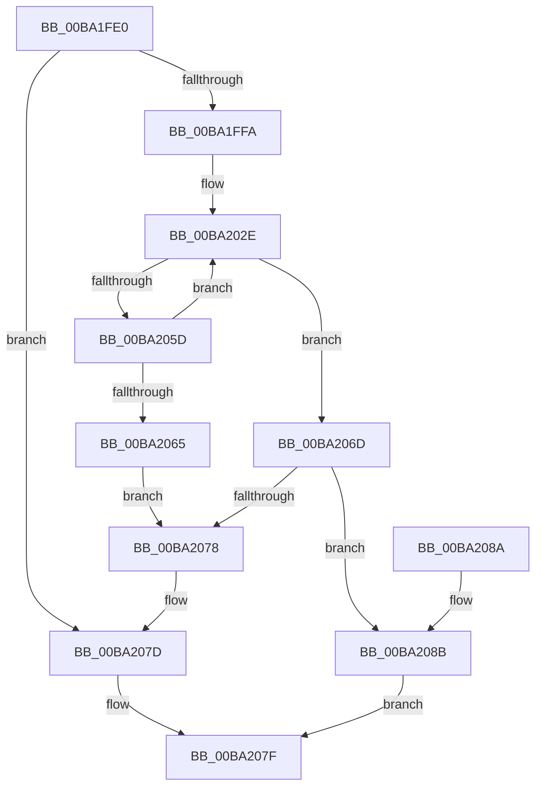

# ViPendingQueuePassiveLevelCompletion

- RVA: `0x00BA1FE0`–`0x00BA20C6` (길이 `230` bytes)
- VA: `0x0000000140BA1FE0`
- 실행 섹션: `PAGEVRFY`
- PDB 이름 있음: `예`; PDB Function 태그: `아니요`
- unwind 정보 RVA: `0x00069D3C`
- 디코드: `58`개 명령, `230/230` bytes 표시
- 미해석 바이트: `0` (있으면 어셈블리에 `.byte`로 보존)

> 이 문서는 커널 이미지의 기계어와 PDB 기호를 분석해 생성했습니다. 4번과 5번은 함수 원형과 자료형을 바이너리 사용 방식에서 추정한 C 해석이며 원본 소스 복구 결과는 아닙니다.

## 1. Dependencies

- 직접 호출 지점: **5**; 고유 호출 대상: **4**
- 직접 호출자로 확인된 함수: **1**
- RIP 상대 이미지 참조: **6**

### Outgoing calls
- `0x00BA2003` → [KeQueryPriorityThread](../../text/38/KeQueryPriorityThread_function_0038F4F0.md) (function, `0x0038F4F0`)
- `0x00BA2078` → [KeLeaveCriticalRegion](../../text/25/KeLeaveCriticalRegion_function_0025D8B0.md) (function, `0x0025D8B0`)
- `0x00BA20A4` → [KeSetPriorityThread](../../text/2C/KeSetPriorityThread_function_002C76E0.md) (function, `0x002C76E0`)
- `0x00BA20B5` → [KeSetEvent](../../text/33/KeSetEvent_function_0033F310.md) (function, `0x0033F310`)
- `0x00BA20BA` → [KeLeaveCriticalRegion](../../text/25/KeLeaveCriticalRegion_function_0025D8B0.md) (function, `0x0025D8B0`)

### Direct callers
- [ViPendingDelayCompletion](ViPendingDelayCompletion_function_00BA1E78.md) at `0x00BA1F4B`

### Static image references
- `0x00BA1FEA` → RVA `0x00F04208` (`.data`; read)
- `0x00BA2027` → RVA `0x00F04068` (`.data`; read)
- `0x00BA202E` → RVA `0x00F04088` (`.data`; read)
- `0x00BA2065` → RVA `0x00F0406C` (`.data`; read/write)
- `0x00BA206D` → RVA `0x00F04068` (`.data`; write)
- `0x00BA208E` → RVA `0x00F04080` (`.data`; read)

## 2. Other-region calls and transfers

- 다른 실행 섹션으로 향하는 call: **5**
  - `0x00BA2003` → [KeQueryPriorityThread](../../text/38/KeQueryPriorityThread_function_0038F4F0.md) (`PAGEVRFY` → `.text`)
  - `0x00BA2078` → [KeLeaveCriticalRegion](../../text/25/KeLeaveCriticalRegion_function_0025D8B0.md) (`PAGEVRFY` → `.text`)
  - `0x00BA20A4` → [KeSetPriorityThread](../../text/2C/KeSetPriorityThread_function_002C76E0.md) (`PAGEVRFY` → `.text`)
  - `0x00BA20B5` → [KeSetEvent](../../text/33/KeSetEvent_function_0033F310.md) (`PAGEVRFY` → `.text`)
  - `0x00BA20BA` → [KeLeaveCriticalRegion](../../text/25/KeLeaveCriticalRegion_function_0025D8B0.md) (`PAGEVRFY` → `.text`)
- 별도 외부 분기/꼬리 이동을 확인하지 못했습니다.

## 3. Assembly (complete function range)

```asm
00BA1FE0  48 89 5C 24 08                  mov qword ptr [rsp + 8], rbx
00BA1FE5  57                              push rdi
00BA1FE6  48 83 EC 20                     sub rsp, 0x20
00BA1FEA  83 3D 17 22 36 00 00            cmp dword ptr [rip + 0x362217], 0
00BA1FF1  48 8B D9                        mov rbx, rcx
00BA1FF4  0F 84 83 00 00 00               je 0x140ba207d
00BA1FFA  65 48 8B 0C 25 88 01 00 00      mov rcx, qword ptr gs:[0x188]
00BA2003  E8 E8 D4 7E FF                  call 0x14038f4f0
00BA2008  65 48 8B 14 25 88 01 00 00      mov rdx, qword ptr gs:[0x188]
00BA2011  44 8B D0                        mov r10d, eax
00BA2014  66 FF 8A E4 01 00 00            dec word ptr [rdx + 0x1e4]
00BA201B  90                              nop
00BA201C  44 8B 0D E5 21 36 00            mov r9d, dword ptr [rip + 0x3621e5]
00BA2023  41 83 CB FF                     or r11d, 0xffffffff
00BA2027  44 8B 05 3A 20 36 00            mov r8d, dword ptr [rip + 0x36203a]
00BA202E  48 8D 05 53 20 36 00            lea rax, [rip + 0x362053]
00BA2035  41 8B C8                        mov ecx, r8d
00BA2038  48 8D 14 49                     lea rdx, [rcx + rcx*2]
00BA203C  48 C1 E2 04                     shl rdx, 4
00BA2040  48 03 D0                        add rdx, rax
00BA2043  33 C0                           xor eax, eax
00BA2045  F0 48 0F B1 1A                  lock cmpxchg qword ptr [rdx], rbx
00BA204A  41 8D 48 01                     lea ecx, [r8 + 1]
00BA204E  3B 0D B4 21 36 00               cmp ecx, dword ptr [rip + 0x3621b4]
00BA2054  1B D2                           sbb edx, edx
00BA2056  23 D1                           and edx, ecx
00BA2058  48 85 C0                        test rax, rax
00BA205B  74 10                           je 0x140ba206d
00BA205D  44 8B C2                        mov r8d, edx
00BA2060  45 03 CB                        add r9d, r11d
00BA2063  75 C9                           jne 0x140ba202e
00BA2065  FF 05 01 20 36 00               inc dword ptr [rip + 0x362001]
00BA206B  EB 0B                           jmp 0x140ba2078
00BA206D  89 15 F5 1F 36 00               mov dword ptr [rip + 0x361ff5], edx
00BA2073  45 3B C3                        cmp r8d, r11d
00BA2076  75 13                           jne 0x140ba208b
00BA2078  E8 33 B8 6B FF                  call 0x14025d8b0
00BA207D  33 C0                           xor eax, eax
00BA207F  48 8B 5C 24 30                  mov rbx, qword ptr [rsp + 0x30]
00BA2084  48 83 C4 20                     add rsp, 0x20
00BA2088  5F                              pop rdi
00BA2089  C3                              ret
00BA208A  CC                              int3
00BA208B  41 8B C0                        mov eax, r8d
00BA208E  48 8D 3D EB 1F 36 00            lea rdi, [rip + 0x361feb]
00BA2095  41 8B D2                        mov edx, r10d
00BA2098  48 8D 1C 40                     lea rbx, [rax + rax*2]
00BA209C  48 C1 E3 04                     shl rbx, 4
00BA20A0  48 8B 0C 3B                     mov rcx, qword ptr [rbx + rdi]
00BA20A4  E8 37 56 72 FF                  call 0x1402c76e0
00BA20A9  48 8D 4F 10                     lea rcx, [rdi + 0x10]
00BA20AD  45 33 C0                        xor r8d, r8d
00BA20B0  48 03 CB                        add rcx, rbx
00BA20B3  33 D2                           xor edx, edx
00BA20B5  E8 56 D2 79 FF                  call 0x14033f310
00BA20BA  E8 F1 B7 6B FF                  call 0x14025d8b0
00BA20BF  B8 01 00 00 00                  mov eax, 1
00BA20C4  EB B9                           jmp 0x140ba207f
```

## 4. C-style interpretation (structured pseudocode)

```c
__int64 __fastcall ViPendingQueuePassiveLevelCompletion(__int64 a1)
{
    __int64 result;
    __int64 v_r11;
    __int64 v_rbx;
    __int64 v_rsp;
    unsigned __int64 v_stack_p8;

    v_stack_p8 = v_rbx;
    v_rsp = (v_rsp) - (32);
    if ((*(unsigned int *)(v_rip + 3547671)) == 0) goto loc_00BA207D;
    result = KeQueryPriorityThread(*(unsigned __int64 *)(gs_base + (0 + 392)), a2, a3, a4);
    v_r11 = (unsigned int)((v_r11) | (0xFFFFFFFFULL));
loc_00BA202E:
    a2 = ((unsigned int)((unsigned int)((unsigned int)(*(unsigned int *)(v_rip + 3547194)))) + (unsigned int)((unsigned int)((unsigned int)(*(unsigned int *)(v_rip + 3547194)))) * 2) << (4);
    a2 = (a2) + (v_rip + 3547219);
    result = 0;
    a2 = (unsigned int)((a2) & ((unsigned int)((unsigned int)(*(unsigned int *)(v_rip + 3547194)) + 1)));
    if (0 == 0) goto loc_00BA206D;
    a4 = (unsigned int)(((unsigned int)(*(unsigned int *)(v_rip + 3547621))) + ((unsigned int)(v_r11)));
    if (condition_is_not_equal) goto loc_00BA202E;
    goto loc_00BA2078;
loc_00BA206D:
    *(unsigned int *)(v_rip + 3547125) = (unsigned int)(a2);
    if (((unsigned int)((unsigned int)((unsigned int)(a2)))) != ((unsigned int)(v_r11))) goto loc_00BA208B;
loc_00BA2078:
    result = KeLeaveCriticalRegion((unsigned int)(*(unsigned int *)(v_rip + 3547194)) + 1, a2, (unsigned int)((unsigned int)(a2)), a4);
loc_00BA207D:
    result = 0;
loc_00BA207F:
    v_rsp = (v_rsp) + (32);
    return result;
loc_00BA208B:
    v_rbx = ((unsigned int)((unsigned int)((unsigned int)((unsigned int)(a2)))) + (unsigned int)((unsigned int)((unsigned int)((unsigned int)(a2)))) * 2) << (4);
    result = KeSetPriorityThread(*(unsigned __int64 *)(v_rbx + v_rip + 3547115 * 1), (unsigned int)((unsigned int)((unsigned int)((unsigned int)(result)))), (unsigned int)((unsigned int)(a2)), a4);
    a3 = 0;
    a1 = (v_rip + 3547115 + 16) + (v_rbx);
    a2 = 0;
    result = KeSetEvent(a1, a2, a3, a4);
    result = KeLeaveCriticalRegion(a1, a2, a3, a4);
    goto loc_00BA207F;
}
```

## 5. (Beta) C Style

```c
int64_t ViPendingQueuePassiveLevelCompletion(int64_t Arg1)
{
    int64_t result;
    int64_t local_r11;
    int64_t local_rbx;
    int64_t local_rsp;
    uint64_t v_stack_p8;

    v_stack_p8 = local_rbx;
    local_rsp = (local_rsp) - (32);
    if ((*(uint32_t *)(v_rip + 0x362217)) == 0) goto loc_00BA207D;
    result = KeQueryPriorityThread(*(uint64_t *)(gs_base + (0 + 0x188)), a2, a3, a4);
    local_r11 = (uint32_t)((local_r11) | (0xFFFFFFFFULL));
loc_00BA202E:
    a2 = ((uint32_t)((uint32_t)((uint32_t)(*(uint32_t *)(v_rip + 0x36203A)))) + (uint32_t)((uint32_t)((uint32_t)(*(uint32_t *)(v_rip + 0x36203A)))) * 2) << (4);
    a2 = (a2) + (v_rip + 3547219);
    result = 0;
    a2 = (uint32_t)((a2) & ((uint32_t)((uint32_t)(*(uint32_t *)(v_rip + 0x36203A)) + 1)));
    if (0 == 0) goto loc_00BA206D;
    a4 = (uint32_t)(((uint32_t)(*(uint32_t *)(v_rip + 0x3621E5))) + ((uint32_t)(local_r11)));
    if (condition_is_not_equal) goto loc_00BA202E;
    goto loc_00BA2078;
loc_00BA206D:
    *(uint32_t *)(v_rip + 0x361FF5) = (uint32_t)(a2);
    if (((uint32_t)((uint32_t)((uint32_t)(a2)))) != ((uint32_t)(local_r11))) goto loc_00BA208B;
loc_00BA2078:
    result = KeLeaveCriticalRegion((uint32_t)(*(uint32_t *)(v_rip + 0x36203A)) + 1, a2, (uint32_t)((uint32_t)(a2)), a4);
loc_00BA207D:
    result = 0;
loc_00BA207F:
    local_rsp = (local_rsp) + (32);
    return result;
loc_00BA208B:
    local_rbx = ((uint32_t)((uint32_t)((uint32_t)((uint32_t)(a2)))) + (uint32_t)((uint32_t)((uint32_t)((uint32_t)(a2)))) * 2) << (4);
    result = KeSetPriorityThread(*(uint64_t *)(local_rbx + v_rip + 0x361FEB * 1), (uint32_t)((uint32_t)((uint32_t)((uint32_t)(result)))), (uint32_t)((uint32_t)(a2)), a4);
    a3 = 0;
    Arg1 = (v_rip + 3547115 + 16) + (local_rbx);
    a2 = 0;
    result = KeSetEvent(Arg1, a2, a3, a4);
    result = KeLeaveCriticalRegion(Arg1, a2, a3, a4);
    goto loc_00BA207F;
}
```

## 6. Execution-region graph

[열기: 2D/3D 그래프와 함수 탐색 컨트롤 패널](../../../control-panel.html?section=pagevrfy&rva=0x00BA1FE0&view=graph)

- 2D 그래프는 위에서 아래로 흐르고, 3D 그래프는 빈 공간을 드래그해 회전합니다. Shift+드래그는 이동, 휠은 확대·축소, 함수 노드 선택은 대상 보고서 이동입니다.

### Static fallback


