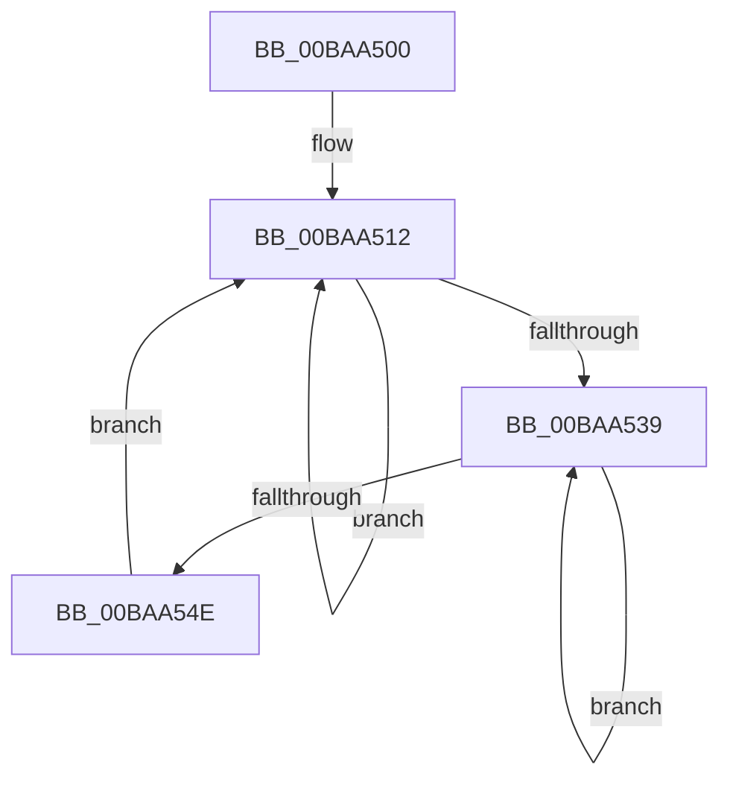

# ViPoolDelayFreeTrimThreadRoutine

- RVA: `0x00BAA500`–`0x00BAA550` (길이 `80` bytes)
- VA: `0x0000000140BAA500`
- 실행 섹션: `PAGEVRFY`
- PDB 이름 있음: `예`; PDB Function 태그: `아니요`
- unwind 정보 RVA: `0x000CAAA4`
- 디코드: `24`개 명령, `80/80` bytes 표시
- 미해석 바이트: `0` (있으면 어셈블리에 `.byte`로 보존)

> 이 문서는 커널 이미지의 기계어와 PDB 기호를 분석해 생성했습니다. 4번과 5번은 함수 원형과 자료형을 바이너리 사용 방식에서 추정한 C 해석이며 원본 소스 복구 결과는 아닙니다.

## 1. Dependencies

- 직접 호출 지점: **3**; 고유 호출 대상: **3**
- 직접 호출자로 확인된 함수: **0**
- RIP 상대 이미지 참조: **0**

### Outgoing calls
- `0x00BAA524` → [KeWaitForSingleObject](../../text/20/KeWaitForSingleObject_function_0020E6B0.md) (function, `0x0020E6B0`)
- `0x00BAA52F` → [ExpInterlockedFlushSList](../../text/6B/ExpInterlockedFlushSList_function_006BA5F0.md) (function, `0x006BA5F0`)
- `0x00BAA541` → [ExFreePoolWithTag](../../poolcode/B8/ExFreePoolWithTag_function_00B82870.md) (function, `0x00B82870`)

### Direct callers
- 이 함수 시작 RVA로 연결되는 직접 call은 확인되지 않았습니다. 간접 호출은 완전히 역산할 수 없습니다.

### Static image references
- 디코드된 RIP-relative 메모리 참조가 없습니다.

## 2. Other-region calls and transfers

- 다른 실행 섹션으로 향하는 call: **3**
  - `0x00BAA524` → [KeWaitForSingleObject](../../text/20/KeWaitForSingleObject_function_0020E6B0.md) (`PAGEVRFY` → `.text`)
  - `0x00BAA52F` → [ExpInterlockedFlushSList](../../text/6B/ExpInterlockedFlushSList_function_006BA5F0.md) (`PAGEVRFY` → `.text`)
  - `0x00BAA541` → [ExFreePoolWithTag](../../poolcode/B8/ExFreePoolWithTag_function_00B82870.md) (`PAGEVRFY` → `POOLCODE`)
- 별도 외부 분기/꼬리 이동을 확인하지 못했습니다.

## 3. Assembly (complete function range)

```asm
00BAA500  48 89 5C 24 08                  mov qword ptr [rsp + 8], rbx
00BAA505  48 89 74 24 10                  mov qword ptr [rsp + 0x10], rsi
00BAA50A  57                              push rdi
00BAA50B  48 83 EC 30                     sub rsp, 0x30
00BAA50F  48 8B F9                        mov rdi, rcx
00BAA512  48 83 64 24 20 00               and qword ptr [rsp + 0x20], 0
00BAA518  48 8D 4F 10                     lea rcx, [rdi + 0x10]
00BAA51C  45 33 C9                        xor r9d, r9d
00BAA51F  45 33 C0                        xor r8d, r8d
00BAA522  33 D2                           xor edx, edx
00BAA524  E8 87 41 66 FF                  call 0x14020e6b0
00BAA529  FF 47 3C                        inc dword ptr [rdi + 0x3c]
00BAA52C  48 8B CF                        mov rcx, rdi
00BAA52F  E8 BC 00 B1 FF                  call 0x1406ba5f0
00BAA534  48 85 C0                        test rax, rax
00BAA537  74 D9                           je 0x140baa512
00BAA539  48 8B 18                        mov rbx, qword ptr [rax]
00BAA53C  33 D2                           xor edx, edx
00BAA53E  48 8B C8                        mov rcx, rax
00BAA541  E8 2A 83 FD FF                  call 0x140b82870
00BAA546  48 8B C3                        mov rax, rbx
00BAA549  48 85 DB                        test rbx, rbx
00BAA54C  75 EB                           jne 0x140baa539
00BAA54E  EB C2                           jmp 0x140baa512
```

## 4. C-style interpretation (structured pseudocode)

```c
__int64 __fastcall ViPoolDelayFreeTrimThreadRoutine(__int64 a1, int a2, int a3, int a4)
{
    __int64 result;
    __int64 v_rsp;
    unsigned __int64 v_stack_m18;
    unsigned __int64 v_stack_p10;
    unsigned __int64 v_stack_p8;

    v_stack_p8 = v_rbx;
    v_stack_p10 = v_rsi;
    v_rsp = (v_rsp) - (48);
loc_00BAA512:
    a4 = 0;
    a3 = 0;
    a2 = 0;
    result = KeWaitForSingleObject(a1 + 16, a2, a3, a4);
    result = ExpInterlockedFlushSList(a1, a2, a3, a4);
    if (result == 0) goto loc_00BAA512;
loc_00BAA539:
    a2 = 0;
    result = ExFreePoolWithTag(result, a2, a3, a4);
    if (*(unsigned __int64 *)(result) != 0) goto loc_00BAA539;
    goto loc_00BAA512;
}
```

## 5. (Beta) C Style

```c
int64_t ViPoolDelayFreeTrimThreadRoutine(void *Arg1, int32_t Arg2, int32_t Arg3, int32_t Arg4)
{
    uint8_t *arg1 = (uint8_t *)Arg1;

    int64_t result;
    int64_t local_rsp;
    uint64_t v_stack_m18;
    uint64_t v_stack_p10;
    uint64_t v_stack_p8;

    v_stack_p8 = local_rbx;
    v_stack_p10 = local_rsi;
    local_rsp = (local_rsp) - (48);
loc_00BAA512:
    Arg4 = 0;
    Arg3 = 0;
    Arg2 = 0;
    result = KeWaitForSingleObject(Arg1 + 16, Arg2, Arg3, Arg4);
    result = ExpInterlockedFlushSList(Arg1, Arg2, Arg3, Arg4);
    if (result == 0) goto loc_00BAA512;
loc_00BAA539:
    Arg2 = 0;
    result = ExFreePoolWithTag(result, Arg2, Arg3, Arg4);
    if (*(uint64_t *)(result) != 0) goto loc_00BAA539;
    goto loc_00BAA512;
}
```

### 관측된 메모리 오프셋

구조체 형식이 확인되지 않은 접근은 인자 기준의 오프셋으로만 기록했습니다.

| 기준 인자 | 오프셋 표현 | 폭 (bit) | 접근 |
|---|---:|---:|---|
| `Arg1` | `+ 0x10` | `64` | `R` |
| `Arg1` | `+ 0x3C` | `32` | `R/W` |

## 6. Execution-region graph

[열기: 2D/3D 그래프와 함수 탐색 컨트롤 패널](../../../control-panel.html?section=pagevrfy&rva=0x00BAA500&view=graph)

- 2D 그래프는 위에서 아래로 흐르고, 3D 그래프는 빈 공간을 드래그해 회전합니다. Shift+드래그는 이동, 휠은 확대·축소, 함수 노드 선택은 대상 보고서 이동입니다.

### Static fallback


