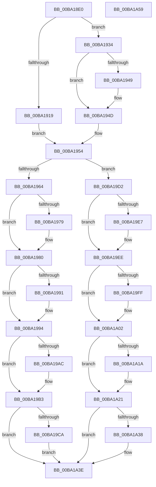

# ViPostPoolAllocation

- RVA: `0x00BA18E0`–`0x00BA1A5A` (길이 `378` bytes)
- VA: `0x0000000140BA18E0`
- 실행 섹션: `PAGEVRFY`
- PDB 이름 있음: `예`; PDB Function 태그: `아니요`
- unwind 정보 RVA: `0x0005C954`
- 디코드: `93`개 명령, `378/378` bytes 표시
- 미해석 바이트: `0` (있으면 어셈블리에 `.byte`로 보존)

> 이 문서는 커널 이미지의 기계어와 PDB 기호를 분석해 생성했습니다. 4번과 5번은 함수 원형과 자료형을 바이너리 사용 방식에서 추정한 C 해석이며 원본 소스 복구 결과는 아닙니다.

## 1. Dependencies

- 직접 호출 지점: **1**; 고유 호출 대상: **1**
- 직접 호출자로 확인된 함수: **1**
- RIP 상대 이미지 참조: **12**

### Outgoing calls
- `0x00BA1937` → [ExpSizeHeapPool](../../text/65/ExpSizeHeapPool_function_0065C924.md) (function, `0x0065C924`)

### Direct callers
- [VfHandlePoolAlloc](../BB/VfHandlePoolAlloc_function_00BB8A90.md) at `0x00BB8E6F`

### Static image references
- `0x00BA1997` → RVA `0x00F04A78` (`.data`; read/write)
- `0x00BA19A3` → RVA `0x00F04A88` (`.data`; read)
- `0x00BA19AC` → RVA `0x00F04A88` (`.data`; write)
- `0x00BA19B8` → RVA `0x00F04A64` (`.data`; read/write)
- `0x00BA19C2` → RVA `0x00F04A6C` (`.data`; read)
- `0x00BA19CA` → RVA `0x00F04A6C` (`.data`; write)
- `0x00BA1A05` → RVA `0x00F04A80` (`.data`; read/write)
- `0x00BA1A11` → RVA `0x00F04A90` (`.data`; read)
- `0x00BA1A1A` → RVA `0x00F04A90` (`.data`; write)
- `0x00BA1A26` → RVA `0x00F04A68` (`.data`; read/write)
- `0x00BA1A30` → RVA `0x00F04A70` (`.data`; read)
- `0x00BA1A38` → RVA `0x00F04A70` (`.data`; write)

## 2. Other-region calls and transfers

- 다른 실행 섹션으로 향하는 call: **1**
  - `0x00BA1937` → [ExpSizeHeapPool](../../text/65/ExpSizeHeapPool_function_0065C924.md) (`PAGEVRFY` → `.text`)
- 별도 외부 분기/꼬리 이동을 확인하지 못했습니다.

## 3. Assembly (complete function range)

```asm
00BA18E0  48 89 5C 24 08                  mov qword ptr [rsp + 8], rbx
00BA18E5  48 89 6C 24 10                  mov qword ptr [rsp + 0x10], rbp
00BA18EA  48 89 74 24 18                  mov qword ptr [rsp + 0x18], rsi
00BA18EF  57                              push rdi
00BA18F0  48 83 EC 20                     sub rsp, 0x20
00BA18F4  48 8B 39                        mov rdi, qword ptr [rcx]
00BA18F7  8B EA                           mov ebp, edx
00BA18F9  4C 8B C7                        mov r8, rdi
00BA18FC  48 C7 C2 00 F0 FF FF            mov rdx, 0xfffffffffffff000
00BA1903  48 8B C1                        mov rax, rcx
00BA1906  41 83 E0 01                     and r8d, 1
00BA190A  48 23 C2                        and rax, rdx
00BA190D  48 8B F1                        mov rsi, rcx
00BA1910  48 8B 58 08                     mov rbx, qword ptr [rax + 8]
00BA1914  4D 85 C0                        test r8, r8
00BA1917  74 1B                           je 0x140ba1934
00BA1919  48 83 E7 FE                     and rdi, 0xfffffffffffffffe
00BA191D  48 89 39                        mov qword ptr [rcx], rdi
00BA1920  48 8B C7                        mov rax, rdi
00BA1923  48 8B 49 10                     mov rcx, qword ptr [rcx + 0x10]
00BA1927  48 23 C2                        and rax, rdx
00BA192A  0F BA 28 0E                     bts dword ptr [rax], 0xe
00BA192E  4C 8D 40 10                     lea r8, [rax + 0x10]
00BA1932  EB 20                           jmp 0x140ba1954
00BA1934  48 8B CF                        mov rcx, rdi
00BA1937  E8 E8 AF AB FF                  call 0x14065c924
00BA193C  48 81 7E 10 E0 0F 00 00         cmp qword ptr [rsi + 0x10], 0xfe0
00BA1944  48 8B C8                        mov rcx, rax
00BA1947  77 04                           ja 0x140ba194d
00BA1949  48 83 E9 10                     sub rcx, 0x10
00BA194D  4C 8D 47 F8                     lea r8, [rdi - 8]
00BA1951  4C 03 C1                        add r8, rcx
00BA1954  48 89 3E                        mov qword ptr [rsi], rdi
00BA1957  48 8B C1                        mov rax, rcx
00BA195A  48 89 4E 10                     mov qword ptr [rsi + 0x10], rcx
00BA195E  40 F6 C5 01                     test bpl, 1
00BA1962  74 6E                           je 0x140ba19d2
00BA1964  F0 48 0F C1 83 80 00 00 00      lock xadd qword ptr [rbx + 0x80], rax
00BA196D  48 03 C1                        add rax, rcx
00BA1970  48 3B 83 90 00 00 00            cmp rax, qword ptr [rbx + 0x90]
00BA1977  76 07                           jbe 0x140ba1980
00BA1979  48 89 83 90 00 00 00            mov qword ptr [rbx + 0x90], rax
00BA1980  B8 01 00 00 00                  mov eax, 1
00BA1985  F0 0F C1 43 70                  lock xadd dword ptr [rbx + 0x70], eax
00BA198A  FF C0                           inc eax
00BA198C  3B 43 78                        cmp eax, dword ptr [rbx + 0x78]
00BA198F  76 03                           jbe 0x140ba1994
00BA1991  89 43 78                        mov dword ptr [rbx + 0x78], eax
00BA1994  48 8B C1                        mov rax, rcx
00BA1997  F0 48 0F C1 05 D8 30 36 00      lock xadd qword ptr [rip + 0x3630d8], rax
00BA19A0  48 03 C1                        add rax, rcx
00BA19A3  48 3B 05 DE 30 36 00            cmp rax, qword ptr [rip + 0x3630de]
00BA19AA  76 07                           jbe 0x140ba19b3
00BA19AC  48 89 05 D5 30 36 00            mov qword ptr [rip + 0x3630d5], rax
00BA19B3  B8 01 00 00 00                  mov eax, 1
00BA19B8  F0 0F C1 05 A4 30 36 00         lock xadd dword ptr [rip + 0x3630a4], eax
00BA19C0  FF C0                           inc eax
00BA19C2  3B 05 A4 30 36 00               cmp eax, dword ptr [rip + 0x3630a4]
00BA19C8  76 74                           jbe 0x140ba1a3e
00BA19CA  89 05 9C 30 36 00               mov dword ptr [rip + 0x36309c], eax
00BA19D0  EB 6C                           jmp 0x140ba1a3e
00BA19D2  F0 48 0F C1 83 88 00 00 00      lock xadd qword ptr [rbx + 0x88], rax
00BA19DB  48 03 C1                        add rax, rcx
00BA19DE  48 3B 83 98 00 00 00            cmp rax, qword ptr [rbx + 0x98]
00BA19E5  76 07                           jbe 0x140ba19ee
00BA19E7  48 89 83 98 00 00 00            mov qword ptr [rbx + 0x98], rax
00BA19EE  B8 01 00 00 00                  mov eax, 1
00BA19F3  F0 0F C1 43 74                  lock xadd dword ptr [rbx + 0x74], eax
00BA19F8  FF C0                           inc eax
00BA19FA  3B 43 7C                        cmp eax, dword ptr [rbx + 0x7c]
00BA19FD  76 03                           jbe 0x140ba1a02
00BA19FF  89 43 7C                        mov dword ptr [rbx + 0x7c], eax
00BA1A02  48 8B D1                        mov rdx, rcx
00BA1A05  F0 48 0F C1 15 72 30 36 00      lock xadd qword ptr [rip + 0x363072], rdx
00BA1A0E  48 03 D1                        add rdx, rcx
00BA1A11  48 3B 15 78 30 36 00            cmp rdx, qword ptr [rip + 0x363078]
00BA1A18  76 07                           jbe 0x140ba1a21
00BA1A1A  48 89 15 6F 30 36 00            mov qword ptr [rip + 0x36306f], rdx
00BA1A21  B9 01 00 00 00                  mov ecx, 1
00BA1A26  F0 0F C1 0D 3A 30 36 00         lock xadd dword ptr [rip + 0x36303a], ecx
00BA1A2E  FF C1                           inc ecx
00BA1A30  3B 0D 3A 30 36 00               cmp ecx, dword ptr [rip + 0x36303a]
00BA1A36  76 06                           jbe 0x140ba1a3e
00BA1A38  89 0D 32 30 36 00               mov dword ptr [rip + 0x363032], ecx
00BA1A3E  48 8B 5C 24 30                  mov rbx, qword ptr [rsp + 0x30]
00BA1A43  48 8B C7                        mov rax, rdi
00BA1A46  48 8B 6C 24 38                  mov rbp, qword ptr [rsp + 0x38]
00BA1A4B  49 89 30                        mov qword ptr [r8], rsi
00BA1A4E  48 8B 74 24 40                  mov rsi, qword ptr [rsp + 0x40]
00BA1A53  48 83 C4 20                     add rsp, 0x20
00BA1A57  5F                              pop rdi
00BA1A58  C3                              ret
00BA1A59  CC                              int3
```

## 4. C-style interpretation (structured pseudocode)

```c
__int64 __fastcall ViPostPoolAllocation(__int64 a1, int a2)
{
    __int64 result;
    __int64 v_rdi;
    __int64 v_rsp;
    unsigned __int64 v_stack_p10;
    unsigned __int64 v_stack_p18;
    unsigned __int64 v_stack_p8;

    v_stack_p8 = v_rbx;
    v_stack_p10 = v_rbp;
    v_stack_p18 = v_rsi;
    v_rsp = (v_rsp) - (32);
    a3 = (unsigned int)((*(unsigned __int64 *)(a1)) & (1));
    result = (a1) & (0xFFFFFFFFFFFFF000ULL);
    if (a3 == 0) goto loc_00BA1934;
    v_rdi = (*(unsigned __int64 *)(a1)) & (-2);
    *(unsigned __int64 *)(a1) = v_rdi;
    result = (v_rdi) & (0xFFFFFFFFFFFFF000ULL);
    goto loc_00BA1954;
loc_00BA1934:
    result = ExpSizeHeapPool(v_rdi, 0xFFFFFFFFFFFFF000ULL, result + 16, a4);
    if ((*(unsigned __int64 *)(a1 + 16)) <= 0xFE0ULL) {
        a1 = (result) - (16);
    }
    a3 = (v_rdi - 8) + (a1);
loc_00BA1954:
    *(unsigned __int64 *)(a1) = v_rdi;
    *(unsigned __int64 *)(a1 + 16) = a1;
    if ((((unsigned __int8)((unsigned int)(a2))) & (1)) == 0) goto loc_00BA19D2;
    result = (a1) + (a1);
    if (result >= = (*(unsigned __int64 *)(*(unsigned __int64 *)(result + 8) + 144))) {
        *(unsigned __int64 *)(*(unsigned __int64 *)(result + 8) + 144) = result;
    }
    result = (unsigned int)((1) + 1);
    if (((unsigned int)(result)) >= = (*(unsigned int *)(*(unsigned __int64 *)(result + 8) + 120))) {
        *(unsigned int *)(*(unsigned __int64 *)(result + 8) + 120) = (unsigned int)(result);
    }
    result = (a1) + (a1);
    if (result >= = (*(unsigned __int64 *)(v_rip + 3551454))) {
        *(unsigned __int64 *)(v_rip + 3551445) = result;
    }
    result = (unsigned int)((1) + 1);
    if (((unsigned int)(result)) <= (*(unsigned int *)(v_rip + 3551396))) goto loc_00BA1A3E;
    *(unsigned int *)(v_rip + 3551388) = (unsigned int)(result);
    goto loc_00BA1A3E;
loc_00BA19D2:
    result = (result) + (a1);
    if (result >= = (*(unsigned __int64 *)(*(unsigned __int64 *)(result + 8) + 152))) {
        *(unsigned __int64 *)(*(unsigned __int64 *)(result + 8) + 152) = result;
    }
    result = (unsigned int)((1) + 1);
    if (((unsigned int)(result)) >= = (*(unsigned int *)(*(unsigned __int64 *)(result + 8) + 124))) {
        *(unsigned int *)(*(unsigned __int64 *)(result + 8) + 124) = (unsigned int)(result);
    }
    a2 = (a1) + (a1);
    if (a2 >= = (*(unsigned __int64 *)(v_rip + 3551352))) {
        *(unsigned __int64 *)(v_rip + 3551343) = a2;
    }
    a1 = (unsigned int)((1) + 1);
    if (((unsigned int)(a1)) >= = (*(unsigned int *)(v_rip + 3551290))) {
        *(unsigned int *)(v_rip + 3551282) = (unsigned int)(a1);
    }
    *(unsigned __int64 *)(a3) = a1;
    v_rsp = (v_rsp) + (32);
    return v_rdi;
}
```

## 5. (Beta) C Style

```c
int64_t ViPostPoolAllocation(void *Arg1, int32_t Arg2)
{
    uint8_t *arg1 = (uint8_t *)Arg1;

    int64_t result;
    int64_t local_rdi;
    int64_t local_rsp;
    uint64_t v_stack_p10;
    uint64_t v_stack_p18;
    uint64_t v_stack_p8;

    v_stack_p8 = local_rbx;
    v_stack_p10 = local_rbp;
    v_stack_p18 = local_rsi;
    local_rsp = (local_rsp) - (32);
    a3 = (uint32_t)((*(uint64_t *)(arg1)) & (1));
    result = (Arg1) & (0xFFFFFFFFFFFFF000ULL);
    if (a3 == 0) goto loc_00BA1934;
    local_rdi = (*(uint64_t *)(arg1)) & (-2);
    *(uint64_t *)(arg1) = local_rdi;
    result = (local_rdi) & (0xFFFFFFFFFFFFF000ULL);
    goto loc_00BA1954;
loc_00BA1934:
    result = ExpSizeHeapPool(local_rdi, 0xFFFFFFFFFFFFF000ULL, result + 16, a4);
    if ((*(uint64_t *)(arg1 + 0x10)) <= 0xFE0ULL) {
        Arg1 = (result) - (16);
    }
    a3 = (local_rdi - 8) + (Arg1);
loc_00BA1954:
    *(uint64_t *)(arg1) = local_rdi;
    *(void **)(arg1 + 0x10) = Arg1;
    if ((((uint8_t)((uint32_t)(Arg2))) & (1)) == 0) goto loc_00BA19D2;
    result = (Arg1) + (Arg1);
    if (result >= = (*(uint64_t *)(*(uint64_t *)(result + 0x8) + 0x90))) {
        *(uint64_t *)(*(uint64_t *)(result + 0x8) + 0x90) = result;
    }
    result = (uint32_t)((1) + 1);
    if (((uint32_t)(result)) >= = (*(uint32_t *)(*(uint64_t *)(result + 0x8) + 0x78))) {
        *(uint32_t *)(*(uint64_t *)(result + 0x8) + 0x78) = (uint32_t)(result);
    }
    result = (Arg1) + (Arg1);
    if (result >= = (*(uint64_t *)(v_rip + 0x3630DE))) {
        *(uint64_t *)(v_rip + 0x3630D5) = result;
    }
    result = (uint32_t)((1) + 1);
    if (((uint32_t)(result)) <= (*(uint32_t *)(v_rip + 0x3630A4))) goto loc_00BA1A3E;
    *(uint32_t *)(v_rip + 0x36309C) = (uint32_t)(result);
    goto loc_00BA1A3E;
loc_00BA19D2:
    result = (result) + (Arg1);
    if (result >= = (*(uint64_t *)(*(uint64_t *)(result + 0x8) + 0x98))) {
        *(uint64_t *)(*(uint64_t *)(result + 0x8) + 0x98) = result;
    }
    result = (uint32_t)((1) + 1);
    if (((uint32_t)(result)) >= = (*(uint32_t *)(*(uint64_t *)(result + 0x8) + 0x7C))) {
        *(uint32_t *)(*(uint64_t *)(result + 0x8) + 0x7C) = (uint32_t)(result);
    }
    Arg2 = (Arg1) + (Arg1);
    if (Arg2 >= = (*(uint64_t *)(v_rip + 0x363078))) {
        *(uint64_t *)(v_rip + 0x36306F) = Arg2;
    }
    Arg1 = (uint32_t)((1) + 1);
    if (((uint32_t)(Arg1)) >= = (*(uint32_t *)(v_rip + 0x36303A))) {
        *(uint32_t *)(v_rip + 0x363032) = (uint32_t)(Arg1);
    }
    *(void **)(a3) = Arg1;
    local_rsp = (local_rsp) + (32);
    return local_rdi;
}
```

### 관측된 메모리 오프셋

구조체 형식이 확인되지 않은 접근은 인자 기준의 오프셋으로만 기록했습니다.

| 기준 인자 | 오프셋 표현 | 폭 (bit) | 접근 |
|---|---:|---:|---|
| `Arg1` | `+ 0x0` | `64` | `R` |
| `Arg1` | `+ 0x0` | `64` | `W` |
| `Arg1` | `+ 0x8` | `64` | `R` |
| `Arg1` | `+ 0x10` | `64` | `R` |
| `Arg1` | `+ 0x10` | `64` | `W` |

## 6. Execution-region graph

[열기: 2D/3D 그래프와 함수 탐색 컨트롤 패널](../../../control-panel.html?section=pagevrfy&rva=0x00BA18E0&view=graph)

- 2D 그래프는 위에서 아래로 흐르고, 3D 그래프는 빈 공간을 드래그해 회전합니다. Shift+드래그는 이동, 휠은 확대·축소, 함수 노드 선택은 대상 보고서 이동입니다.

### Static fallback


