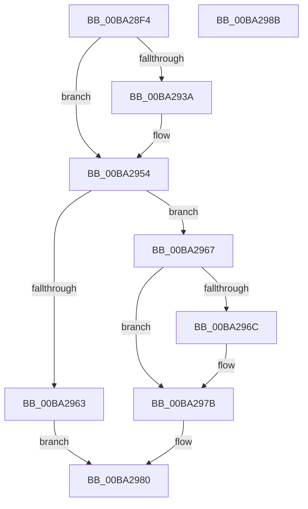

# ViRemLockDeleteFirstTreeNode

- RVA: `0x00BA28F4`–`0x00BA298C` (길이 `152` bytes)
- VA: `0x0000000140BA28F4`
- 실행 섹션: `PAGEVRFY`
- PDB 이름 있음: `예`; PDB Function 태그: `아니요`
- unwind 정보 RVA: `0x00065960`
- 디코드: `42`개 명령, `152/152` bytes 표시
- 미해석 바이트: `0` (있으면 어셈블리에 `.byte`로 보존)

> 이 문서는 커널 이미지의 기계어와 PDB 기호를 분석해 생성했습니다. 4번과 5번은 함수 원형과 자료형을 바이너리 사용 방식에서 추정한 C 해석이며 원본 소스 복구 결과는 아닙니다.

## 1. Dependencies

- 직접 호출 지점: **5**; 고유 호출 대상: **5**
- 직접 호출자로 확인된 함수: **2**
- RIP 상대 이미지 참조: **1**

### Outgoing calls
- `0x00BA291C` → [VfAvlInitializeLockContext](../../text/4A/VfAvlInitializeLockContext_function_004A686C.md) (function, `0x004A686C`)
- `0x00BA292D` → [VfAvlLookupTreeNode](../../text/3E/VfAvlLookupTreeNode_function_003EF1B4.md) (function, `0x003EF1B4`)
- `0x00BA294C` → [VfAvlDeleteTreeNode](../../text/3E/VfAvlDeleteTreeNode_function_003EE240.md) (function, `0x003EE240`)
- `0x00BA2959` → [VfAvlCleanupLockContext](../../text/3E/VfAvlCleanupLockContext_function_003EF56C.md) (function, `0x003EF56C`)
- `0x00BA2976` → [VfAvlFreeNodeNoLock](../../text/61/VfAvlFreeNodeNoLock_function_006126D8.md) (function, `0x006126D8`)

### Direct callers
- [VerifierIoInitializeRemoveLockEx](VerifierIoInitializeRemoveLockEx_function_00BA2610.md) at `0x00BA26B4`
- [sub_00BBC33A](../BB/Unknown_function_00BBC33A.md) at `0x00BBC340`

### Static image references
- `0x00BA2926` → RVA `0x00FFDCE0` (`PAGEVRFD`; read)

## 2. Other-region calls and transfers

- 다른 실행 섹션으로 향하는 call: **5**
  - `0x00BA291C` → [VfAvlInitializeLockContext](../../text/4A/VfAvlInitializeLockContext_function_004A686C.md) (`PAGEVRFY` → `.text`)
  - `0x00BA292D` → [VfAvlLookupTreeNode](../../text/3E/VfAvlLookupTreeNode_function_003EF1B4.md) (`PAGEVRFY` → `.text`)
  - `0x00BA294C` → [VfAvlDeleteTreeNode](../../text/3E/VfAvlDeleteTreeNode_function_003EE240.md) (`PAGEVRFY` → `.text`)
  - `0x00BA2959` → [VfAvlCleanupLockContext](../../text/3E/VfAvlCleanupLockContext_function_003EF56C.md) (`PAGEVRFY` → `.text`)
  - `0x00BA2976` → [VfAvlFreeNodeNoLock](../../text/61/VfAvlFreeNodeNoLock_function_006126D8.md) (`PAGEVRFY` → `.text`)
- 별도 외부 분기/꼬리 이동을 확인하지 못했습니다.

## 3. Assembly (complete function range)

```asm
00BA28F4  48 89 5C 24 08                  mov qword ptr [rsp + 8], rbx
00BA28F9  57                              push rdi
00BA28FA  48 83 EC 40                     sub rsp, 0x40
00BA28FE  0F 57 C0                        xorps xmm0, xmm0
00BA2901  33 C0                           xor eax, eax
00BA2903  4C 8B CA                        mov r9, rdx
00BA2906  48 89 44 24 30                  mov qword ptr [rsp + 0x30], rax
00BA290B  4C 8B C1                        mov r8, rcx
00BA290E  33 D2                           xor edx, edx
00BA2910  48 8D 4C 24 20                  lea rcx, [rsp + 0x20]
00BA2915  33 DB                           xor ebx, ebx
00BA2917  0F 11 44 24 20                  movups xmmword ptr [rsp + 0x20], xmm0
00BA291C  E8 4B 3F 90 FF                  call 0x1404a686c
00BA2921  48 8D 54 24 20                  lea rdx, [rsp + 0x20]
00BA2926  48 8D 0D B3 B3 45 00            lea rcx, [rip + 0x45b3b3]
00BA292D  E8 82 C8 84 FF                  call 0x1403ef1b4
00BA2932  48 8B F8                        mov rdi, rax
00BA2935  48 85 C0                        test rax, rax
00BA2938  74 1A                           je 0x140ba2954
00BA293A  4C 8B 00                        mov r8, qword ptr [rax]
00BA293D  48 8D 54 24 20                  lea rdx, [rsp + 0x20]
00BA2942  45 33 C9                        xor r9d, r9d
00BA2945  48 8D 0D 94 B3 45 00            lea rcx, [rip + 0x45b394]
00BA294C  E8 EF B8 84 FF                  call 0x1403ee240
00BA2951  48 8B D8                        mov rbx, rax
00BA2954  48 8D 4C 24 20                  lea rcx, [rsp + 0x20]
00BA2959  E8 0E CC 84 FF                  call 0x1403ef56c
00BA295E  48 85 FF                        test rdi, rdi
00BA2961  75 04                           jne 0x140ba2967
00BA2963  33 C0                           xor eax, eax
00BA2965  EB 19                           jmp 0x140ba2980
00BA2967  48 85 DB                        test rbx, rbx
00BA296A  74 0F                           je 0x140ba297b
00BA296C  48 8B D3                        mov rdx, rbx
00BA296F  48 8D 0D 6A B3 45 00            lea rcx, [rip + 0x45b36a]
00BA2976  E8 5D FD A6 FF                  call 0x1406126d8
00BA297B  B8 01 00 00 00                  mov eax, 1
00BA2980  48 8B 5C 24 50                  mov rbx, qword ptr [rsp + 0x50]
00BA2985  48 83 C4 40                     add rsp, 0x40
00BA2989  5F                              pop rdi
00BA298A  C3                              ret
00BA298B  CC                              int3
```

## 4. C-style interpretation (structured pseudocode)

```c
__int64 __fastcall ViRemLockDeleteFirstTreeNode(__int64 a1, __int64 a2)
{
    __int64 result;
    __int64 v_rbx;
    __int64 v_rsp;
    unsigned __int64 v_stack_m18;
    unsigned __int64 v_stack_m28;
    unsigned __int64 v_stack_p8;

    v_stack_p8 = v_rbx;
    v_rsp = (v_rsp) - (64);
    result = 0;
    v_stack_m18 = 0;
    a2 = 0;
    v_rbx = 0;
    v_stack_m28 = v_xmm0;
    result = VfAvlInitializeLockContext(v_stack_m28, a2, a1, a2);
    result = VfAvlLookupTreeNode(v_rip + 4567987, v_stack_m28, a1, a2);
    if (result != 0) {
        a3 = *(unsigned __int64 *)(result);
        a2 = v_stack_m28;
        a4 = 0;
        a1 = v_rip + 4567956;
        result = VfAvlDeleteTreeNode(a1, a2, a3, a4);
        v_rbx = result;
    }
    result = VfAvlCleanupLockContext(v_stack_m28, a2, a3, a4);
    if (result != 0) goto loc_00BA2967;
    result = 0;
    goto loc_00BA2980;
loc_00BA2967:
    if (v_rbx != 0) {
        a2 = v_rbx;
        a1 = v_rip + 4567914;
        result = VfAvlFreeNodeNoLock(a1, a2, a3, a4);
    }
loc_00BA2980:
    v_rsp = (v_rsp) + (64);
    return 1;
}
```

## 5. (Beta) C Style

```c
int64_t ViRemLockDeleteFirstTreeNode(int64_t Arg1, int64_t Arg2)
{
    int64_t result;
    int64_t local_rbx;
    int64_t local_rsp;
    uint64_t v_stack_m18;
    uint64_t v_stack_m28;
    uint64_t v_stack_p8;

    v_stack_p8 = local_rbx;
    local_rsp = (local_rsp) - (64);
    result = 0;
    v_stack_m18 = 0;
    Arg2 = 0;
    local_rbx = 0;
    v_stack_m28 = v_xmm0;
    result = VfAvlInitializeLockContext(v_stack_m28, Arg2, Arg1, Arg2);
    result = VfAvlLookupTreeNode(v_rip + 4567987, v_stack_m28, Arg1, Arg2);
    if (result != 0) {
        a3 = *(uint64_t *)(result);
        Arg2 = v_stack_m28;
        a4 = 0;
        Arg1 = v_rip + 4567956;
        result = VfAvlDeleteTreeNode(Arg1, Arg2, a3, a4);
        local_rbx = result;
    }
    result = VfAvlCleanupLockContext(v_stack_m28, Arg2, a3, a4);
    if (result != 0) goto loc_00BA2967;
    result = 0;
    goto loc_00BA2980;
loc_00BA2967:
    if (local_rbx != 0) {
        Arg2 = local_rbx;
        Arg1 = v_rip + 4567914;
        result = VfAvlFreeNodeNoLock(Arg1, Arg2, a3, a4);
    }
loc_00BA2980:
    local_rsp = (local_rsp) + (64);
    return 1;
}
```

## 6. Execution-region graph

[열기: 2D/3D 그래프와 함수 탐색 컨트롤 패널](../../../control-panel.html?section=pagevrfy&rva=0x00BA28F4&view=graph)

- 2D 그래프는 위에서 아래로 흐르고, 3D 그래프는 빈 공간을 드래그해 회전합니다. Shift+드래그는 이동, 휠은 확대·축소, 함수 노드 선택은 대상 보고서 이동입니다.

### Static fallback


