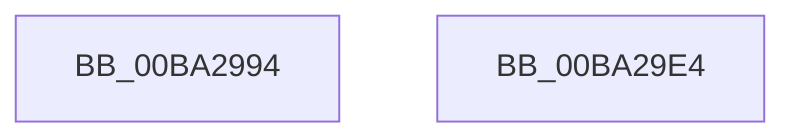

# ViRemLockFindSurrogate

- RVA: `0x00BA2994`–`0x00BA29E5` (길이 `81` bytes)
- VA: `0x0000000140BA2994`
- 실행 섹션: `PAGEVRFY`
- PDB 이름 있음: `예`; PDB Function 태그: `아니요`
- unwind 정보 RVA: `0x000697A4`
- 디코드: `22`개 명령, `81/81` bytes 표시
- 미해석 바이트: `0` (있으면 어셈블리에 `.byte`로 보존)

> 이 문서는 커널 이미지의 기계어와 PDB 기호를 분석해 생성했습니다. 4번과 5번은 함수 원형과 자료형을 바이너리 사용 방식에서 추정한 C 해석이며 원본 소스 복구 결과는 아닙니다.

## 1. Dependencies

- 직접 호출 지점: **3**; 고유 호출 대상: **3**
- 직접 호출자로 확인된 함수: **4**
- RIP 상대 이미지 참조: **1**

### Outgoing calls
- `0x00BA29B4` → [VfAvlInitializeLockContext](../../text/4A/VfAvlInitializeLockContext_function_004A686C.md) (function, `0x004A686C`)
- `0x00BA29C9` → [VfAvlLookupTreeNode](../../text/3E/VfAvlLookupTreeNode_function_003EF1B4.md) (function, `0x003EF1B4`)
- `0x00BA29D6` → [VfAvlCleanupLockContext](../../text/3E/VfAvlCleanupLockContext_function_003EF56C.md) (function, `0x003EF56C`)

### Direct callers
- [VerifierIoAcquireRemoveLockEx](VerifierIoAcquireRemoveLockEx_function_00BA2580.md) at `0x00BA25B8`
- [VerifierIoInitializeRemoveLockEx](VerifierIoInitializeRemoveLockEx_function_00BA2610.md) at `0x00BA265B`
- [VerifierIoReleaseRemoveLockAndWaitEx](VerifierIoReleaseRemoveLockAndWaitEx_function_00BA27A0.md) at `0x00BA27C7`
- [VerifierIoReleaseRemoveLockEx](VerifierIoReleaseRemoveLockEx_function_00BA2810.md) at `0x00BA2837`

### Static image references
- `0x00BA29C2` → RVA `0x00FFDCE0` (`PAGEVRFD`; read)

## 2. Other-region calls and transfers

- 다른 실행 섹션으로 향하는 call: **3**
  - `0x00BA29B4` → [VfAvlInitializeLockContext](../../text/4A/VfAvlInitializeLockContext_function_004A686C.md) (`PAGEVRFY` → `.text`)
  - `0x00BA29C9` → [VfAvlLookupTreeNode](../../text/3E/VfAvlLookupTreeNode_function_003EF1B4.md) (`PAGEVRFY` → `.text`)
  - `0x00BA29D6` → [VfAvlCleanupLockContext](../../text/3E/VfAvlCleanupLockContext_function_003EF56C.md) (`PAGEVRFY` → `.text`)
- 별도 외부 분기/꼬리 이동을 확인하지 못했습니다.

## 3. Assembly (complete function range)

```asm
00BA2994  40 53                           push rbx
00BA2996  48 83 EC 40                     sub rsp, 0x40
00BA299A  33 C0                           xor eax, eax
00BA299C  0F 57 C0                        xorps xmm0, xmm0
00BA299F  4C 8B C1                        mov r8, rcx
00BA29A2  48 89 44 24 30                  mov qword ptr [rsp + 0x30], rax
00BA29A7  48 8D 4C 24 20                  lea rcx, [rsp + 0x20]
00BA29AC  0F 11 44 24 20                  movups xmmword ptr [rsp + 0x20], xmm0
00BA29B1  8D 50 01                        lea edx, [rax + 1]
00BA29B4  E8 B3 3E 90 FF                  call 0x1404a686c
00BA29B9  44 8D 4A 1F                     lea r9d, [rdx + 0x1f]
00BA29BD  48 8D 54 24 20                  lea rdx, [rsp + 0x20]
00BA29C2  48 8D 0D 17 B3 45 00            lea rcx, [rip + 0x45b317]
00BA29C9  E8 E6 C7 84 FF                  call 0x1403ef1b4
00BA29CE  48 8D 4C 24 20                  lea rcx, [rsp + 0x20]
00BA29D3  48 8B D8                        mov rbx, rax
00BA29D6  E8 91 CB 84 FF                  call 0x1403ef56c
00BA29DB  48 8B C3                        mov rax, rbx
00BA29DE  48 83 C4 40                     add rsp, 0x40
00BA29E2  5B                              pop rbx
00BA29E3  C3                              ret
00BA29E4  CC                              int3
```

## 4. C-style interpretation (structured pseudocode)

```c
__int64 __fastcall ViRemLockFindSurrogate(__int64 a1)
{
    __int64 result;
    __int64 v_rsp;
    unsigned __int64 v_stack_m18;
    unsigned __int64 v_stack_m28;

    v_rsp = (v_rsp) - (64);
    result = 0;
    v_stack_m18 = 0;
    v_stack_m28 = v_xmm0;
    result = VfAvlInitializeLockContext(v_stack_m28, result + 1, a1, a4);
    result = VfAvlLookupTreeNode(v_rip + 4567831, v_stack_m28, a1, result + 1 + 31);
    result = VfAvlCleanupLockContext(v_stack_m28, v_stack_m28, a1, result + 1 + 31);
    v_rsp = (v_rsp) + (64);
    return result;
}
```

## 5. (Beta) C Style

```c
int64_t ViRemLockFindSurrogate(int64_t Arg1)
{
    int64_t result;
    int64_t local_rsp;
    uint64_t v_stack_m18;
    uint64_t v_stack_m28;

    local_rsp = (local_rsp) - (64);
    result = 0;
    v_stack_m18 = 0;
    v_stack_m28 = v_xmm0;
    result = VfAvlInitializeLockContext(v_stack_m28, result + 1, Arg1, a4);
    result = VfAvlLookupTreeNode(v_rip + 4567831, v_stack_m28, Arg1, result + 1 + 31);
    result = VfAvlCleanupLockContext(v_stack_m28, v_stack_m28, Arg1, result + 1 + 31);
    local_rsp = (local_rsp) + (64);
    return result;
}
```

## 6. Execution-region graph

[열기: 2D/3D 그래프와 함수 탐색 컨트롤 패널](../../../control-panel.html?section=pagevrfy&rva=0x00BA2994&view=graph)

- 2D 그래프는 위에서 아래로 흐르고, 3D 그래프는 빈 공간을 드래그해 회전합니다. Shift+드래그는 이동, 휠은 확대·축소, 함수 노드 선택은 대상 보고서 이동입니다.

### Static fallback


