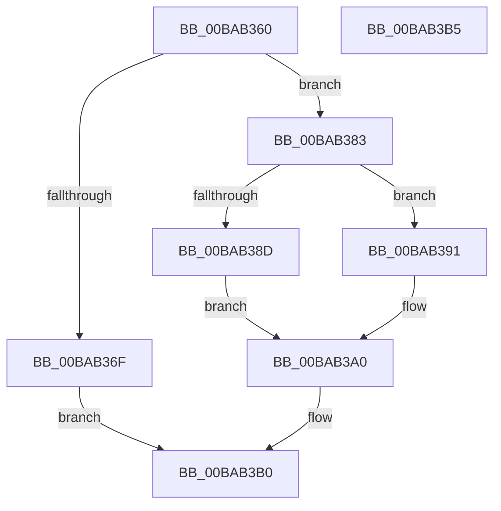

# ViSettingsEnableKernelHandleChecking

- RVA: `0x00BAB360`–`0x00BAB3B6` (길이 `86` bytes)
- VA: `0x0000000140BAB360`
- 실행 섹션: `PAGEVRFY`
- PDB 이름 있음: `예`; PDB Function 태그: `아니요`
- unwind 정보 RVA: `0x0005C788`
- 디코드: `21`개 명령, `86/86` bytes 표시
- 미해석 바이트: `0` (있으면 어셈블리에 `.byte`로 보존)

> 이 문서는 커널 이미지의 기계어와 PDB 기호를 분석해 생성했습니다. 4번과 5번은 함수 원형과 자료형을 바이너리 사용 방식에서 추정한 C 해석이며 원본 소스 복구 결과는 아닙니다.

## 1. Dependencies

- 직접 호출 지점: **2**; 고유 호출 대상: **1**
- 직접 호출자로 확인된 함수: **2**
- RIP 상대 이미지 참조: **3**

### Outgoing calls
- `0x00BAB371` → [PsSetProcessHandleTracingInformation](../../page/78/PsSetProcessHandleTracingInformation_function_00781BB8.md) (function, `0x00781BB8`)
- `0x00BAB3A0` → [PsSetProcessHandleTracingInformation](../../page/78/PsSetProcessHandleTracingInformation_function_00781BB8.md) (function, `0x00781BB8`)

### Direct callers
- [VfSettingsCheckForChanges](VfSettingsCheckForChanges_function_00BAB250.md) at `0x00BAB2FD`
- [VfSettingsMiscellaneousChecksInitPhase1](VfSettingsMiscellaneousChecksInitPhase1_function_00BAB32C.md) at `0x00BAB34D`

### Static image references
- `0x00BAB366` → RVA `0x00FC6AB0` (`ALMOSTRO`; read)
- `0x00BAB376` → RVA `0x00FC42C0` (`.data`; read/write)
- `0x00BAB383` → RVA `0x00E0E934` (`.data`; read)

## 2. Other-region calls and transfers

- 다른 실행 섹션으로 향하는 call: **2**
  - `0x00BAB371` → [PsSetProcessHandleTracingInformation](../../page/78/PsSetProcessHandleTracingInformation_function_00781BB8.md) (`PAGEVRFY` → `PAGE`)
  - `0x00BAB3A0` → [PsSetProcessHandleTracingInformation](../../page/78/PsSetProcessHandleTracingInformation_function_00781BB8.md) (`PAGEVRFY` → `PAGE`)
- 별도 외부 분기/꼬리 이동을 확인하지 못했습니다.

## 3. Assembly (complete function range)

```asm
00BAB360  48 83 EC 28                     sub rsp, 0x28
00BAB364  85 C9                           test ecx, ecx
00BAB366  48 8B 0D 43 B7 41 00            mov rcx, qword ptr [rip + 0x41b743]
00BAB36D  75 14                           jne 0x140bab383
00BAB36F  33 D2                           xor edx, edx
00BAB371  E8 42 68 BD FF                  call 0x140781bb8
00BAB376  F0 81 25 3F 8F 41 00 FF FF FF BF  lock and dword ptr [rip + 0x418f3f], 0xbfffffff
00BAB381  EB 2D                           jmp 0x140bab3b0
00BAB383  8B 05 AB 35 26 00               mov eax, dword ptr [rip + 0x2635ab]
00BAB389  85 C0                           test eax, eax
00BAB38B  75 04                           jne 0x140bab391
00BAB38D  33 D2                           xor edx, edx
00BAB38F  EB 0F                           jmp 0x140bab3a0
00BAB391  48 83 64 24 38 00               and qword ptr [rsp + 0x38], 0
00BAB397  48 8D 54 24 38                  lea rdx, [rsp + 0x38]
00BAB39C  89 44 24 3C                     mov dword ptr [rsp + 0x3c], eax
00BAB3A0  E8 13 68 BD FF                  call 0x140781bb8
00BAB3A5  F0 81 0D 10 8F 41 00 00 00 00 40  lock or dword ptr [rip + 0x418f10], 0x40000000
00BAB3B0  48 83 C4 28                     add rsp, 0x28
00BAB3B4  C3                              ret
00BAB3B5  CC                              int3
```

## 4. C-style interpretation (structured pseudocode)

```c
__int64 __fastcall ViSettingsEnableKernelHandleChecking(int a1, int a2)
{
    __int64 result;
    __int64 v_rsp;
    unsigned __int64 v_stack_p10;
    unsigned int v_stack_p14;

    v_rsp = (v_rsp) - (40);
    if (a1 != 0) goto loc_00BAB383;
    a2 = 0;
    result = PsSetProcessHandleTracingInformation(*(unsigned __int64 *)(v_rip + 4306755), a2, a3, a4);
    goto loc_00BAB3B0;
loc_00BAB383:
    if ((unsigned int)((unsigned int)(*(unsigned int *)(v_rip + 2504107))) != 0) goto loc_00BAB391;
    a2 = 0;
    goto loc_00BAB3A0;
loc_00BAB391:
    v_stack_p14 = (unsigned int)((unsigned int)(*(unsigned int *)(v_rip + 2504107)));
loc_00BAB3A0:
    result = PsSetProcessHandleTracingInformation(*(unsigned __int64 *)(v_rip + 4306755), v_stack_p10, a3, a4);
loc_00BAB3B0:
    v_rsp = (v_rsp) + (40);
    return result;
}
```

## 5. (Beta) C Style

```c
int64_t ViSettingsEnableKernelHandleChecking(int32_t Arg1, int32_t Arg2)
{
    int64_t result;
    int64_t local_rsp;
    uint64_t v_stack_p10;
    uint32_t v_stack_p14;

    local_rsp = (local_rsp) - (40);
    if (Arg1 != 0) goto loc_00BAB383;
    Arg2 = 0;
    result = PsSetProcessHandleTracingInformation(*(uint64_t *)(v_rip + 0x41B743), Arg2, a3, a4);
    goto loc_00BAB3B0;
loc_00BAB383:
    if ((uint32_t)((uint32_t)(*(uint32_t *)(v_rip + 0x2635AB))) != 0) goto loc_00BAB391;
    Arg2 = 0;
    goto loc_00BAB3A0;
loc_00BAB391:
    v_stack_p14 = (uint32_t)((uint32_t)(*(uint32_t *)(v_rip + 0x2635AB)));
loc_00BAB3A0:
    result = PsSetProcessHandleTracingInformation(*(uint64_t *)(v_rip + 0x41B743), v_stack_p10, a3, a4);
loc_00BAB3B0:
    local_rsp = (local_rsp) + (40);
    return result;
}
```

## 6. Execution-region graph

[열기: 2D/3D 그래프와 함수 탐색 컨트롤 패널](../../../control-panel.html?section=pagevrfy&rva=0x00BAB360&view=graph)

- 2D 그래프는 위에서 아래로 흐르고, 3D 그래프는 빈 공간을 드래그해 회전합니다. Shift+드래그는 이동, 휠은 확대·축소, 함수 노드 선택은 대상 보고서 이동입니다.

### Static fallback


