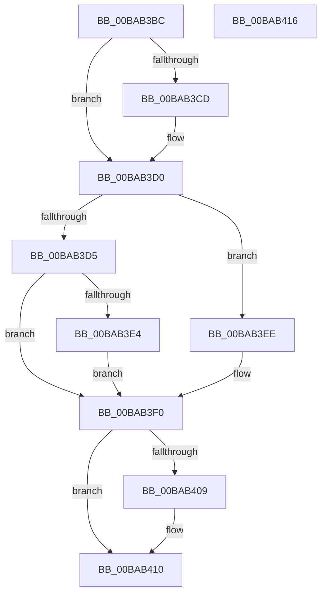

# ViSettingsIoCheckForChanges

- RVA: `0x00BAB3BC`–`0x00BAB417` (길이 `91` bytes)
- VA: `0x0000000140BAB3BC`
- 실행 섹션: `PAGEVRFY`
- PDB 이름 있음: `예`; PDB Function 태그: `아니요`
- unwind 정보 RVA: `0x0005CF00`
- 디코드: `27`개 명령, `91/91` bytes 표시
- 미해석 바이트: `0` (있으면 어셈블리에 `.byte`로 보존)

> 이 문서는 커널 이미지의 기계어와 PDB 기호를 분석해 생성했습니다. 4번과 5번은 함수 원형과 자료형을 바이너리 사용 방식에서 추정한 C 해석이며 원본 소스 복구 결과는 아닙니다.

## 1. Dependencies

- 직접 호출 지점: **2**; 고유 호출 대상: **2**
- 직접 호출자로 확인된 함수: **2**
- RIP 상대 이미지 참조: **5**

### Outgoing calls
- `0x00BAB3F8` → [IoVerifierCheckForSettingsChange](../B9/IoVerifierCheckForSettingsChange_function_00B92258.md) (function, `0x00B92258`)
- `0x00BAB40B` → [VfWdCheckForSettingsChange](VfWdCheckForSettingsChange_function_00BAC888.md) (function, `0x00BAC888`)

### Direct callers
- [VfInitVerifierComponents](../B9/VfInitVerifierComponents_function_00B93AC0.md) at `0x00B93ADE`
- [VfSettingsCheckForChanges](VfSettingsCheckForChanges_function_00BAB250.md) at `0x00BAB2BA`

### Static image references
- `0x00BAB3C2` → RVA `0x00F04864` (`.data`; read)
- `0x00BAB3D5` → RVA `0x00FF4000` (`PAGEVRFD`; read)
- `0x00BAB3E6` → RVA `0x00F04AC0` (`.data`; read/write)
- `0x00BAB3F0` → RVA `0x00FF4000` (`PAGEVRFD`; write)
- `0x00BAB3FD` → RVA `0x00E681A0` (`.data`; read)

## 2. Other-region calls and transfers

- 다른 실행 섹션으로 향하는 call: **0**
- 별도 외부 분기/꼬리 이동을 확인하지 못했습니다.

## 3. Assembly (complete function range)

```asm
00BAB3BC  40 53                           push rbx
00BAB3BE  48 83 EC 20                     sub rsp, 0x20
00BAB3C2  83 3D 9B 94 35 00 00            cmp dword ptr [rip + 0x35949b], 0
00BAB3C9  8B D9                           mov ebx, ecx
00BAB3CB  75 03                           jne 0x140bab3d0
00BAB3CD  83 E3 EF                        and ebx, 0xffffffef
00BAB3D0  F6 C3 10                        test bl, 0x10
00BAB3D3  75 19                           jne 0x140bab3ee
00BAB3D5  8B 05 25 8C 44 00               mov eax, dword ptr [rip + 0x448c25]
00BAB3DB  B9 01 00 00 00                  mov ecx, 1
00BAB3E0  85 C0                           test eax, eax
00BAB3E2  75 0C                           jne 0x140bab3f0
00BAB3E4  8B C1                           mov eax, ecx
00BAB3E6  87 05 D4 96 35 00               xchg dword ptr [rip + 0x3596d4], eax
00BAB3EC  EB 02                           jmp 0x140bab3f0
00BAB3EE  33 C9                           xor ecx, ecx
00BAB3F0  89 0D 0A 8C 44 00               mov dword ptr [rip + 0x448c0a], ecx
00BAB3F6  8B CB                           mov ecx, ebx
00BAB3F8  E8 5B 6E FE FF                  call 0x140b92258
00BAB3FD  F7 05 99 CD 2B 00 00 00 40 00   test dword ptr [rip + 0x2bcd99], 0x400000
00BAB407  75 07                           jne 0x140bab410
00BAB409  8B CB                           mov ecx, ebx
00BAB40B  E8 78 14 00 00                  call 0x140bac888
00BAB410  48 83 C4 20                     add rsp, 0x20
00BAB414  5B                              pop rbx
00BAB415  C3                              ret
00BAB416  CC                              int3
```

## 4. C-style interpretation (structured pseudocode)

```c
__int64 __fastcall ViSettingsIoCheckForChanges(int a1)
{
    __int64 result;
    __int64 v_rbx;
    __int64 v_rsp;

    v_rsp = (v_rsp) - (32);
    v_rbx = (unsigned int)(a1);
    if ((*(unsigned int *)(v_rip + 3511451)) == 0) {
        v_rbx = (unsigned int)(((unsigned int)(a1)) & (0xFFFFFFEFULL));
    }
    if ((((unsigned __int8)(v_rbx)) & (16)) != 0) goto loc_00BAB3EE;
    if ((unsigned int)((unsigned int)(*(unsigned int *)(v_rip + 4492325))) != 0) goto loc_00BAB3F0;
    goto loc_00BAB3F0;
loc_00BAB3EE:
    a1 = 0;
loc_00BAB3F0:
    *(unsigned int *)(v_rip + 4492298) = 0;
    result = IoVerifierCheckForSettingsChange((unsigned int)((unsigned int)(v_rbx)), a2, a3, a4);
    if (((*(unsigned int *)(v_rip + 2870681)) & (0x400000ULL)) == 0) {
        a1 = (unsigned int)(v_rbx);
        result = VfWdCheckForSettingsChange(a1, a2, a3, a4);
    }
    v_rsp = (v_rsp) + (32);
    return result;
}
```

## 5. (Beta) C Style

```c
int64_t ViSettingsIoCheckForChanges(int32_t Arg1)
{
    int64_t result;
    int64_t local_rbx;
    int64_t local_rsp;

    local_rsp = (local_rsp) - (32);
    local_rbx = (uint32_t)(Arg1);
    if ((*(uint32_t *)(v_rip + 0x35949B)) == 0) {
        local_rbx = (uint32_t)(((uint32_t)(Arg1)) & (0xFFFFFFEFULL));
    }
    if ((((uint8_t)(local_rbx)) & (16)) != 0) goto loc_00BAB3EE;
    if ((uint32_t)((uint32_t)(*(uint32_t *)(v_rip + 0x448C25))) != 0) goto loc_00BAB3F0;
    goto loc_00BAB3F0;
loc_00BAB3EE:
    Arg1 = 0;
loc_00BAB3F0:
    *(uint32_t *)(v_rip + 0x448C0A) = 0;
    result = IoVerifierCheckForSettingsChange((uint32_t)((uint32_t)(local_rbx)), a2, a3, a4);
    if (((*(uint32_t *)(v_rip + 0x2BCD99)) & (0x400000ULL)) == 0) {
        Arg1 = (uint32_t)(local_rbx);
        result = VfWdCheckForSettingsChange(Arg1, a2, a3, a4);
    }
    local_rsp = (local_rsp) + (32);
    return result;
}
```

## 6. Execution-region graph

[열기: 2D/3D 그래프와 함수 탐색 컨트롤 패널](../../../control-panel.html?section=pagevrfy&rva=0x00BAB3BC&view=graph)

- 2D 그래프는 위에서 아래로 흐르고, 3D 그래프는 빈 공간을 드래그해 회전합니다. Shift+드래그는 이동, 휠은 확대·축소, 함수 노드 선택은 대상 보고서 이동입니다.

### Static fallback


