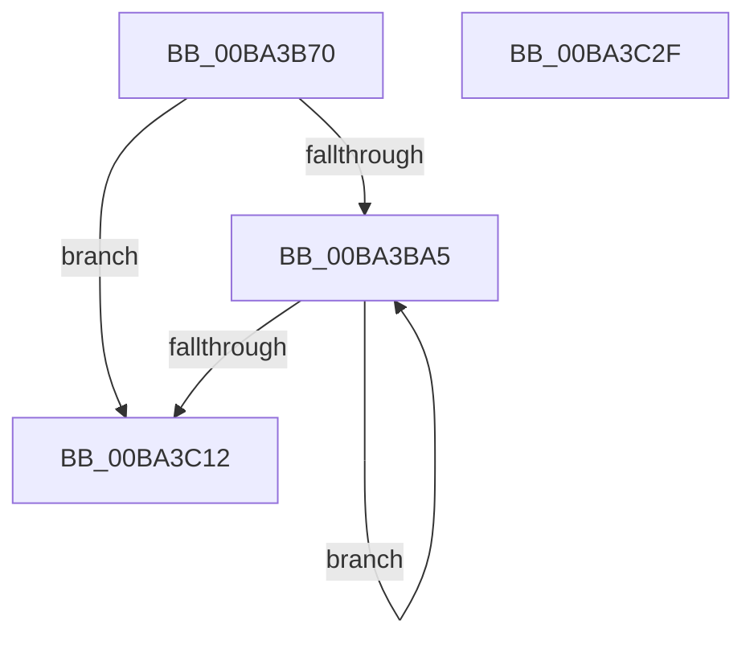

# ViSetupBTSPerProcNoEnable

- RVA: `0x00BA3B70`–`0x00BA3C30` (길이 `192` bytes)
- VA: `0x0000000140BA3B70`
- 실행 섹션: `PAGEVRFY`
- PDB 이름 있음: `예`; PDB Function 태그: `아니요`
- unwind 정보 RVA: `0x000C3764`
- 디코드: `50`개 명령, `192/192` bytes 표시
- 미해석 바이트: `0` (있으면 어셈블리에 `.byte`로 보존)

> 이 문서는 커널 이미지의 기계어와 PDB 기호를 분석해 생성했습니다. 4번과 5번은 함수 원형과 자료형을 바이너리 사용 방식에서 추정한 C 해석이며 원본 소스 복구 결과는 아닙니다.

## 1. Dependencies

- 직접 호출 지점: **3**; 고유 호출 대상: **3**
- 직접 호출자로 확인된 함수: **1**
- RIP 상대 이미지 참조: **4**

### Outgoing calls
- `0x00BA3BDE` → [KeSetSystemGroupAffinityThread](../../text/39/KeSetSystemGroupAffinityThread_function_00399140.md) (function, `0x00399140`)
- `0x00BA3C01` → [KeRevertToUserGroupAffinityThread](../../text/39/KeRevertToUserGroupAffinityThread_function_00398EC0.md) (function, `0x00398EC0`)
- `0x00BA3C1F` → [_security_check_cookie](../../text/6A/_security_check_cookie_function_006AC640.md) (function, `0x006AC640`)

### Direct callers
- [VfBranchTracingPluginEntry](VfBranchTracingPluginEntry_function_00BA37D0.md) at `0x00BA38C7`

### Static image references
- `0x00BA3B7A` → RVA `0x00E0A740` (`.data`; read)
- `0x00BA3B89` → RVA `0x00FC6A80` (`ALMOSTRO`; read)
- `0x00BA3BA5` → RVA `0x00F231B0` (`.data`; read)
- `0x00BA3BE3` → RVA `0x01000C50` (`PAGEVRFD`; read)

## 2. Other-region calls and transfers

- 다른 실행 섹션으로 향하는 call: **3**
  - `0x00BA3BDE` → [KeSetSystemGroupAffinityThread](../../text/39/KeSetSystemGroupAffinityThread_function_00399140.md) (`PAGEVRFY` → `.text`)
  - `0x00BA3C01` → [KeRevertToUserGroupAffinityThread](../../text/39/KeRevertToUserGroupAffinityThread_function_00398EC0.md) (`PAGEVRFY` → `.text`)
  - `0x00BA3C1F` → [_security_check_cookie](../../text/6A/_security_check_cookie_function_006AC640.md) (`PAGEVRFY` → `.text`)
- 별도 외부 분기/꼬리 이동을 확인하지 못했습니다.

## 3. Assembly (complete function range)

```asm
00BA3B70  48 89 5C 24 08                  mov qword ptr [rsp + 8], rbx
00BA3B75  57                              push rdi
00BA3B76  48 83 EC 50                     sub rsp, 0x50
00BA3B7A  48 8B 05 BF 6B 26 00            mov rax, qword ptr [rip + 0x266bbf]
00BA3B81  48 33 C4                        xor rax, rsp
00BA3B84  48 89 44 24 40                  mov qword ptr [rsp + 0x40], rax
00BA3B89  8B 05 F1 2E 42 00               mov eax, dword ptr [rip + 0x422ef1]
00BA3B8F  33 FF                           xor edi, edi
00BA3B91  0F 57 C0                        xorps xmm0, xmm0
00BA3B94  0F 57 C9                        xorps xmm1, xmm1
00BA3B97  0F 11 44 24 20                  movups xmmword ptr [rsp + 0x20], xmm0
00BA3B9C  0F 11 4C 24 30                  movups xmmword ptr [rsp + 0x30], xmm1
00BA3BA1  85 C0                           test eax, eax
00BA3BA3  74 6D                           je 0x140ba3c12
00BA3BA5  48 8B 05 04 F6 37 00            mov rax, qword ptr [rip + 0x37f604]
00BA3BAC  48 8D 54 24 30                  lea rdx, [rsp + 0x30]
00BA3BB1  8B 0C B8                        mov ecx, dword ptr [rax + rdi*4]
00BA3BB4  33 C0                           xor eax, eax
00BA3BB6  89 44 24 2A                     mov dword ptr [rsp + 0x2a], eax
00BA3BBA  66 89 44 24 2E                  mov word ptr [rsp + 0x2e], ax
00BA3BBF  8B C1                           mov eax, ecx
00BA3BC1  C1 E8 06                        shr eax, 6
00BA3BC4  83 E1 3F                        and ecx, 0x3f
00BA3BC7  66 89 44 24 28                  mov word ptr [rsp + 0x28], ax
00BA3BCC  B8 01 00 00 00                  mov eax, 1
00BA3BD1  48 D3 E0                        shl rax, cl
00BA3BD4  48 8D 4C 24 20                  lea rcx, [rsp + 0x20]
00BA3BD9  48 89 44 24 20                  mov qword ptr [rsp + 0x20], rax
00BA3BDE  E8 5D 55 7F FF                  call 0x140399140
00BA3BE3  48 8D 15 66 D0 45 00            lea rdx, [rip + 0x45d066]
00BA3BEA  B9 00 06 00 00                  mov ecx, 0x600
00BA3BEF  48 8B 14 FA                     mov rdx, qword ptr [rdx + rdi*8]
00BA3BF3  48 8B C2                        mov rax, rdx
00BA3BF6  48 C1 EA 20                     shr rdx, 0x20
00BA3BFA  0F 30                           wrmsr
00BA3BFC  48 8D 4C 24 30                  lea rcx, [rsp + 0x30]
00BA3C01  E8 BA 52 7F FF                  call 0x140398ec0
00BA3C06  8B 0D 74 2E 42 00               mov ecx, dword ptr [rip + 0x422e74]
00BA3C0C  FF C7                           inc edi
00BA3C0E  3B F9                           cmp edi, ecx
00BA3C10  72 93                           jb 0x140ba3ba5
00BA3C12  B8 01 00 00 00                  mov eax, 1
00BA3C17  48 8B 4C 24 40                  mov rcx, qword ptr [rsp + 0x40]
00BA3C1C  48 33 CC                        xor rcx, rsp
00BA3C1F  E8 1C 8A B0 FF                  call 0x1406ac640
00BA3C24  48 8B 5C 24 60                  mov rbx, qword ptr [rsp + 0x60]
00BA3C29  48 83 C4 50                     add rsp, 0x50
00BA3C2D  5F                              pop rdi
00BA3C2E  C3                              ret
00BA3C2F  CC                              int3
```

## 4. C-style interpretation (structured pseudocode)

```c
__int64 __fastcall ViSetupBTSPerProcNoEnable(void)
{
    __int64 result;
    __int64 v_rdi;
    __int64 v_rsp;
    unsigned __int64 v_stack_m18;
    unsigned __int64 v_stack_m28;
    unsigned __int16 v_stack_m2A;
    unsigned int v_stack_m2E;
    unsigned __int16 v_stack_m30;
    unsigned __int64 v_stack_m38;
    unsigned __int64 v_stack_p8;

    v_stack_p8 = v_rbx;
    v_rsp = (v_rsp) - (80);
    result = (*(unsigned __int64 *)(v_rip + 2517951)) ^ (v_rsp);
    v_stack_m18 = result;
    v_rdi = 0;
    v_stack_m38 = v_xmm0;
    v_stack_m28 = v_xmm1;
    if ((unsigned int)((unsigned int)(*(unsigned int *)(v_rip + 4337393))) == 0) goto loc_00BA3C12;
loc_00BA3BA5:
    result = 0;
    v_stack_m2E = 0;
    v_stack_m2A = 0;
    result = (unsigned int)(((unsigned int)((unsigned int)((unsigned int)(*(unsigned int *)(*(unsigned __int64 *)(v_rip + 3667460) + v_rdi * 4))))) >> (6));
    a1 = (unsigned int)(((unsigned int)(*(unsigned int *)(*(unsigned __int64 *)(v_rip + 3667460) + v_rdi * 4))) & (63));
    v_stack_m30 = (unsigned __int16)(result);
    result = (1) << ((unsigned __int8)(a1));
    v_stack_m38 = result;
    result = KeSetSystemGroupAffinityThread(v_stack_m38, v_stack_m28, a3, a4);
    a2 = (*(unsigned __int64 *)(v_rip + 4575334 + v_rdi * 8)) >> (32);
    result = KeRevertToUserGroupAffinityThread(v_stack_m28, a2, a3, a4);
    v_rdi = (unsigned int)((v_rdi) + 1);
    if (((unsigned int)(v_rdi)) < ((unsigned int)((unsigned int)(*(unsigned int *)(v_rip + 4337268))))) goto loc_00BA3BA5;
loc_00BA3C12:
    a1 = (v_stack_m18) ^ (v_rsp);
    result = _security_check_cookie(a1, a2, a3, a4);
    v_rsp = (v_rsp) + (80);
    return result;
}
```

## 5. (Beta) C Style

```c
void ViSetupBTSPerProcNoEnable(void)
{
    int64_t result;
    int64_t local_rdi;
    int64_t local_rsp;
    uint64_t v_stack_m18;
    uint64_t v_stack_m28;
    uint16_t v_stack_m2A;
    uint32_t v_stack_m2E;
    uint16_t v_stack_m30;
    uint64_t v_stack_m38;
    uint64_t v_stack_p8;

    v_stack_p8 = local_rbx;
    local_rsp = (local_rsp) - (80);
    result = (*(uint64_t *)(v_rip + 0x266BBF)) ^ (local_rsp);
    v_stack_m18 = result;
    local_rdi = 0;
    v_stack_m38 = v_xmm0;
    v_stack_m28 = v_xmm1;
    if ((uint32_t)((uint32_t)(*(uint32_t *)(v_rip + 0x422EF1))) == 0) goto loc_00BA3C12;
loc_00BA3BA5:
    result = 0;
    v_stack_m2E = 0;
    v_stack_m2A = 0;
    result = (uint32_t)(((uint32_t)((uint32_t)((uint32_t)(*(uint32_t *)(*(uint64_t *)(v_rip + 0x37F604) + local_rdi * 4))))) >> (6));
    a1 = (uint32_t)(((uint32_t)(*(uint32_t *)(*(uint64_t *)(v_rip + 0x37F604) + local_rdi * 4))) & (63));
    v_stack_m30 = (uint16_t)(result);
    result = (1) << ((uint8_t)(a1));
    v_stack_m38 = result;
    result = KeSetSystemGroupAffinityThread(v_stack_m38, v_stack_m28, a3, a4);
    a2 = (*(uint64_t *)(v_rip + 0x45D066 + local_rdi * 8)) >> (32);
    result = KeRevertToUserGroupAffinityThread(v_stack_m28, a2, a3, a4);
    local_rdi = (uint32_t)((local_rdi) + 1);
    if (((uint32_t)(local_rdi)) < ((uint32_t)((uint32_t)(*(uint32_t *)(v_rip + 0x422E74))))) goto loc_00BA3BA5;
loc_00BA3C12:
    a1 = (v_stack_m18) ^ (local_rsp);
    result = _security_check_cookie(a1, a2, a3, a4);
    local_rsp = (local_rsp) + (80);
    return result;
}
```

## 6. Execution-region graph

[열기: 2D/3D 그래프와 함수 탐색 컨트롤 패널](../../../control-panel.html?section=pagevrfy&rva=0x00BA3B70&view=graph)

- 2D 그래프는 위에서 아래로 흐르고, 3D 그래프는 빈 공간을 드래그해 회전합니다. Shift+드래그는 이동, 휠은 확대·축소, 함수 노드 선택은 대상 보고서 이동입니다.

### Static fallback


