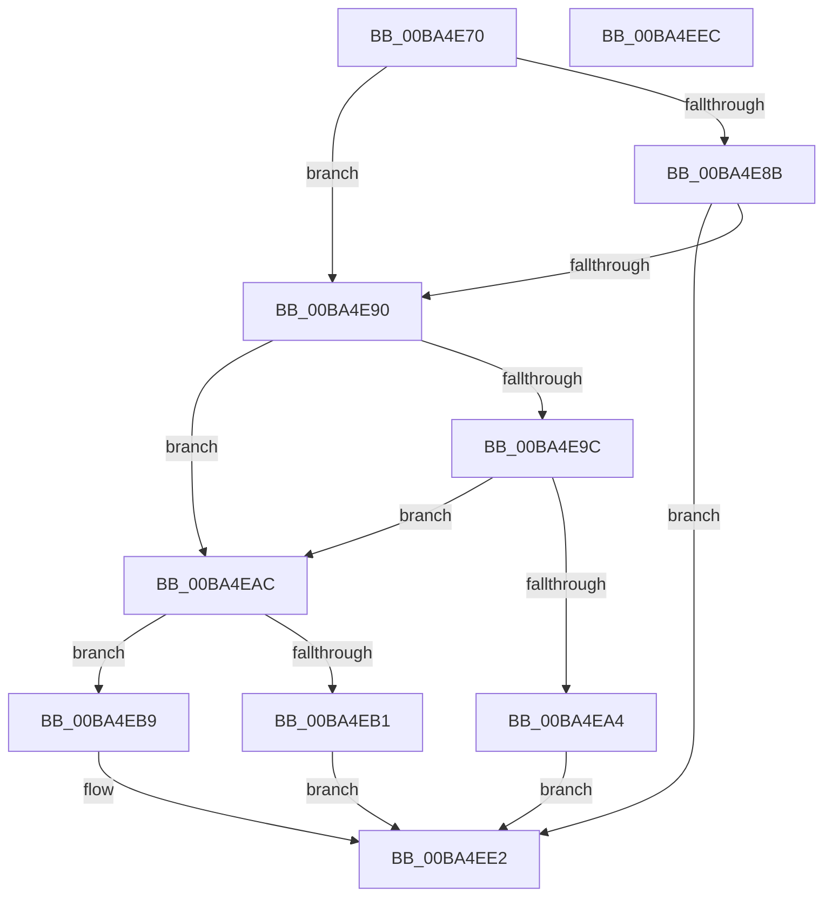

# ViShutdownWatchdogExecuteDpc

- RVA: `0x00BA4E70`–`0x00BA4EED` (길이 `125` bytes)
- VA: `0x0000000140BA4E70`
- 실행 섹션: `PAGEVRFY`
- PDB 이름 있음: `예`; PDB Function 태그: `아니요`
- unwind 정보 RVA: `0x00063458`
- 디코드: `32`개 명령, `125/125` bytes 표시
- 미해석 바이트: `0` (있으면 어셈블리에 `.byte`로 보존)

> 이 문서는 커널 이미지의 기계어와 PDB 기호를 분석해 생성했습니다. 4번과 5번은 함수 원형과 자료형을 바이너리 사용 방식에서 추정한 C 해석이며 원본 소스 복구 결과는 아닙니다.

## 1. Dependencies

- 직접 호출 지점: **2**; 고유 호출 대상: **2**
- 직접 호출자로 확인된 함수: **0**
- RIP 상대 이미지 참조: **8**

### Outgoing calls
- `0x00BA4EDD` → [CarReportRuleViolationFromNt](../B9/CarReportRuleViolationFromNt_function_00B9D904.md) (function, `0x00B9D904`)
- `0x00BA4EE2` → [ViShutdownScheduleWatchdog](ViShutdownScheduleWatchdog_function_00BA4DF0.md) (function, `0x00BA4DF0`)

### Direct callers
- 이 함수 시작 RVA로 연결되는 직접 call은 확인되지 않았습니다. 간접 호출은 완전히 역산할 수 없습니다.

### Static image references
- `0x00BA4E74` → RVA `0x00FFDAFC` (`PAGEVRFD`; read)
- `0x00BA4E7C` → RVA `0x00FFDA7C` (`PAGEVRFD`; read)
- `0x00BA4E83` → RVA `0x00FFDAFC` (`PAGEVRFD`; write)
- `0x00BA4E90` → RVA `0x00EFF3B0` (`.data`; read)
- `0x00BA4E9C` → RVA `0x00FFDB80` (`PAGEVRFD`; read)
- `0x00BA4EA4` → RVA `0x00FFDB80` (`PAGEVRFD`; write)
- `0x00BA4EB1` → RVA `0x00FFDA24` (`PAGEVRFD`; read/write)
- `0x00BA4EB9` → RVA `0x00FFDC60` (`PAGEVRFD`; read)

## 2. Other-region calls and transfers

- 다른 실행 섹션으로 향하는 call: **0**
- 별도 외부 분기/꼬리 이동을 확인하지 못했습니다.

## 3. Assembly (complete function range)

```asm
00BA4E70  48 83 EC 48                     sub rsp, 0x48
00BA4E74  8B 15 82 8C 45 00               mov edx, dword ptr [rip + 0x458c82]
00BA4E7A  FF C2                           inc edx
00BA4E7C  83 3D F9 8B 45 00 01            cmp dword ptr [rip + 0x458bf9], 1
00BA4E83  89 15 73 8C 45 00               mov dword ptr [rip + 0x458c73], edx
00BA4E89  75 05                           jne 0x140ba4e90
00BA4E8B  83 FA 04                        cmp edx, 4
00BA4E8E  72 52                           jb 0x140ba4ee2
00BA4E90  8B 0D 1A A5 35 00               mov ecx, dword ptr [rip + 0x35a51a]
00BA4E96  33 C0                           xor eax, eax
00BA4E98  85 C9                           test ecx, ecx
00BA4E9A  74 10                           je 0x140ba4eac
00BA4E9C  3B 0D DE 8C 45 00               cmp ecx, dword ptr [rip + 0x458cde]
00BA4EA2  74 08                           je 0x140ba4eac
00BA4EA4  89 0D D6 8C 45 00               mov dword ptr [rip + 0x458cd6], ecx
00BA4EAA  EB 36                           jmp 0x140ba4ee2
00BA4EAC  83 FA 01                        cmp edx, 1
00BA4EAF  76 08                           jbe 0x140ba4eb9
00BA4EB1  87 05 6D 8B 45 00               xchg dword ptr [rip + 0x458b6d], eax
00BA4EB7  EB 29                           jmp 0x140ba4ee2
00BA4EB9  4C 8B 05 A0 8D 45 00            mov r8, qword ptr [rip + 0x458da0]
00BA4EC0  BA 15 01 00 00                  mov edx, 0x115
00BA4EC5  48 89 44 24 30                  mov qword ptr [rsp + 0x30], rax
00BA4ECA  45 33 C9                        xor r9d, r9d
00BA4ECD  C7 44 24 28 04 00 00 00         mov dword ptr [rsp + 0x28], 4
00BA4ED5  48 89 44 24 20                  mov qword ptr [rsp + 0x20], rax
00BA4EDA  8D 4A AF                        lea ecx, [rdx - 0x51]
00BA4EDD  E8 22 8A FF FF                  call 0x140b9d904
00BA4EE2  E8 09 FF FF FF                  call 0x140ba4df0
00BA4EE7  48 83 C4 48                     add rsp, 0x48
00BA4EEB  C3                              ret
00BA4EEC  CC                              int3
```

## 4. C-style interpretation (structured pseudocode)

```c
__int64 __fastcall ViShutdownWatchdogExecuteDpc(__int64 a1, __int64 a2, __int64 a3, int a4)
{
    __int64 result;
    __int64 v_rsp;
    unsigned __int64 v_stack_m18;
    unsigned int v_stack_m20;
    unsigned __int64 v_stack_m28;

    v_rsp = (v_rsp) - (72);
    a2 = (unsigned int)(((unsigned int)(*(unsigned int *)(v_rip + 4557954))) + 1);
    *(unsigned int *)(v_rip + 4557939) = (unsigned int)(a2);
    if ((*(unsigned int *)(v_rip + 4557817)) != 1) goto loc_00BA4E90;
    if (((unsigned int)(a2)) < 4) goto loc_00BA4EE2;
loc_00BA4E90:
    result = 0;
    if ((unsigned int)((unsigned int)(*(unsigned int *)(v_rip + 3515674))) == 0) goto loc_00BA4EAC;
    if (((unsigned int)((unsigned int)(*(unsigned int *)(v_rip + 3515674)))) == (*(unsigned int *)(v_rip + 4558046))) goto loc_00BA4EAC;
    *(unsigned int *)(v_rip + 4558038) = (unsigned int)((unsigned int)(*(unsigned int *)(v_rip + 3515674)));
    goto loc_00BA4EE2;
loc_00BA4EAC:
    if (((unsigned int)(a2)) <= 1) goto loc_00BA4EB9;
    goto loc_00BA4EE2;
loc_00BA4EB9:
    v_stack_m18 = 0;
    a4 = 0;
    v_stack_m20 = 4;
    v_stack_m28 = 0;
    result = CarReportRuleViolationFromNt(277 - 81, 277, *(unsigned __int64 *)(v_rip + 4558240), a4);
loc_00BA4EE2:
    result = ViShutdownScheduleWatchdog(277 - 81, 277, *(unsigned __int64 *)(v_rip + 4558240), a4);
    v_rsp = (v_rsp) + (72);
    return result;
}
```

## 5. (Beta) C Style

```c
int64_t ViShutdownWatchdogExecuteDpc(int64_t Arg1, int64_t Arg2, int64_t Arg3, int32_t Arg4)
{
    int64_t result;
    int64_t local_rsp;
    uint64_t v_stack_m18;
    uint32_t v_stack_m20;
    uint64_t v_stack_m28;

    local_rsp = (local_rsp) - (72);
    Arg2 = (uint32_t)(((uint32_t)(*(uint32_t *)(v_rip + 0x458C82))) + 1);
    *(uint32_t *)(v_rip + 0x458C73) = (uint32_t)(Arg2);
    if ((*(uint32_t *)(v_rip + 0x458BF9)) != 1) goto loc_00BA4E90;
    if (((uint32_t)(Arg2)) < 4) goto loc_00BA4EE2;
loc_00BA4E90:
    result = 0;
    if ((uint32_t)((uint32_t)(*(uint32_t *)(v_rip + 0x35A51A))) == 0) goto loc_00BA4EAC;
    if (((uint32_t)((uint32_t)(*(uint32_t *)(v_rip + 0x35A51A)))) == (*(uint32_t *)(v_rip + 0x458CDE))) goto loc_00BA4EAC;
    *(uint32_t *)(v_rip + 0x458CD6) = (uint32_t)((uint32_t)(*(uint32_t *)(v_rip + 0x35A51A)));
    goto loc_00BA4EE2;
loc_00BA4EAC:
    if (((uint32_t)(Arg2)) <= 1) goto loc_00BA4EB9;
    goto loc_00BA4EE2;
loc_00BA4EB9:
    v_stack_m18 = 0;
    Arg4 = 0;
    v_stack_m20 = 4;
    v_stack_m28 = 0;
    result = CarReportRuleViolationFromNt(277 - 81, 277, *(uint64_t *)(v_rip + 0x458DA0), Arg4);
loc_00BA4EE2:
    result = ViShutdownScheduleWatchdog(277 - 81, 277, *(uint64_t *)(v_rip + 0x458DA0), Arg4);
    local_rsp = (local_rsp) + (72);
    return result;
}
```

## 6. Execution-region graph

[열기: 2D/3D 그래프와 함수 탐색 컨트롤 패널](../../../control-panel.html?section=pagevrfy&rva=0x00BA4E70&view=graph)

- 2D 그래프는 위에서 아래로 흐르고, 3D 그래프는 빈 공간을 드래그해 회전합니다. Shift+드래그는 이동, 휠은 확대·축소, 함수 노드 선택은 대상 보고서 이동입니다.

### Static fallback


