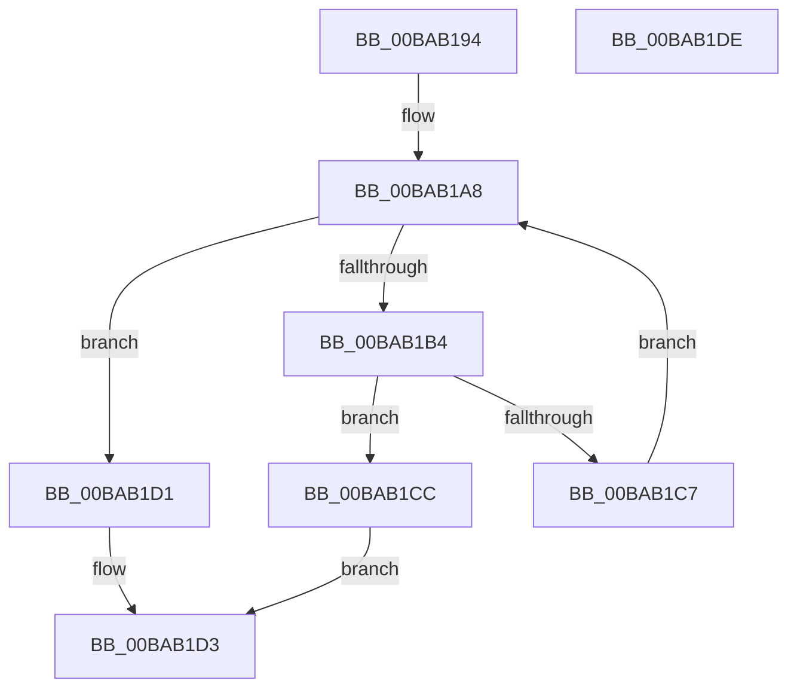

# ViSuspectDriversLookupEntry

- RVA: `0x00BAB194`–`0x00BAB1DF` (길이 `75` bytes)
- VA: `0x0000000140BAB194`
- 실행 섹션: `PAGEVRFY`
- PDB 이름 있음: `예`; PDB Function 태그: `아니요`
- unwind 정보 RVA: `0x0005CAAC`
- 디코드: `24`개 명령, `75/75` bytes 표시
- 미해석 바이트: `0` (있으면 어셈블리에 `.byte`로 보존)

> 이 문서는 커널 이미지의 기계어와 PDB 기호를 분석해 생성했습니다. 4번과 5번은 함수 원형과 자료형을 바이너리 사용 방식에서 추정한 C 해석이며 원본 소스 복구 결과는 아닙니다.

## 1. Dependencies

- 직접 호출 지점: **1**; 고유 호출 대상: **1**
- 직접 호출자로 확인된 함수: **6**
- RIP 상대 이미지 참조: **1**

### Outgoing calls
- `0x00BAB1BE` → [RtlEqualUnicodeString](../../page/93/RtlEqualUnicodeString_function_00932A20.md) (function, `0x00932A20`)

### Direct callers
- [VfVolatileRemoveDifVerification](../../text/61/VfVolatileRemoveDifVerification_function_006169F0.md) at `0x00616A1E`
- [VfSuspectDifRemoveEntry](VfSuspectDifRemoveEntry_function_00BAA630.md) at `0x00BAA636`
- [VfSuspectDriversLookupName](VfSuspectDriversLookupName_function_00BAAE74.md) at `0x00BAAE78`
- [VfSuspectDriversRemove](VfSuspectDriversRemove_function_00BAAE94.md) at `0x00BAAEAB`
- [VfSuspectDriversUnloadCallback](VfSuspectDriversUnloadCallback_function_00BAAF34.md) at `0x00BAB00F`
- [VfSuspectDriversIsLoaded](../../init/C4/VfSuspectDriversIsLoaded_function_00C4C7F8.md) at `0x00C4C7FC`

### Static image references
- `0x00BAB19E` → RVA `0x00F049E0` (`.data`; read)

## 2. Other-region calls and transfers

- 다른 실행 섹션으로 향하는 call: **1**
  - `0x00BAB1BE` → [RtlEqualUnicodeString](../../page/93/RtlEqualUnicodeString_function_00932A20.md) (`PAGEVRFY` → `PAGE`)
- 별도 외부 분기/꼬리 이동을 확인하지 못했습니다.

## 3. Assembly (complete function range)

```asm
00BAB194  48 89 5C 24 08                  mov qword ptr [rsp + 8], rbx
00BAB199  57                              push rdi
00BAB19A  48 83 EC 20                     sub rsp, 0x20
00BAB19E  48 8B 1D 3B 98 35 00            mov rbx, qword ptr [rip + 0x35983b]
00BAB1A5  48 8B F9                        mov rdi, rcx
00BAB1A8  48 8D 05 31 98 35 00            lea rax, [rip + 0x359831]
00BAB1AF  48 3B D8                        cmp rbx, rax
00BAB1B2  74 1D                           je 0x140bab1d1
00BAB1B4  48 8D 4B 28                     lea rcx, [rbx + 0x28]
00BAB1B8  41 B0 01                        mov r8b, 1
00BAB1BB  48 8B D7                        mov rdx, rdi
00BAB1BE  E8 5D 78 D8 FF                  call 0x140932a20
00BAB1C3  84 C0                           test al, al
00BAB1C5  75 05                           jne 0x140bab1cc
00BAB1C7  48 8B 1B                        mov rbx, qword ptr [rbx]
00BAB1CA  EB DC                           jmp 0x140bab1a8
00BAB1CC  48 8B C3                        mov rax, rbx
00BAB1CF  EB 02                           jmp 0x140bab1d3
00BAB1D1  33 C0                           xor eax, eax
00BAB1D3  48 8B 5C 24 30                  mov rbx, qword ptr [rsp + 0x30]
00BAB1D8  48 83 C4 20                     add rsp, 0x20
00BAB1DC  5F                              pop rdi
00BAB1DD  C3                              ret
00BAB1DE  CC                              int3
```

## 4. C-style interpretation (structured pseudocode)

```c
__int64 __fastcall ViSuspectDriversLookupEntry(__int64 a1)
{
    __int64 result;
    __int64 v_rsp;
    unsigned __int64 v_stack_p8;

    v_stack_p8 = v_rbx;
    v_rsp = (v_rsp) - (32);
loc_00BAB1A8:
    if ((*(unsigned __int64 *)(v_rip + 3512379)) == (v_rip + 3512369)) goto loc_00BAB1D1;
    result = RtlEqualUnicodeString(*(unsigned __int64 *)(v_rip + 3512379) + 40, a1, 1, a4);
    if ((unsigned __int8)(result) != 0) goto loc_00BAB1CC;
    goto loc_00BAB1A8;
loc_00BAB1CC:
    goto loc_00BAB1D3;
loc_00BAB1D1:
    result = 0;
loc_00BAB1D3:
    v_rsp = (v_rsp) + (32);
    return result;
}
```

## 5. (Beta) C Style

```c
int64_t ViSuspectDriversLookupEntry(int64_t Arg1)
{
    int64_t result;
    int64_t local_rsp;
    uint64_t v_stack_p8;

    v_stack_p8 = local_rbx;
    local_rsp = (local_rsp) - (32);
loc_00BAB1A8:
    if ((*(uint64_t *)(v_rip + 0x35983B)) == (v_rip + 3512369)) goto loc_00BAB1D1;
    result = RtlEqualUnicodeString(*(uint64_t *)(v_rip + 0x35983B) + 40, Arg1, 1, a4);
    if ((uint8_t)(result) != 0) goto loc_00BAB1CC;
    goto loc_00BAB1A8;
loc_00BAB1CC:
    goto loc_00BAB1D3;
loc_00BAB1D1:
    result = 0;
loc_00BAB1D3:
    local_rsp = (local_rsp) + (32);
    return result;
}
```

## 6. Execution-region graph

[열기: 2D/3D 그래프와 함수 탐색 컨트롤 패널](../../../control-panel.html?section=pagevrfy&rva=0x00BAB194&view=graph)

- 2D 그래프는 위에서 아래로 흐르고, 3D 그래프는 빈 공간을 드래그해 회전합니다. Shift+드래그는 이동, 휠은 확대·축소, 함수 노드 선택은 대상 보고서 이동입니다.

### Static fallback


