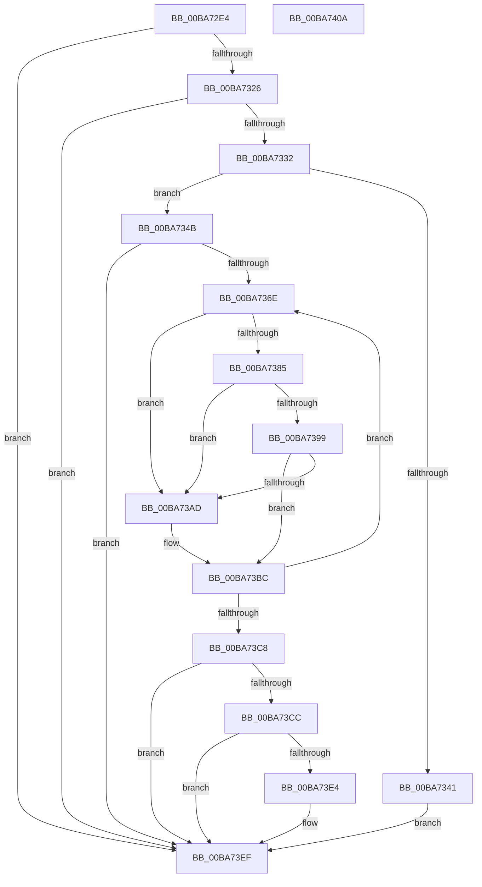

# ViThunkApplyPristineCurrentSession

- RVA: `0x00BA72E4`–`0x00BA740B` (길이 `295` bytes)
- VA: `0x0000000140BA72E4`
- 실행 섹션: `PAGEVRFY`
- PDB 이름 있음: `예`; PDB Function 태그: `아니요`
- unwind 정보 RVA: `0x0006B074`
- 디코드: `84`개 명령, `295/295` bytes 표시
- 미해석 바이트: `0` (있으면 어셈블리에 `.byte`로 보존)

> 이 문서는 커널 이미지의 기계어와 PDB 기호를 분석해 생성했습니다. 4번과 5번은 함수 원형과 자료형을 바이너리 사용 방식에서 추정한 C 해석이며 원본 소스 복구 결과는 아닙니다.

## 1. Dependencies

- 직접 호출 지점: **7**; 고유 호출 대상: **5**
- 직접 호출자로 확인된 함수: **1**
- RIP 상대 이미지 참조: **5**

### Outgoing calls
- `0x00BA7315` → [RtlImageDirectoryEntryToData](../../text/43/RtlImageDirectoryEntryToData_function_004328D0.md) (function, `0x004328D0`)
- `0x00BA735E` → [memset](../../text/6C/memset_function_006C6C40.md) (function, `0x006C6C40`)
- `0x00BA7378` → [ViThunkGetPristine](ViThunkGetPristine_function_00BA7860.md) (function, `0x00BA7860`)
- `0x00BA738C` → [ViThunkGetPristine](ViThunkGetPristine_function_00BA7860.md) (function, `0x00BA7860`)
- `0x00BA73A0` → [ViThunkGetPristine](ViThunkGetPristine_function_00BA7860.md) (function, `0x00BA7860`)
- `0x00BA73D9` → [MmApplyVerifierToRunningImage](../BB/MmApplyVerifierToRunningImage_function_00BB4780.md) (function, `0x00BB4780`)
- `0x00BA73EA` → [VfUtilPrintCheckinString](../B9/VfUtilPrintCheckinString_function_00B934D4.md) (function, `0x00B934D4`)

### Direct callers
- [VfThunkApplyPristineToAllSession](VfThunkApplyPristineToAllSession_function_00BA7174.md) at `0x00BA7188`

### Static image references
- `0x00BA7332` → RVA `0x00F04390` (`.data`; read)
- `0x00BA734B` → RVA `0x00F044C4` (`.data`; read)
- `0x00BA7371` → RVA `0x00FF4A40` (`PAGEVRFD`; read)
- `0x00BA7385` → RVA `0x00FF51B0` (`PAGEVRFD`; read)
- `0x00BA7399` → RVA `0x00FF5F20` (`PAGEVRFD`; read)

## 2. Other-region calls and transfers

- 다른 실행 섹션으로 향하는 call: **2**
  - `0x00BA7315` → [RtlImageDirectoryEntryToData](../../text/43/RtlImageDirectoryEntryToData_function_004328D0.md) (`PAGEVRFY` → `.text`)
  - `0x00BA735E` → [memset](../../text/6C/memset_function_006C6C40.md) (`PAGEVRFY` → `.text`)
- 별도 외부 분기/꼬리 이동을 확인하지 못했습니다.

## 3. Assembly (complete function range)

```asm
00BA72E4  48 8B C4                        mov rax, rsp
00BA72E7  48 89 58 10                     mov qword ptr [rax + 0x10], rbx
00BA72EB  48 89 68 18                     mov qword ptr [rax + 0x18], rbp
00BA72EF  48 89 70 20                     mov qword ptr [rax + 0x20], rsi
00BA72F3  57                              push rdi
00BA72F4  41 56                           push r14
00BA72F6  41 57                           push r15
00BA72F8  48 83 EC 20                     sub rsp, 0x20
00BA72FC  83 60 08 00                     and dword ptr [rax + 8], 0
00BA7300  4C 8D 48 08                     lea r9, [rax + 8]
00BA7304  48 8B E9                        mov rbp, rcx
00BA7307  33 DB                           xor ebx, ebx
00BA7309  48 8B 49 30                     mov rcx, qword ptr [rcx + 0x30]
00BA730D  B2 01                           mov dl, 1
00BA730F  33 F6                           xor esi, esi
00BA7311  44 8D 43 0C                     lea r8d, [rbx + 0xc]
00BA7315  E8 B6 B5 88 FF                  call 0x1404328d0
00BA731A  4C 8B F0                        mov r14, rax
00BA731D  48 85 C0                        test rax, rax
00BA7320  0F 84 C9 00 00 00               je 0x140ba73ef
00BA7326  8B 7C 24 40                     mov edi, dword ptr [rsp + 0x40]
00BA732A  85 FF                           test edi, edi
00BA732C  0F 84 BD 00 00 00               je 0x140ba73ef
00BA7332  4C 8B 3D 57 D0 35 00            mov r15, qword ptr [rip + 0x35d057]
00BA7339  C1 EF 03                        shr edi, 3
00BA733C  4D 85 FF                        test r15, r15
00BA733F  75 0A                           jne 0x140ba734b
00BA7341  BB 17 00 00 C0                  mov ebx, 0xc0000017
00BA7346  E9 A4 00 00 00                  jmp 0x140ba73ef
00BA734B  8B 05 73 D1 35 00               mov eax, dword ptr [rip + 0x35d173]
00BA7351  33 D2                           xor edx, edx
00BA7353  49 8B CF                        mov rcx, r15
00BA7356  4C 8D 04 40                     lea r8, [rax + rax*2]
00BA735A  49 C1 E0 03                     shl r8, 3
00BA735E  E8 DD F8 B1 FF                  call 0x1406c6c40
00BA7363  45 33 DB                        xor r11d, r11d
00BA7366  85 FF                           test edi, edi
00BA7368  0F 84 81 00 00 00               je 0x140ba73ef
00BA736E  49 8B 0E                        mov rcx, qword ptr [r14]
00BA7371  48 8D 15 C8 D6 44 00            lea rdx, [rip + 0x44d6c8]
00BA7378  E8 E3 04 00 00                  call 0x140ba7860
00BA737D  4C 8B D0                        mov r10, rax
00BA7380  48 85 C0                        test rax, rax
00BA7383  75 28                           jne 0x140ba73ad
00BA7385  48 8D 15 24 DE 44 00            lea rdx, [rip + 0x44de24]
00BA738C  E8 CF 04 00 00                  call 0x140ba7860
00BA7391  4C 8B D0                        mov r10, rax
00BA7394  48 85 C0                        test rax, rax
00BA7397  75 14                           jne 0x140ba73ad
00BA7399  48 8D 15 80 EB 44 00            lea rdx, [rip + 0x44eb80]
00BA73A0  E8 BB 04 00 00                  call 0x140ba7860
00BA73A5  4C 8B D0                        mov r10, rax
00BA73A8  48 85 C0                        test rax, rax
00BA73AB  74 0F                           je 0x140ba73bc
00BA73AD  48 8D 0C 76                     lea rcx, [rsi + rsi*2]
00BA73B1  FF C6                           inc esi
00BA73B3  45 89 1C CF                     mov dword ptr [r15 + rcx*8], r11d
00BA73B7  4D 89 54 CF 08                  mov qword ptr [r15 + rcx*8 + 8], r10
00BA73BC  41 FF C3                        inc r11d
00BA73BF  49 83 C6 08                     add r14, 8
00BA73C3  44 3B DF                        cmp r11d, edi
00BA73C6  72 A6                           jb 0x140ba736e
00BA73C8  85 F6                           test esi, esi
00BA73CA  74 23                           je 0x140ba73ef
00BA73CC  48 8B 15 BD CF 35 00            mov rdx, qword ptr [rip + 0x35cfbd]
00BA73D3  44 8B C6                        mov r8d, esi
00BA73D6  48 8B CD                        mov rcx, rbp
00BA73D9  E8 A2 D3 00 00                  call 0x140bb4780
00BA73DE  8B D8                           mov ebx, eax
00BA73E0  85 C0                           test eax, eax
00BA73E2  78 0B                           js 0x140ba73ef
00BA73E4  48 8D 4D 58                     lea rcx, [rbp + 0x58]
00BA73E8  B2 01                           mov dl, 1
00BA73EA  E8 E5 C0 FE FF                  call 0x140b934d4
00BA73EF  48 8B 6C 24 50                  mov rbp, qword ptr [rsp + 0x50]
00BA73F4  8B C3                           mov eax, ebx
00BA73F6  48 8B 5C 24 48                  mov rbx, qword ptr [rsp + 0x48]
00BA73FB  48 8B 74 24 58                  mov rsi, qword ptr [rsp + 0x58]
00BA7400  48 83 C4 20                     add rsp, 0x20
00BA7404  41 5F                           pop r15
00BA7406  41 5E                           pop r14
00BA7408  5F                              pop rdi
00BA7409  C3                              ret
00BA740A  CC                              int3
```

## 4. C-style interpretation (structured pseudocode)

```c
__int64 __fastcall ViThunkApplyPristineCurrentSession(__int64 a1)
{
    __int64 result;
    __int64 v_r11;
    __int64 v_r14;
    __int64 v_rbx;
    __int64 v_rdi;
    __int64 v_rsi;
    __int64 v_rsp;
    unsigned __int64 v_stack_p10;
    unsigned __int64 v_stack_p18;
    unsigned __int64 v_stack_p20;
    unsigned int v_stack_p8;

    *(unsigned __int64 *)(v_rsp + 16) = v_rbx;
    *(unsigned __int64 *)(v_rsp + 24) = v_rbp;
    *(unsigned __int64 *)(v_rsp + 32) = v_rsi;
    v_rsp = (v_rsp) - (32);
    v_rbx = 0;
    v_rsi = 0;
    result = RtlImageDirectoryEntryToData(*(unsigned __int64 *)(a1 + 48), 1, v_rbx + 12, v_rsp + 8);
    if (result == 0) goto loc_00BA73EF;
    if ((unsigned int)((unsigned int)(v_stack_p8)) == 0) goto loc_00BA73EF;
    v_rdi = (unsigned int)(((unsigned int)(v_stack_p8)) >> (3));
    if (*(unsigned __int64 *)(v_rip + 3526743) != 0) goto loc_00BA734B;
    goto loc_00BA73EF;
loc_00BA734B:
    a2 = 0;
    a3 = ((unsigned int)(*(unsigned int *)(v_rip + 3527027)) + (unsigned int)(*(unsigned int *)(v_rip + 3527027)) * 2) << (3);
    result = memset(*(unsigned __int64 *)(v_rip + 3526743), a2, a3, v_rsp + 8);
    v_r11 = 0;
    if ((unsigned int)(v_rdi) == 0) goto loc_00BA73EF;
loc_00BA736E:
    result = ViThunkGetPristine(*(unsigned __int64 *)(result), v_rip + 4511432, a3, v_rsp + 8);
    if (result != 0) goto loc_00BA73AD;
    result = ViThunkGetPristine(*(unsigned __int64 *)(result), v_rip + 4513316, a3, v_rsp + 8);
    if (result != 0) goto loc_00BA73AD;
    result = ViThunkGetPristine(*(unsigned __int64 *)(result), v_rip + 4516736, a3, v_rsp + 8);
    if (result != 0) {
        a1 = v_rsi + v_rsi * 2;
        v_rsi = (unsigned int)((v_rsi) + 1);
        *(unsigned int *)(*(unsigned __int64 *)(v_rip + 3526743) + a1 * 8) = 0;
        *(unsigned __int64 *)(*(unsigned __int64 *)(v_rip + 3526743) + a1 * 8 + 8) = result;
    }
    v_r11 = (unsigned int)((v_r11) + 1);
    v_r14 = (result) + (8);
    if (((unsigned int)(v_r11)) < ((unsigned int)(v_rdi))) goto loc_00BA736E;
    if ((unsigned int)(v_rsi) == 0) goto loc_00BA73EF;
    result = MmApplyVerifierToRunningImage(a1, *(unsigned __int64 *)(v_rip + 3526589), (unsigned int)((unsigned int)(v_rsi)), v_rsp + 8);
    if (!(sign_flag)) {
        a1 = a1 + 88;
        a2 = 1;
        result = VfUtilPrintCheckinString(a1, a2, (unsigned int)((unsigned int)(v_rsi)), v_rsp + 8);
    }
    v_rsp = (v_rsp) + (32);
    return (unsigned int)((unsigned int)((unsigned int)((unsigned int)(result))));
}
```

## 5. (Beta) C Style

```c
int64_t ViThunkApplyPristineCurrentSession(void *Arg1)
{
    uint8_t *arg1 = (uint8_t *)Arg1;

    int64_t result;
    int64_t local_r11;
    int64_t local_r14;
    int64_t local_rbx;
    int64_t local_rdi;
    int64_t local_rsi;
    int64_t local_rsp;
    uint64_t v_stack_p10;
    uint64_t v_stack_p18;
    uint64_t v_stack_p20;
    uint32_t v_stack_p8;

    *(uint64_t *)(local_rsp + 0x10) = local_rbx;
    *(uint64_t *)(local_rsp + 0x18) = local_rbp;
    *(uint64_t *)(local_rsp + 0x20) = local_rsi;
    local_rsp = (local_rsp) - (32);
    local_rbx = 0;
    local_rsi = 0;
    result = RtlImageDirectoryEntryToData(*(uint64_t *)(arg1 + 0x30), 1, local_rbx + 12, local_rsp + 8);
    if (result == 0) goto loc_00BA73EF;
    if ((uint32_t)((uint32_t)(v_stack_p8)) == 0) goto loc_00BA73EF;
    local_rdi = (uint32_t)(((uint32_t)(v_stack_p8)) >> (3));
    if (*(uint64_t *)(v_rip + 0x35D057) != 0) goto loc_00BA734B;
    goto loc_00BA73EF;
loc_00BA734B:
    a2 = 0;
    a3 = ((uint32_t)(*(uint32_t *)(v_rip + 0x35D173)) + (uint32_t)(*(uint32_t *)(v_rip + 0x35D173)) * 2) << (3);
    result = memset(*(uint64_t *)(v_rip + 0x35D057), a2, a3, local_rsp + 8);
    local_r11 = 0;
    if ((uint32_t)(local_rdi) == 0) goto loc_00BA73EF;
loc_00BA736E:
    result = ViThunkGetPristine(*(uint64_t *)(result), v_rip + 4511432, a3, local_rsp + 8);
    if (result != 0) goto loc_00BA73AD;
    result = ViThunkGetPristine(*(uint64_t *)(result), v_rip + 4513316, a3, local_rsp + 8);
    if (result != 0) goto loc_00BA73AD;
    result = ViThunkGetPristine(*(uint64_t *)(result), v_rip + 4516736, a3, local_rsp + 8);
    if (result != 0) {
        Arg1 = local_rsi + local_rsi * 2;
        local_rsi = (uint32_t)((local_rsi) + 1);
        *(uint32_t *)(*(uint64_t *)(v_rip + 0x35D057) + arg1 * 8) = 0;
        *(uint64_t *)(*(uint64_t *)(v_rip + 0x35D057) + arg1 * 8 + 0x8) = result;
    }
    local_r11 = (uint32_t)((local_r11) + 1);
    local_r14 = (result) + (8);
    if (((uint32_t)(local_r11)) < ((uint32_t)(local_rdi))) goto loc_00BA736E;
    if ((uint32_t)(local_rsi) == 0) goto loc_00BA73EF;
    result = MmApplyVerifierToRunningImage(Arg1, *(uint64_t *)(v_rip + 0x35CFBD), (uint32_t)((uint32_t)(local_rsi)), local_rsp + 8);
    if (!(sign_flag)) {
        Arg1 = Arg1 + 88;
        a2 = 1;
        result = VfUtilPrintCheckinString(Arg1, a2, (uint32_t)((uint32_t)(local_rsi)), local_rsp + 8);
    }
    local_rsp = (local_rsp) + (32);
    return (uint32_t)((uint32_t)((uint32_t)((uint32_t)(result))));
}
```

### 관측된 메모리 오프셋

구조체 형식이 확인되지 않은 접근은 인자 기준의 오프셋으로만 기록했습니다.

| 기준 인자 | 오프셋 표현 | 폭 (bit) | 접근 |
|---|---:|---:|---|
| `Arg1` | `+ 0x30` | `64` | `R` |
| `Arg1` | `+ 0x58` | `64` | `R` |

## 6. Execution-region graph

[열기: 2D/3D 그래프와 함수 탐색 컨트롤 패널](../../../control-panel.html?section=pagevrfy&rva=0x00BA72E4&view=graph)

- 2D 그래프는 위에서 아래로 흐르고, 3D 그래프는 빈 공간을 드래그해 회전합니다. Shift+드래그는 이동, 휠은 확대·축소, 함수 노드 선택은 대상 보고서 이동입니다.

### Static fallback


