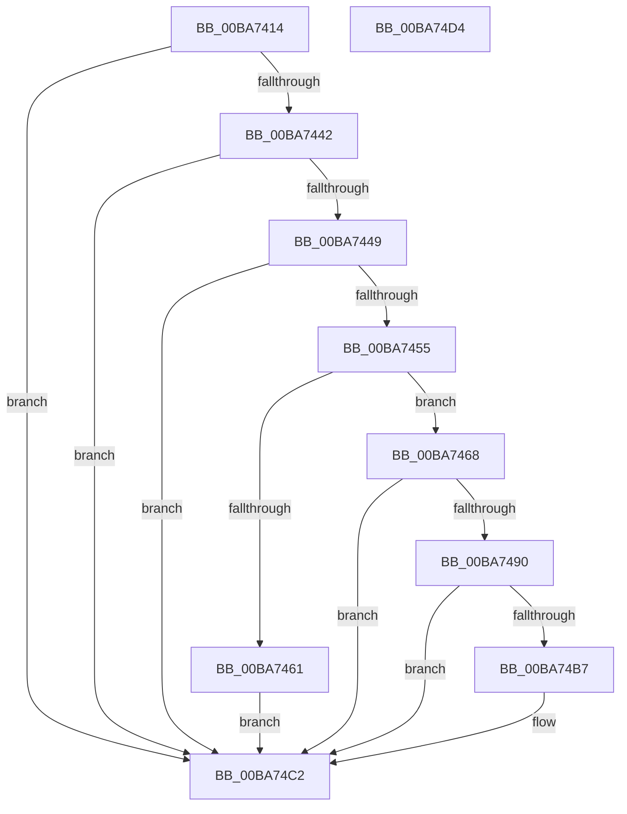

# ViThunkApplyWdmThunksCurrentSession

- RVA: `0x00BA7414`–`0x00BA74D5` (길이 `193` bytes)
- VA: `0x0000000140BA7414`
- 실행 섹션: `PAGEVRFY`
- PDB 이름 있음: `예`; PDB Function 태그: `아니요`
- unwind 정보 RVA: `0x0005FD94`
- 디코드: `54`개 명령, `193/193` bytes 표시
- 미해석 바이트: `0` (있으면 어셈블리에 `.byte`로 보존)

> 이 문서는 커널 이미지의 기계어와 PDB 기호를 분석해 생성했습니다. 4번과 5번은 함수 원형과 자료형을 바이너리 사용 방식에서 추정한 C 해석이며 원본 소스 복구 결과는 아닙니다.

## 1. Dependencies

- 직접 호출 지점: **7**; 고유 호출 대상: **7**
- 직접 호출자로 확인된 함수: **1**
- RIP 상대 이미지 참조: **2**

### Outgoing calls
- `0x00BA7431` → [VfTargetDriversGetNode](../../text/3E/VfTargetDriversGetNode_function_003EE174.md) (function, `0x003EE174`)
- `0x00BA744C` → [ViIsDriverSuspectForVerifier](../B9/ViIsDriverSuspectForVerifier_function_00B9381C.md) (function, `0x00B9381C`)
- `0x00BA7478` → [memset](../../text/6C/memset_function_006C6C40.md) (function, `0x006C6C40`)
- `0x00BA7485` → [ViThunkFindAllThunkedImports](ViThunkFindAllThunkedImports_function_00BA7678.md) (function, `0x00BA7678`)
- `0x00BA7498` → [ViThunkFindAllSharedExports](ViThunkFindAllSharedExports_function_00BA755C.md) (function, `0x00BA755C`)
- `0x00BA74AC` → [MmApplyVerifierToRunningImage](../BB/MmApplyVerifierToRunningImage_function_00BB4780.md) (function, `0x00BB4780`)
- `0x00BA74BD` → [VfUtilPrintCheckinString](../B9/VfUtilPrintCheckinString_function_00B934D4.md) (function, `0x00B934D4`)

### Direct callers
- [VfSuspectApplyDifVolatileVerification](VfSuspectApplyDifVolatileVerification_function_00BAA558.md) at `0x00BAA5AA`

### Static image references
- `0x00BA7455` → RVA `0x00F04390` (`.data`; read)
- `0x00BA7468` → RVA `0x00F044C4` (`.data`; read)

## 2. Other-region calls and transfers

- 다른 실행 섹션으로 향하는 call: **2**
  - `0x00BA7431` → [VfTargetDriversGetNode](../../text/3E/VfTargetDriversGetNode_function_003EE174.md) (`PAGEVRFY` → `.text`)
  - `0x00BA7478` → [memset](../../text/6C/memset_function_006C6C40.md) (`PAGEVRFY` → `.text`)
- 별도 외부 분기/꼬리 이동을 확인하지 못했습니다.

## 3. Assembly (complete function range)

```asm
00BA7414  48 89 5C 24 10                  mov qword ptr [rsp + 0x10], rbx
00BA7419  48 89 74 24 18                  mov qword ptr [rsp + 0x18], rsi
00BA741E  57                              push rdi
00BA741F  48 83 EC 20                     sub rsp, 0x20
00BA7423  83 64 24 30 00                  and dword ptr [rsp + 0x30], 0
00BA7428  48 8B F9                        mov rdi, rcx
00BA742B  48 8B 49 30                     mov rcx, qword ptr [rcx + 0x30]
00BA742F  33 DB                           xor ebx, ebx
00BA7431  E8 3E 6D 84 FF                  call 0x1403ee174
00BA7436  48 8B F0                        mov rsi, rax
00BA7439  48 85 C0                        test rax, rax
00BA743C  0F 84 80 00 00 00               je 0x140ba74c2
00BA7442  8B 40 10                        mov eax, dword ptr [rax + 0x10]
00BA7445  A8 01                           test al, 1
00BA7447  75 79                           jne 0x140ba74c2
00BA7449  48 8B CF                        mov rcx, rdi
00BA744C  E8 CB C3 FE FF                  call 0x140b9381c
00BA7451  85 C0                           test eax, eax
00BA7453  74 6D                           je 0x140ba74c2
00BA7455  48 8B 0D 34 CF 35 00            mov rcx, qword ptr [rip + 0x35cf34]
00BA745C  48 85 C9                        test rcx, rcx
00BA745F  75 07                           jne 0x140ba7468
00BA7461  BB 17 00 00 C0                  mov ebx, 0xc0000017
00BA7466  EB 5A                           jmp 0x140ba74c2
00BA7468  8B 05 56 D0 35 00               mov eax, dword ptr [rip + 0x35d056]
00BA746E  33 D2                           xor edx, edx
00BA7470  4C 8D 04 40                     lea r8, [rax + rax*2]
00BA7474  49 C1 E0 03                     shl r8, 3
00BA7478  E8 C3 F7 B1 FF                  call 0x1406c6c40
00BA747D  4C 8D 44 24 30                  lea r8, [rsp + 0x30]
00BA7482  48 8B CF                        mov rcx, rdi
00BA7485  E8 EE 01 00 00                  call 0x140ba7678
00BA748A  39 5C 24 30                     cmp dword ptr [rsp + 0x30], ebx
00BA748E  76 32                           jbe 0x140ba74c2
00BA7490  4C 8D 44 24 30                  lea r8, [rsp + 0x30]
00BA7495  48 8B CE                        mov rcx, rsi
00BA7498  E8 BF 00 00 00                  call 0x140ba755c
00BA749D  44 8B 44 24 30                  mov r8d, dword ptr [rsp + 0x30]
00BA74A2  48 8B CF                        mov rcx, rdi
00BA74A5  48 8B 15 E4 CE 35 00            mov rdx, qword ptr [rip + 0x35cee4]
00BA74AC  E8 CF D2 00 00                  call 0x140bb4780
00BA74B1  8B D8                           mov ebx, eax
00BA74B3  85 C0                           test eax, eax
00BA74B5  78 0B                           js 0x140ba74c2
00BA74B7  48 8D 4F 58                     lea rcx, [rdi + 0x58]
00BA74BB  33 D2                           xor edx, edx
00BA74BD  E8 12 C0 FE FF                  call 0x140b934d4
00BA74C2  48 8B 74 24 40                  mov rsi, qword ptr [rsp + 0x40]
00BA74C7  8B C3                           mov eax, ebx
00BA74C9  48 8B 5C 24 38                  mov rbx, qword ptr [rsp + 0x38]
00BA74CE  48 83 C4 20                     add rsp, 0x20
00BA74D2  5F                              pop rdi
00BA74D3  C3                              ret
00BA74D4  CC                              int3
```

## 4. C-style interpretation (structured pseudocode)

```c
__int64 __fastcall ViThunkApplyWdmThunksCurrentSession(__int64 a1, int a2)
{
    __int64 result;
    __int64 v_rbx;
    __int64 v_rsp;
    unsigned __int64 v_stack_p10;
    unsigned __int64 v_stack_p18;
    unsigned int v_stack_p8;

    v_stack_p10 = v_rbx;
    v_stack_p18 = v_rsi;
    v_rsp = (v_rsp) - (32);
    v_rbx = 0;
    result = VfTargetDriversGetNode(*(unsigned __int64 *)(a1 + 48), a2, a3, a4);
    if (result == 0) goto loc_00BA74C2;
    if ((((unsigned __int8)((unsigned int)(*(unsigned int *)(result + 16)))) & (1)) != 0) goto loc_00BA74C2;
    result = ViIsDriverSuspectForVerifier(a1, a2, a3, a4);
    if ((unsigned int)(result) == 0) goto loc_00BA74C2;
    if (*(unsigned __int64 *)(v_rip + 3526452) != 0) goto loc_00BA7468;
    goto loc_00BA74C2;
loc_00BA7468:
    a2 = 0;
    a3 = ((unsigned int)(*(unsigned int *)(v_rip + 3526742)) + (unsigned int)(*(unsigned int *)(v_rip + 3526742)) * 2) << (3);
    result = memset(*(unsigned __int64 *)(v_rip + 3526452), a2, a3, a4);
    result = ViThunkFindAllThunkedImports(a1, a2, v_stack_p8, a4);
    if (v_stack_p8 <= ((unsigned int)((unsigned int)(0xC0000017ULL)))) goto loc_00BA74C2;
    result = ViThunkFindAllSharedExports(result, a2, v_stack_p8, a4);
    result = MmApplyVerifierToRunningImage(a1, *(unsigned __int64 *)(v_rip + 3526372), (unsigned int)(v_stack_p8), a4);
    if (!(sign_flag)) {
        a1 = a1 + 88;
        a2 = 0;
        result = VfUtilPrintCheckinString(a1, a2, (unsigned int)(v_stack_p8), a4);
    }
    v_rsp = (v_rsp) + (32);
    return (unsigned int)((unsigned int)((unsigned int)((unsigned int)(result))));
}
```

## 5. (Beta) C Style

```c
int64_t ViThunkApplyWdmThunksCurrentSession(void *Arg1, int32_t Arg2)
{
    uint8_t *arg1 = (uint8_t *)Arg1;

    int64_t result;
    int64_t local_rbx;
    int64_t local_rsp;
    uint64_t v_stack_p10;
    uint64_t v_stack_p18;
    uint32_t v_stack_p8;

    v_stack_p10 = local_rbx;
    v_stack_p18 = local_rsi;
    local_rsp = (local_rsp) - (32);
    local_rbx = 0;
    result = VfTargetDriversGetNode(*(uint64_t *)(arg1 + 0x30), Arg2, a3, a4);
    if (result == 0) goto loc_00BA74C2;
    if ((((uint8_t)((uint32_t)(*(uint32_t *)(result + 0x10)))) & (1)) != 0) goto loc_00BA74C2;
    result = ViIsDriverSuspectForVerifier(Arg1, Arg2, a3, a4);
    if ((uint32_t)(result) == 0) goto loc_00BA74C2;
    if (*(uint64_t *)(v_rip + 0x35CF34) != 0) goto loc_00BA7468;
    goto loc_00BA74C2;
loc_00BA7468:
    Arg2 = 0;
    a3 = ((uint32_t)(*(uint32_t *)(v_rip + 0x35D056)) + (uint32_t)(*(uint32_t *)(v_rip + 0x35D056)) * 2) << (3);
    result = memset(*(uint64_t *)(v_rip + 0x35CF34), Arg2, a3, a4);
    result = ViThunkFindAllThunkedImports(Arg1, Arg2, v_stack_p8, a4);
    if (v_stack_p8 <= ((uint32_t)((uint32_t)(0xC0000017ULL)))) goto loc_00BA74C2;
    result = ViThunkFindAllSharedExports(result, Arg2, v_stack_p8, a4);
    result = MmApplyVerifierToRunningImage(Arg1, *(uint64_t *)(v_rip + 0x35CEE4), (uint32_t)(v_stack_p8), a4);
    if (!(sign_flag)) {
        Arg1 = Arg1 + 88;
        Arg2 = 0;
        result = VfUtilPrintCheckinString(Arg1, Arg2, (uint32_t)(v_stack_p8), a4);
    }
    local_rsp = (local_rsp) + (32);
    return (uint32_t)((uint32_t)((uint32_t)((uint32_t)(result))));
}
```

### 관측된 메모리 오프셋

구조체 형식이 확인되지 않은 접근은 인자 기준의 오프셋으로만 기록했습니다.

| 기준 인자 | 오프셋 표현 | 폭 (bit) | 접근 |
|---|---:|---:|---|
| `Arg1` | `+ 0x30` | `64` | `R` |
| `Arg1` | `+ 0x58` | `64` | `R` |

## 6. Execution-region graph

[열기: 2D/3D 그래프와 함수 탐색 컨트롤 패널](../../../control-panel.html?section=pagevrfy&rva=0x00BA7414&view=graph)

- 2D 그래프는 위에서 아래로 흐르고, 3D 그래프는 빈 공간을 드래그해 회전합니다. Shift+드래그는 이동, 휠은 확대·축소, 함수 노드 선택은 대상 보고서 이동입니다.

### Static fallback


