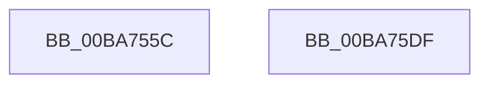

# ViThunkFindAllSharedExports

- RVA: `0x00BA755C`–`0x00BA75E0` (길이 `132` bytes)
- VA: `0x0000000140BA755C`
- 실행 섹션: `PAGEVRFY`
- PDB 이름 있음: `예`; PDB Function 태그: `아니요`
- unwind 정보 RVA: `0x00060BC4`
- 디코드: `34`개 명령, `132/132` bytes 표시
- 미해석 바이트: `0` (있으면 어셈블리에 `.byte`로 보존)

> 이 문서는 커널 이미지의 기계어와 PDB 기호를 분석해 생성했습니다. 4번과 5번은 함수 원형과 자료형을 바이너리 사용 방식에서 추정한 C 해석이며 원본 소스 복구 결과는 아닙니다.

## 1. Dependencies

- 직접 호출 지점: **6**; 고유 호출 대상: **2**
- 직접 호출자로 확인된 함수: **1**
- RIP 상대 이미지 참조: **4**

### Outgoing calls
- `0x00BA757F` → [RtlNumberOfClearBits](../../text/43/RtlNumberOfClearBits_function_00433F40.md) (function, `0x00433F40`)
- `0x00BA7590` → [ViThunkFindSharedExports](ViThunkFindSharedExports_function_00BA77E8.md) (function, `0x00BA77E8`)
- `0x00BA759C` → [RtlNumberOfClearBits](../../text/43/RtlNumberOfClearBits_function_00433F40.md) (function, `0x00433F40`)
- `0x00BA75AD` → [ViThunkFindSharedExports](ViThunkFindSharedExports_function_00BA77E8.md) (function, `0x00BA77E8`)
- `0x00BA75B9` → [RtlNumberOfClearBits](../../text/43/RtlNumberOfClearBits_function_00433F40.md) (function, `0x00433F40`)
- `0x00BA75CA` → [ViThunkFindSharedExports](ViThunkFindSharedExports_function_00BA77E8.md) (function, `0x00BA77E8`)

### Direct callers
- [ViThunkApplyWdmThunksCurrentSession](ViThunkApplyWdmThunksCurrentSession_function_00BA7414.md) at `0x00BA7498`

### Static image references
- `0x00BA756B` → RVA `0x00F04390` (`.data`; read)
- `0x00BA7575` → RVA `0x00FFDC70` (`PAGEVRFD`; read)
- `0x00BA7595` → RVA `0x00FFDC80` (`PAGEVRFD`; read)
- `0x00BA75B2` → RVA `0x00FFDC90` (`PAGEVRFD`; read)

## 2. Other-region calls and transfers

- 다른 실행 섹션으로 향하는 call: **3**
  - `0x00BA757F` → [RtlNumberOfClearBits](../../text/43/RtlNumberOfClearBits_function_00433F40.md) (`PAGEVRFY` → `.text`)
  - `0x00BA759C` → [RtlNumberOfClearBits](../../text/43/RtlNumberOfClearBits_function_00433F40.md) (`PAGEVRFY` → `.text`)
  - `0x00BA75B9` → [RtlNumberOfClearBits](../../text/43/RtlNumberOfClearBits_function_00433F40.md) (`PAGEVRFY` → `.text`)
- 별도 외부 분기/꼬리 이동을 확인하지 못했습니다.

## 3. Assembly (complete function range)

```asm
00BA755C  48 89 5C 24 08                  mov qword ptr [rsp + 8], rbx
00BA7561  48 89 74 24 10                  mov qword ptr [rsp + 0x10], rsi
00BA7566  57                              push rdi
00BA7567  48 83 EC 20                     sub rsp, 0x20
00BA756B  48 8B 1D 1E CE 35 00            mov rbx, qword ptr [rip + 0x35ce1e]
00BA7572  48 8B F1                        mov rsi, rcx
00BA7575  48 8D 0D F4 66 45 00            lea rcx, [rip + 0x4566f4]
00BA757C  49 8B F8                        mov rdi, r8
00BA757F  E8 BC C9 88 FF                  call 0x140433f40
00BA7584  48 8B 4E 18                     mov rcx, qword ptr [rsi + 0x18]
00BA7588  8B D0                           mov edx, eax
00BA758A  4C 8B CF                        mov r9, rdi
00BA758D  4C 8B C3                        mov r8, rbx
00BA7590  E8 53 02 00 00                  call 0x140ba77e8
00BA7595  48 8D 0D E4 66 45 00            lea rcx, [rip + 0x4566e4]
00BA759C  E8 9F C9 88 FF                  call 0x140433f40
00BA75A1  48 8B 4E 10                     mov rcx, qword ptr [rsi + 0x10]
00BA75A5  8B D0                           mov edx, eax
00BA75A7  4C 8B CF                        mov r9, rdi
00BA75AA  4C 8B C3                        mov r8, rbx
00BA75AD  E8 36 02 00 00                  call 0x140ba77e8
00BA75B2  48 8D 0D D7 66 45 00            lea rcx, [rip + 0x4566d7]
00BA75B9  E8 82 C9 88 FF                  call 0x140433f40
00BA75BE  48 8B 4E 20                     mov rcx, qword ptr [rsi + 0x20]
00BA75C2  8B D0                           mov edx, eax
00BA75C4  4C 8B CF                        mov r9, rdi
00BA75C7  4C 8B C3                        mov r8, rbx
00BA75CA  E8 19 02 00 00                  call 0x140ba77e8
00BA75CF  48 8B 5C 24 30                  mov rbx, qword ptr [rsp + 0x30]
00BA75D4  48 8B 74 24 38                  mov rsi, qword ptr [rsp + 0x38]
00BA75D9  48 83 C4 20                     add rsp, 0x20
00BA75DD  5F                              pop rdi
00BA75DE  C3                              ret
00BA75DF  CC                              int3
```

## 4. C-style interpretation (structured pseudocode)

```c
__int64 __fastcall ViThunkFindAllSharedExports(__int64 a1, __int64 a2, __int64 a3)
{
    __int64 result;
    __int64 v_rsp;
    unsigned __int64 v_stack_p10;
    unsigned __int64 v_stack_p8;

    v_stack_p8 = v_rbx;
    v_stack_p10 = v_rsi;
    v_rsp = (v_rsp) - (32);
    result = RtlNumberOfClearBits(v_rip + 4548340, a2, a3, a4);
    result = ViThunkFindSharedExports(*(unsigned __int64 *)(a1 + 24), (unsigned int)((unsigned int)(result)), *(unsigned __int64 *)(v_rip + 3526174), a3);
    result = RtlNumberOfClearBits(v_rip + 4548324, (unsigned int)((unsigned int)(result)), *(unsigned __int64 *)(v_rip + 3526174), a3);
    result = ViThunkFindSharedExports(*(unsigned __int64 *)(a1 + 16), (unsigned int)((unsigned int)(result)), *(unsigned __int64 *)(v_rip + 3526174), a3);
    result = RtlNumberOfClearBits(v_rip + 4548311, (unsigned int)((unsigned int)(result)), *(unsigned __int64 *)(v_rip + 3526174), a3);
    result = ViThunkFindSharedExports(*(unsigned __int64 *)(a1 + 32), (unsigned int)((unsigned int)(result)), *(unsigned __int64 *)(v_rip + 3526174), a3);
    v_rsp = (v_rsp) + (32);
    return result;
}
```

## 5. (Beta) C Style

```c
int64_t ViThunkFindAllSharedExports(void *Arg1, int64_t Arg2, int64_t Arg3)
{
    uint8_t *arg1 = (uint8_t *)Arg1;

    int64_t result;
    int64_t local_rsp;
    uint64_t v_stack_p10;
    uint64_t v_stack_p8;

    v_stack_p8 = local_rbx;
    v_stack_p10 = local_rsi;
    local_rsp = (local_rsp) - (32);
    result = RtlNumberOfClearBits(v_rip + 4548340, Arg2, Arg3, a4);
    result = ViThunkFindSharedExports(*(uint64_t *)(arg1 + 0x18), (uint32_t)((uint32_t)(result)), *(uint64_t *)(v_rip + 0x35CE1E), Arg3);
    result = RtlNumberOfClearBits(v_rip + 4548324, (uint32_t)((uint32_t)(result)), *(uint64_t *)(v_rip + 0x35CE1E), Arg3);
    result = ViThunkFindSharedExports(*(uint64_t *)(arg1 + 0x10), (uint32_t)((uint32_t)(result)), *(uint64_t *)(v_rip + 0x35CE1E), Arg3);
    result = RtlNumberOfClearBits(v_rip + 4548311, (uint32_t)((uint32_t)(result)), *(uint64_t *)(v_rip + 0x35CE1E), Arg3);
    result = ViThunkFindSharedExports(*(uint64_t *)(arg1 + 0x20), (uint32_t)((uint32_t)(result)), *(uint64_t *)(v_rip + 0x35CE1E), Arg3);
    local_rsp = (local_rsp) + (32);
    return result;
}
```

### 관측된 메모리 오프셋

구조체 형식이 확인되지 않은 접근은 인자 기준의 오프셋으로만 기록했습니다.

| 기준 인자 | 오프셋 표현 | 폭 (bit) | 접근 |
|---|---:|---:|---|
| `Arg1` | `+ 0x10` | `64` | `R` |
| `Arg1` | `+ 0x18` | `64` | `R` |
| `Arg1` | `+ 0x20` | `64` | `R` |

## 6. Execution-region graph

[열기: 2D/3D 그래프와 함수 탐색 컨트롤 패널](../../../control-panel.html?section=pagevrfy&rva=0x00BA755C&view=graph)

- 2D 그래프는 위에서 아래로 흐르고, 3D 그래프는 빈 공간을 드래그해 회전합니다. Shift+드래그는 이동, 휠은 확대·축소, 함수 노드 선택은 대상 보고서 이동입니다.

### Static fallback


