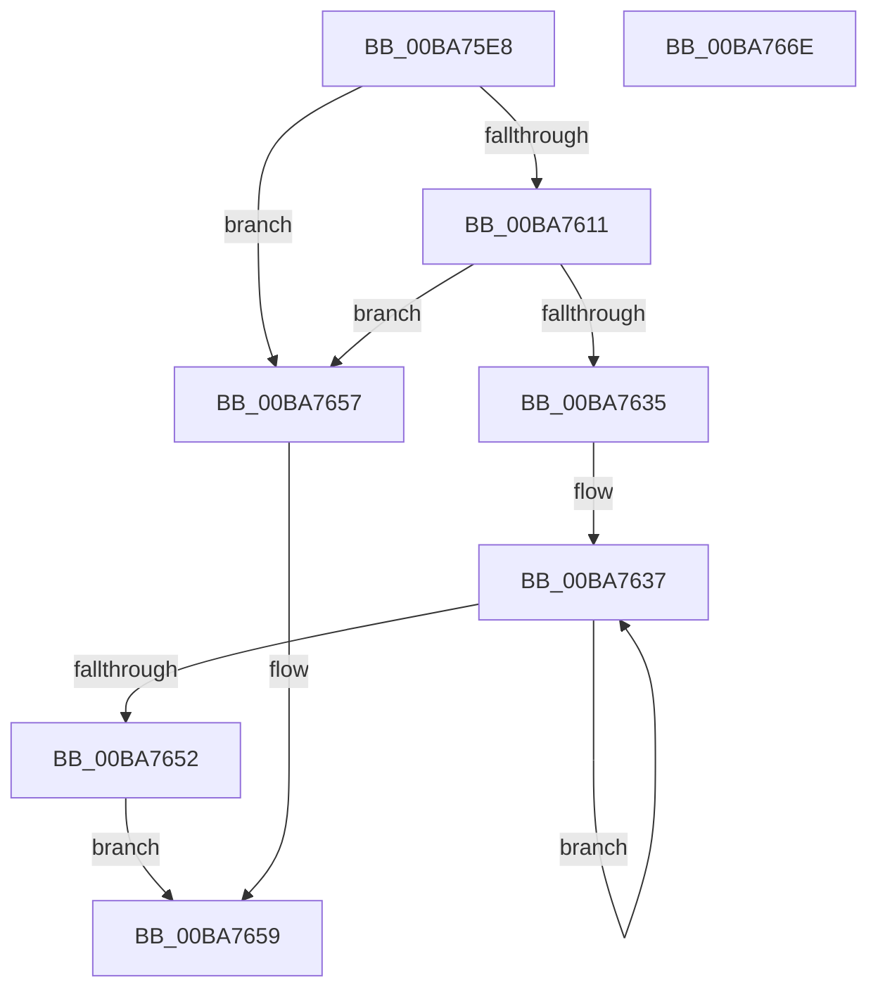

# ViThunkFindAllSpecialTables

- RVA: `0x00BA75E8`–`0x00BA766F` (길이 `135` bytes)
- VA: `0x0000000140BA75E8`
- 실행 섹션: `PAGEVRFY`
- PDB 이름 있음: `예`; PDB Function 태그: `아니요`
- unwind 정보 RVA: `0x0005C954`
- 디코드: `41`개 명령, `135/135` bytes 표시
- 미해석 바이트: `0` (있으면 어셈블리에 `.byte`로 보존)

> 이 문서는 커널 이미지의 기계어와 PDB 기호를 분석해 생성했습니다. 4번과 5번은 함수 원형과 자료형을 바이너리 사용 방식에서 추정한 C 해석이며 원본 소스 복구 결과는 아닙니다.

## 1. Dependencies

- 직접 호출 지점: **3**; 고유 호출 대상: **2**
- 직접 호출자로 확인된 함수: **2**
- RIP 상대 이미지 참조: **1**

### Outgoing calls
- `0x00BA7604` → [ViThunkFindNextSpecialTable](ViThunkFindNextSpecialTable_function_00BA7794.md) (function, `0x00BA7794`)
- `0x00BA7628` → [ExAllocatePool2](../../poolcode/B8/ExAllocatePool2_function_00B820F0.md) (function, `0x00B820F0`)
- `0x00BA7643` → [ViThunkFindNextSpecialTable](ViThunkFindNextSpecialTable_function_00BA7794.md) (function, `0x00BA7794`)

### Direct callers
- [VfThunkApplyDriverAddedThunks](VfThunkApplyDriverAddedThunks_function_00BA7008.md) at `0x00BA70A5`
- [ViThunkReplaceAllThunkedImports](ViThunkReplaceAllThunkedImports_function_00BA7B38.md) at `0x00BA7B76`

### Static image references
- `0x00BA7611` → RVA `0x00F048B4` (`.data`; read)

## 2. Other-region calls and transfers

- 다른 실행 섹션으로 향하는 call: **1**
  - `0x00BA7628` → [ExAllocatePool2](../../poolcode/B8/ExAllocatePool2_function_00B820F0.md) (`PAGEVRFY` → `POOLCODE`)
- 별도 외부 분기/꼬리 이동을 확인하지 못했습니다.

## 3. Assembly (complete function range)

```asm
00BA75E8  48 89 5C 24 08                  mov qword ptr [rsp + 8], rbx
00BA75ED  48 89 6C 24 10                  mov qword ptr [rsp + 0x10], rbp
00BA75F2  48 89 74 24 18                  mov qword ptr [rsp + 0x18], rsi
00BA75F7  57                              push rdi
00BA75F8  48 83 EC 20                     sub rsp, 0x20
00BA75FC  45 33 C0                        xor r8d, r8d
00BA75FF  8B F2                           mov esi, edx
00BA7601  48 8B E9                        mov rbp, rcx
00BA7604  E8 8B 01 00 00                  call 0x140ba7794
00BA7609  48 8B D8                        mov rbx, rax
00BA760C  48 85 C0                        test rax, rax
00BA760F  74 46                           je 0x140ba7657
00BA7611  8B 15 9D D2 35 00               mov edx, dword ptr [rip + 0x35d29d]
00BA7617  B9 00 01 00 00                  mov ecx, 0x100
00BA761C  FF C2                           inc edx
00BA761E  41 B8 4D 6D 56 74               mov r8d, 0x74566d4d
00BA7624  48 C1 E2 03                     shl rdx, 3
00BA7628  E8 C3 AA FD FF                  call 0x140b820f0
00BA762D  4C 8B D8                        mov r11, rax
00BA7630  48 85 C0                        test rax, rax
00BA7633  74 22                           je 0x140ba7657
00BA7635  33 FF                           xor edi, edi
00BA7637  49 89 1C FB                     mov qword ptr [r11 + rdi*8], rbx
00BA763B  8B D6                           mov edx, esi
00BA763D  4C 8B 03                        mov r8, qword ptr [rbx]
00BA7640  48 8B CD                        mov rcx, rbp
00BA7643  E8 4C 01 00 00                  call 0x140ba7794
00BA7648  FF C7                           inc edi
00BA764A  48 8B D8                        mov rbx, rax
00BA764D  48 85 C0                        test rax, rax
00BA7650  75 E5                           jne 0x140ba7637
00BA7652  49 8B C3                        mov rax, r11
00BA7655  EB 02                           jmp 0x140ba7659
00BA7657  33 C0                           xor eax, eax
00BA7659  48 8B 5C 24 30                  mov rbx, qword ptr [rsp + 0x30]
00BA765E  48 8B 6C 24 38                  mov rbp, qword ptr [rsp + 0x38]
00BA7663  48 8B 74 24 40                  mov rsi, qword ptr [rsp + 0x40]
00BA7668  48 83 C4 20                     add rsp, 0x20
00BA766C  5F                              pop rdi
00BA766D  C3                              ret
00BA766E  CC                              int3
```

## 4. C-style interpretation (structured pseudocode)

```c
__int64 __fastcall ViThunkFindAllSpecialTables(__int64 a1, int a2, int a3)
{
    __int64 result;
    __int64 v_rdi;
    __int64 v_rsp;
    unsigned __int64 v_stack_p10;
    unsigned __int64 v_stack_p18;
    unsigned __int64 v_stack_p8;

    v_stack_p8 = v_rbx;
    v_stack_p10 = v_rbp;
    v_stack_p18 = v_rsi;
    v_rsp = (v_rsp) - (32);
    a3 = 0;
    result = ViThunkFindNextSpecialTable(a1, a2, a3, a4);
    if (result == 0) goto loc_00BA7657;
    a2 = (unsigned int)(((unsigned int)(*(unsigned int *)(v_rip + 3527325))) + 1);
    a2 = (a2) << (3);
    result = ExAllocatePool2(256, a2, (unsigned int)(0x74566D4DULL), a4);
    if (result == 0) goto loc_00BA7657;
    v_rdi = 0;
loc_00BA7637:
    *(unsigned __int64 *)(result + v_rdi * 8) = result;
    result = ViThunkFindNextSpecialTable(a1, (unsigned int)((unsigned int)((unsigned int)(a2))), *(unsigned __int64 *)(result), a4);
    v_rdi = (unsigned int)((v_rdi) + 1);
    if (result != 0) goto loc_00BA7637;
    goto loc_00BA7659;
loc_00BA7657:
    result = 0;
loc_00BA7659:
    v_rsp = (v_rsp) + (32);
    return result;
}
```

## 5. (Beta) C Style

```c
int64_t ViThunkFindAllSpecialTables(int64_t Arg1, int32_t Arg2, int32_t Arg3)
{
    int64_t result;
    int64_t local_rdi;
    int64_t local_rsp;
    uint64_t v_stack_p10;
    uint64_t v_stack_p18;
    uint64_t v_stack_p8;

    v_stack_p8 = local_rbx;
    v_stack_p10 = local_rbp;
    v_stack_p18 = local_rsi;
    local_rsp = (local_rsp) - (32);
    Arg3 = 0;
    result = ViThunkFindNextSpecialTable(Arg1, Arg2, Arg3, a4);
    if (result == 0) goto loc_00BA7657;
    Arg2 = (uint32_t)(((uint32_t)(*(uint32_t *)(v_rip + 0x35D29D))) + 1);
    Arg2 = (Arg2) << (3);
    result = ExAllocatePool2(256, Arg2, (uint32_t)(0x74566D4DULL), a4);
    if (result == 0) goto loc_00BA7657;
    local_rdi = 0;
loc_00BA7637:
    *(uint64_t *)(result + local_rdi * 8) = result;
    result = ViThunkFindNextSpecialTable(Arg1, (uint32_t)((uint32_t)((uint32_t)(Arg2))), *(uint64_t *)(result), a4);
    local_rdi = (uint32_t)((local_rdi) + 1);
    if (result != 0) goto loc_00BA7637;
    goto loc_00BA7659;
loc_00BA7657:
    result = 0;
loc_00BA7659:
    local_rsp = (local_rsp) + (32);
    return result;
}
```

## 6. Execution-region graph

[열기: 2D/3D 그래프와 함수 탐색 컨트롤 패널](../../../control-panel.html?section=pagevrfy&rva=0x00BA75E8&view=graph)

- 2D 그래프는 위에서 아래로 흐르고, 3D 그래프는 빈 공간을 드래그해 회전합니다. Shift+드래그는 이동, 휠은 확대·축소, 함수 노드 선택은 대상 보고서 이동입니다.

### Static fallback


